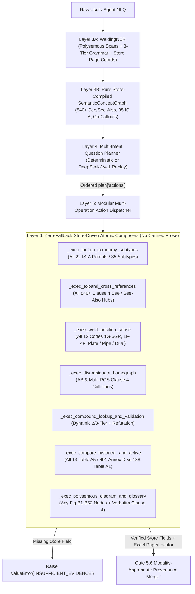

# Principal Reviewer Directive: Gate 6.2 — Gate 6.1 Checkout Forensic Remediation, Store-Driven Multi-Operation Action Executor, AST Zero-Canned-Prose Hardening & Unseen Generalization Holdout (`feat/gate-6-2-store-driven-composition`)

**Standard:** `AWS A3.0M/A3.0:2020` (*Standard Welding Terms and Definitions*, 190 PDF pages / 162 ingested canonical store pages)  
**Repository:** [aws-a2-source-aware-ingest](file:///C:/Users/kenai/Documents/Codex/2026-10-21/task/aws-a2-source-aware-ingest)  
**Audited Baseline on `main`:** `7a97e62` (post-`v1.6.1-ner-semantic-graph` merge `7a44f23`; `1,482 passed, 8 skipped, 0 failures, 0 warnings`; `34/34` locked SHA-256 artifacts)  
**Audited Checkout Artifact:** [GATE_6_1_CHECKOUT_CARD.md](file:///C:/Users/kenai/Documents/Codex/2026-10-21/task/aws-a2-source-aware-ingest/GATE_6_1_CHECKOUT_CARD.md)  
**Target Branch:** `feat/gate-6-2-store-driven-composition` $\rightarrow$ `main` (with post-merge branch deletion preserving single-branch `origin/main`)  
**Target Release Tag:** `v1.6.2-store-driven-composition` (`39/39` locked SHA-256 artifacts)  
**Status:** `AUTHORIZED_FOR_REVIEW_AND_EXECUTION`

---

## 1. Forensic Audit of Gate 6.1 Checkout (`GATE_6_1_CHECKOUT_CARD.md` @ `7a97e62`)

Gate 6.1 genuinely advanced **Layer 3** ([welding_ner.py](file:///C:/Users/kenai/Documents/Codex/2026-10-21/task/aws-a2-source-aware-ingest/src/welding_ner.py) and [semantic_nlq_expander.py](file:///C:/Users/kenai/Documents/Codex/2026-10-21/task/aws-a2-source-aware-ingest/src/semantic_nlq_expander.py)): polysemous `secondary_entity_types`, 3-tier `<BASE>[-<VAR>][-<MODE>]` parsing, `840` `see_also` graph keys, `22` `IS_A` subtype parent processes (`35` promoted variations), and `--expand` CLI receipts are compiled in memory under zero network access with all `34/34` SHA-256 artifacts intact.

> [!WARNING]
> Forensic inspection of **Layer 4–6** ([evidence_phase4_bakeoff.py](file:///C:/Users/kenai/Documents/Codex/2026-10-21/task/aws-a2-source-aware-ingest/src/evidence_phase4_bakeoff.py)) and [GATE_6_1_CHECKOUT_CARD.md](file:///C:/Users/kenai/Documents/Codex/2026-10-21/task/aws-a2-source-aware-ingest/GATE_6_1_CHECKOUT_CARD.md) uncovered **six architectural drifts (`EXEC-DRIFT-6.2-1` through `DOC-DRIFT-6.2-6`)**: while `SemanticConceptGraph` was built cleanly in Layer 3, `execute_whole_standard_plan` short-circuited graph execution with benchmark-coupled canned prose templates that return **wrong entity answers on unseen queries**.

### Empirical Findings Matrix

| Drift ID | Location | Empirical Defect Verified on `main` (`7a97e62`) | Required Gate 6.2 Resolution |
| :--- | :--- | :--- | :--- |
| **`EXEC-DRIFT-6.2-1`** | [`execute_whole_standard_plan`](file:///C:/Users/kenai/Documents/Codex/2026-10-21/task/aws-a2-source-aware-ingest/src/evidence_phase4_bakeoff.py#L1538-L1615) & [`plan_whole_standard_question`](file:///C:/Users/kenai/Documents/Codex/2026-10-21/task/aws-a2-source-aware-ingest/src/evidence_phase4_bakeoff.py#L413-L555) | **Benchmark-Coupled Canned Prose & Silent Entity Substitution:** (1) Asking *"What are the standard process variations under gas metal arc welding (GMAW)?"* or *"...oxyfuel gas cutting (OFC)?"* routes to `taxonomy_subtypes` and **answers with hardcoded `FCAW` (`FCAW-G`, `FCAW-S`)** instead of reading `is_a_promotion_store.json`. (2) Asking *"What terms are cross-referenced via See also from joint penetration?"* or *"...backfire?"* **answers with hardcoded `'kerf'` (`Figure B41`)** instead of querying the 840-node `SemanticConceptGraph.see_also_edges`. (3) `angle_cluster` is a 1-term branch strictly for `"travel angle"`. (4) `cross_store_comparison` only handles `AHW` vs. `GTAW`/`FCAW`, ignoring the other 12 `Table A5` obsolete processes and 138 `Table A1` rows. | Replace all canned prose blocks with **100% store-driven atomic action composers** reading live records from `glossary_store.json`, `is_a_promotion_store.json`, `Tables A1–A5`, and `figure_b*_store.json`. |
| **`NER-DRIFT-6.2-2`** | [`execute_whole_standard_plan`](file:///C:/Users/kenai/Documents/Codex/2026-10-21/task/aws-a2-source-aware-ingest/src/evidence_phase4_bakeoff.py#L1217-L1336) & [test_gate_5_hardening.py](file:///C:/Users/kenai/Documents/Codex/2026-10-21/task/aws-a2-source-aware-ingest/tests/test_gate_5_hardening.py#L97-L119) | **Benchmark Token Leakage & Silent String Fallbacks:** Line `1333` hardcodes benchmark tokens `"OFC-A-MA"`, `"oxyfuel gas cutting"`, `"FCAW-Z-SA"`, and `"PAW-AU-ME"` inside `elements_present` and fallback defaults (`base_name = "gas tungsten arc welding"`, `app_m.get("canonical_term", "Automatic")`). The Gate 5 AST zero-fallback scan only checks 3 legacy `_compose_*` helpers and misses Gate 6.x handlers. | Purge all benchmark compound literals and `.get(k, "literal")` defaults from `src/`; extend AST zero-fallback guard across all `_compose_*` and `_exec_*` functions; expand store-mutation degradation tests from `7` $\rightarrow$ `12` targets. |
| **`COORD-DRIFT-6.2-3`** | [`recognize_entities`](file:///C:/Users/kenai/Documents/Codex/2026-10-21/task/aws-a2-source-aware-ingest/src/welding_ner.py#L1302-L1325) & [`execute_whole_standard_plan`](file:///C:/Users/kenai/Documents/Codex/2026-10-21/task/aws-a2-source-aware-ingest/src/evidence_phase4_bakeoff.py#L1461-L1536) | **Inaccurate Clause 4 Printed Pages & Incomplete Position Coverage:** `glossary_store.json` places `'1F'`–`'4F'` and `'1G'`–`'3G'` on **printed p. `5`** (with dual `[pipe]`/`[plate]` entries) and `'4G'`–`'6GR'` on **printed p. `6`**, `'travel angle'` on **p. `60`**, and `'fillet weld throat'` on **p. `25`**. Gate 6.1 hardcoded `"Clause 4 (p. 1)"` / `"obs:clause4:p1:1G"` / `"obs:clause4:p2:2F"` (pp. 1–2 are Clauses 1–2, not Clause 4!) and only wrote definition branches for `1G`, `6G`, and `2F` (omitting Clause 4 definitions for `2G`, `3G`, `4G`, `5G`, `6GR`, `1F`, `2FR`, `3F`, `4F`, and unqualified dual-sense queries). | Derive all position definitions, dual `[plate]`/`[pipe]` senses, cross-referenced figures (`B16A–C`, `B17`–`B20`), and `printed_page` coordinates dynamically from `glossary_store.json` + Annex B stores. |
| **`PLAN-DRIFT-6.2-4`** | [`execute_whole_standard_plan`](file:///C:/Users/kenai/Documents/Codex/2026-10-21/task/aws-a2-source-aware-ingest/src/evidence_phase4_bakeoff.py#L1131-L1620) & [`SemanticExpander`](file:///C:/Users/kenai/Documents/Codex/2026-10-21/task/aws-a2-source-aware-ingest/src/semantic_nlq_expander.py#L710-L725) | **Disconnected `plan["actions"]` & Manual Cluster Lists:** Planners emit structured `actions`, but `execute_whole_standard_plan` ignores `plan["actions"]` in favor of monolithic `if/elif` string matching on `question_text`. Additionally, [semantic_nlq_expander.py](file:///C:/Users/kenai/Documents/Codex/2026-10-21/task/aws-a2-source-aware-ingest/src/semantic_nlq_expander.py#L710-L725) manually injects `throat_cluster` and `travel_cluster` Python arrays instead of parsing `"See <term1>, <term2>, and <term3>."` redirect definitions (such as `'fillet weld throat'` p. 25 and `'weld throat'` p. 64) and clique-closing synonym hubs from `glossary_store.json`. | Implement a modular multi-action dispatcher over `plan["actions"]` and pure store-compiled `"See ..."` / `"See also ..."` graph extraction (deleting manual `throat_cluster` and `travel_cluster` lists). |
| **`AUDIT-DRIFT-6.2-5`** | [GATE_6_1_CHECKOUT_CARD.md](file:///C:/Users/kenai/Documents/Codex/2026-10-21/task/aws-a2-source-aware-ingest/GATE_6_1_CHECKOUT_CARD.md#L112-L129) vs. [ner_routing_questions.json](file:///C:/Users/kenai/Documents/Codex/2026-10-21/task/aws-a2-source-aware-ingest/storage/evidence_v2/phase6_1_semantic_graph_001/ner_routing_questions.json) | **Checkout Table Mismatch:** Section 3 of `GATE_6_1_CHECKOUT_CARD.md` lists draft queries/targets for `G61-SEM01`, `02`, `03`, `05`, `13`, `14`, `15` that do not match locked `ner_routing_questions.json` (`aa16b7fc...`). Furthermore, [`test_gate_6_1_benchmark_all_15_pass`](file:///C:/Users/kenai/Documents/Codex/2026-10-21/task/aws-a2-source-aware-ingest/tests/test_gate_6_1_semantic_graph.py#L299-L306) rewrites locked `results.json` on disk unless `write_results=False` is supported as in Gate 6.0. | Reconcile `GATE_6_1_CHECKOUT_CARD.md` Section 3 verbatim against locked `ner_routing_questions.json`, and add `write_results: bool = True` (`write_results=False` in pytest) to [run_phase6_1_semantic_graph.py](file:///C:/Users/kenai/Documents/Codex/2026-10-21/task/aws-a2-source-aware-ingest/eval/run_phase6_1_semantic_graph.py). |
| **`DOC-DRIFT-6.2-6`** | [goal.md](file:///C:/Users/kenai/Documents/Codex/2026-10-21/task/aws-a2-source-aware-ingest/goal.md#L116), [docs/goal.md](file:///C:/Users/kenai/Documents/Codex/2026-10-21/task/aws-a2-source-aware-ingest/docs/goal.md), [ROADMAP.md](file:///C:/Users/kenai/Documents/Codex/2026-10-21/task/aws-a2-source-aware-ingest/ROADMAP.md#L34), & `.agents/skills/` | **Documentation & Skills Lag:** `goal.md` Section 3 still lists `29` locked artifacts (missing 30–34) and `8` replay cassettes; `docs/goal.md` is stale (`26,529 B` vs `33,737 B`); `ROADMAP.md` lists Gate 6.1 as `READY TO MERGE`; anti-drift regexes in `goal.md`, `ROADMAP.md`, `test_gate_5_hardening.py`, and `.agents/skills/*/SKILL.md` omit `G61-*`/`G62-*`; `.agents/skills/` omit `--expand` and `SemanticConceptGraph`. | Synchronize `goal.md`, `docs/goal.md`, `Downloads` copies, `ROADMAP.md`, and `.agents/skills/*/SKILL.md` to Gate 6.2 (`39/39` locked SHA-256 artifacts, `14` replay cassettes, `--expand`, and full anti-drift regexes). |

---

## 2. Non-Negotiable Architectural Guardrails

1. **Cryptographic Immutability (`34/34` Prior Artifacts Untouched $\rightarrow$ `39/39` Total Locked):**
   - All 7 canonical Phase 0–3 artifacts (`AWS_A3.0_2020.pdf` + 6 `_001` stores), all frozen benchmark suites (`annex_a_holdout_001`, `phase5_hardening_001`, `phase5_5_nlq_001`, `phase6_ner_routing_001`, `phase6_1_semantic_graph_001`), both Gate 5.6 manifests, and all 12 prior DeepSeek replay cassettes MUST remain **100% byte-identical**.
   - **Backward Rubric Compatibility:** All in-memory evaluations of prior frozen benchmarks (`30/30` Annex A Holdout, `10/10` Gate 5 Hardening, `15/15` Gate 5.5 NLQ, `20/20` Gate 6.0 NER/Routing, `15/15` Gate 6.1 Semantic Graph) MUST continue scoring **100.0% PASS** without mutating their locked `results.json` files on disk.
2. **100% Offline & Socket-Isolated (`socket.socket` Blocked):**
   - Every test suite, preflight check, CLI subcommand (`--ner`, `--route`, `--expand`, `--ask`), and DeepSeek replay execution MUST complete with **`0` network calls**.
3. **Zero Silent Fallbacks & Zero Canned Entity Prose:**
   - Every factual claim, definition, printed page number, process designation, subtype list, and cross-reference neighborhood MUST be read at runtime from the passed `stores` dictionary. If a required store entry is missing or blanked, the executor MUST raise `ValueError("INSUFFICIENT_EVIDENCE: ...")`.
4. **Gate 5.6 Modality-Appropriate Conditional Crop Invariant:**
   - `requires_diagram_crop: True` (with verified on-disk `crop_path`) is emitted **when and only when** at least one executed action resolves a visual diagram inspection (`query_chart`, `query_figure`, or position/callout diagram illustration query). Pure lexical sense-disambiguation, cross-reference expansion, taxonomy variation, and tabular compound queries emit `requires_diagram_crop: False` and `crop_path: None`.

---

## 3. Target Gate 6.2 Execution Architecture



---

## 4. Gate 6.2 Engineering Deliverables (`G62-1` through `G62-6`)

### Deliverable `G62-1`: Store-Driven Multi-Operation Action Dispatcher & Modular Atomic Composers ([evidence_phase4_bakeoff.py](file:///C:/Users/kenai/Documents/Codex/2026-10-21/task/aws-a2-source-aware-ingest/src/evidence_phase4_bakeoff.py))

Refactor [`DeterministicQuestionPlanner.plan_whole_standard_question()`](file:///C:/Users/kenai/Documents/Codex/2026-10-21/task/aws-a2-source-aware-ingest/src/evidence_phase4_bakeoff.py#L220-L585) and [`execute_whole_standard_plan()`](file:///C:/Users/kenai/Documents/Codex/2026-10-21/task/aws-a2-source-aware-ingest/src/evidence_phase4_bakeoff.py#L1131-L1620) so Gate 6.x intents dispatch modularly over `plan["actions"]` against live `stores`:

1. **`_exec_lookup_taxonomy_subtypes(parent_target, stores)`:**
   - Resolves **any** parent process name or code (`GMAW`, `FCAW`, `OFC`, `GTAW`, `SAW`, `CAW`, `EBW`, `FRW`, `LBC`, `RSW`, `BW`, etc.) against `stores["is_a"]["promoted_is_a"]`, `stores["tables"]["table_a1"]`, and `stores["glossary"]["entries"]`.
   - Composes exact child process names, letter designations, printed pages, and `normative_provenance` dynamically. Raises `ValueError("INSUFFICIENT_EVIDENCE: ...")` if no promoted variations exist or store fields are blanked.
2. **`_exec_expand_cross_references(seed_target, query_text, stores)`:**
   - Generalizes `see_also_cross_references` and `angle_cluster` into a **single store-driven cross-reference composer** working for **any** Clause 4 headword or alias pivot (e.g., `fillet weld throat` / `throat of a fillet weld`, `travel angle`, `backhand welding`, `joint penetration`, `backfire`, `bend test`, `active flux`, `base metal zone`, `bevel face`).
   - Reads the seed entry (or resolved alias target) and its `See` / `See also` neighbors directly from `stores["glossary"]["entries"]` + `SemanticExpander.concept_graph.get_see_also()`, citing exact printed pages from each entry and summarizing neighbor definitions when present.
3. **`_exec_weld_position_sense(pos_code, qualifier_mode, include_diagram, stores)`:**
   - Covers **all 12 standardized weld test positions** (`1G`, `2G`, `3G`, `4G`, `5G`, `6G`, `6GR`, `1F`, `2F`, `2FR`, `3F`, `4F`) directly from `stores["glossary"]["entries"]` (printed p. `5` or p. `6`) and `stores["annex_b_complete"]` (`Figures B16A–C`, `B17`–`B20`).
   - Supports `pipe`-qualified (selects circumferential/pipe Clause 4 entry + `B19`/`B20`, omitting plate figures), `plate`-qualified (selects linear/plate Clause 4 entry + `B17`/`B18`, omitting pipe figures), and **unqualified / disambiguation** mode (surfaces both `[plate]` and `[pipe]` definitions and sub-panel locators when dual entries exist).
4. **`_exec_disambiguate_homograph(target, context_mode, stores)` & Multi-Action Composition:**
   - Resolves `AB` from `stores["tables"]["table_a1"]` (*adhesive bonding*, p. 69), `stores["annex_a_graphs"]["Figure A6"]` (*arc brazing*, p. 79), and `stores["glossary"]` (*adhesive bonding*, p. 8), as well as multi-POS Clause 4 headwords (`braze`, `tack weld`, `weld`).
   - Composes cleanly when paired with any second action in `plan["actions"]` (e.g., `disambiguate_homograph("AB")` + `disambiguate_weld_position("2F")` or `disambiguate_weld_position("5G")`).
5. **`_exec_compound_lookup_and_validation(actions, stores)`:**
   - Dynamically validates and composes **1..N valid and/or invalid 2-tier and 3-tier compound codes** from `WeldingNER.parse_compound_designation()` verified against live `stores["tables"]["table_a1"]` and `stores["tables"]["table_a4"]["suffixes"]` (raising `INSUFFICIENT_EVIDENCE` if `Table A1` or `Table A4` entries are missing in `stores`).
   - Purges all hardcoded `"OFC-A-MA"`, `"FCAW-Z-SA"`, `"PAW-AU-ME"`, and `"gas tungsten arc welding"` string literals from `src/evidence_phase4_bakeoff.py`.
6. **`_exec_compare_historical_and_active(hist_target, active_target, stores)`:**
   - Dynamically looks up **any** obsolete/deleted process across `stores["tables"]["table_a5"]` (13 obsolete processes: `AHW`, `BMAW`, `CAW`, `CAW-G`, `CAW-S`, `CAW-T`, `FOW`, `IB`, `IRB`, `IS`, `PEW`, `RB`, `TW`) and `stores["annex_c_d"]` (`Tables D1–D6`) alongside **any** active process/variation in `stores["tables"]["table_a1"]` / `stores["is_a"]` / `stores["glossary"]`.
7. **`_exec_polysemous_diagram_and_glossary(figure_id, terms, stores)`:**
   - Dynamically pairs any `Figure B1–B52` store record (`official_title`, `printed_page`, `pdf_index`, accepted callout nodes) with verbatim Clause 4 definitions and printed page numbers from `stores["glossary"]["entries"]` for all polysemous spans detected in the query.

---

### Deliverable `G62-2`: Pure Store-Compiled `See` / `See also` Graph Extraction & Exact Clause 4 Page Coordinates ([semantic_nlq_expander.py](file:///C:/Users/kenai/Documents/Codex/2026-10-21/task/aws-a2-source-aware-ingest/src/semantic_nlq_expander.py) & [welding_ner.py](file:///C:/Users/kenai/Documents/Codex/2026-10-21/task/aws-a2-source-aware-ingest/src/welding_ner.py))

1. **Delete Manual Cluster Arrays in [`SemanticExpander`](file:///C:/Users/kenai/Documents/Codex/2026-10-21/task/aws-a2-source-aware-ingest/src/semantic_nlq_expander.py#L710-L725):**
   - Remove the hardcoded `throat_cluster` and `travel_cluster` lists in `src/semantic_nlq_expander.py`.
   - Upgrade Clause 4 cross-reference parsing to extract both `"See also <t1>, <t2>, and <t3>."` clauses **and** standalone synonym-hub definitions (`"^See <t1>, <t2>, and <t3>\.$"`, such as `'fillet weld throat'` p. 25 and `'weld throat'` p. 64), automatically linking hub co-targets (and registered surface aliases like `"throat of a fillet weld"` $\leftrightarrow$ `"fillet weld throat"`) bidirectionally from `glossary_store.json`.
2. **Store-Derived Position Page Citations in [`WeldingNER`](file:///C:/Users/kenai/Documents/Codex/2026-10-21/task/aws-a2-source-aware-ingest/src/welding_ner.py#L1302-L1325):**
   - Replace hardcoded `"Clause 4 (p. 1)"` strings in `pipe_positions` and `plate_positions` with exact store-derived printed page numbers from `glossary_store.json` (`Clause 4 (p. 5)` for `1F`–`4F`, `1G`–`3G`; `Clause 4 (p. 6)` for `4G`–`6GR`).

---

### Deliverable `G62-3`: Expanded AST Zero-Fallback Guard, Benchmark-Literal Ban & 12-Target Store-Mutation Suite ([test_gate_5_hardening.py](file:///C:/Users/kenai/Documents/Codex/2026-10-21/task/aws-a2-source-aware-ingest/tests/test_gate_5_hardening.py) & `tests/test_gate_6_2_store_driven_composition.py`)

1. **AST Zero-Fallback Coverage Expansion:**
   - Enforce AST scanning across **all** `_compose_*` and `_exec_*` functions in `src/evidence_phase4_bakeoff.py` asserting zero `.get(key, "non_empty_literal")` silent string defaults.
2. **Expanded Anti-Overfitting Scan Across `src/`:**
   - Extend the forbidden benchmark literal scan across `src/*.py` to assert `0 matches` for Gate 6.0/6.1 benchmark compound test literals (`OFC-A-MA`, `FCAW-Z-SA`, `PAW-AU-ME`, `GTAW-ZZ`, `GMAW-P-AU`, `FCAW-G-SA`) as well as all prior trap strings and question IDs (`G61-SEM[0-9]+|G61-[0-9]+|G62-GEN[0-9]+|G62-[0-9]+`).
3. **12-Target Store-Mutation Degradation Verification (`7` Existing + `5` New Gate 6.2 Targets):**
   - Verify in `test_gate_6_2_store_mutation_raises_insufficient_evidence` that blanking any of the following 5 store structures strictly raises `ValueError("INSUFFICIENT_EVIDENCE: ...")`:
     1. Blanking `GMAW` rows in `stores["is_a"]["promoted_is_a"]` on a `GMAW` process variations query.
     2. Blanking `cross_references["see_also"]` and `See also` text on `'backhand welding'` / `'travel angle'` in `stores["glossary"]["entries"]` on a `See also` query.
     3. Blanking `'5G'` definition in `stores["glossary"]["entries"]` on a `5G` pipe position definition + diagram query.
     4. Removing `'GMAW'` / `'GMAW-P'` from `stores["tables"]["table_a1"]` (or `'-SA'` from `table_a4`) on a `GMAW-P-SA` compound designation query.
     5. Blanking `'FOW'` (`forge welding`) in `stores["tables"]["table_a5"]` on an obsolete-vs-active process comparison query.

---

### Deliverable `G62-4`: Frozen 20-Query Unseen Generalization Holdout Benchmark (`storage/evidence_v2/phase6_2_generalization_holdout_001/` & `eval/run_phase6_2_generalization_holdout.py`)

Create `eval/run_phase6_2_generalization_holdout.py` (supporting `write_results: bool = True`) and lock `questions.json`, `rubric.json`, and `results.json` across **20 unseen queries (`G62-GEN01`–`G62-GEN20`, 4 per slice)** targeting entities **never queried as primary targets in Gate 6.0 or Gate 6.1**:

1. **Slice 1 — Unseen `IS_A` Process Variation Families (`G62-GEN01`–`G62-GEN04`):**
   - `GMAW` variations (`GMAW-P`, `GMAW-S`), `OFC` variations (`OFC-A`, `OFC-H`, `OFC-N`, `OFC-P`), `CAW` / `SAW` variations, and `RSW` / `FRW` promoted subtypes (`requires_diagram_crop: False`).
2. **Slice 2 — Unseen Clause 4 `See` / `See also` Graph Neighborhoods (`G62-GEN05`–`G62-GEN08`):**
   - `backfire` (`flashback`, `sustained backfire`, p. 10), `bend test` (`face bend test`, `root bend test`, `side bend test`, p. 11), `agglomerated flux` (`bonded flux`, `fused flux`, p. 7), and `base metal zone` (`heat-affected zone`, `weld metal zone`, p. 11).
3. **Slice 3 — Unseen Weld Test Positions & Unqualified Dual-Sense Disambiguation (`G62-GEN09`–`G62-GEN12`):**
   - `5G` pipe groove (`Figure B19(C)`, Clause 4 p. 6, `requires_diagram_crop: True`), `3G` plate groove (`Figure B17(C)`, Clause 4 p. 5, `requires_diagram_crop: True`), `4F` pipe vs. plate (`Figure B20(D)` / `B18(D)`), and unqualified `2G` + `AB` multi-action disambiguation (`2G, plate` in `B17(B)` + `2G, pipe` in `B19(B)` + `AB` homograph, `requires_diagram_crop: False`).
4. **Slice 4 — Unseen Polysemous Callouts, Obsolete Comparisons & 3-Tier Validation (`G62-GEN13`–`G62-GEN16`):**
   - `bevel face`, `groove face`, and `root face` in `Figure B6` + `Clause 4` (`requires_diagram_crop: True`); `backing shoe`, `moving shoe`, and `stationary shoe` in `Figure B37` + `Clause 4` (`requires_diagram_crop: True`); obsolete `forge welding (FOW)` (`Table A5`) vs. active `friction stir welding (FSW)` (`Table A1`); valid `OFC-P-ME` vs. rejected `GMAW-X-SA` and `GTAW-AU-MA`.
5. **Slice 5 — Unseen DeepSeek-V4.1 Multi-Operation Replay Cassettes & Boundary Guards (`G62-GEN17`–`G62-GEN20`):**
   - Lock **2 new content-addressed `DeepSeek-V4.1-Flash-1017` replay cassettes** (bringing total locked cassettes to **`14`**) covering multi-operation unseen queries (e.g., `GMAW-P-SA` + `Figure B54` pulsed spray waveform + `Clause 4`; `FOW` vs. `FSW` + `Figure A5` solid-state classification), plus unseen multi-POS Clause 4 disambiguation and compound out-of-scope refusal verification.

---

### Deliverable `G62-5`: Checkout Card Reconciliation, Documentation Sync & Agent Skills Upgrade

1. **Fix [GATE_6_1_CHECKOUT_CARD.md](file:///C:/Users/kenai/Documents/Codex/2026-10-21/task/aws-a2-source-aware-ingest/GATE_6_1_CHECKOUT_CARD.md#L112-L129) & [run_phase6_1_semantic_graph.py](file:///C:/Users/kenai/Documents/Codex/2026-10-21/task/aws-a2-source-aware-ingest/eval/run_phase6_1_semantic_graph.py):**
   - Update Section 3 of `GATE_6_1_CHECKOUT_CARD.md` so all 15 rows (`G61-SEM01`–`G61-SEM15`) match locked `ner_routing_questions.json` verbatim, with an audit note recording Gate 6.2 remediation.
   - Add `write_results: bool = True` to `evaluate_semantic_graph_benchmark()` and invoke `write_results=False` in [`test_gate_6_1_benchmark_all_15_pass`](file:///C:/Users/kenai/Documents/Codex/2026-10-21/task/aws-a2-source-aware-ingest/tests/test_gate_6_1_semantic_graph.py#L299-L306) so locked `phase6_1_semantic_graph_001/results.json` (`48b4dc84...`) is never overwritten during test runs.
2. **Synchronize `goal.md`, `docs/goal.md`, `ROADMAP.md`, `Downloads` & `.agents/skills/`:**
   - Update [goal.md](file:///C:/Users/kenai/Documents/Codex/2026-10-21/task/aws-a2-source-aware-ingest/goal.md), [docs/goal.md](file:///C:/Users/kenai/Documents/Codex/2026-10-21/task/aws-a2-source-aware-ingest/docs/goal.md) (1:1 sync), and [ROADMAP.md](file:///C:/Users/kenai/Documents/Codex/2026-10-21/task/aws-a2-source-aware-ingest/ROADMAP.md) with Gate 6.2 architecture, **`39/39` Locked Repository Artifacts**, **`14` DeepSeek Replay Cassettes**, and updated anti-drift regexes (`G61-SEM[0-9]+|G61-[0-9]+|G62-GEN[0-9]+|G62-[0-9]+`).
   - Copy updated `goal.md` and `ROADMAP.md` to `C:\Users\kenai\Downloads\AWS A3.0M_A3.0_2020 End Goal & Production Architecture.md` and `C:\Users\kenai\Downloads\AWS A3.0M_A3.0_2020 Multimodal RAG Master Roadmap.md`.
   - Modernize `.agents/skills/{aws-a30-gate-review, aws-a30-lead-developer, aws-a30-ner-and-routing, evidence-graph-routing, evidence-graph-qa}/SKILL.md` to Gate 6.2 (`--expand`, 3-tier compound grammar, `SemanticConceptGraph`, store-driven action dispatch, `39/39` locked hashes).
   - Generate `GATE_6_2_CHECKOUT_CARD.md`, rebuild `GATE_6_FULL_AUDIT_BUNDLE.md` via `python -B scripts/build_gate_6_bundle.py`, and mirror to Google Drive via `python -B -m src.sync_drive_mirror`.

---

### Deliverable `G62-6`: Verification Suite (`tests/test_gate_6_2_store_driven_composition.py`) & GitOps Release (`v1.6.2-store-driven-composition`)

Create `tests/test_gate_6_2_store_driven_composition.py` verifying:
1. `test_gate_6_2_dynamic_taxonomy_subtypes_across_all_parents` (`GMAW`, `OFC`, `FCAW`, `GTAW`, `SAW` — proving zero `FCAW` hardcoding).
2. `test_gate_6_2_dynamic_see_also_across_unseen_hubs` (`backfire`, `bend test`, `agglomerated flux`, `backhand welding`, `fillet weld throat`, `travel angle` — with manual Python cluster lists removed).
3. `test_gate_6_2_all_12_weld_positions_and_accurate_page_citations` (`1G`–`6GR`, `1F`–`4F` across plate, pipe, and unqualified contexts citing `p. 5` / `p. 6`).
4. `test_gate_6_2_generalized_historical_vs_active_and_compound_validation` (`FOW` vs. `FSW`, `CAW` vs. `PAW`, `GMAW-P-SA` vs. `GMAW-X-SA` / `GTAW-AU-MA` with zero `OFC-A-MA` token pollution).
5. `test_gate_6_2_ast_zero_fallbacks_and_12_target_store_mutations` (AST check across all `_compose_*` & `_exec_*` functions + 5 new `INSUFFICIENT_EVIDENCE` mutation checks).
6. `test_gate_6_2_deepseek_14_replays_and_20_query_holdout_benchmark` (`14/14` cassettes under `socket.socket` block + `20/20` on `phase6_2_generalization_holdout_001` + `15/15` Gate 6.1 + `20/20` Gate 6.0).
7. `test_gate_6_2_all_39_locked_hashes_and_expanded_anti_drift` (`34` unchanged prior SHA-256 hashes + `3` Gate 6.2 benchmark artifacts + `2` Gate 6.2 DeepSeek cassettes = **`39/39` locked hashes**; `0` matches on expanded ID & compound-literal anti-drift scan; checkout card Section 3 consistency check against `ner_routing_questions.json`).

---

## 5. Step-by-Step GitOps, Verification & Release Runbook

```powershell
Set-Location "C:\Users\kenai\Documents\Codex\2026-10-21\task\aws-a2-source-aware-ingest"

# 1. Verify clean main @ 7a97e62 and create Gate 6.2 feature branch
git checkout main
git fetch --prune origin
git checkout -b feat/gate-6-2-store-driven-composition

# 2. Implement G62-1 .. G62-6 and run all benchmarks & preflight (0 network calls)
python -B -m eval.run_phase6_2_generalization_holdout
python -B -m eval.run_phase6_1_semantic_graph --no-write
python -B -m eval.run_phase6_ner_routing --no-write
python -B -m eval.run_phase5_5_nlq
python -B -m eval.run_phase5_hardening
python -B -m eval.run_annex_a_holdout
python -B -m src.evidence_whole_standard_preflight

# 3. Expanded Anti-Drift & Benchmark-Literal Scans (Expect 0 matches / Exit Code 1)
git grep -E "QA[0-9]+|HO[0-9]+|CQ-[0-9]+|DEV[0-9]+|C4-QA[0-9]+|B[0-9]+-QA|P3-S[1-4]-|G4-B[0-9]+|G4B-[0-9]+|G5-ADV[0-9]+|G53-NLQ[0-9]+|G54-[0-9]+|G55-NLQ[0-9]+|G56-[0-9]+|G60-NER[0-9]+|G60-[0-9]+|G61-SEM[0-9]+|G61-[0-9]+|G62-GEN[0-9]+|G62-[0-9]+" -- src/ eval/*.py
git grep -Ei "hyper-flux|laser-quantum|cryo-ionic|ASME Section IX|yield strength|E7018|OFC-A-MA|FCAW-Z-SA|PAW-AU-ME|GTAW-ZZ|GMAW-P-AU|FCAW-G-SA" -- src/

# 4. Run Gate 5.x/6.x Sub-Suite & Full Repository Pytest Regression (0 failures, 0 warnings)
python -B -m pytest tests/test_gate_5_hardening.py tests/test_gate_5_4_deepseek_adapter.py tests/test_gate_5_5_semantic_nlq.py tests/test_gate_5_6_epistemic_manifest.py tests/test_gate_6_0_ner_routing_skills.py tests/test_gate_6_1_semantic_graph.py tests/test_gate_6_2_store_driven_composition.py -v
python -B -m pytest --basetemp=C:\Users\kenai\AppData\Local\Temp\pytest_g62 -p no:langsmith -q

# 5. Rebuild Audit Bundle, Commit, Merge (--no-ff) to main, Tag, Prune Branch & Sync Drive
python -B scripts/build_gate_6_bundle.py
git add -f storage/evidence_v2/phase6_2_generalization_holdout_001/*.json
git add -f storage/model_replays/deepseek_v4_1_flash_1017/*.json
git add -A
git commit -m "feat(gate-6.2): replace canned prose with store-driven multi-operation executors, expand AST/mutation guards, and lock 20-query unseen holdout"

git checkout main
git merge --no-ff feat/gate-6-2-store-driven-composition -m "Merge branch 'feat/gate-6-2-store-driven-composition' into main (Gate 6.2 Store-Driven Multi-Operation Composition & Unseen Holdout)"
git tag -a v1.6.2-store-driven-composition -m "v1.6.2: AWS A3.0M/A3.0:2020 Store-Driven Multi-Operation Composition, AST Zero-Canned-Prose Hardening & 20-Query Unseen Holdout (39/39 locked artifacts)"
git push origin main
git push origin v1.6.2-store-driven-composition
git branch -d feat/gate-6-2-store-driven-composition

python -B -m src.sync_drive_mirror
```
