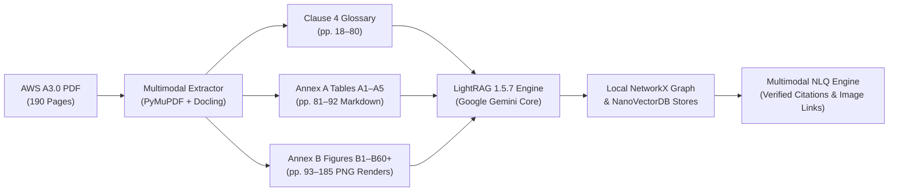

# AWS A3.0 Standalone Multimodal Prototype

A clean-slate, standalone prototype for Natural Language Querying (NLQ) over the full 190-page **AWS A3.0M/A3.0:2020 Standard Welding Terms and Definitions**.

This prototype demonstrates multimodal search and retrieval—connecting text definitions, process designation tables, and engineering diagrams with exact source citations and strict abstentions.

---

## Architecture & Features



1. **Native Multimodal LightRAG 1.5.7**:
   - Resolves the RAG-Anything version wrinkle: RAG-Anything was merged directly upstream into LightRAG v1.5.0 in May 2026. This prototype uses `lightrag-hku>=1.5.7` with built-in sidecar and Docling support.
2. **First-Class Google Gemini Inference**:
   - Uses `gemini-2.0-flash` for high-throughput multimodal reasoning, graph entity/relationship extraction, and answer synthesis.
   - Uses `models/text-embedding-004` (768-dim) for semantic vectors.
3. **High-Fidelity Vector Figure Rendering**:
   - The PDF contains vector drawings in `/Form` XObjects rather than raster scans. PyMuPDF renders all 97 Annex B engineering diagrams into crisp 180 DPI images (`parsed/figures/`).
4. **Complete Corpus & Environment Isolation**:
   - Pure local file-based storage (`./storage/`) via NetworkX and NanoVectorDB. Zero external database servers (no Neo4j, no Docker required).
5. **Exact Citation & Abstention Harness**:
   - 12-question gold benchmark (`eval/gold_benchmark.json`) verifying that answers cite exact clauses, pages, and figure/table IDs, and cleanly abstain on out-of-scope topics.

---

## Repository Structure

```text
aws-a30-prototype/
├── data/
│   └── AWS_A3.0_2020.pdf             # Full 190-page reference specification
├── parsed/
│   ├── text_chunks.jsonl              # 64 extracted glossary text chunks
│   ├── tables/                        # Tables A1–A5 in Markdown
│   └── figures/                       # 97 rendered Annex B figure diagrams + JSON metadata
├── storage/                           # Local LightRAG stores (NetworkX + NanoVectorDB)
├── eval/
│   ├── gold_benchmark.json            # 12 curated multimodal evaluation questions
│   ├── test_scorer.py                 # Automated benchmark scoring harness
│   └── benchmark_report.md            # Generated benchmark evaluation report
├── src/
│   ├── config.py                      # Model endpoints and directory paths
│   ├── extract.py                     # Multimodal PDF extraction pipeline
│   ├── indexer.py                     # LightRAG indexing engine (Gemini)
│   ├── query.py                       # NLQ CLI with asset resolution
│   └── citation_checker.py            # Deterministic citation validation
├── docs/                              # Historical lessons, roadmaps, and plans
│   ├── navy_weld_multimodal_lessons_learned.md
│   ├── navy_weld_framework_roadmap.md
│   ├── navy_weld_value_and_outcomes_assessment.md
│   └── aws_a30_standalone_prototype_plan.md
├── .env.example                       # Environment configuration template
├── pyproject.toml                     # Python dependencies
└── README.md
```

---

## Quickstart

### 1. Prerequisites & Environment
Python 3.11+ is recommended. Install dependencies:
```bash
pip install -r requirements.txt
# Or:
pip install "lightrag-hku>=1.5.7" pymupdf docling google-genai openai pydantic python-dotenv
```

### 2. Configure Gemini API Key
Copy `.env.example` to `.env` and set your key:
```bash
# In PowerShell:
Add-Content -Path .env -Value "GEMINI_API_KEY=your_actual_key_here"
```

### 3. Extract Multimodal Assets
Extract the text, tables, and render all 97 figure diagrams:
```bash
python -m src.extract
```

### 4. Build the LightRAG Index
Populate local graph and vector indices:
```bash
# Dry run (validates chunks without API calls):
python -m src.indexer --dry-run

# Live indexing with Gemini:
python -m src.indexer
```

### 5. Run Natural Language Queries
Ask questions via the CLI:
```bash
python -m src.query "Explain a 1F pipe position and show its diagram"
python -m src.query "What is the letter designation for gas metal arc welding - pulsed arc?"
```

The system will return:
- Direct technical answer.
- Exact citations (e.g., `Clause 4, p. 5`, `Annex B, Figure B20`, `Table A1`).
- Direct file path links to the resolved figure diagrams or table files.

### 6. Run Automated Benchmark
Execute the 12-question challenge suite:
```bash
python -m eval.test_scorer
```
Outputs a detailed report to `eval/benchmark_report.md`.

---

## Project Documentation
Detailed system specifications, operational rules, and architecture rationale are available in the `docs/` folder:
- [Project Goals & Evaluation Criteria](docs/goal.md)
- [System Architecture & Epistemic Graph Design](docs/architecture.md)
- [Multi-Agent System (MAS) Operating Guidelines](docs/agents.md)
- [Multimodal Lessons Learned](docs/navy_weld_multimodal_lessons_learned.md)
- [Framework Roadmap](docs/navy_weld_framework_roadmap.md)
- [Value and Outcomes Assessment](docs/navy_weld_value_and_outcomes_assessment.md)
- [Technical Implementation Plan](docs/aws_a30_standalone_prototype_plan.md)

## Local API security boundaries

Model API roots are approved through server configuration. Request-level `base_url`
overrides must match the selected engine's configured root. Existing model and
retrieval defaults are preserved. Assets are served from a startup allowlist with
path and link containment checks. A separate production UI can be approved using
`A30_ALLOWED_ORIGINS`; query clients must send JSON with Content-Length.
Browser-entered API keys stay in page memory. See [security boundary notes](docs/security_boundary_notes.md)
for compatibility details, isolated tests and the deliberately deferred HTML risks.
