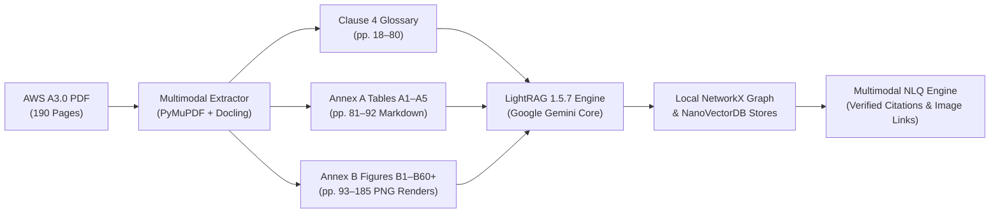

# AWS A3.0 Standalone Multimodal Prototype

## Bounded foundation publication closeout (2026-10-22)

The owner authorized publication after a focused existing-interface check and
independent review. The canonical backend CLI/API passed five boundary probes:
separate evidence observations and accepted assertions, a two-hop knowledge path
with complete source proof, candidate exclusion and missing-authority abstention.
No exposed MCP tool provides this route; the CLI/API is the verified interface.
The 13 focused admission/route/wrapper checks passed in 1.89 s; independent review
found no material blockers. Model/provider NONE, zero inference calls.
This closes the bounded A1 epistemic foundation, not general natural-language QA.
The original 31 PASS and exposed/fresh failures below remain unchanged. Source,
gold, full raw evidence and runtime databases stay local and outside publication.
Prepare language planning/completeness on a separate branch; no new implementation
or automatic QA/model campaign is authorized by this closeout.

## Implemented A1 evidence-to-knowledge boundary (2026-10-22)

**BOUNDED_A1_EPISTEMIC_BOUNDARY_IMPLEMENTED_WITH_NLQ_GAPS.** Harness 1.4.0 /
planner 1.3.0 now uses a versioned SQLite copy with two logical layers: 226 source
observations, 99 lexical concepts and 316 typed assertions (287 ACCEPTED,
29 CANDIDATE, 0 DISPUTED). The prior registry and native graph remain unchanged.
Accepted source-bound literal labels/designations/membership/connections are not
human-reviewed semantic types; no `IS_A` is accepted and indentation remains candidate.
Admission is recomputed from source observations, scope/rules and proof references;
metadata hashes are not approval. Stale/tampered material fails closed.
Actual `--graph-qa` uses the store: automatic designation/category/membership uses
knowledge; layout and other operations use evidence. `--query-layer knowledge|evidence`
selects explicitly; unsupported knowledge hierarchy requests retain insufficient evidence.
Four actual CLI executions ran once each: original 31 **31 PASS**, exposed old 8
**2 PASS / 3 PARTIAL / 3 FAIL** (DEVELOPMENT), untuned fresh 6 **2 PASS / 2 PARTIAL /
2 FAIL**, plus one declared ungraded knowledge-path integration: 46 questions total.
The evidence/assertion audit found zero structural closure issues; this is neither
a full general KG nor general natural-language acceptance. Model/provider NONE, zero calls.
Backend A1 only, vendor-neutral harness, GR optional/unbenchmarked; no UI or new models; no corpus visual-retrieval claim. **Stop: no automatic repair/replay.**
Freeze: `storage/evidence_v2/a1_epistemic_freeze_002.json`. Report finalized:
`Figure_A1_Epistemic_Layers_002_Report.md` in the parent workspace; Library delivered (version 0).

Canonical integration is the A1 CLI `--graph-qa` route (auto or explicit
`--query-layer evidence|knowledge`). The general `query.async_query` v1/v2
model-reader pipeline remains unchanged. Pure `answer_graph` without a store is
an observation compatibility helper, not an accepted-KG path; no universal
production integration is claimed.

## Historical first-slice A1 relationships and multihop result (2026-10-22)

**DONE_WITH_FRESH_QA_GAPS; not general natural-language acceptance.** The local
backend-only A1 slice implements authenticated canonical source loading, stable
node/edge evidence IDs, parents, complete direct/recursive expansion, ordered
common-ancestor operations and atomic claim/evidence traces. Declared caller
graphs cannot authenticate source; candidate indentation remains unreviewed.
The accepted graph remains 99 nodes/127 edges with 226 evidence bindings.
Software checks passed 42/42 (0.91 s) and 99/99 (1.09 s); independent code/source
review found no material findings or required fixes. Model/provider NONE, zero calls.
One actual CLI pass each: original 31 **31 PASS**; fresh held-out eight **2 PASS /
3 PARTIAL / 3 FAIL**. The original 31 already passed before this slice; 30 answer
strings are unchanged. Existing ordered multihop cases were source-validated;
new sibling/common-ancestor behavior has synthetic coverage only, not fresh end-to-end QA.
Remaining fresh gaps mostly concern planning/composition despite relevant evidence
being present; no source/OCR defect was established. No automatic repair or replay.
Keep GR optional/unbenchmarked and the harness vendor-neutral: no UI, models,
Git publication or corpus visual-retrieval claim. The [local report](../Figure_A1_Faithful_Relationships_Multihop_001_Report.md)
and private freeze/grades retain the evidence; The report is delivered in Library (version 0); local evidence remains retained.


**Current local A1 pass 004 complete (2026-10-21):** branch
`fix/a1-query-completeness`, base main `799112f`. Harness
`a1-graph-qa-1.2.0` / planner `1.2.0` independently grades **QA001 15 PASS** and
**QA002 16 PASS**, with no failures, partials or regressions. Both existing sets
ran once, 31 questions total, model/provider **NONE**, zero calls. The correct
Q16 source-limit answer retains `insufficient_evidence`; grading is not a count
of successful route statuses. Focused checks passed 33/33 in 0.77 s; no full suite.

This is DEVELOPMENT on exposed questions, not unseen or LLM validation. The
source graph, database, v1 default and prior runs/graders remain unchanged.
Indentation remains candidate layout rather than reviewed semantic subtype;
query grammar remains bounded. The existing routing/QA skills were reused
unchanged. See the [private local report](storage/evidence_v2/a1_qa_repair_004/report.md).
**Publication authorized (2026-10-21):** the owner approved commit, push, PR merge and local/online synchronization for this completed repair. Stop further repair and QA work; the bounded results and qualifications above remain unchanged.

**Historical publication status, pass 003 (2026-10-21):** The owner approved
publishing that prototype. V1 remains the default; v2 is opt-in. Figure A1 development QA remains
15 PASS on QA001 and 9 PASS / 4 FAIL / 3 PARTIAL on QA002. Publication does not
change those results or establish general answer correctness.

**Historical bounded A1 pass 003 complete (2026-10-21):** harness `1.1.0` independently
grades **15 PASS / 0 FAIL / 0 PARTIAL** on the original set and **9 PASS /
4 FAIL / 3 PARTIAL** on the follow-up. Both sets ran once, 31 questions total,
model/provider **NONE**, zero calls. This is DEVELOPMENT on exposed sets, not
unseen or LLM validation. Focused checks passed 33/33 in 0.56 s; no full suite.
Original baselines remain intact, including the follow-up's 1.0 result of
0 PASS / 15 FAIL / 1 PARTIAL.

Multi-name resolution is correct for 13/13 mentions and 23/23 mappings, but layout
and source-limit tasks still fail or omit requested detail. Follow-up PASS:
01–08, 11; PARTIAL: 09, 14, 16; FAIL: 10, 12, 13, 15. See the
[private local report](storage/evidence_v2/a1_qa_repair_003/report.md).
The source graph, six protected sources and 168 prior receipt files are unchanged.
**Stopped after this repair pass: no further repair or replay.**

Two thin project skills invoke existing code:
[evidence-graph-routing](.agents/skills/evidence-graph-routing/SKILL.md) and
[evidence-graph-qa](.agents/skills/evidence-graph-qa/SKILL.md). Each contains only
`SKILL.md` and `agents/openai.yaml`; no wrapper framework or automatic backend
skill loading is integrated. The source adapter remains Figure A1 only.

```powershell
python -B -m src.evidence_a1_cli --root <repo> --input <cqs> --graph-qa --output <repo>/storage/evidence_v2/<new-run>.json
```

For an authorized future execution, record existing source/edition/image/graph
and harness/input identities first with existing hash tools; keep private grades
out of execution. No extra checks/infrastructure, UI/model/cloud, new database/
global configuration or Git publication is part of this completed bounded pass.

**Historical first owner A1 graph QA result:** unchanged prepared baseline completed
0/15 questions; the added explicit `--graph-qa` harness independently passes
15/15 on this exposed set. Model/provider **NONE**, zero calls. The source graph
and stores are unchanged. This is deterministic DEVELOPMENT QA, not an LLM or
unseen evaluation. See [harness, results and known routing limit](docs/evidence_v2_a1_qa_001.md).
The bounded run has stopped. Earlier empty-CQ setup status below is historical.

**Historical pre-question Figure A1 setup scope.** Backend source/graph bindings, real
ancestor traversal and the complete single-image packet pass structural checks.
The owner will supply competency questions; the shipped CQ dataset
is empty. No new inference or answer-accuracy tests run in this scope. Start with:

```powershell
python -B -m src.evidence_a1_cli --input eval/evidence_v2_a1_owner_cqs.json
```

See [A1 setup, commands, limitations and readiness](docs/evidence_v2_a1_setup.md).
V1 remains default; `main` is unchanged. Earlier B6/table/comparison work below
is historical and deferred; do not run its model examples under the active scope.

**Runtime recovery (2026-10-21):** The existing local vision model now reads the
complete three-image packet with a 16,384-token request context. Independent
grading of the original source slice is **4/6 cases**, **11/13 facts correct**
and **10/13 source-supported**; multipage semantic acceptance remains incomplete.
The repaired negative control and exposed visual replay are reported separately.
See [runtime diagnosis and real reader comparison](docs/evidence_v2_runtime_recovery.md).
V1 remains default; all work stays local with `main` unchanged.
The [unchanged-v1 comparison status](docs/evidence_v2_live_comparison_blocker.md)
records one executed provider-free pair and the exact local-only blocker for
five configured cloud-generation cases, plus one installed-model trial recommendation.

## Local v2 evidence slice (2026-10-21)

The opt-in v2 slice adds content-bound evidence objects, typed lookup/ambiguity
routes and a complete evidence-to-reader packet. Local annotated tag `v1.0`
preserves baseline `24bac45465bcb5c9ea14663f7a669927d5d2ed00`; work is on
`v2/evidence-engine`, with `main` unchanged and no commit, push, publication or
merge in this task. This baseline is a prototype with known gaps, including
heading-only A2/A3 Markdown and text-only generated answering.

V1 remains the default. In the existing authorized local checkout:

```powershell
python -m src.query "Define root face" --evidence-version v2
python -B -m src.evidence_a1_cli --input eval/evidence_v2_a1_owner_cqs.json
```

The second command performs structural checks only and never calls a model.
The existing optional local reader uses the configured loopback Ollama service and
installed `VLM_MODEL`; it is not exercised in the active setup scope.
Its final answering request receives every required image
as original validated pixels. No new credentials or private-data destination are
needed. API clients may opt in through `{"evidence_version":"v2",
"v2_reader":"extractive"}` or `"local"` in the existing guarded `/api/query`
request. No browser UI changes are included. Omit the version or select `v1`
to roll back behavior.

The bounded source slice covers six definition/alias entries, structured Tables
A2/A3 and Figure B6's three full-page continuations plus the source applicability
note. A targeted three-page native extraction supplies 133/134 table rows in
ignored `storage/evidence_v2/tables.v2.2.json`, preserving the original empty
Markdown and source discrepancies. Keep licensed sources/derivatives and raw
answers local; distributable fixtures contain original synthetic content only.
Exact extraction validates source bindings; generated claims remain semantically
`UNASSESSED` even when their evidence IDs and citations are valid.

See the [current results and blockers](docs/evidence_v2_implementation.md),
[schema/interface contract](docs/evidence_v2_schema.md),
[dependency/build limits](docs/dependency_contract.md) and
[active plan](docs/aws_a30_standalone_prototype_plan.md). Historical results below
remain evidence for their stated scopes; they do not establish full multimodal
answer accuracy or production readiness.

**Vector reader fix and evaluation (2026-10-15):** The chunk reader now accepts validated existing numeric lists and native encoded vectors, with an exact LightRAG 1.5.7 contract guard. On frozen questions, strict target Hit@10 was 1/28 before and 11/28 after in a fixed-pool component comparison; the separate current hybrid lane reached 23/28. Only 12 targets are mapped in the reader pool. These results and 220 selected Python checks do not establish factual answer accuracy. See [protocol, results and limits](docs/vector_reader_compatibility.md).

A clean-slate, standalone prototype for Natural Language Querying (NLQ) over the full 190-page **AWS A3.0M/A3.0:2020 Standard Welding Terms and Definitions**.

This prototype demonstrates multimodal search and retrieval—connecting text definitions, process designation tables, and engineering diagrams with exact source citations and strict abstentions.

**Source metadata update (2026-10-15):** [the verified manifest](config/aws_a30_2020_manifest.json) now supplies canonical locations and explicit existing asset bindings through `src/standard_manifest.py`. Its inventory is 190 PDF pages, 62 figures (including distinct B16A/B/C) and 11 tables (A1-A5, D1-D6). Printed pages and viewer ordinals remain distinct. Annex B's applicability conflict is retained. See the [implementation evidence and limits](docs/declarative_manifest_implementation.md); historical feature/count claims below are not fresh ingestion or answer-quality evidence.

---

## Architecture & Features



1. **Native Multimodal LightRAG 1.5.7**:
   - Resolves the RAG-Anything version wrinkle: RAG-Anything was merged directly upstream into LightRAG v1.5.0 in May 2026. This prototype uses `lightrag-hku==1.5.7` with built-in sidecar and Docling support.
2. **First-Class Google Gemini Inference**:
   - Uses `gemini-2.0-flash` for high-throughput multimodal reasoning, graph entity/relationship extraction, and answer synthesis.
   - Existing contextual retrieval uses local `BAAI/bge-large-en-v1.5` vectors with 1024 dimensions; this manifest change does not re-embed data or change provider settings.
3. **High-Fidelity Vector Figure Rendering**:
   - Existing page renders are bound explicitly to 62 source figures. The 97 historical Annex-B JSONL records are per-page artifacts, including misclassified later pages; they are not 97 distinct diagrams.
4. **Complete Corpus & Environment Isolation**:
   - Pure local file-based storage (`./storage/`) via NetworkX and NanoVectorDB. Zero external database servers (no Neo4j, no Docker required).
5. **Exact Citation & Abstention Harness**:
   - The frozen 50-question benchmark (`eval/gold_benchmark.json`) is unchanged. This change was checked with offline deterministic fixtures, without rerunning model-based answer evaluation.

---

## Repository Structure

```text
aws-a30-prototype/
├── data/
│   └── AWS_A3.0_2020.pdf             # Full 190-page reference specification
├── parsed/
│   ├── text_chunks.jsonl              # 64 extracted glossary text chunks
│   ├── tables/                        # Tables A1–A5 in Markdown
│   └── figures/                       # 97 rendered Annex B figure diagrams + JSON metadata
├── storage/                           # Local LightRAG stores (NetworkX + NanoVectorDB)
├── eval/
│   ├── gold_benchmark.json            # 12 curated multimodal evaluation questions
│   ├── test_scorer.py                 # Automated benchmark scoring harness
│   └── benchmark_report.md            # Generated benchmark evaluation report
├── src/
│   ├── config.py                      # Model endpoints and directory paths
│   ├── extract.py                     # Multimodal PDF extraction pipeline
│   ├── indexer.py                     # LightRAG indexing engine (Gemini)
│   ├── query.py                       # NLQ CLI with asset resolution
│   └── citation_checker.py            # Deterministic citation validation
├── docs/                              # Historical lessons, roadmaps, and plans
│   ├── navy_weld_multimodal_lessons_learned.md
│   ├── navy_weld_framework_roadmap.md
│   ├── navy_weld_value_and_outcomes_assessment.md
│   └── aws_a30_standalone_prototype_plan.md
├── .env.example                       # Environment configuration template
└── README.md
```

---

## Historical v1 quickstart

### 1. Prerequisites & Environment
Python 3.11+ is required; the observed existing environment is Python 3.12.7. `pyproject.toml` defines the standard-library v2 core and exact optional direct v1/test/build pins; `requirements-v1.lock` records observed direct runtime versions. These are not a complete transitive or model/corpus lock. See [the dependency contract](docs/dependency_contract.md) and [the exact LightRAG 1.5.7 reader guard](docs/vector_reader_compatibility.md) before changing the environment.

The following original setup commands are operator reference. The bounded v2 task does not authorize new credentials, full extraction, indexing or cloud calls.

### 2. Configure Gemini API Key
Copy `.env.example` to `.env` and set your key:
```bash
# In PowerShell:
Add-Content -Path .env -Value "GEMINI_API_KEY=your_actual_key_here"
```

### 3. Extract Multimodal Assets
Extract the text, tables, and render all 97 figure diagrams:
```bash
python -m src.extract
```

### 4. Build the LightRAG Index
Populate local graph and vector indices:
```bash
# Dry run (validates chunks without API calls):
python -m src.indexer --dry-run

# Live indexing with Gemini:
python -m src.indexer
```

### 5. Run Natural Language Queries
Ask questions via the CLI:
```bash
python -m src.query "Explain a 1F pipe position and show its diagram"
python -m src.query "What is the letter designation for gas metal arc welding - pulsed arc?"
```

The system will return:
- Direct technical answer.
- Exact citations (e.g., `Clause 4, p. 5`, `Annex B, Figure B20`, `Table A1`).
- Direct file path links to the resolved figure diagrams or table files.

### 6. Run Automated Benchmark
Execute the 12-question challenge suite:
```bash
python -m eval.test_scorer
```
Outputs a detailed report to `eval/benchmark_report.md`.

---

## Project Documentation
Detailed system specifications, operational rules, and architecture rationale are available in the `docs/` folder:
- [Project Goals & Evaluation Criteria](docs/goal.md)
- [System Architecture & Epistemic Graph Design](docs/architecture.md)
- [Multi-Agent System (MAS) Operating Guidelines](docs/agents.md)
- [Multimodal Lessons Learned](docs/navy_weld_multimodal_lessons_learned.md)
- [Framework Roadmap](docs/navy_weld_framework_roadmap.md)
- [Value and Outcomes Assessment](docs/navy_weld_value_and_outcomes_assessment.md)
- [Technical Implementation Plan](docs/aws_a30_standalone_prototype_plan.md)

**Helper hardening (2026-10-15):** UI geometry is validated without changing the stored registry; canonical figure/table ranges are bounded and resolved atomically; pure terminology helpers preserve target/sense/process/provenance records through an explicit in-memory projection. These changes do not rebuild stores, activate terminology expansion in live retrieval, or establish better answer accuracy. See [implementation evidence and limits](docs/helper_hardening_implementation.md).

**Live terminology validation (2026-10-15):** Three reviewed headwords now supply source-bound evidence bundles to actual hybrid retrieval and generation. The frozen 33-case comparison preserves all 10 unrelated controls; complete reviewed evidence improves from 1/12 within the previous top five to 12/12 at rank one. Local-model answer errors and citation failures remain, so this is not full multimodal NLQ readiness. See [results, reproduction and limits](docs/terminology_live_results.md).

## Local API security boundaries

Model API roots are approved through server configuration. Request-level `base_url`
overrides must match the selected engine's configured root. Existing model and
retrieval defaults are preserved. Assets are served from a startup allowlist with
path and link containment checks. A separate production UI can be approved using
`A30_ALLOWED_ORIGINS`; query clients must send JSON with Content-Length.
Browser-entered API keys stay in page memory. See [security boundary notes](docs/security_boundary_notes.md)
for compatibility details, isolated tests and the deliberately deferred HTML risks.

If the required contextual retrieval index is absent, queries return
`RETRIEVAL_INDEX_MISSING` with restoration guidance (HTTP 503; CLI exit 1).
The application does not automatically rebuild the index or generate an answer.
