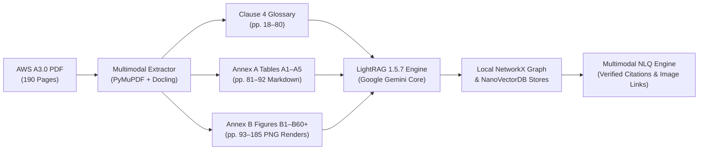

# AWS A3.0 Standalone Multimodal Prototype

Local prevention branch `feat/planner-contract-preflight` adds a one-response
offline contract check and a small developer planning/release skill after repair004.
See [branch handoff](docs/branch_handoff.md) for the exact command and known failures.
It does not improve model selection or authorize inference/publication.

## Current disposition: offline contract repair004 complete

The metadata boundary is repaired: original planned rationale is validated and
preserved as unverified trace metadata, while the internal planned reason maps to
the shared contract value. Unresolved explanations and typed/action/source/evidence
guards remain strict. Contract1.2/question instructions1.1 are runtime-loaded.

All67 ORIGINAL fresh003 responses were replayed through the real public planner
entry point and canonical compiler/backend, with no action/entity/intent replacement.
Independent content grades: A1 35 PASS/10 PARTIAL/6 UNASSESSED; A2 9 PASS/4 PARTIAL/
3 UNASSESSED. Unassessed factual cases are failed deliveries, not good abstentions.
Three A1 passes are appropriate clarifications. Runtime model/API calls:0. The new
instructions were not seen by a model; these are cached development results.

All51 deterministic controls, source/stores and1,503 prior artifacts are unchanged.
Focused software checks97 PASS; independent metadata/code and source/proof review
CLEAR. Supported physical paths are not semantic IS_A or accepted-KG multihop:
this replay ran one accepted designation lookup and zero knowledge path queries.
Hold live-planner adoption/merge; remaining choices omit lists/groups/follow-ups or
use invalid modes/targets/references. No automatic semantic repair or paid rerun.

Exactly two serial workstreams are authorized: this completed repair/report, then
a separate local prevention branch for one real-entry preflight, a small project
planning/release skill and short handoff. A reviewed local checkpoint is permitted;
no push, merge, deletion, inference, OCR, A3 or extra framework work is authorized.
Historical sections below describe their recorded runs, not current authorization.

## Current disposition: fresh question-interface003 blocked

One approved fresh67-question DeepSeek pass completed with unchanged runtime/data:
67 valid JSON/schema responses and natural stops, but66 plans rejected before graph
execution. A1 delivered one correct clarification and50 failures; A2 delivered16
failures. Factual content/support of rejected answers is UNASSESSED, not a successful
source-limited abstention. Zero graph operations or substantive source answers ran.

Root cause: the new action schema permits a planned-part rationale, while the adapter
forwards it to a legacy compiler requiring `reason=""`. The new prompt omitted that
constraint. This is an interface/compiler defect; it does not demonstrate failed OCR
or retrieval. No repairs, replay or extra model calls followed. Hold merge/live-planner
adoption. Main,111 frozen code files, source/stores and001/002 results are preserved.
Full actual answers and diagnosis are in the interface003 Library report and ignored
`storage/evidence_v2/a1_a2_relationship_003/`. No Git publication is authorized here.

## Current local work: offline question interface002

The opt-in planner now presents four question actions—term lookup, member listing,
relationship check and path explanation—and compiles them into the existing typed
graph backend. Source-backed identity resolution, explicit follow-up references and
failed-operation coverage are verified offline. Extraction, source stores,
admission rules and the deterministic default are preserved.

Fresh001's67 original model outputs/answers remain the baseline: A2 16 PASS;
A1 46 PASS/4 PARTIAL/1 UNASSESSED. Manual/adapted plans are not fresh model results.
No new inference, ingestion work or Git publication is authorized in this pass.
See the existing plan and architecture for exact contract and staged capability scope.

Offline002: all five affected A1 manual-action answers and A2's chart-limit answer
PASS content/delivery/support; all51 deterministic controls are unchanged. Unchanged
saved model plans retain their original omissions. No model has consumed the new
interface; keep adoption pending one separately approved fresh pass. Minor duplicate
path/designation text remains. Full answers/receipts: ignored
`storage/evidence_v2/a1_a2_relationship_002/` and the interface002 Library report.

## A1/A2 relationship readiness001: fresh local validation (2026-10-23)

Local branch `feat/a1-a2-relationship-readiness` starts from main `71088ce`.
One frozen DeepSeek development-planner pass completed all67 calls naturally:
A2 content/delivery16 PASS; A1 content46 PASS/4 PARTIAL/1 UNASSESSED, with the last
case an answerable lookup/delivery failure. Three A1 passes are proper clarifications.
All original15 owner questions pass. No relation supplement fired in this pass.

Source/admission and all109 frozen runtime files are unchanged. Proof review is
clear: qualified indentation/arrow observations remain candidates; all156 operation
records declared evidence, not knowledge-layer paths. Physical support certificates
do not establish semantic IS_A. Hold general planner adoption and A3; retain text
baseline and fix only demonstrated intent/coverage gaps under a separate decision.
No new OCR, framework, provider, production acceptance or Git publication occurred.
Actual answers/usage/limitations: `Figure_A1_A2_Relationship_Readiness_001_Report.md`;
private receipts: `storage/evidence_v2/a1_a2_relationship_001/`.

## Preserved A2 finishing slice009: cached baseline (2026-10-23)

The bounded A2 ingest/evidence slice and opt-in planner finishing pass are verified
on existing exposed questions. Default deterministic behavior is preserved; fresh
model selection, production Terra/Luna and unseen generalization remain unvalidated.
No new OCR/model/provider call, figure, framework or UI was introduced by009.

Optional `run_questions(..., source_observation_path=...)` / `query --source-observation`
adds source-bound canonical **candidate** figure evidence in the A2 adapter. Source,
page/crop/region/connector bindings and native PDF-rendered clip pixels are checked.
This authenticates provenance, not the AI observation's truth. Candidate evidence
and claims stay outside accepted proof catalogs/KG admission and completeness flags;
knowledge-only answers are not augmented. Text is rendered only for successful
evidence-layer `epistemic_limits`/`chart_layout` operations; otherwise the optional
candidate packet is separate. Omitting the option preserves prior behavior.

A conservative compiler guard reuses the existing deterministic relation intent
only for a ready single-part literal evidence path with exactly matching ordered
endpoints. It supplements, never replaces, original model operations and records
its origin. Membership, source-layout ancestry, physical common-root reachability
and semantic subtype remain distinct. Ambiguous/compound/ref-dependent batches are
not guessed; forced knowledge execution rejects the evidence-only layout operation.

Capability staging remains **text first, relationships second, multihop third**.
Known-source labels/codes and identity clarification are independently usable;
compound requests retain every relationship/path part. Qualified relationships
now include the optional candidate whole-A2 connector observation. Ordered source
paths and accepted physical support are demonstrated; model-requested accepted-KG
paths and semantic IS_A transitivity are not established. Candidate indentation and
AI observations never become accepted semantic facts through recognition or reachability.

One frozen cached005-plan replay: A2 content/delivery **16 PASS**; A1 **51 PASS**,
including three proper clarifications. This is compiler/executor recovery with
explicit deterministic supplementation and candidate evidence, not improved model
performance. Original007/008 plans, grades and artifacts remain unchanged. All51
deterministic A1 control answers/coverage/rows/paths/verdicts are unchanged, including
the known planning_unsupported versus source-limit metadata caveat. Runtime execution
still retains redundant failed/blocked requests; semantic completeness remains
UNASSESSED automatically. Do not equate content grades with all operations succeeding.

Validation:398 existing applicable software checks passed; independent focused code,
source and answer review passed. An offline wheel includes the runtime JSON contract
and excludes source assets/stores; sandbox build failures are retained separately
from the successful host build. Harness1.7.6, graph adapter1.4, instruction1.4/wire1.0;
no model has consumed instruction1.4. Source observations are optional read-only
attachments; existing graph/store admission decisions are unchanged.

Authorized Git closeout is conditional on these checks and a clean publication
review; its exact commit/PR/merge/sync receipt is kept in the Library report, not
fabricated here. Private PDFs/images/OCR/vision traces/stores/caches stay outside Git.
Rollback leaves the observation option unset and deterministic default enabled;
no reset, branch/worktree deletion or unrelated cleanup is required. AWS backend
correctness remains one slice at a time; no automatic A3, Navy Weld or Utopia work.
Report: `Figure_A2_Planner_Integration_002_Report.md`; private actual answers/receipts:
`storage/evidence_v2/a2_planner_009/`. GR remains optional, not a required harness.

## Preserved offline planner006 baseline

**Bounded offline simplification complete; hold planner adoption/publication.**
One replay used the unchanged005 saved plans: no model, OCR or external calls.
A2 content **15 PASS/1 PARTIAL**, delivery **14 PASS/2 PARTIAL**; A1 content
**50 PASS/1 PARTIAL**, delivery **48 PASS/3 PARTIAL**. A1's50 passes include three
appropriate identity clarifications, not50 factual answers. These are exposed
regressions and cached-plan replay, not fresh model or production acceptance.
All51 deterministic A1 control answers/coverage/rows/paths/verdicts are unchanged.

Runtime1.7.4 loads `src/evidence_chart_contract.json` through its Python loader:
contract1.0, instruction1.3, wire1.0. Prompt/profile/schema/compiler definitions
share that asset; explicit safeguards remain code. No model consumed instruction1.3.
`SKILL.md` routing/QA guidance remains developer/agent guidance, not automatic
runtime skill loading. Shared definitions reduce drift; they cannot prevent it.

Quote labels no longer require a character partition. Exact source/query bindings,
typed IDs/roles/budgets and result dependencies remain enforced. One batch retains
blocked operations, runs safe independent ones, and blocks failed dependents.
Exact equivalent operations can share execution without losing part/field mappings.
Explicit `chart_layout` alone requests whole-chart observations; empty IDs never
mean all nodes. Membership, layout, physical connectivity and semantic subtype
remain distinct. Dictionary candidates now also bind unresolved identity requests.

Execution coverage is separate from semantic answer completeness (`UNASSESSED`
until independent grading). Actual bound assertion status/rule/support qualifies
observations. Five returned paths have complete accepted literal/physical support,
including the A2 Allied→Thermal Cutting→Arc Cutting route; these are structural
certifications of evidence paths, not semantic IS_A transitivity or a new KG search.
No persisted observation/admission decision was changed. Source bytes, gold,67 raw
plans,109 frozen code files and463 prior005 artifacts passed preservation checks.

Remaining: A2-Q15 omits explicit source judgment about arrow directions and has
invalid partition/oversized operations; Q16 adds an empty redundant designation
follow-up. A1-QA002-14 answers a subtype question with a cross-chart path instead
of its relationship verdict. CQ003/QA002-10 contain the requested facts but retain
confusing redundant-operation warnings. No automatic repair/evaluation loop follows.
The known deterministic reason-label caveat is preserved with its unchanged controls.

AWS backend correctness stays slice by slice: A2 only plus A1 regressions, no UI,
A3, Navy Weld, Utopia, framework or model campaign. GR remains optional. Review
actual answers before further inference or publication. Source-aware ingest and
planner are logically separable, but shared API/traversal hunks require a deliberate
split; no two independently publishable commits or foundation PR were created.
Report: `Figure_A2_Planner_Integration_002_Report.md`; private receipts and all
answers: `storage/evidence_v2/a2_planner_006/`. No Git publication is authorized.

## Preserved fresh005 baseline

Fresh005 used67 natural-stop `deepseek-flash` planner calls with instruction1.2:
A2 content12 PASS/4 UNASSESSED, delivery10 PASS/2 PARTIAL/4 UNASSESSED;
A1 41 PASS/1 PARTIAL/9 UNASSESSED included two proper clarifications.
It executed52 graph queries (12 A2+40 A1), plus two zero-operation clarifications:
**52, not54 executions**. All original receipts/answers remain unchanged. The full
report is archived as `006/report_v5_before.md` and Library version5 of
`libfile_467be2fe46b08191be1c7380b658b958`; its raw ZIP remains
`libfile_a2abf18257b08191a21e3db693d4df18`. Neither005 nor006 establishes production
or unseen acceptance. The independent review's predicted scores and invented A2
Solid-State Cutting question were not adopted; actual source/receipts govern.

## Preserved offline004 baseline

004 replayed older saved plans, with zero new model calls: A2 delivery11/3/0/2
and content14/0/0/2; A1 43/6/0/2 included three appropriate clarifications.
It did not test instruction1.2 in a model. Its exact full report remains
`storage/evidence_v2/a2_planner_005/report_v4_before.md` (SHA256
`f0abc1ae5f14151d898acbaab87b16f8dbe82a178c0479c43c354b3bf9b6ffb0`), with historical checks/proof limits and prior Library version4.

## Preserved planner003 development baseline

The fresh instruction1.1 DeepSeek run completed67 natural-stop calls, with no
truncation/retry/fallback. A2 clear delivery/content:6 PASS/10 UNASSESSED; A1
complete-answer30/12/3/6, factual-data35/7/3/6. Plans were6/16 ready in A2 and45/51
in A1; nine evidence paths and no accepted-KG paths returned. This was a development
proxy, not production acceptance. Full answers/raw plans/report remain unchanged
in `storage/evidence_v2/a2_planner_004/report_v3_before.md` and prior003 artifacts;
archive SHA256 `14da3c37608c51fee0da312d6ef9c667d45782b8aab6d9f10026df337c303308`. Library version 3 retains that earlier report in version history. The replay above is not new model performance.

## Historical A2 planner002 (2026-10-23)

**Offline contract repair reviewed; fresh model validation is not authorized.**
Instruction revision `chart-llm-plan-instructions-1.1` keeps wire schema `1.0`;
per-operation restrictions and planned `reason=''` are explicit in prompt and
schema descriptions. Flat schema remains a structural superset; compiler guards/
admission are unchanged. Fifty focused checks passed; unchanged saved67-response
compiler replay confirms0 executable plans and identical first rejections. No
plan rewrite, new model call or model-improvement claim. Hold Git. Fresh validation
needs separate approval. The same Library file is now version2 with offline
findings; the original67-call record and Libraryv1 remain preserved.

**VALIDATION_PASS_COMPLETE_TYPED_PLAN_CONTRACT_NOT_READY.** Continue locally on
`feat/a2-source-aware-ingest`; no publication is authorized. Reuse cached A2
source evidence and the unchanged 16 A2 development questions plus 51 exposed
A1 regressions. Preserve `storage/evidence_v2/a2_planner_002/baseline_freeze.json`
and all source/QA001 results below. No successful 002 model acceptance is claimed.

The reviewed opt-in question-to-validated-plan adapter uses the existing deterministic
evidence/KG executor and admission rules. Model inputs contain the question and
source dictionary names/codes/IDs only, with no graph edges, gold or prior answers.
Generic result references must support group/path follow-ups and preserve every
requested part; recognizing an ID does not admit a relationship.

The backend consumes the versioned `build_prompt`, operation contract, JSON
schema and validator in `src/evidence_chart_llm_plan.py`. Existing `.agents`
`evidence-graph-routing`/`evidence-graph-qa` skills are developer guidance read by
agents, not automatically loaded by the backend; no new skill workstream is added.

### Historical first local-attempt setup

AWS STS succeeded in the configured `us-gov-west-1` context, but SageMaker
`list_endpoints` returned AccessDenied/400 and Bedrock `list_inference_profiles`
AccessDenied/403; config has no verified Terra/Luna mapping. No credentials were
changed. Before inference, the owner selected installed `qwen2.5:3b` text Instruct
(3.086B) / Ollama 0.40.4; **no 8B calls occurred**. Digest:
`357c53fb659c5076de1d65ccb0b397446227b71a42be9d1603d46168015c9e4b`.
This remains a **proxy, not Terra/Luna**: native metadata context 32768, chosen
runtime 16384, `num_predict=-1`, temperature 0, seed 42. Actual usage/stop reasons
and limitations must be reported.

### Historical approval-block/local-attempt record — permission resolved

The following record predates the new explicit approval and final 67-call pass.
Its zero-DeepSeek-call and no-retry statements describe that earlier denied
launch only; they are not the current inference totals.

**A2 is not done and is not ready for closeout.** Automatic approval review
rejected the exact DeepSeek A2 CLI launch before `CreateProcess`: sending the
questions and private source-derived identity dictionary to `api.deepseek.com`
lacked explicit private-source-disclosure authorization. The action is known
**UNEXECUTED**, with zero DeepSeek inference calls; no retry or alternate path
was attempted. Existing authentication/model-list reads succeeded, but those
metadata reads did not authorize source-bearing inference.

Before any launch, explicit approval is needed to send the existing 16 A2/51 A1
questions, source-derived dictionary names/codes/IDs and operation contract/schema
to the existing `https://api.deepseek.com` endpoint using existing credentials.
No PDF/image, graph edges, gold or previous answers are part of that proposed
input. No new credential grant, private-data upload retry or bypass is authorized.
The pending proxy remains `deepseek-flash` (documented
`DeepSeek-V4.1-Flash-1017`), thinking disabled, temperature 0, JSON-object output
and the same strict contract/schema. Its planned explicit provider maximum is
393216 output tokens rather than the default 8K; native context is 1M. None of
these inference settings has been executed. `deepseek-v4-pro` was also listed;
legacy `deepseek-chat` was absent. This is operational failover, not a new bakeoff.

All 32 local request directories/attempts remain preserved, with 30 natural
completions. A1 request010 contains only `request.json`, no receipt or stream;
its execution is **UNCERTAIN/prepared-interrupted**, not confirmed generation.
The initial schema run's 16 A2/nine A1 natural responses lacked required fields;
The prepared tenth A1 attempt was interrupted during diagnosis; its actual model
execution cannot be established from the retained artifacts.
The flat-schema-only correction preserved all 67 prompts byte-for-byte, profiles,
validator and admission. The flat run's first five A2 backend answers were invalid
plans (`SINGLE_SUBJECT_REQUIRED`); the sixth repeated query text and was manually
client-stopped at 83,103 characters: this sixth flat A2 request has confirmed
repetitive generation. All 30 saved backend answers have zero operations, rows,
paths and claims; **no new semantic answers were produced**. The five flat plans
mixed literal IDs with a current-operation self-reference, violating prior-only
dependency/cardinality rules rather than missing source data. The
repetition watch now handles arbitrary periods; no local rerun or arbitrary
output-token ceiling follows from that software correction.

The opt-in runtime/backend integration and versioned `chart-llm-plan-1.0`
contract are implemented/reviewed, with flat schema encoding. Final applicable
software checks: **382 PASS in 10.49 s**, five known warnings; independent code
review CLEAR. These establish implementation checks, not successful model plans
or answer quality. Source/baseline hashes are unchanged and the deterministic A1
control's 51 answer strings and coverage are identical (44 complete/2 partial/
5 unanswered). The 16+51 model acceptance
run remains blocked/pending, not passed. Report
`Figure_A2_Planner_Integration_002_Report.md` is delivered to Library version 0
(`libfile_467be2fe46b08191be1c7380b658b958`); it includes the actual saved responses,
controls, independent audit and the precise blocked action.
Stop here: no more local trials, external inference retries, OCR/A3/UI/Navy Weld,
new questions/framework/skill workstream or Git publication.

### Final authorized validation pass — complete; contract not ready

New explicit private-source-disclosure approval resolved the previous launch
block. The known-unexecuted A2 launch was retried once and allowed, followed by
A1. The final pass made **67 DeepSeek calls (16 A2/51 A1)**: all naturally stopped,
with no API errors, truncation, inference retry or fallback. Every response model
was `deepseek-flash`. All original prompts, code and gold remained frozen; no
fixes or tuning occurred during this pass.

Raw JSON/schema validity was **67/67**, but typed executable plans were **0/67**.
All 67 results were unsupported/unanswered before execution, with zero operations,
retrieval, rows, paths or claims. A2 rejected plans: 12 `UNUSED_INFORMATION_FIELDS`,
three `FIELDS_INVALID`, one `SINGLE_SUBJECT_REQUIRED`. A1: 30 `FIELDS_INVALID`,
18 `UNUSED_INFORMATION_FIELDS`, one `SINGLE_SUBJECT_REQUIRED` and two
`PLANNED_PART_INVALID`. Source-answer grading is **UNASSESSED/NOT_RUN**, not a
0/67 semantic-accuracy score; end-to-end pipeline acceptance nevertheless fails.

That frozen live pass showed schema/prose/compiler usability defects and model planning/
adherence mistakes. The flat structural schema allows field arrays whose
operation-specific restrictions are implicit in prose and enforced by the
validator. Raw unexecuted plans also show wrong operation selection, ambiguity
handling and direct-versus-recursive list-depth choices. Do not blame the contract
or model capability alone, or call these executed OCR/KG/retrieval failures:
retrieval never ran. The next decision is generic contract/interface clarification
and simplification, not OCR changes, more questions or an automatic tuning loop.
No further implementation or publication is authorized.

Usage was 247737 input/22999 output tokens (270736 total; 136064 cache-hit/
111673 cache-miss input). Summed API latency was 148.573 s, median 2.204 s,
maximum 3.530 s. Published-rate billing estimate: USD0.03096–0.06192; invoice
unavailable. The prior 382 passing software checks remain valid because code is
unchanged; they do not establish contract usability. The deterministic A1 control
still has identical 51 answer strings and runtime 44 complete/2 partial/
5 unanswered; A2 source/QA001's 7 PASS/4 PARTIAL/5 FAIL baseline is unchanged.
A2 is not done and is not ready for Git closeout. Report
`Figure_A2_Planner_Integration_002_Report.md` is updated in the same Library file
`libfile_467be2fe46b08191be1c7380b658b958`, confirmed version1, including all 67 raw
backend answers and raw plans. Preserve all local attempts and the historical
approval-block record.

The plan follows `planning-and-task-breakdown` and Scope Discipline in
`using-agent-skills`; no dedicated drift skill/framework is added. No OCR, A3,
UI, Navy Weld, production integration or new benchmark. Stop on concrete gaps,
without gold changes or repeated tuning. See the [existing implementation plan](docs/aws_a30_standalone_prototype_plan.md).

## Historical A2 source/QA001 (2026-10-23)

**STOP_AFTER_A2_DEVELOPMENT_PASS — SOURCE_INGEST_READY_NLQ_NOT_READY_FOR_CLOSEOUT.**
Work remains local/uncommitted on `feat/a2-source-aware-ingest`; main is unchanged
at `2d7b73813228c1cd6f907ca014a23693a888de81`. Hold publication: the source layer
works, but the actual A2 answer/completeness results below do not meet acceptance.

Figure A2 is **Master Chart of Allied Processes**, `figure:figure_a2`, PDF index
88 / viewer page 89 / printed page 76. Its normalized page crop
`[0.075, 0.10, 0.45, 0.89]` (`ymin,xmin,ymax,xmax`) excludes A3 on the same page.
Adapter `a2-source-aware-ingest-1.4` (`src/evidence_a2.py`) combines native vector
boxes/strokes with local OCR for outlined-font labels: eight OCR calls total
(cached initial PSM11 plus seven per-box PSM6); later derived projections used
zero OCR calls. This is hybrid source ingest, not independent image-only OCR.
No LLM/external calls occurred and no VLM was needed for the native geometry.
A2 vocabulary comes only from A2 observations; no A1 dictionary facts are imported.
The final graph has 38 nodes (seven boxes/31 printed rows), six undirected
physical connectors, 112 ACCEPTED/12 CANDIDATE/0 DISPUTED assertions and zero
accepted `IS_A`. All returned proofs/assertion references joined correctly;
231 support joins and zero candidate promotions were verified. Lower category
boxes have multilevel physical connections, not geometric containment inside
the thermal-cutting box. Indentation remains candidate.

After the code freeze, one fixed 16-question A2 batch and one existing 51-question
A1 regression ran. A2 independent content review found **7 PASS / 4 PARTIAL /
5 FAIL**, while runtime coverage was **3 complete / 11 partial / 2 unanswered**;
only three answers were clean on both content and coverage. Independent delivery/
coverage grading was **3 PASS / 8 PARTIAL / 5 FAIL**. False clarification/
unsupported warnings remain even on some content-complete answers. A1's 51 answer
strings and coverage are verbatim unchanged: 51 content PASS, runtime 44/2/5,
including the known `HO003-06` reason-label caveat. These are development/exposed
regressions, not unseen or production-model acceptance.

The initial full 287-check run had one legacy-helper contract failure. A minimal
post-QA compatibility patch fixed that caller contract; nine focused checks then
passed, followed by **287 PASS in 7.82 s** with five known warnings. The actual QA
results remain from the frozen pre-patch code; no QA rerun is claimed. Old/new
coverage-helper results matched for all 31 typed A2 operations. Source, code and final compatibility
review cleared; that review is not NLQ answer acceptance.
Source/image/question hashes and all original/intermediate artifacts are retained.
The completion drift check remained A2-only, with no new UI/framework/model,
question/gold mutation or automatic repair loop. Primary gaps are intent
composition, anaphora/path planning and honest coverage, not missing source OCR.
Next decision: a bounded language-to-typed-operation repair; do not start another
OCR change, framework bakeoff or automatic rerun. No commit/push/merge is authorized.
GR remains optional; Navy Weld/Utopia are deferred. The reported AWS GPT-5.6
Terra/Luna setup remains unverified; no production endpoint/model acceptance was
simulated. Preserve the closed A1/private records below. Report `Figure_A2_Source_Aware_Ingest_001_Report.md` is delivered to Library,
version 0 (`libfile_333e9b8fb2a48191ae37ac99fa0a2633`).

The canonical A2 query interface below documents the completed pass; `<NEWignoredpath>`
must be an unused output under ignored storage and is not authorization to rerun:

```powershell
python -B -m src.evidence_a2 --root . query --graph storage/evidence_v2/a2_ingest_001/final_projection_005/graph.json --input storage/evidence_v2/a2_ingest_001/evaluation/questions.json --output <NEWignoredpath> --layer auto
```

See [the existing implementation plan](docs/aws_a30_standalone_prototype_plan.md)
for completed source tasks and unmet answer acceptance.

## Preserved A1 records

**Git closeout record (2026-10-23): REVIEWED FEATURE; PR #11.**
The reviewed implementation is published in [PR #11](https://github.com/kaiello/aws-a30-prototype/pull/11).
Independent code/publication reviews approved and all 270 local checks passed.
The PR records the live publication/merge state; the separate closeout report
records exact local main/origin/GitHub synchronization and post-merge checks.
Preserve the bounded dictionary-assisted A1 scope, private artifacts and
unrelated work. The 003 result below remains the historical pre-publication
record; this closeout does not start the next slice.

**Historical pre-publication raster integration 003 (2026-10-23): BOUNDED_A1_INTEGRATION_READY_FOR_OWNER_REVIEW.**
Local/uncommitted `feat/a1-source-aware-ingest`, based on unchanged main
`039087d06d55860bda19c1c8ea3b55b678cb8e4a`; no commit/push/merge is authorized.
The actual retained-raster pipeline executed the existing 51 questions once:
**51 content PASS in auto and 51 content PASS in candidate-evidence view**,
with **51 native content PASS** unchanged. Auto answers match native after only
removing the explicit raster-provenance prefix; evidence answers add qualified
parent-layout details in 14 cases without changing facts. All 51 are exposed
regressions, not unseen/general QA or cross-figure acceptance. Runtime coverage
is separately 44 complete/2 partial/5 unanswered because ambiguity and source
limits remain explicit; this does not mean 51 complete factual answers.
The known native `HO003-06` shielding-gas reason-label caveat is preserved.
003 reused unchanged 002 OCR/model artifacts with **zero new OCR/model calls**.
Typed per-predicate automatic pixel/OCR checks admitted 287 assertions (189
literal facts, 90 row enclosures and eight physical connectors). The 29
indentation assertions remain candidate; no `IS_A` was accepted. All 226 raw
observations/proofs remain candidate. The 586 support joins include source-local
glyph corroboration for four low-confidence/corrected codes; dictionary matching
alone grants no admission. All eight measured connector stroke regions and box
contacts were independently checked against pixels; these are undirected
physical links, with no arrow direction or semantic subtype inferred.
Scoped completeness accounts for observed rows/pixel bands, measured borders,
fresh rectangle inventory, orphan ink/words and required projection edges.
Applicable scopes passed without native reference totals or expected QA answers.
The KG recomputes retained seed/pixels/graph and checks file hashes before
admission. These are automatic source checks, not human approval, mathematical
proof or authority from a receipt flag/hash alone.
The full 270 A1 software checks passed in 7.67 s; independent code/source/proof
and actual-answer review found no material blocker. Software counts support the
answer/evidence results, not substitute for them. Frozen runtime/source files
and all 72 prior artifacts remain unchanged; native/001/002 inputs, gold,
outputs and private source evidence are preserved. No post-output repair/replay,
extra benchmark/framework, tuning loop or automatic model retry occurred.
Ready for owner review of this bounded A1 integration only. AWS backend one
figure at a time; GR optional, Navy Weld/Utopia deferred, no UI/new models/services
or automatic Git publication. Final report delivered to Library, version 0
(`libfile_24260fa7fb7c8191bfd0d5fcce255cbf`).

**Historical dictionary-assisted ingest 002 (2026-10-23): NOT_READY_FOR_ACCEPTED_RASTER_QA; HOLD UNMERGED.**
Local/uncommitted `feat/a1-source-aware-ingest`, based on unchanged main
`039087d06d55860bda19c1c8ea3b55b678cb8e4a`; no commit/push/merge is authorized.
This bounded pass used the source-backed dictionary's 99 labels and 97 printed
codes to normalize observed OCR, preserving raw text, provenance and uncertainty.
It supplied no reference regions, boxes, relationships, unseen entities, gold
answers or accepted status. This is **dictionary-assisted ingestion**, unlike
independent attempt 001 retained below. Source comparison found all 99 nodes
(90 processes/eight categories/root) and 127 physical relations (90 enclosures,
29 indentation links/eight root connectors), with no missing/extra identities or
endpoint relations. Two connectors came from CV and six from VLM. The six VLM
relationship regions identify endpoint boxes rather than connecting strokes;
this is an unresolved evidence-localization gap, not fully verified anchors.
The only local `qwen3-vl:8b-instruct` / Ollama 0.40.4 call used six unresolved
tasks/seven referenced nodes plus pixels, naturally completing in 42.656 s with
8980 input/645 output tokens. Actual context was 32768, `num_predict=-1`,
temperature 0, seed 42; metadata supports 262144, not allocated for this run.
One end-to-end pass executed the existing 51 exposed questions in both raster
views. Unchanged content rubrics grade candidate-evidence answers **32 PASS /
2 PARTIAL / 17 FAIL**, and mixed auto-policy answers **16 PASS / 4 PARTIAL /
31 FAIL**. Auto includes evidence operations; these are not accepted-KG accuracy
scores. All 226 record proofs and 316 assertions remain candidate, with zero
accepted assertions and 570 valid support joins. Valid joins do not establish
correct stroke localization or answer completeness. `complete_chart=False`
blocks exhaustive lists even in evidence view; auto knowledge operations abstain
where identities/relations have not been admitted. No candidate was promoted to
raise scores. Native answers remain exact: **51 content PASS**, coverage
44 complete/2 partial/5 unanswered and the existing reason-label caveat.
The 254 software checks passed in 7.27 s; answer quality and evidence limitations
above determine readiness. Original inputs/gold, native/001 results, frozen code
and private source artifacts are preserved; no post-output repair/replay occurred.
Recommended next decision: address completeness/admission handling and connector
stroke anchors in a bounded follow-up. No further model call, automatic repair
cycle or new benchmark/framework starts from this result. AWS/A1 backend first,
one figure; GR optional, Navy Weld/Utopia deferred, no UI/new models/services.
Report `Figure_A1_Dictionary_Assisted_Ingest_002_Report.md` is delivered to
Library, version 0 (`libfile_508fed85d1d48191a9158ead2c695363`).

**Historical independent source-aware ingest 001 (2026-10-22):
NOT_READY_FOR_RASTER_QA; HOLD UNMERGED.** Local/uncommitted
`feat/a1-source-aware-ingest`, unchanged main
`039087d06d55860bda19c1c8ea3b55b678cb8e4a`; no publication is authorized.
The reviewed source-aware implementation passed 231 software checks in 6.56 s.
Native PDF text/vector ingest and one canonical 51-question pass preserve exact
007 answers: 51 content PASS, native coverage 44/2/5 with the existing reason-label
caveat, reader model NONE/zero calls. These are exposed regression controls.
The image-only PDF has zero native characters/vectors; its 300-DPI PNG is
2540 x 3287. One Tesseract 5.5 / OpenCV 4.12 extraction produced 410 words and
eight rectangles, but no resolved root/usable graph: original setup used zero
model calls and ran no raster QA. A separately recorded, reviewed generic
cached-observation continuation reused that OCR without threshold/gold changes.
Its only local vision call used `qwen3-vl:8b-instruct` / Ollama 0.40.4, context
32768, `num_predict=-1`, temperature 0, seed 42. After 315.156 s it ended
`done_reason=length`: input 21799 + output 10969 filled the configured window
(model metadata declares 262144; this is not that native ceiling). Incomplete
JSON was labeled `invalid_output` by the wrapper; context exhaustion is not an
answer-quality grade. No usable raster graph or accepted proposal resulted.
All 51 raster questions are **NOT_RUN**, semantic grades null, not 51 failures.
Source inspection found 73/90 correct name/code pairs, 7/8 true headings plus
one false root-fragment category, and 99 correct physical edges/no extras;
17 enclosures, 3 indentation links and 8 connectors are missing. Root words
exist in OCR but were misassigned and excluded from allowed bootstrap IDs, so
the current contract cannot express the correct root; larger context alone
cannot fix it. Partial model output also contains invalid IDs/link types;
these are diagnostics, not a complete model grade or salvageable QA result.
The main gaps are row/layout assignment and the input/output contract, not
established generic OCR/model inability. No post-model repair/retry occurred.
Native records and candidate-binding paths retain method/version/anchors/provenance/
uncertainty; the incomplete actual raster run remains raw observations/model
diagnostics, with no raster KG store created.
Raster extraction receives pixels/identity metadata, never reused native facts.
OCR/VLM observations remain candidates, not automatic accepted-KG admissions.
Further compact unresolved-only vision/contract/layout work needs the next bounded
decision. AWS/A1 one figure first; Navy Weld/Utopia deferred, GR optional; no UI,
new framework/install/cloud or automatic extra experiments. Report `Figure_A1_Source_Aware_Ingest_001_Report.md` is delivered to Library, version 0 (`libfile_d8ad457a723c8191a513ea866d462d33`).

## Source-aware ingest CLI/API

Version 1.2 adds `--integrate-raster <retained-ingest-result>` for the bounded
003 path. It accepts retained local artifacts and existing questions, with no
new extraction/model options. The source-backed admission checks recompute the
actual evidence; this is not manual approval or trust in a prior receipt flag.
The completed, independently graded bounded pass used this integration interface:

```powershell
python -B -m src.evidence_a1_ingest --root . --integrate-raster storage/evidence_v2/a1_dictionary_ingest_002/raster_run/ingest_result.json --run-dir storage/evidence_v2/a1_raster_integration_003/run --questions storage/evidence_v2/a1_source_ingest_001/questions_51.json
```

The new explicit assisted route adds `--dictionary-assisted` and optional
`--questions <execution-only-CQ-file>` to the same CLI. `--questions` runs the
existing backend after extraction in both accepted-auto and candidate-evidence
views; it does not change admission or establish extraction completeness.
An unused private output directory is required. The following shows the same
interface used for the completed bounded pass; `_NEW` is a reproduction target,
not authorization for another model/QA run:

```powershell
python -B -m src.evidence_a1_ingest --root . --input-pdf storage/evidence_v2/a1_source_ingest_001/raster_input/a1_image_only.pdf --parent-binding storage/evidence_v2/a1_source_ingest_001/raster_input/parent_binding.json --dictionary-assisted --vision --questions storage/evidence_v2/a1_source_ingest_001/questions_51.json --run-dir storage/evidence_v2/a1_dictionary_ingest_002/raster_NEW
```

The commands below also describe the preserved independent/native interfaces.
Their historical image-only input restrictions do not prohibit the explicitly
labelled vocabulary assistance above.

The opt-in entry point is [`src/evidence_a1_ingest.py`](src/evidence_a1_ingest.py),
version `a1-source-aware-ingest-1.2`; canonical defaults are unchanged. The
raster/CV adapter is [`evidence_a1_raster.py`](src/evidence_a1_raster.py) and the
installed-local candidate reader is [`evidence_a1_vision.py`](src/evidence_a1_vision.py).
Reference commands from the checkout root follow. `_NEW` directories/outputs must
be unused under ignored `storage/evidence_v2`; these are interfaces, not extra
trials or permission to repeat the closed model attempt.

```powershell
python -B -m src.evidence_a1_ingest --root . --prepare --run-dir storage/evidence_v2/a1_prepare_NEW
python -B -m src.evidence_a1_ingest --root . --input-pdf data/AWS_A3.0_2020.pdf --parent-binding storage/evidence_v2/a1_prepare_NEW/parent_binding.json --run-dir storage/evidence_v2/a1_native_NEW
python -B -m src.evidence_a1_ingest --root . --input-pdf storage/evidence_v2/a1_prepare_NEW/a1_image_only.pdf --parent-binding storage/evidence_v2/a1_prepare_NEW/parent_binding.json --run-dir storage/evidence_v2/a1_raster_NEW
python -B -m src.evidence_a1_ingest --root . --resume-raster storage/evidence_v2/a1_source_ingest_001/raster_run/ingest_result.json --vision --run-dir storage/evidence_v2/a1_resume_NEW
python -B -m src.evidence_a1_cli --root . --input storage/evidence_v2/a1_source_ingest_001/questions_51.json --graph-qa --query-layer auto --output storage/evidence_v2/a1_native_51_NEW.json
```

The native/raster selector is the actual input PDF inspection. `--vision` is
opt-in on raster ingest. The independent route exits before inference when its
initial graph is unavailable; the assisted route can pass a partial OCR projection
and all observed root-word IDs to the validated vision fallback.
`--resume-raster` requires `--vision` and a prior immutable
`RASTER_GRAPH_UNAVAILABLE` result with zero model calls; it reuses cached
OCR/pixels without another OCR pass. It cannot accept new extraction inputs.
Existing APIs are `inspect_page`, `prepare_raster_source`, `ingest_source`,
`resume_raster_structure` and `answer_raster_questions(..., runtime_relpath=...)`.
The raster-QA API requires a usable extracted graph; without one it returns
`NOT_RUN_EXTRACTION_GRAPH_UNAVAILABLE`. **Raster QA was not executed in 001.**
In 002, `--questions` wrote both `accepted_auto` and `candidate_evidence` results
into the run directory. The latter is qualified observation retrieval; neither
view bypasses admission or assumes extraction completeness.

## Historical validation 007 and PR #10 closeout (2026-10-22)

PR #10 merged at `039087d06d55860bda19c1c8ea3b55b678cb8e4a`; clean local/main
and online synchronization (0/0) were verified before this branch was prepared.
The following validation record predates that completed publication.

**Historical pre-publication validation 007 (2026-10-22):** Make the AWS
backend correct one bounded slice at a time; Navy Weld integration and Utopia
evaluation remain deferred. Targeted repair is complete in harness 1.7.1 /
planner 1.6.1 / lexicon 1.0: all 179 A1 software checks passed and independent
code/publication review approved. The forced-knowledge child-list/codes request
now safely abstains and legacy `parent_groups` compatibility is restored.
Four canonical CLI calls executed the same 51 questions once; all verbatim
answers match 005, unchanged gold gives 51 content PASS, and capture is unchanged.
All 51 are exposed development regressions, not unseen/general QA acceptance.
Native coverage remains 44 complete / 2 partial / 5 unanswered, with the documented
shielding-gas reason-label limitation; model/provider NONE, zero inference calls.
Source, dictionary, admission and prior results are unchanged. Commit/push, draft
PR, merge and local/online sync are authorized next; Git completion is not yet
claimed. Keep source/schema/ingest changes outside this closeout. No next slice
starts automatically.

## Historical pre-publication A1 completeness repair 005 result (2026-10-22)

**BOUNDED_EXPOSED_REGRESSION_PASS.** Local/uncommitted branch
`feat/a1-nlq-planning-completeness`, base/main
`7e6e80450dbdbc5ad8910462c8707b383eeae6ff`; ready for the owner's Git review/
closeout decision with the labeling limitation below; no publication is currently
authorized. Frozen harness 1.7.0 /
planner 1.6.0 / lexicon 1.0 correct generic follow-up/coverage binding and false
clarification/unsupported markers; source facts, the 196-entry dictionary,
aliases and evidence-to-knowledge admission remain unchanged.
One frozen execution of all 51 questions used four canonical CLI calls against
actual A1 source, model/provider NONE and zero inference/external calls.
Independent content/capture inspection grades original 31 **31 PASS**, exposed
eight **8 PASS**, exposed six **6 PASS**, and prior fresh six **6 PASS**:
**51 PASS / 0 PARTIAL / 0 FAIL**, versus 004's 50 PASS / 1 PARTIAL. Every actual
requested subpart was captured in this set. HO003-06 now includes its requested
designation/group follow-up alongside a legitimate source-limit abstention;
the false `state`, possessive-`s` and identification-marker warnings are gone.
HO001-07 keeps both requested lookups explicitly ambiguous with source choices.
The named spurious markers are gone; 46 answer strings are unchanged and five
changed. Runtime coverage remains a separate measure: 44 complete,
2 partial, 5 unanswered, reflecting three true ambiguity questions and four
source-limit questions (two composite partials), not failed content grades.
Native metadata is not perfect: HO003-06's legitimately unavailable shielding-gas
part is still labeled `planning_unsupported` /
`requested_information_field_not_supported`, rather than source-limit. Its
abstention and SMAW/AW follow-up answer are correct; the reason classification
remains a documented limitation, not an automatic new repair/replay.
All 51 are exposed development regressions, not unseen/general NLQ acceptance.
Twenty-four focused synthetic checks passed in 2.21 s; the known non-failing
pyreadline shutdown warning remains. Independent code review approved the freeze.
The original questions/rubrics/gold and prior raw artifacts remain immutable,
gold stayed outside execution, and frozen code/source identities are unchanged.
Internal trace audit checked 81 operations (39 knowledge / 42 evidence), 381
accepted-assertion references (143 unique), all SQL ACCEPTED, and 844 support
observations with full source scope/closure. All 71 candidate occurrences stayed
evidence-only; no accepted `IS_A`. Ten evidence paths contain 26 hops / 11 reverse
steps; no accepted-KG paths were returned in this auto run. Zero internal join,
source or structural issues were found and source/DB hashes stayed unchanged.
Twelve internal child-target bindings and all seven ambiguity parts were checked;
actual natural-language capture/content/support were independently graded above.
The full 51-answer report `Figure_A1_NLQ_Repair_005_Report.md` is finalized in
the parent task workspace and delivered to Library (version 0). Preserve 004/003
history below. Backend A1 only, GR optional; no UI, new models/NER/framework, external
inference, automatic experiments/repair loops, Git publication or deletion work.

## Historical A1 composition repair 004 result (2026-10-22)

**BOUNDED_REPAIR_EVALUATED_WITH_LANGUAGE_GAPS.** Local/uncommitted branch
`feat/a1-nlq-planning-completeness`, base/main
`7e6e80450dbdbc5ad8910462c8707b383eeae6ff`; no publication is authorized.
Frozen harness 1.6.0 / planner 1.5.0 / lexicon 1.0 repair generic child targets,
follow-ups, path direction, grouped row partitioning and coverage accounting.
Source facts, aliases and the evidence-to-knowledge admission boundary remain
unchanged; recognizing a name does not promote candidate layout to knowledge.
Four canonical CLI calls executed all 51 unchanged questions once against actual
A1 source, model/provider NONE and zero inference/external calls. Independent
content grades: original 31 **31 PASS**; exposed eight **8 PASS**; exposed six
**6 PASS**; prior fresh six **5 PASS / 1 PARTIAL**. Total **50 PASS / 1 PARTIAL /
0 FAIL**, versus 003's 45 PASS / 5 PARTIAL / 1 FAIL. All 51 are now exposed
development regressions; this is not fresh generalization or general QA acceptance.
Runtime coverage is complete for 43/51 versus 30/51 previously; runtime status is
not a semantic grade. HO003-06 still omits the requested SMAW designation/AW-group
follow-up and emits a false possessive-`s` warning. HO003-04 has full content but
a false `state`-to-SSW clarification; HO001-07 returns useful ambiguity choices
while retaining an unsupported identification clause. Hold readiness/publication
for the remaining language and coverage limits; do not automatically repair/replay.
Internal trace audit matched 79 operations (37 knowledge / 42 evidence) and 369
accepted-assertion references (140 unique) to SQLite; 71 candidate occurrences
stayed evidence-only. Ten evidence paths contain 26 hops / 11 reverse steps;
the auto run returned no accepted-KG paths. No internal proof, join, source-scope,
accepted-status, candidate-promotion or path-direction issue was found; source/DB
hashes stayed unchanged. Child-target checks validate executed plans, not whether
every requested natural-language part was captured.
Focused synthetic checks passed nine coverage cases in 1.60 s before two review
fixes, then 21 combined cases in 3.36 s before the final narrow delta; the single
affected list-scope check passed in 0.63 s after that delta. No full post-delta
21-case run is claimed. The actual CLI content grades above are separate evidence.
Preserve the 003 snapshot/raw/report baseline in
`storage/evidence_v2/a1_nlq_repair_baseline_004` and its historical record below.
Gold stayed outside execution and all earlier results remain immutable.
The full-answer report `Figure_A1_NLQ_Repair_004_Report.md` is finalized in the
parent task workspace; Library delivered (version 0). Backend A1 only; no UI, NER,
new models/framework, external inference, Git publication or deletion work.

## Historical A1 language-planning result 003 (2026-10-22)

**BOUNDED_SLICE_IMPLEMENTED_WITH_NLQ_GAPS.** Local/uncommitted branch
`feat/a1-nlq-planning-completeness`, base
`7e6e80450dbdbc5ad8910462c8707b383eeae6ff`; no commit, push or merge is authorized.
Harness 1.5.0 / planner 1.4.0 / lexicon 1.0 implement source-backed identity
linking, compositional intent planning, typed evidence-versus-knowledge operations
and per-part answer/unsupported/ambiguity receipts. The dictionary has 196 entries:
99 literal labels, 7 heading codes and 90 process codes; actual verified aliases
remain zero. Normalization is matching, not a source alias. Identity recognition
never admits a relationship; candidate indentation retains its evidence-only
qualification and knowledge still requires accepted assertions with source proof.
The frozen canonical backend ran each of 51 questions once, model/provider NONE,
zero model/external inference calls. Independent content grades, separate from
runtime statuses: original 31 **31 PASS**; exposed eight **6 PASS / 1 PARTIAL /
1 FAIL**; exposed six **4 PASS / 2 PARTIAL / 0 FAIL**; independently frozen fresh
six **4 PASS / 2 PARTIAL / 0 FAIL**. The first 45 are development regressions;
the last six were untuned for this pass and are now exposed, not general acceptance.
Trace audit covered 75 operations (36 knowledge / 39 evidence), 226 record
bindings and 336 accepted-assertion references (119 unique), with no join,
identity or candidate-authority issue. This auto run returned nine evidence-layer
paths / 23 hops and no accepted-KG `knowledge_paths`; the earlier explicit KG
integration remains a separate historical check, not a new result here.
Focused checks initially passed 12 and failed 2; direction-separator and scope
contract defects were fixed, then the two affected checks passed. Independent
review approved the freeze; no full post-fix suite is claimed. Code/source/runtime
identities stayed unchanged after freeze. Original questions/gold/raw results remain
immutable and grading stayed outside execution.
Remaining gaps include spurious unsupported tails/over-abstention in runtime
coverage, missing child sets or wrong parent targets, omitted follow-ups, path
direction and unsupported row partitioning. Coverage receipts are not proof that
every natural-language intent was understood or answered. **Stop after this pass;
no automatic repair/replay.** Backend A1 only, no UI, models, NER or new framework;
GR remains optional/unbenchmarked. General natural-language QA is not solved.
Final report: `Figure_A1_NLQ_Completeness_003_Report.md` in the parent workspace,
including all 51 exact backend answers. Library delivered (version 0).
Earlier records below are history.

## Historical bounded foundation publication closeout (2026-10-22)

The owner authorized publication after a focused existing-interface check and
independent review. The canonical backend CLI/API passed five boundary probes:
separate evidence observations and accepted assertions, a two-hop knowledge path
with complete source proof, candidate exclusion and missing-authority abstention.
No exposed MCP tool provides this route; the CLI/API is the verified interface.
The 13 focused admission/route/wrapper checks passed in 1.89 s; independent review
found no material blockers. Model/provider NONE, zero inference calls.
The subsequent PR review found a first-initialization recovery defect. Atomic
publication after staging validation fixes it; one regression reproduced the
failure and eight store checks passed in 1.39 s. Windows was exercised; the
non-overwriting POSIX publication branch received static review only.
This closes the bounded A1 epistemic foundation, not general natural-language QA.
The original 31 PASS and exposed/fresh failures below remain unchanged. Source,
gold, full raw evidence and runtime databases stay local and outside publication.
Prepare language planning/completeness on a separate branch; no new implementation
or automatic QA/model campaign is authorized by this closeout.

## Implemented A1 evidence-to-knowledge boundary (2026-10-22)

**BOUNDED_A1_EPISTEMIC_BOUNDARY_IMPLEMENTED_WITH_NLQ_GAPS.** Harness 1.4.0 /
planner 1.3.0 now uses a versioned SQLite copy with two logical layers: 226 source
observations, 99 lexical concepts and 316 typed assertions (287 ACCEPTED,
29 CANDIDATE, 0 DISPUTED). The prior registry and native graph remain unchanged.
Accepted source-bound literal labels/designations/membership/connections are not
human-reviewed semantic types; no `IS_A` is accepted and indentation remains candidate.
Admission is recomputed from source observations, scope/rules and proof references;
metadata hashes are not approval. Stale/tampered material fails closed.
Actual `--graph-qa` uses the store: automatic designation/category/membership uses
knowledge; layout and other operations use evidence. `--query-layer knowledge|evidence`
selects explicitly; unsupported knowledge hierarchy requests retain insufficient evidence.
Four actual CLI executions ran once each: original 31 **31 PASS**, exposed old 8
**2 PASS / 3 PARTIAL / 3 FAIL** (DEVELOPMENT), untuned fresh 6 **2 PASS / 2 PARTIAL /
2 FAIL**, plus one declared ungraded knowledge-path integration: 46 questions total.
The evidence/assertion audit found zero structural closure issues; this is neither
a full general KG nor general natural-language acceptance. Model/provider NONE, zero calls.
Backend A1 only, vendor-neutral harness, GR optional/unbenchmarked; no UI or new models; no corpus visual-retrieval claim. **Stop: no automatic repair/replay.**
Freeze: `storage/evidence_v2/a1_epistemic_freeze_002.json`. Report finalized:
`Figure_A1_Epistemic_Layers_002_Report.md` in the parent workspace; Library delivered (version 0).

Canonical integration is the A1 CLI `--graph-qa` route (auto or explicit
`--query-layer evidence|knowledge`). The general `query.async_query` v1/v2
model-reader pipeline remains unchanged. Pure `answer_graph` without a store is
an observation compatibility helper, not an accepted-KG path; no universal
production integration is claimed.

## Historical first-slice A1 relationships and multihop result (2026-10-22)

**DONE_WITH_FRESH_QA_GAPS; not general natural-language acceptance.** The local
backend-only A1 slice implements authenticated canonical source loading, stable
node/edge evidence IDs, parents, complete direct/recursive expansion, ordered
common-ancestor operations and atomic claim/evidence traces. Declared caller
graphs cannot authenticate source; candidate indentation remains unreviewed.
The accepted graph remains 99 nodes/127 edges with 226 evidence bindings.
Software checks passed 42/42 (0.91 s) and 99/99 (1.09 s); independent code/source
review found no material findings or required fixes. Model/provider NONE, zero calls.
One actual CLI pass each: original 31 **31 PASS**; fresh held-out eight **2 PASS /
3 PARTIAL / 3 FAIL**. The original 31 already passed before this slice; 30 answer
strings are unchanged. Existing ordered multihop cases were source-validated;
new sibling/common-ancestor behavior has synthetic coverage only, not fresh end-to-end QA.
Remaining fresh gaps mostly concern planning/composition despite relevant evidence
being present; no source/OCR defect was established. No automatic repair or replay.
Keep GR optional/unbenchmarked and the harness vendor-neutral: no UI, models,
Git publication or corpus visual-retrieval claim. The [local report](../Figure_A1_Faithful_Relationships_Multihop_001_Report.md)
and private freeze/grades retain the evidence; The report is delivered in Library (version 0); local evidence remains retained.


**Current local A1 pass 004 complete (2026-10-21):** branch
`fix/a1-query-completeness`, base main `799112f`. Harness
`a1-graph-qa-1.2.0` / planner `1.2.0` independently grades **QA001 15 PASS** and
**QA002 16 PASS**, with no failures, partials or regressions. Both existing sets
ran once, 31 questions total, model/provider **NONE**, zero calls. The correct
Q16 source-limit answer retains `insufficient_evidence`; grading is not a count
of successful route statuses. Focused checks passed 33/33 in 0.77 s; no full suite.

This is DEVELOPMENT on exposed questions, not unseen or LLM validation. The
source graph, database, v1 default and prior runs/graders remain unchanged.
Indentation remains candidate layout rather than reviewed semantic subtype;
query grammar remains bounded. The existing routing/QA skills were reused
unchanged. See the [private local report](storage/evidence_v2/a1_qa_repair_004/report.md).
**Publication authorized (2026-10-21):** the owner approved commit, push, PR merge and local/online synchronization for this completed repair. Stop further repair and QA work; the bounded results and qualifications above remain unchanged.

**Historical publication status, pass 003 (2026-10-21):** The owner approved
publishing that prototype. V1 remains the default; v2 is opt-in. Figure A1 development QA remains
15 PASS on QA001 and 9 PASS / 4 FAIL / 3 PARTIAL on QA002. Publication does not
change those results or establish general answer correctness.

**Historical bounded A1 pass 003 complete (2026-10-21):** harness `1.1.0` independently
grades **15 PASS / 0 FAIL / 0 PARTIAL** on the original set and **9 PASS /
4 FAIL / 3 PARTIAL** on the follow-up. Both sets ran once, 31 questions total,
model/provider **NONE**, zero calls. This is DEVELOPMENT on exposed sets, not
unseen or LLM validation. Focused checks passed 33/33 in 0.56 s; no full suite.
Original baselines remain intact, including the follow-up's 1.0 result of
0 PASS / 15 FAIL / 1 PARTIAL.

Multi-name resolution is correct for 13/13 mentions and 23/23 mappings, but layout
and source-limit tasks still fail or omit requested detail. Follow-up PASS:
01–08, 11; PARTIAL: 09, 14, 16; FAIL: 10, 12, 13, 15. See the
[private local report](storage/evidence_v2/a1_qa_repair_003/report.md).
The source graph, six protected sources and 168 prior receipt files are unchanged.
**Stopped after this repair pass: no further repair or replay.**

Two thin project skills invoke existing code:
[evidence-graph-routing](.agents/skills/evidence-graph-routing/SKILL.md) and
[evidence-graph-qa](.agents/skills/evidence-graph-qa/SKILL.md). Each contains only
`SKILL.md` and `agents/openai.yaml`; no wrapper framework or automatic backend
skill loading is integrated. The source adapter remains Figure A1 only.

```powershell
python -B -m src.evidence_a1_cli --root <repo> --input <cqs> --graph-qa --output <repo>/storage/evidence_v2/<new-run>.json
```

For an authorized future execution, record existing source/edition/image/graph
and harness/input identities first with existing hash tools; keep private grades
out of execution. No extra checks/infrastructure, UI/model/cloud, new database/
global configuration or Git publication is part of this completed bounded pass.

**Historical first owner A1 graph QA result:** unchanged prepared baseline completed
0/15 questions; the added explicit `--graph-qa` harness independently passes
15/15 on this exposed set. Model/provider **NONE**, zero calls. The source graph
and stores are unchanged. This is deterministic DEVELOPMENT QA, not an LLM or
unseen evaluation. See [harness, results and known routing limit](docs/evidence_v2_a1_qa_001.md).
The bounded run has stopped. Earlier empty-CQ setup status below is historical.

**Historical pre-question Figure A1 setup scope.** Backend source/graph bindings, real
ancestor traversal and the complete single-image packet pass structural checks.
The owner will supply competency questions; the shipped CQ dataset
is empty. No new inference or answer-accuracy tests run in this scope. Start with:

```powershell
python -B -m src.evidence_a1_cli --input eval/evidence_v2_a1_owner_cqs.json
```

See [A1 setup, commands, limitations and readiness](docs/evidence_v2_a1_setup.md).
V1 remains default; `main` is unchanged. Earlier B6/table/comparison work below
is historical and deferred; do not run its model examples under the active scope.

**Runtime recovery (2026-10-21):** The existing local vision model now reads the
complete three-image packet with a 16,384-token request context. Independent
grading of the original source slice is **4/6 cases**, **11/13 facts correct**
and **10/13 source-supported**; multipage semantic acceptance remains incomplete.
The repaired negative control and exposed visual replay are reported separately.
See [runtime diagnosis and real reader comparison](docs/evidence_v2_runtime_recovery.md).
V1 remains default; all work stays local with `main` unchanged.
The [unchanged-v1 comparison status](docs/evidence_v2_live_comparison_blocker.md)
records one executed provider-free pair and the exact local-only blocker for
five configured cloud-generation cases, plus one installed-model trial recommendation.

## Local v2 evidence slice (2026-10-21)

The opt-in v2 slice adds content-bound evidence objects, typed lookup/ambiguity
routes and a complete evidence-to-reader packet. Local annotated tag `v1.0`
preserves baseline `24bac45465bcb5c9ea14663f7a669927d5d2ed00`; work is on
`v2/evidence-engine`, with `main` unchanged and no commit, push, publication or
merge in this task. This baseline is a prototype with known gaps, including
heading-only A2/A3 Markdown and text-only generated answering.

V1 remains the default. In the existing authorized local checkout:

```powershell
python -m src.query "Define root face" --evidence-version v2
python -B -m src.evidence_a1_cli --input eval/evidence_v2_a1_owner_cqs.json
```

The second command performs structural checks only and never calls a model.
The existing optional local reader uses the configured loopback Ollama service and
installed `VLM_MODEL`; it is not exercised in the active setup scope.
Its final answering request receives every required image
as original validated pixels. No new credentials or private-data destination are
needed. API clients may opt in through `{"evidence_version":"v2",
"v2_reader":"extractive"}` or `"local"` in the existing guarded `/api/query`
request. No browser UI changes are included. Omit the version or select `v1`
to roll back behavior.

The bounded source slice covers six definition/alias entries, structured Tables
A2/A3 and Figure B6's three full-page continuations plus the source applicability
note. A targeted three-page native extraction supplies 133/134 table rows in
ignored `storage/evidence_v2/tables.v2.2.json`, preserving the original empty
Markdown and source discrepancies. Keep licensed sources/derivatives and raw
answers local; distributable fixtures contain original synthetic content only.
Exact extraction validates source bindings; generated claims remain semantically
`UNASSESSED` even when their evidence IDs and citations are valid.

See the [current results and blockers](docs/evidence_v2_implementation.md),
[schema/interface contract](docs/evidence_v2_schema.md),
[dependency/build limits](docs/dependency_contract.md) and
[active plan](docs/aws_a30_standalone_prototype_plan.md). Historical results below
remain evidence for their stated scopes; they do not establish full multimodal
answer accuracy or production readiness.

**Vector reader fix and evaluation (2026-10-15):** The chunk reader now accepts validated existing numeric lists and native encoded vectors, with an exact LightRAG 1.5.7 contract guard. On frozen questions, strict target Hit@10 was 1/28 before and 11/28 after in a fixed-pool component comparison; the separate current hybrid lane reached 23/28. Only 12 targets are mapped in the reader pool. These results and 220 selected Python checks do not establish factual answer accuracy. See [protocol, results and limits](docs/vector_reader_compatibility.md).

A clean-slate, standalone prototype for Natural Language Querying (NLQ) over the full 190-page **AWS A3.0M/A3.0:2020 Standard Welding Terms and Definitions**.

This prototype demonstrates multimodal search and retrieval—connecting text definitions, process designation tables, and engineering diagrams with exact source citations and strict abstentions.

**Source metadata update (2026-10-15):** [the verified manifest](config/aws_a30_2020_manifest.json) now supplies canonical locations and explicit existing asset bindings through `src/standard_manifest.py`. Its inventory is 190 PDF pages, 62 figures (including distinct B16A/B/C) and 11 tables (A1-A5, D1-D6). Printed pages and viewer ordinals remain distinct. Annex B's applicability conflict is retained. See the [implementation evidence and limits](docs/declarative_manifest_implementation.md); historical feature/count claims below are not fresh ingestion or answer-quality evidence.

---

## Architecture & Features



1. **Native Multimodal LightRAG 1.5.7**:
   - Resolves the RAG-Anything version wrinkle: RAG-Anything was merged directly upstream into LightRAG v1.5.0 in May 2026. This prototype uses `lightrag-hku==1.5.7` with built-in sidecar and Docling support.
2. **First-Class Google Gemini Inference**:
   - Uses `gemini-2.0-flash` for high-throughput multimodal reasoning, graph entity/relationship extraction, and answer synthesis.
   - Existing contextual retrieval uses local `BAAI/bge-large-en-v1.5` vectors with 1024 dimensions; this manifest change does not re-embed data or change provider settings.
3. **High-Fidelity Vector Figure Rendering**:
   - Existing page renders are bound explicitly to 62 source figures. The 97 historical Annex-B JSONL records are per-page artifacts, including misclassified later pages; they are not 97 distinct diagrams.
4. **Complete Corpus & Environment Isolation**:
   - Pure local file-based storage (`./storage/`) via NetworkX and NanoVectorDB. Zero external database servers (no Neo4j, no Docker required).
5. **Exact Citation & Abstention Harness**:
   - The frozen 50-question benchmark (`eval/gold_benchmark.json`) is unchanged. This change was checked with offline deterministic fixtures, without rerunning model-based answer evaluation.

---

## Repository Structure

```text
aws-a30-prototype/
├── data/
│   └── AWS_A3.0_2020.pdf             # Full 190-page reference specification
├── parsed/
│   ├── text_chunks.jsonl              # 64 extracted glossary text chunks
│   ├── tables/                        # Tables A1–A5 in Markdown
│   └── figures/                       # 97 rendered Annex B figure diagrams + JSON metadata
├── storage/                           # Local LightRAG stores (NetworkX + NanoVectorDB)
├── eval/
│   ├── gold_benchmark.json            # 12 curated multimodal evaluation questions
│   ├── test_scorer.py                 # Automated benchmark scoring harness
│   └── benchmark_report.md            # Generated benchmark evaluation report
├── src/
│   ├── config.py                      # Model endpoints and directory paths
│   ├── extract.py                     # Multimodal PDF extraction pipeline
│   ├── indexer.py                     # LightRAG indexing engine (Gemini)
│   ├── query.py                       # NLQ CLI with asset resolution
│   └── citation_checker.py            # Deterministic citation validation
├── docs/                              # Historical lessons, roadmaps, and plans
│   ├── navy_weld_multimodal_lessons_learned.md
│   ├── navy_weld_framework_roadmap.md
│   ├── navy_weld_value_and_outcomes_assessment.md
│   └── aws_a30_standalone_prototype_plan.md
├── .env.example                       # Environment configuration template
└── README.md
```

---

## Historical v1 quickstart

### 1. Prerequisites & Environment
Python 3.11+ is required; the observed existing environment is Python 3.12.7. `pyproject.toml` defines the standard-library v2 core and exact optional direct v1/test/build pins; `requirements-v1.lock` records observed direct runtime versions. These are not a complete transitive or model/corpus lock. See [the dependency contract](docs/dependency_contract.md) and [the exact LightRAG 1.5.7 reader guard](docs/vector_reader_compatibility.md) before changing the environment.

The following original setup commands are operator reference. The bounded v2 task does not authorize new credentials, full extraction, indexing or cloud calls.

### 2. Configure Gemini API Key
Copy `.env.example` to `.env` and set your key:
```bash
# In PowerShell:
Add-Content -Path .env -Value "GEMINI_API_KEY=your_actual_key_here"
```

### 3. Extract Multimodal Assets
Extract the text, tables, and render all 97 figure diagrams:
```bash
python -m src.extract
```

### 4. Build the LightRAG Index
Populate local graph and vector indices:
```bash
# Dry run (validates chunks without API calls):
python -m src.indexer --dry-run

# Live indexing with Gemini:
python -m src.indexer
```

### 5. Run Natural Language Queries
Ask questions via the CLI:
```bash
python -m src.query "Explain a 1F pipe position and show its diagram"
python -m src.query "What is the letter designation for gas metal arc welding - pulsed arc?"
```

The system will return:
- Direct technical answer.
- Exact citations (e.g., `Clause 4, p. 5`, `Annex B, Figure B20`, `Table A1`).
- Direct file path links to the resolved figure diagrams or table files.

### 6. Run Automated Benchmark
Execute the 12-question challenge suite:
```bash
python -m eval.test_scorer
```
Outputs a detailed report to `eval/benchmark_report.md`.

---

## Project Documentation
Detailed system specifications, operational rules, and architecture rationale are available in the `docs/` folder:
- [Project Goals & Evaluation Criteria](docs/goal.md)
- [System Architecture & Epistemic Graph Design](docs/architecture.md)
- [Multi-Agent System (MAS) Operating Guidelines](docs/agents.md)
- [Multimodal Lessons Learned](docs/navy_weld_multimodal_lessons_learned.md)
- [Framework Roadmap](docs/navy_weld_framework_roadmap.md)
- [Value and Outcomes Assessment](docs/navy_weld_value_and_outcomes_assessment.md)
- [Technical Implementation Plan](docs/aws_a30_standalone_prototype_plan.md)

**Helper hardening (2026-10-15):** UI geometry is validated without changing the stored registry; canonical figure/table ranges are bounded and resolved atomically; pure terminology helpers preserve target/sense/process/provenance records through an explicit in-memory projection. These changes do not rebuild stores, activate terminology expansion in live retrieval, or establish better answer accuracy. See [implementation evidence and limits](docs/helper_hardening_implementation.md).

**Live terminology validation (2026-10-15):** Three reviewed headwords now supply source-bound evidence bundles to actual hybrid retrieval and generation. The frozen 33-case comparison preserves all 10 unrelated controls; complete reviewed evidence improves from 1/12 within the previous top five to 12/12 at rank one. Local-model answer errors and citation failures remain, so this is not full multimodal NLQ readiness. See [results, reproduction and limits](docs/terminology_live_results.md).

## Local API security boundaries

Model API roots are approved through server configuration. Request-level `base_url`
overrides must match the selected engine's configured root. Existing model and
retrieval defaults are preserved. Assets are served from a startup allowlist with
path and link containment checks. A separate production UI can be approved using
`A30_ALLOWED_ORIGINS`; query clients must send JSON with Content-Length.
Browser-entered API keys stay in page memory. See [security boundary notes](docs/security_boundary_notes.md)
for compatibility details, isolated tests and the deliberately deferred HTML risks.

If the required contextual retrieval index is absent, queries return
`RETRIEVAL_INDEX_MISSING` with restoration guidance (HTTP 503; CLI exit 1).
The application does not automatically rebuild the index or generate an answer.
