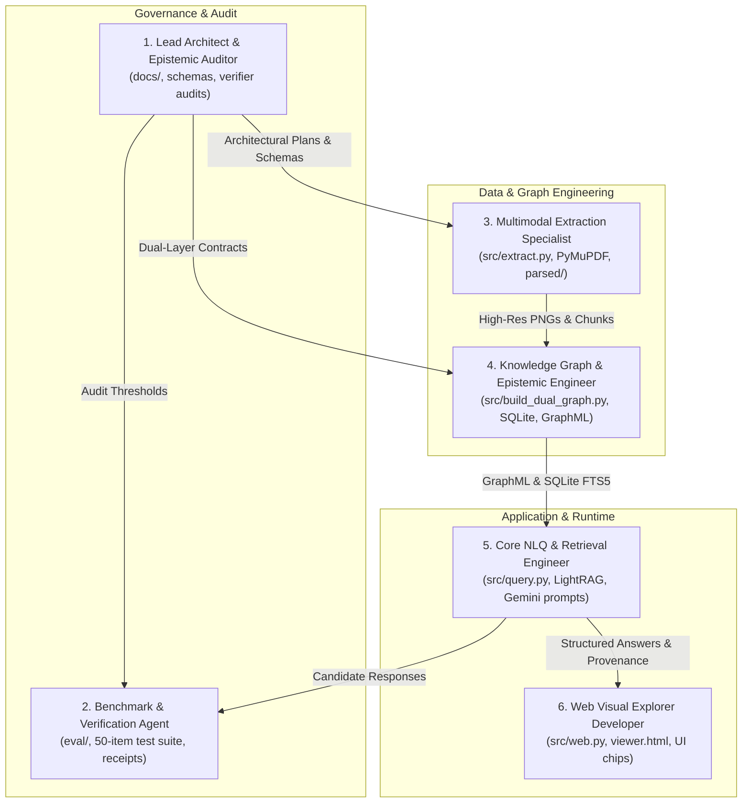

# Multi-Agent System (MAS) Operating Guidelines: AWS A3.0 Prototype

### Publication and running-app evidence boundary (2026-10-16)

Keep the actual guarded API 19/19 and Chrome 8/8 smoke results distinct from
synthetic fixtures and semantic accuracy. The favicon 404 still fails strict
clean-network acceptance; provider-disabled runtime checks do not exercise
generated-answer behavior. Preserve original failed fresh 2/6 and 3/6 results
and the exposed DEVELOPMENT 4/6,489/491 replay, including both conservative
scalar-policy mismatches. Publish implementation, synthetic tests and aggregate
source-safe documentation only; keep licensed sources, private cases/labels/raw
answers, credentials, local machine receipts and generated stores local. This
historical evidence grants no future provider, restart or publication authority.

### Through-range repair evidence boundary (2026-10-16)

Preserve the element-only full-match `through` rule and existing canonical
range guards; do not broaden page grammar or normalize unsupported endpoints.
Compound asset-fault regressions must retain all required source records,
independent diagnostics and healthy subsets without support upgrades. The
first fresh 3/6, 461/491 result remains frozen; the repaired exposed replay is
DEVELOPMENT 4/6, 489/491. Its two remaining scalar-policy failures remain
failures. The original plan allows unassessed or insufficient in these pure
resolver cases; generated-answer rejection is a separate wrapper boundary.
No runtime reload, new cohort or publication authority follows from this repair.

### Claim/evidence resolution boundary (2026-10-16)

Preserve per-element asset failures without dropping unrelated source identity
or claim diagnostics. Direct inspection consumes ordered continuations.
Canonical parent qualifiers and independent sources have distinct binding roles.
Generated source-identity failures return insufficient evidence; rejected links
remain diagnostics, never asserted/supporting facts. Keep fixture acceptance
separate from the unreloaded app, semantic grading and failed frozen workflow gate.

Use the canonical complete-reference parser and per-asset validator. Preserve
raw mentions/qualifiers, canonical identity, explicit per-claim selectors, native
entry/span/hash proof, raw declaration order and validated render order. Keep
optional companions separate from required evidence. Only server-derived
reviewed fact views grant support; client flags, page overlap, available pixels
and graph links do not. Generic extraction remains incomplete and unassessed.
The [implementation receipt](claim_evidence_implementation.md) retains original
failed development scoring and a separately amended navigation protocol. Do not
relabel replayed cases as fresh, state-contract metrics as semantic truth, or
offline UI checks as live browser/API acceptance. No publication or runtime
reload authority is granted by this receipt.

Keep literal citation roles separate from selected-context provenance. Retain
selected navigation annotations and reject them as required selected evidence;
do not rewrite an explicit direct citation as navigation to satisfy a grader.
Preserve the first fresh 2/6 result and frozen strict expectations. Later exposed
replays are DEVELOPMENT, including after the conservative role-selection repair.

### Bounded answer grounding boundary (2026-10-16)

Preserve the pure reviewed-fact composer, complete alternative/sense groups, exact span/hash/source bindings and explicit outcome/origin/assessment contracts. A supported asserted fact is not proof of complete question coverage; leave generated/unassessed scores nullable and do not restore graph-derived truth or unconditional verification labels. Keep frozen original/holdout cases and rubric denominators unchanged. [The current receipt](answer_grounding_implementation.md) preserves the original two omissions and reports their repaired DEVELOPMENT replay separately; reused holdouts cannot count as fresh unseen validation. Keep application scope-policy notes separate from factual claims and native source anchors. Real-browser query/figure flows pass with a retained favicon 404; synthetic tests and a failed clean-network assertion must not be relabeled as complete clean-browser acceptance. Local inference, reloads, browser/API actions, rebuilds and publication require their own applicable owner authorization; this historical receipt grants none.

### Reviewed live terminology boundary (2026-10-15)

The three-headword adapter now reads `storage/terminology_registry.json` without modifying corpus/index/graph files. Keep licensed registry/qrels/prompts/raw answers local and ignored. Preserve complete target groups, conditional senses, explicit anchors and the original-entry/parser-projection distinction. Unrelated inputs must avoid registry I/O and retain exact ranking/score behavior. Invalid relevant evidence returns `TERMINOLOGY_REGISTRY_INVALID`/HTTP 503 before model initialization. Run the guarded suite for synthetic checks; source-backed captures and approved local inference require their own explicit scope. [Runtime results and limits](terminology_live_results.md) document the authorized restart and evaluation; they do not authorize future provider calls, rebuilds or restarts.

### Helper hardening boundaries (2026-10-15)

Keep UI geometry in normalized `[ymin,xmin,ymax,xmax]` lists and centers `[cy,cx]`; reject malformed metadata rather than repairing stored coordinates. Reuse the canonical citation parser and preserve singular retrieval compatibility. Terminology helpers require supplied bounded/reviewed entries and verified sense/process-compatible existing node IDs; their explicit projection seam operates on the supplied in-memory graph only. Do not infer authority to call the full builder, write stores, activate expansion or reload a server. [Implementation evidence](helper_hardening_implementation.md) records checks and remaining boundaries.

### Chunk reader and evaluation protocol (2026-10-15)

Keep the instance-local vector compatibility reader version/source guard; a dependency upgrade requires a reviewed adapter change. Do not convert stores or re-embed to work around reader-format drift without explicit owner authority. Run `tests/test_vector_reader_compat.py` against the installed native package separately from the stubbed manifest runner. [The evaluation protocol](vector_reader_compatibility.md) preserves the frozen gold, all 28 strict targets including coverage misses, and separate retrieval, heuristic and factually ungraded answer evidence. Under the current owner scope, use installed local models only; the historical external gold, commit and push steps below are not authorized by a bug-fix request.

This repository (`kaiello/aws-a30-prototype`) is designed for collaborative, multi-agent AI development and automated verification. Any AI agent, pairing assistant, or automated worker operating in this codebase must adhere strictly to the role definitions, domain boundaries, and operating protocols detailed below.

### Source metadata ownership (2026-10-15)

Use `src/standard_manifest.py` and `config/aws_a30_2020_manifest.json` for source identity, canonical element IDs, printed/viewer page mappings and explicit ordered assets. Do not restore competing editable inventories or infer a source page from a filename. Keep UI chip/category data and image-space bboxes in their existing registries. Preserve typed candidate UI companions and Annex B's conflicting applicability. Cached graph labels/pages are retrieval hints, not source authority. [Implementation receipt](declarative_manifest_implementation.md) records tests and unresolved legacy artifacts. Run `python -B tests/run_manifest_offline.py` for guarded local checks; do not interpret those checks as a live semantic/reading evaluation.

---

## 1. Core Agent Roles & Domain Boundaries



### 1. Lead Architect & Epistemic Auditor
* **Primary Domain**: Architectural specifications in `docs/`, graph ontology schemas, and overall system boundaries.
* **Responsibilities**:
  - Defines and preserves the boundary between the **Domain Ontology Layer** and the **Normative Evidence Layer**.
  - Audits candidate changes to ensure zero degradation of epistemic verifiability.
  - Reviews pull requests and code refactors before merging.
* **Hard Constraints**:
  - Does NOT directly write low-level extraction scripts or UI CSS.
  - Must verify that any schema change has a corresponding migration or projection plan.

### 2. Benchmark & Verification Agent
* **Primary Domain**: Evaluation harness (`eval/test_scorer.py`), gold test suite (`eval/gold_benchmark.json`), and run receipts (`eval/run_receipt_*.json`).
* **Responsibilities**:
  - Executes automated evaluation runs against all 7 modality categories.
  - Enforces strict scoring criteria: claim-to-page citation verification, figure ID validation, and negative control abstention checks.
  - Generates detailed benchmark reports (e.g., `card07_benchmark_report.md`).
* **Hard Constraints**:
  - Must NEVER relax benchmark assertions or alter ground-truth citations to artificially boost pass rates.
  - Benchmark questions must remain frozen and tamper-proof.

### 3. Multimodal Extraction Specialist
* **Primary Domain**: PDF ingestion pipelines (`src/extract.py`, `src/extract_annex_b_remaining_figures.py`, etc.), vector rendering, and the centralized figure catalog (`src/figure_inspectors.py`).
* **Responsibilities**:
  - Extracts 100% of figures at 180 DPI directly from vector `/Form` XObjects.
  - Curates and maintains the **267+ Interactive Callout Chips** with accurate coordinates, labels, and query triggers.
  - Parses structured tables into clean, auditable Markdown and JSONL.
* **Hard Constraints**:
  - Must NEVER downsample or compress images in a way that obscures fine weld symbols or line work.
  - Must strictly preserve printed page numbers versus PDF page offsets.

### 4. Knowledge Graph & Epistemic Engineer
* **Primary Domain**: Dual-layer graph projection (`src/build_dual_graph.py`), GraphML exports (`storage/dual_layer_knowledge_graph.graphml`), and embedded SQLite registry (`storage/dual_layer_registry.db`).
* **Responsibilities**:
  - Builds and maintains the 2,522 ontology concept nodes, 471 evidence nodes, and 5,854 epistemic grounding bridges.
  - Maintains SQLite `FTS5` full-text search indexes (`ontology_fts`) and JSON1 query endpoints.
  - Implements graph traversal algorithms in `src/epistemic_verifier.py`.
* **Hard Constraints**:
  - **Zero Re-Ingestion Guarantee**: Must use deterministic Python projection over existing disk assets. Must NEVER initiate expensive re-parsing of 190 PDF pages or redundant cloud LLM extraction calls.

### 5. Core NLQ & Retrieval Engineer
* **Primary Domain**: Natural language query resolution (`src/query.py`, `src/indexer.py`), LightRAG 1.5.7 integration, and Google Gemini prompt orchestration.
* **Responsibilities**:
  - Orchestrates dual-level graph retrieval (low-level specific entities + high-level thematic relationships).
  - Enforces exact citation syntax in model responses: `[AWS A3.0:2020 Clause 4, p. X]`, `[Annex B, Figure BX]`, `[Annex A, Table AX]`.
  - Attaches epistemic trace metadata and asset file links to the JSON response payload.
* **Hard Constraints**:
  - Must NEVER guess or interpolate facts not supported by retrieved chunks or diagrams.

### 6. Web Visual Explorer Developer
* **Primary Domain**: Web interface (`src/web.py`), standalone viewer (`viewer.html`), and client-side visualization logic.
* **Responsibilities**:
  - Implements the real-time search interface, suggestion chips, and visual directory drawer.
  - Renders the **Dual-Layer Epistemic Provenance Trail** badges (`VERIFIED_GROUNDED`, `TRUTHFUL_ABSTENTION`).
  - Implements smooth SVG/canvas zoom and pan controls with clickable diagram callout chips.
* **Hard Constraints**:
  - Must keep the web application completely offline-capable. Zero external CDN dependencies that fail in air-gapped environments.

---

## 2. Inviolable Operating Protocols

### Protocol A: The Zero Re-Ingestion Rule
All raw text chunks, high-resolution figures, structured tables, and base entity-relationship caches already exist in `parsed/` and `storage/`. 
- **Rule**: Any agent working on graph schema updates, taxonomy refactors, or search optimizations MUST use deterministic Python projections (as established in `src/build_dual_graph.py`).
- **Forbidden**: Running full re-extraction or re-indexing against the cloud LLM without prior approval from the Lead Architect.

### Protocol B: Strict Grounding & Citation Mandate
Every technical answer emitted by any tool or agent must be grounded by an unbroken path from the asserted concept across an epistemic bridge (`[:DEFINED_IN]`, `[:ILLUSTRATED_BY]`, `[:TABULATED_IN]`) to an `:EvidenceNode`.
- Assertions lacking an evidence path must be flagged as `PROVISIONAL_PARTIAL` or rejected.
- Hallucinated standard elements (e.g., citing a non-existent clause or figure) are treated as critical benchmark failures.

### Protocol C: Faithful Abstention Protocol
Welding engineering demands strict adherence to code jurisdiction. When asked questions outside the scope of **AWS A3.0** (such as fabrication acceptance limits in AWS D1.1, base metal chemistry in ASTM, or filler yield strengths in AWS A5.1):
- The agent must **cleanly and explicitly abstain**.
- The abstention must cite why the topic is out of scope and, if known, identify the governing code of jurisdiction.
- The agent must never speculate or synthesize plausible-sounding parameters.

---

## 3. Post-Task Execution Protocol

At the completion of any milestone, card, or substantial refactor, the active agent must execute the following protocol before concluding:

1. **Run the Automated Gold Benchmark**:
   ```pwsh
   python -m eval.test_scorer --report eval/cardXX_benchmark_report.md --receipt eval/run_receipt_cardXX.json
   ```
   Confirm that the pass rate meets or exceeds the 100.0% standard.

2. **Verify Git Working Tree Hygiene**:
   Run `git status` to verify that no temporary scratch files, untracked logs, or stray cache files are left uncommitted. Ensure `.gitignore` properly excludes `__pycache__` and local secrets (`.env`).

3. **Update Project Documentation**:
   If changes affect the graph schema, storage substrates, benchmark scores, or API contracts, immediately update:
   - `docs/architecture.md` (System changes)
   - `docs/goal.md` (Milestone progress)
   - `docs/agents.md` (Role or protocol updates)
   - `README.md` (Quickstart or status changes)

4. **Git Commit & Push**:
   Commit changes using clean, conventional commit messages:
   ```pwsh
   git add docs/ src/ eval/
   git commit -m "docs: add agents, architecture, and goal documentation"
   git push origin main
   ```

## Local security boundary maintenance (2026-10-15)

Keep server-approved provider endpoints, asset containment and browser-origin checks
in the supported query path. Requests must not authorize new model destinations.
Use the isolated checks in [security boundary notes](security_boundary_notes.md)
when testing security changes without model calls. These checks make no gold
answer-quality claim; external-model benchmark runs, commits and pushes remain
subject to the active owner's authorization and constraints.
