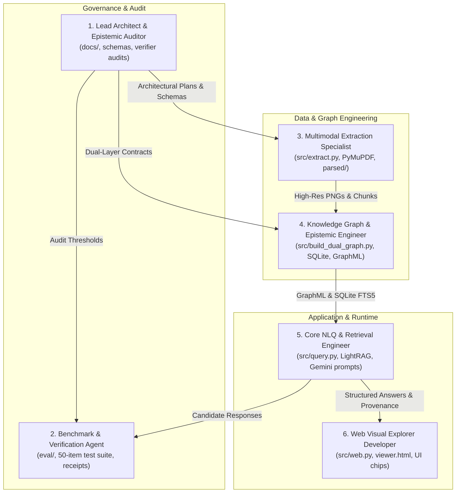

# Multi-Agent System (MAS) Operating Guidelines: AWS A3.0 Prototype

**Git closeout record (2026-10-23): REVIEWED FEATURE; PR #11.**
The reviewed implementation is published in [PR #11](https://github.com/kaiello/aws-a30-prototype/pull/11).
Independent code/publication reviews approved and all 270 local checks passed.
The PR records the live publication/merge state; the separate closeout report
records exact local main/origin/GitHub synchronization and post-merge checks.
Preserve the bounded dictionary-assisted A1 scope, private artifacts and
unrelated work. The 003 result below remains the historical pre-publication
record; this closeout does not start the next slice.

**Historical pre-publication raster integration 003 (2026-10-23): BOUNDED_A1_INTEGRATION_READY_FOR_OWNER_REVIEW.**
Local/uncommitted `feat/a1-source-aware-ingest`, based on unchanged main
`039087d06d55860bda19c1c8ea3b55b678cb8e4a`; no commit/push/merge is authorized.
The actual retained-raster pipeline executed the existing 51 questions once:
**51 content PASS in auto and 51 content PASS in candidate-evidence view**,
with **51 native content PASS** unchanged. Auto answers match native after only
removing the explicit raster-provenance prefix; evidence answers add qualified
parent-layout details in 14 cases without changing facts. All 51 are exposed
regressions, not unseen/general QA or cross-figure acceptance. Runtime coverage
is separately 44 complete/2 partial/5 unanswered because ambiguity and source
limits remain explicit; this does not mean 51 complete factual answers.
The known native `HO003-06` shielding-gas reason-label caveat is preserved.
003 reused unchanged 002 OCR/model artifacts with **zero new OCR/model calls**.
Typed per-predicate automatic pixel/OCR checks admitted 287 assertions (189
literal facts, 90 row enclosures and eight physical connectors). The 29
indentation assertions remain candidate; no `IS_A` was accepted. All 226 raw
observations/proofs remain candidate. The 586 support joins include source-local
glyph corroboration for four low-confidence/corrected codes; dictionary matching
alone grants no admission. All eight measured connector stroke regions and box
contacts were independently checked against pixels; these are undirected
physical links, with no arrow direction or semantic subtype inferred.
Scoped completeness accounts for observed rows/pixel bands, measured borders,
fresh rectangle inventory, orphan ink/words and required projection edges.
Applicable scopes passed without native reference totals or expected QA answers.
The KG recomputes retained seed/pixels/graph and checks file hashes before
admission. These are automatic source checks, not human approval, mathematical
proof or authority from a receipt flag/hash alone.
The full 270 A1 software checks passed in 7.67 s; independent code/source/proof
and actual-answer review found no material blocker. Software counts support the
answer/evidence results, not substitute for them. Frozen runtime/source files
and all 72 prior artifacts remain unchanged; native/001/002 inputs, gold,
outputs and private source evidence are preserved. No post-output repair/replay,
extra benchmark/framework, tuning loop or automatic model retry occurred.
Ready for owner review of this bounded A1 integration only. AWS backend one
figure at a time; GR optional, Navy Weld/Utopia deferred, no UI/new models/services
or automatic Git publication. Final report delivered to Library, version 0
(`libfile_24260fa7fb7c8191bfd0d5fcce255cbf`).

**Historical dictionary-assisted ingest 002 (2026-10-23): NOT_READY_FOR_ACCEPTED_RASTER_QA; HOLD UNMERGED.**
Local/uncommitted `feat/a1-source-aware-ingest`, based on unchanged main
`039087d06d55860bda19c1c8ea3b55b678cb8e4a`; no commit/push/merge is authorized.
This bounded pass used the source-backed dictionary's 99 labels and 97 printed
codes to normalize observed OCR, preserving raw text, provenance and uncertainty.
It supplied no reference regions, boxes, relationships, unseen entities, gold
answers or accepted status. This is **dictionary-assisted ingestion**, unlike
independent attempt 001 retained below. Source comparison found all 99 nodes
(90 processes/eight categories/root) and 127 physical relations (90 enclosures,
29 indentation links/eight root connectors), with no missing/extra identities or
endpoint relations. Two connectors came from CV and six from VLM. The six VLM
relationship regions identify endpoint boxes rather than connecting strokes;
this is an unresolved evidence-localization gap, not fully verified anchors.
The only local `qwen3-vl:8b-instruct` / Ollama 0.40.4 call used six unresolved
tasks/seven referenced nodes plus pixels, naturally completing in 42.656 s with
8980 input/645 output tokens. Actual context was 32768, `num_predict=-1`,
temperature 0, seed 42; metadata supports 262144, not allocated for this run.
One end-to-end pass executed the existing 51 exposed questions in both raster
views. Unchanged content rubrics grade candidate-evidence answers **32 PASS /
2 PARTIAL / 17 FAIL**, and mixed auto-policy answers **16 PASS / 4 PARTIAL /
31 FAIL**. Auto includes evidence operations; these are not accepted-KG accuracy
scores. All 226 record proofs and 316 assertions remain candidate, with zero
accepted assertions and 570 valid support joins. Valid joins do not establish
correct stroke localization or answer completeness. `complete_chart=False`
blocks exhaustive lists even in evidence view; auto knowledge operations abstain
where identities/relations have not been admitted. No candidate was promoted to
raise scores. Native answers remain exact: **51 content PASS**, coverage
44 complete/2 partial/5 unanswered and the existing reason-label caveat.
The 254 software checks passed in 7.27 s; answer quality and evidence limitations
above determine readiness. Original inputs/gold, native/001 results, frozen code
and private source artifacts are preserved; no post-output repair/replay occurred.
Recommended next decision: address completeness/admission handling and connector
stroke anchors in a bounded follow-up. No further model call, automatic repair
cycle or new benchmark/framework starts from this result. AWS/A1 backend first,
one figure; GR optional, Navy Weld/Utopia deferred, no UI/new models/services.
Report `Figure_A1_Dictionary_Assisted_Ingest_002_Report.md` is delivered to
Library, version 0 (`libfile_508fed85d1d48191a9158ead2c695363`).

**Historical independent source-aware ingest 001 (2026-10-22):
NOT_READY_FOR_RASTER_QA; HOLD UNMERGED.** Local/uncommitted
`feat/a1-source-aware-ingest`, unchanged main
`039087d06d55860bda19c1c8ea3b55b678cb8e4a`; no publication is authorized.
The reviewed source-aware implementation passed 231 software checks in 6.56 s.
Native PDF text/vector ingest and one canonical 51-question pass preserve exact
007 answers: 51 content PASS, native coverage 44/2/5 with the existing reason-label
caveat, reader model NONE/zero calls. These are exposed regression controls.
The image-only PDF has zero native characters/vectors; its 300-DPI PNG is
2540 x 3287. One Tesseract 5.5 / OpenCV 4.12 extraction produced 410 words and
eight rectangles, but no resolved root/usable graph: original setup used zero
model calls and ran no raster QA. A separately recorded, reviewed generic
cached-observation continuation reused that OCR without threshold/gold changes.
Its only local vision call used `qwen3-vl:8b-instruct` / Ollama 0.40.4, context
32768, `num_predict=-1`, temperature 0, seed 42. After 315.156 s it ended
`done_reason=length`: input 21799 + output 10969 filled the configured window
(model metadata declares 262144; this is not that native ceiling). Incomplete
JSON was labeled `invalid_output` by the wrapper; context exhaustion is not an
answer-quality grade. No usable raster graph or accepted proposal resulted.
All 51 raster questions are **NOT_RUN**, semantic grades null, not 51 failures.
Source inspection found 73/90 correct name/code pairs, 7/8 true headings plus
one false root-fragment category, and 99 correct physical edges/no extras;
17 enclosures, 3 indentation links and 8 connectors are missing. Root words
exist in OCR but were misassigned and excluded from allowed bootstrap IDs, so
the current contract cannot express the correct root; larger context alone
cannot fix it. Partial model output also contains invalid IDs/link types;
these are diagnostics, not a complete model grade or salvageable QA result.
The main gaps are row/layout assignment and the input/output contract, not
established generic OCR/model inability. No post-model repair/retry occurred.
Native records and candidate-binding paths retain method/version/anchors/provenance/
uncertainty; the incomplete actual raster run remains raw observations/model
diagnostics, with no raster KG store created.
Raster extraction receives pixels/identity metadata, never reused native facts.
OCR/VLM observations remain candidates, not automatic accepted-KG admissions.
Further compact unresolved-only vision/contract/layout work needs the next bounded
decision. AWS/A1 one figure first; Navy Weld/Utopia deferred, GR optional; no UI,
new framework/install/cloud or automatic extra experiments. Report `Figure_A1_Source_Aware_Ingest_001_Report.md` is delivered to Library, version 0 (`libfile_d8ad457a723c8191a513ea866d462d33`).

## Historical validation 007 and PR #10 closeout (2026-10-22)

PR #10 merged at `039087d06d55860bda19c1c8ea3b55b678cb8e4a`; clean local/main
and online synchronization (0/0) were verified before this branch was prepared.
The following validation record predates that completed publication.

**Historical pre-publication validation 007 (2026-10-22):** Make the AWS
backend correct one bounded slice at a time; Navy Weld integration and Utopia
evaluation remain deferred. Targeted repair is complete in harness 1.7.1 /
planner 1.6.1 / lexicon 1.0: all 179 A1 software checks passed and independent
code/publication review approved. The forced-knowledge child-list/codes request
now safely abstains and legacy `parent_groups` compatibility is restored.
Four canonical CLI calls executed the same 51 questions once; all verbatim
answers match 005, unchanged gold gives 51 content PASS, and capture is unchanged.
All 51 are exposed development regressions, not unseen/general QA acceptance.
Native coverage remains 44 complete / 2 partial / 5 unanswered, with the documented
shielding-gas reason-label limitation; model/provider NONE, zero inference calls.
Source, dictionary, admission and prior results are unchanged. Commit/push, draft
PR, merge and local/online sync are authorized next; Git completion is not yet
claimed. Keep source/schema/ingest changes outside this closeout. No next slice
starts automatically.

## Historical pre-publication A1 completeness repair 005 result (2026-10-22)

**BOUNDED_EXPOSED_REGRESSION_PASS.** Local/uncommitted branch
`feat/a1-nlq-planning-completeness`, base/main
`7e6e80450dbdbc5ad8910462c8707b383eeae6ff`; ready for the owner's Git review/
closeout decision with the labeling limitation below; no publication is currently
authorized. Frozen harness 1.7.0 /
planner 1.6.0 / lexicon 1.0 correct generic follow-up/coverage binding and false
clarification/unsupported markers; source facts, the 196-entry dictionary,
aliases and evidence-to-knowledge admission remain unchanged.
One frozen execution of all 51 questions used four canonical CLI calls against
actual A1 source, model/provider NONE and zero inference/external calls.
Independent content/capture inspection grades original 31 **31 PASS**, exposed
eight **8 PASS**, exposed six **6 PASS**, and prior fresh six **6 PASS**:
**51 PASS / 0 PARTIAL / 0 FAIL**, versus 004's 50 PASS / 1 PARTIAL. Every actual
requested subpart was captured in this set. HO003-06 now includes its requested
designation/group follow-up alongside a legitimate source-limit abstention;
the false `state`, possessive-`s` and identification-marker warnings are gone.
HO001-07 keeps both requested lookups explicitly ambiguous with source choices.
The named spurious markers are gone; 46 answer strings are unchanged and five
changed. Runtime coverage remains a separate measure: 44 complete,
2 partial, 5 unanswered, reflecting three true ambiguity questions and four
source-limit questions (two composite partials), not failed content grades.
Native metadata is not perfect: HO003-06's legitimately unavailable shielding-gas
part is still labeled `planning_unsupported` /
`requested_information_field_not_supported`, rather than source-limit. Its
abstention and SMAW/AW follow-up answer are correct; the reason classification
remains a documented limitation, not an automatic new repair/replay.
All 51 are exposed development regressions, not unseen/general NLQ acceptance.
Twenty-four focused synthetic checks passed in 2.21 s; the known non-failing
pyreadline shutdown warning remains. Independent code review approved the freeze.
The original questions/rubrics/gold and prior raw artifacts remain immutable,
gold stayed outside execution, and frozen code/source identities are unchanged.
Internal trace audit checked 81 operations (39 knowledge / 42 evidence), 381
accepted-assertion references (143 unique), all SQL ACCEPTED, and 844 support
observations with full source scope/closure. All 71 candidate occurrences stayed
evidence-only; no accepted `IS_A`. Ten evidence paths contain 26 hops / 11 reverse
steps; no accepted-KG paths were returned in this auto run. Zero internal join,
source or structural issues were found and source/DB hashes stayed unchanged.
Twelve internal child-target bindings and all seven ambiguity parts were checked;
actual natural-language capture/content/support were independently graded above.
The full 51-answer report `Figure_A1_NLQ_Repair_005_Report.md` is finalized in
the parent task workspace and delivered to Library (version 0). Preserve 004/003
history below. Backend A1 only, GR optional; no UI, new models/NER/framework, external
inference, automatic experiments/repair loops, Git publication or deletion work.

## Historical A1 composition repair 004 result (2026-10-22)

**BOUNDED_REPAIR_EVALUATED_WITH_LANGUAGE_GAPS.** Local/uncommitted branch
`feat/a1-nlq-planning-completeness`, base/main
`7e6e80450dbdbc5ad8910462c8707b383eeae6ff`; no publication is authorized.
Frozen harness 1.6.0 / planner 1.5.0 / lexicon 1.0 repair generic child targets,
follow-ups, path direction, grouped row partitioning and coverage accounting.
Source facts, aliases and the evidence-to-knowledge admission boundary remain
unchanged; recognizing a name does not promote candidate layout to knowledge.
Four canonical CLI calls executed all 51 unchanged questions once against actual
A1 source, model/provider NONE and zero inference/external calls. Independent
content grades: original 31 **31 PASS**; exposed eight **8 PASS**; exposed six
**6 PASS**; prior fresh six **5 PASS / 1 PARTIAL**. Total **50 PASS / 1 PARTIAL /
0 FAIL**, versus 003's 45 PASS / 5 PARTIAL / 1 FAIL. All 51 are now exposed
development regressions; this is not fresh generalization or general QA acceptance.
Runtime coverage is complete for 43/51 versus 30/51 previously; runtime status is
not a semantic grade. HO003-06 still omits the requested SMAW designation/AW-group
follow-up and emits a false possessive-`s` warning. HO003-04 has full content but
a false `state`-to-SSW clarification; HO001-07 returns useful ambiguity choices
while retaining an unsupported identification clause. Hold readiness/publication
for the remaining language and coverage limits; do not automatically repair/replay.
Internal trace audit matched 79 operations (37 knowledge / 42 evidence) and 369
accepted-assertion references (140 unique) to SQLite; 71 candidate occurrences
stayed evidence-only. Ten evidence paths contain 26 hops / 11 reverse steps;
the auto run returned no accepted-KG paths. No internal proof, join, source-scope,
accepted-status, candidate-promotion or path-direction issue was found; source/DB
hashes stayed unchanged. Child-target checks validate executed plans, not whether
every requested natural-language part was captured.
Focused synthetic checks passed nine coverage cases in 1.60 s before two review
fixes, then 21 combined cases in 3.36 s before the final narrow delta; the single
affected list-scope check passed in 0.63 s after that delta. No full post-delta
21-case run is claimed. The actual CLI content grades above are separate evidence.
Preserve the 003 snapshot/raw/report baseline in
`storage/evidence_v2/a1_nlq_repair_baseline_004` and its historical record below.
Gold stayed outside execution and all earlier results remain immutable.
The full-answer report `Figure_A1_NLQ_Repair_004_Report.md` is finalized in the
parent task workspace; Library delivered (version 0). Backend A1 only; no UI, NER,
new models/framework, external inference, Git publication or deletion work.

## Historical A1 language-planning result 003 (2026-10-22)

**BOUNDED_SLICE_IMPLEMENTED_WITH_NLQ_GAPS.** Local/uncommitted branch
`feat/a1-nlq-planning-completeness`, base
`7e6e80450dbdbc5ad8910462c8707b383eeae6ff`; no commit, push or merge is authorized.
Harness 1.5.0 / planner 1.4.0 / lexicon 1.0 implement source-backed identity
linking, compositional intent planning, typed evidence-versus-knowledge operations
and per-part answer/unsupported/ambiguity receipts. The dictionary has 196 entries:
99 literal labels, 7 heading codes and 90 process codes; actual verified aliases
remain zero. Normalization is matching, not a source alias. Identity recognition
never admits a relationship; candidate indentation retains its evidence-only
qualification and knowledge still requires accepted assertions with source proof.
The frozen canonical backend ran each of 51 questions once, model/provider NONE,
zero model/external inference calls. Independent content grades, separate from
runtime statuses: original 31 **31 PASS**; exposed eight **6 PASS / 1 PARTIAL /
1 FAIL**; exposed six **4 PASS / 2 PARTIAL / 0 FAIL**; independently frozen fresh
six **4 PASS / 2 PARTIAL / 0 FAIL**. The first 45 are development regressions;
the last six were untuned for this pass and are now exposed, not general acceptance.
Trace audit covered 75 operations (36 knowledge / 39 evidence), 226 record
bindings and 336 accepted-assertion references (119 unique), with no join,
identity or candidate-authority issue. This auto run returned nine evidence-layer
paths / 23 hops and no accepted-KG `knowledge_paths`; the earlier explicit KG
integration remains a separate historical check, not a new result here.
Focused checks initially passed 12 and failed 2; direction-separator and scope
contract defects were fixed, then the two affected checks passed. Independent
review approved the freeze; no full post-fix suite is claimed. Code/source/runtime
identities stayed unchanged after freeze. Original questions/gold/raw results remain
immutable and grading stayed outside execution.
Remaining gaps include spurious unsupported tails/over-abstention in runtime
coverage, missing child sets or wrong parent targets, omitted follow-ups, path
direction and unsupported row partitioning. Coverage receipts are not proof that
every natural-language intent was understood or answered. **Stop after this pass;
no automatic repair/replay.** Backend A1 only, no UI, models, NER or new framework;
GR remains optional/unbenchmarked. General natural-language QA is not solved.
Final report: `Figure_A1_NLQ_Completeness_003_Report.md` in the parent workspace,
including all 51 exact backend answers. Library delivered (version 0).
Earlier records below are history.

## Historical bounded foundation publication closeout (2026-10-22)

The owner authorized publication after a focused existing-interface check and
independent review. The canonical backend CLI/API passed five boundary probes:
separate evidence observations and accepted assertions, a two-hop knowledge path
with complete source proof, candidate exclusion and missing-authority abstention.
No exposed MCP tool provides this route; the CLI/API is the verified interface.
The 13 focused admission/route/wrapper checks passed in 1.89 s; independent review
found no material blockers. Model/provider NONE, zero inference calls.
The subsequent PR review found a first-initialization recovery defect. Atomic
publication after staging validation fixes it; one regression reproduced the
failure and eight store checks passed in 1.39 s. Windows was exercised; the
non-overwriting POSIX publication branch received static review only.
This closes the bounded A1 epistemic foundation, not general natural-language QA.
The original 31 PASS and exposed/fresh failures below remain unchanged. Source,
gold, full raw evidence and runtime databases stay local and outside publication.
Prepare language planning/completeness on a separate branch; no new implementation
or automatic QA/model campaign is authorized by this closeout.

### Final bounded A1 epistemic boundary and stop (2026-10-22)

**BOUNDED_A1_EPISTEMIC_BOUNDARY_IMPLEMENTED_WITH_NLQ_GAPS.** Harness 1.4.0 /
planner 1.3.0 implements the A1 SQL/assertion/query boundary; it is not a full
general KG or general NLQ acceptance. Preserve prior registry/native graph,
source evidence, frozen questions/gold/raw results and first-slice history below.
The versioned working SQLite copy has five namespaced tables, 226 observations,
99 concepts and 316 assertions: 287 ACCEPTED/29 CANDIDATE/0 DISPUTED. Accept only
source-bound scoped literal facts under recomputed rules/proof closure, never
metadata hashes as approval or invented human semantic review. No accepted `IS_A`;
candidate indentation remains candidate. Direct evidence remains accessible.
Actual auto/explicit knowledge/evidence routes use persisted assertions; unsupported
knowledge hierarchy requests must remain insufficient without admitted authority.
Original 31 PASS; exposed old 8 2 PASS/3 PARTIAL/3 FAIL are DEVELOPMENT, while new
untuned fresh 6 are 2 PASS/2 PARTIAL/2 FAIL. Four CLI executions ran once each,
46 questions including one declared ungraded knowledge integration. Model NONE/0 calls.
Three material review issues were fixed before freeze, then targeted checks and
independent review approved the freeze; do not claim a full post-fix suite.
The structural audit matched persisted accepted assertions/full proof closure,
with zero issues; semantic/request-completeness gaps remain. Backend A1 only,
GR optional, no UI or models; no corpus visual recall. **No automatic repair/replay.**
Freeze: `storage/evidence_v2/a1_epistemic_freeze_002.json`; report finalized:
`Figure_A1_Epistemic_Layers_002_Report.md` in parent workspace, Library delivered (version 0).

Canonical integration is the A1 CLI `--graph-qa` route (auto or explicit
`--query-layer evidence|knowledge`). The general `query.async_query` v1/v2
model-reader pipeline remains unchanged. Pure `answer_graph` without a store is
an observation compatibility helper, not an accepted-KG path; no universal
production integration is claimed.

### Historical first-slice bounded A1 result and stop (2026-10-22)

**DONE_WITH_FRESH_QA_GAPS; not general natural-language acceptance.** Base remains
`1b4e04e5017acf018b48482cb784486d18544309`; backend A1 only, no UI, models or Git publication.
Canonical source authentication, stable node/edge evidence bindings, parents,
complete direct/recursive expansion, ordered common-ancestor operations and atomic
claim/evidence traces are implemented. Declared caller graphs cannot authenticate
source. Preserve native graph `6476c898439108dbeaf7b92f0be3946a3e0d3538d5c15afb860d1cf0e02cc4d2`
(99 nodes/127 edges), all 226 bindings, and candidate indentation's unreviewed status.
Software checks passed 42/42 in 0.91 s and 99/99 in 1.09 s; independent review
found no material findings or required fixes. Model/provider NONE, zero calls.
Original 31 actual CLI cases: 31 PASS; fresh held-out eight: 2 PASS / 3 PARTIAL /
3 FAIL. The original set already passed; 30 strings are unchanged. Existing ordered
multihop cases are source-validated, but new sibling/common-ancestor behavior is
synthetic-only, without fresh end-to-end QA coverage. Most remaining gaps concern
planning/composition despite evidence being present; no source/OCR defect established.
Keep GR optional/unbenchmarked, the harness vendor-neutral, and all frozen
questions/gold/raw outputs unchanged. **Stop: no automatic repair, replay or model run.**
See the [local report](../../Figure_A1_Faithful_Relationships_Multihop_001_Report.md),
[freeze receipt](../storage/evidence_v2/faithful_a1_freeze_001.json) and private grades;
The report is delivered in Library (version 0); local evidence remains retained. No corpus visual-retrieval claim follows from this image.


### Current local A1 pass 004 result and stop (2026-10-21)

The owner authorized one focused A1 backend repair on
`fix/a1-query-completeness`, base main `799112f`. Harness
`a1-graph-qa-1.2.0` / planner `1.2.0` independently grades **QA001 15 PASS** and
**QA002 16 PASS**, with no failures, partials or regressions. Both sets ran once,
31 questions total; model/provider NONE, zero calls. Focused checks passed
33/33 in 0.77 s; no full suite. Q16 correctly retains `insufficient_evidence`
while explaining absent operating information without inventing values.

The existing [routing](../.agents/skills/evidence-graph-routing/SKILL.md) and
[QA](../.agents/skills/evidence-graph-qa/SKILL.md) skills guided existing code and
remain unchanged. No skill infrastructure was added. This is DEVELOPMENT on
exposed questions with bounded grammar; candidate indentation is not reviewed
semantic subtype. Source graph/database, v1 default and all earlier raw runs
and graders are unchanged; gold stayed outside execution. See the
[private report](../storage/evidence_v2/a1_qa_repair_004/report.md).

**Stop further repair/replay work.** The owner subsequently authorized commit,
push, PR merge and local/online synchronization for this completed pass (2026-10-21).
Preserve the recorded results and source qualifications. This closeout adds no
UI, other-figure, model or database work. Earlier pass 003 approval remains historical.

### Historical one-time publication authorization, pass 003 (2026-10-21)

The owner authorized committing and pushing the prior v2 work, merging it
into main, then pulling and verifying local/remote synchronization. This replaces
the historical local-only Git restrictions below for this publication. Preserve
v1 defaults, the v1.0 baseline, private source/gold/raw runs and all documented
QA failures. No further repair loop, question/model run, UI or other-figure work
is included. The bounded repair result below remains the evaluation record;
publication does not promote the prototype to semantic or production acceptance.

### Historical bounded A1 pass 003 result and stop (2026-10-21)

Independent grading is complete for the one harness `1.1.0` repair pass:
QA001 is **15 PASS / 0 FAIL / 0 PARTIAL**; QA002 is **9 PASS / 4 FAIL /
3 PARTIAL**. Preserve the original QA001 pre-capability 0/15 baseline and 1.0
DEVELOPMENT 15/15. QA002's 1.0 baseline remains 0 PASS / 15 FAIL / 1 PARTIAL;
1.1's 9/4/3 is DEVELOPMENT on the same exposed set, not unseen or model validation.
Both sets ran exactly once (15 + 16 questions), model/provider NONE, zero calls.
Focused 33/33 checks passed in 0.56 s; no full-suite run is claimed.

QA001 retains 90/90 correct supported source pairs, all 29 candidate-child
qualifications, and 7/7 lookup facts including two bounded negatives. QA002
multi-name resolution has 13/13 mentions and 23/23 mappings correct, but layout
questions 06–12 grade 4 PASS / 1 PARTIAL / 2 FAIL. Source-limit questions 13–16
grade 0 PASS / 2 PARTIAL / 2 FAIL, meeting 3/11 criteria. QA002 PASS: 01–08, 11;
PARTIAL: 09, 14, 16; FAIL: 10, 12, 13, 15. See the
[private report](../storage/evidence_v2/a1_qa_repair_003/report.md).

Remaining gaps: Q09 omits the broader-category subtask; Q10 rejects residual
wording despite resolving three entities; Q12 retains the comparison scope gate;
Q13 mistakes A1 context for a missing selector; Q14 correctly avoids an
unsupported semantic assertion but omits positive enclosure families; Q15's
generic “Does” parse blocks the epistemic request; Q16 states the correct limit
but omits concrete missing fields. **Stop: no further repair or replay.**

Source graph 99 nodes / 127 edges and SHA-256
`6476c898439108dbeaf7b92f0be3946a3e0d3538d5c15afb860d1cf0e02cc4d2`
are unchanged, as are all 168 prior receipt files and six protected sources.
Keep private gold/raw outputs unchanged and grading outside execution. Candidate
layout does not become reviewed semantics; runtime semantic validation remains false.

[evidence-graph-routing](../.agents/skills/evidence-graph-routing/SKILL.md) and
[evidence-graph-qa](../.agents/skills/evidence-graph-qa/SKILL.md) are thin project
skills, each only `SKILL.md` and `agents/openai.yaml`, invoking existing core/CLI
code. No wrapper/framework or automatic backend skill loading is added. A1 is
still the only source adapter. No further checks/infrastructure, image/model run,
UI/cloud, database/global setting or Git publication is included.

### Historical final bounded A1 graph-QA result and stop (2026-10-21)

Independent grading is complete for the owner's 15 Figure A1 questions:
**15/15 PASS, 0 FAIL, 0 UNASSESSED**. The first eight actual answer strings and
returned rows contain **90/90 source pairs correctly retrieved, correct and
supported**, with zero missing/extra pairs, duplicates, designation mismatches
or source-binding errors. All 29 indented children retain their candidate
qualification. The other seven facts are **7/7 correct and supported**. The two
negative verdicts were checked against the complete original chart and positive
membership elsewhere in it, not inferred from absence in a retrieved subset.

This is the first generic graph-QA DEVELOPMENT result on these 15 exposed
questions, not unseen validation or an LLM benchmark. The original baseline is
still **0/15**, all `V2_READER_REQUIRED` without answers. Model/provider for the
new deterministic execution is NONE, with zero LLM calls. Runtime
`semantic_validation: false` remains unchanged: independent PASS grades do not
promote candidate graph edges or relabel runtime evidence as semantically verified.

No source-graph update occurred. Its 99 nodes / 127 edges retain full SHA-256
`6476c898439108dbeaf7b92f0be3946a3e0d3538d5c15afb860d1cf0e02cc4d2`.
Protected source, database and indices remain unchanged. The capability is the
explicit `src/evidence_a1_cli.py --graph-qa` path (`a1-graph-qa-1.0`); default
packet mode, v1 and ordinary v2/extractive behavior remain unchanged.

**Stop after this bounded set.** Run no other image, model, comparison or replay
automatically. Keep the single-A1/backend-only scope, private grading metadata
and raw reports in ignored storage, and no UI/cloud/commit/push/merge. The
[final source-safe QA receipt](evidence_v2_a1_qa_001.md) owns the grading record;
earlier pending sections below are historical checkpoints.

### Historical A1 execution checkpoint before independent grading (2026-10-21)

One actual execution of the generic opt-in graph QA completed for the owner's
15 A1 questions: **15 `graph_answer` outputs**, model/provider **NONE**, and
**zero LLM calls**. Independent grading is PENDING. Do not call this “15 passes”
or infer answer correctness, completeness or source support from those output
states. The 160 targeted synthetic checks passed in 2.01 s; they are software
regression evidence, not semantic grading.

Measured wall time was 374.355 ms. Engine total was 120.446 ms, comprising
source projection 89.930 ms, image validation 8.503 ms and graph QA 22.013 ms.
These describe this one bounded local execution, not a production latency SLA.
See the [source-safe first QA receipt](evidence_v2_a1_qa_001.md) for outcomes and
the later independent grading record; full raw answers/reports stay ignored.

The baseline predates the QA code addition; the source graph is unchanged.
Its frozen **99 nodes / 127 edges** and full SHA-256 match exactly before/after.
Protected source, database and indices are unchanged. Only the generic QA code
and explicit CLI flag were added after the baseline; no graph semantic repair
or source-graph update occurred. Preserve the original baseline's 15
`V2_READER_REQUIRED` results rather than overwriting them with development output.

`src/evidence_a1_cli.py --graph-qa` explicitly opts into the reusable operations
in `src/evidence_a1_graph_qa.py`, version `a1-graph-qa-1.0`. Default packet mode
and v1 are unchanged. The ordinary v2/extractive path still returns
`V2_READER_REQUIRED` for these graph questions; this separate opt-in is not
proof that the ordinary reader path has acquired semantic reasoning capability.

Keep owner IDs `A1-CQ-001` through `A1-CQ-015` and grading-only trailing “No”
metadata isolated from prompts/graph/answer logic. Stay on the single A1 image,
backend only: no UI, cloud, other figures, commit, push or merge. No DeepSeek or
local-model trial was consumed by this deterministic graph-QA execution.

### Historical first Figure A1 QA execution authorization (2026-10-21)

The owner has provided 15 Figure A1 competency questions, execution IDs
`A1-CQ-001` through `A1-CQ-015`, and authorized a bounded first QA/harness run.
The prior empty-dataset/setup-only stop below is historical. Work remains on the
single Figure A1 image, backend only; no UI, cloud calls, other figures,
commit, push or merge is in scope.

The baseline is frozen at ignored `storage/evidence_v2/a1_qa_run_001`, captured
before the QA code addition; the source graph remained unchanged. All 15 actual v2 queries returned
`V2_READER_REQUIRED` and no answers. The list requests 1–8 exposed only the root
and eight category nodes, with zero process rows. No LLM call occurred. Preserve
that baseline and its exact outputs; do not recalculate it after implementation
or relabel later development results as baseline evidence.

After that baseline, generic deterministic graph-QA capabilities are authorized.
Implement reusable graph selection/traversal and answer composition, with no
hardcoded answers keyed to the 15 questions and no graph semantic repairs made
to satisfy their expectations. Keep the first implemented QA trace separately
labeled DEVELOPMENT. Await actual case/result metrics before claiming any pass,
coverage or supported-answer improvement.

The final two questions' trailing “No” values are private grading metadata only.
Keep them outside execution prompts, retrieval hints, graph updates and answer
logic. Full raw traces and answers/reports stay in ignored storage. The
[source-safe first QA summary](evidence_v2_a1_qa_001.md) records aggregate evidence
without publishing licensed source or private grading data.

Where deterministic graph answers suffice, record model/provider as NONE and
zero LLM calls. This is graph-QA evaluation, not an LLM/model comparison. Earlier
DeepSeek/local-model allowances do not authorize a cloud run or other image in
this A1 task. Preserve original semantic failures and frozen rubrics; no prior
score is upgraded by a new development trace.

### Historical setup-only stop before owner questions (2026-10-21)

The latest owner instruction is **set everything up; the owner will provide the
competency questions**. Stop further competency-question generation, answer
accuracy grading, model comparisons and inference evaluation. All DeepSeek and
local inference evaluations are stopped. None of the newly approved five
DeepSeek cases or the single `qwen2.5vl:7b` trial started; do not consume those
allowances or treat earlier permission as an instruction to resume them.

Prepare Figure A1 only: canonical single-image/source-edition identity,
source-bound labels and designations, qualified graph hierarchy, manifest and
read-only database bindings, actual graph-traversal retrieval, complete evidence
packet delivery and usable v2 CLI/harness input for the owner's future questions.
Keep existing SQLite/graph stores unchanged. The selected object remains Figure
A1 — Master Chart of Welding and Joining Processes,
`parsed/figures/Figure_A1_p88.png`, PDF index 87 / viewer 88 / printed 75.
Table A1, A2, B6 and other images remain outside this setup unit.

Run structural checks only: IDs, joins, graph paths, editions/fingerprints, image
bindings, required evidence closure and future-input validation. These checks
must not be reported as semantic answer accuracy. The competency-question dataset
is **EMPTY — owner pending**. The agent-authored private A1 rubric is DEFERRED;
it is not an accepted owner competency-question set and must not drive a run.

Stop at `READY_FOR_OWNER_COMPETENCY_QUESTIONS` only if the setup is usable and
the structural checks support that state; otherwise report the exact setup
blocker. Do not advance automatically to A2/B6 or invent replacement questions.
The [A1 setup receipt](evidence_v2_a1_setup.md) owns readiness evidence and
remaining blockers. No UI work, new database/graph framework, commit, push or
merge is authorized. Earlier evaluation plans/results below are historical;
preserve their original failures and frozen rubrics without running them now.

### Historical resolved Figure A1 evaluation scope (2026-10-21)

Context and source inspection now identify **Figure A1 — Master Chart of Welding
and Joining Processes** as the current object. Its sole image is
`parsed/figures/Figure_A1_p88.png`: PDF index 87, viewer page 88, printed page 75.
Table A1 is a separate two-page table on printed pages 69–70 and is not included.
The earlier identity-pending section below is a historical checkpoint.

The source auditor confirmed eight category boxes. The legacy merged candidate
`annex_a_figures_a1_a2_a3_anatomy` has incorrect AB/CAB expansions; do not reuse
those expansions as source facts or let the merged A1/A2/A3 candidate override
this single-figure identity. A new versioned Figure A1 source projection is under
development. Keep existing SQLite and graph stores unchanged; their old candidate
records are diagnostic inputs, not approved truth to copy or silently repair.

Measure whether the complete correct single-A1 graph evidence and the exact
current image pixels enter the reader, then independently assess answer
correctness and source support. Keep the six-layer failure trace. No B6, Table A1,
other images, UI work or new database/graph framework belongs to this unit. Do not
automatically advance while its supported-answer gate remains unresolved; record
a supported pass or exact blocker before considering a next image.

A DeepSeek baseline generation for this new A1 source is NOT authorized by the
earlier five-case comparison budget. The one installed `qwen2.5vl:7b` trial is
still UNUSED and pending; do not claim execution, support or spent allowance.
No old SQLite/graph writes, additional provider/destination, installs, persistent
settings changes, service restart, commit, push or merge are authorized.

### Historical A1-first identification checkpoint (2026-10-21)

The latest parent scope supersedes the pending multi-case validation plan:
work on **A1 first, one image at a time**, backend only. A1's canonical source
identity is pending source inspection. Do not infer that “Annex A” identifies
an object named “A1”, or assume A1 means Table A1, Figure A1 or a particular
image file. Resolve the exact document edition, object kind, canonical ID,
source locator and image/region binding before extracting facts or running a
reader. Report unresolved identity as a blocker rather than guessing.

Do not run B6, other images or unrelated comparison cases in this scope.
The original multipage B6 rubric is deferred, with its questions, grades and
failures preserved. Keep the current image's source-to-claim trace and do not
automatically advance while its correctness/support gate remains unresolved.
Record a supported pass or an exact blocker before considering any next image.

All five previously approved external DeepSeek cases and the one installed
`qwen2.5vl:7b` trial are UNUSED; none has started under that approval. The one
local trial may be applied to A1 once source identity and the complete current
image packet are established; do not label it consumed or successful before
execution evidence exists. The prior five-case DeepSeek scope does not authorize
sending new A1 source material. No additional paid calls, provider/destination,
installation, persistent settings change, service restart or commit/push/merge
is authorized. Do not add UI work or choose a new database/graph framework.

Use the six backend failure layers below to distinguish wrong source/graph/join
or retrieved data from packet loss and reader reasoning. Supported answers for
the current image determine success. Earlier approval plans and results below
are historical records; this A1-first restriction is the active work boundary.

### Historical backend direction and unused bounded approval (2026-10-21)

The owner's latest direction makes v2.0 backend-only: correct source/graph data,
database structure and edition joins, graph retrieval and expansion, complete
correct evidence entering the reader, and supported answers. Do not enhance or
redesign the UI. Existing web API version-flag compatibility is the only web
surface in scope. Judge progress by answer correctness and source support,
not by test counts, citations, graph connectivity or successful generation alone.

Diagnose each failed case at its first evidenced failing layer and retain the
trace needed to distinguish a retrieval failure from a reasoning failure:

- **Source ingestion:** missing, stale or incorrectly extracted source text,
  cells, headers, notes, regions or assets.
- **Graph facts/relations:** incorrect concepts, senses, facts, relationship
  types, qualifications or provenance; candidate relations remain candidates.
- **Database/edition joins:** wrong document/edition/hash/locator association,
  orphan or duplicate identities, or cross-edition evidence joins.
- **Retrieval/ranking/expansion:** required facts absent or wrongly ranked,
  incorrect seed selection, alias resolution or qualified traversal/expansion.
- **Packet construction:** retrieved evidence omitted, reordered or stripped of
  required qualifiers, exceptions, footnotes, continuations or image bytes.
- **Reader reasoning:** complete correct evidence reached the reader, but the
  answer omits, misinterprets or invents a claim, or fails faithful abstention.

Use the existing SQLite/manifest/graph spine first. Do not select a new database
or graph framework without a measured gap, a reproducible failing trace and a
comparison showing why a bounded correction to the existing spine is inadequate.

New trusted approval permits exactly five frozen unchanged-v1 comparison cases
through the existing configured DeepSeek provider, plus one trial of the already
installed `qwen2.5vl:7b` model. This narrow exception supersedes the earlier
local-only provider blocker for those cases only. Results under this approval
are pending; do not claim success or repeat calls beyond that allowance. No other
paid cases, new providers/destinations, installs, persistent settings changes or
service restart are authorized. No commit, push, publication or merge, branch
deletion or tag move is authorized. Preserve every prior semantic failure,
original grade and frozen rubric; label exposed-case replays as DEVELOPMENT.

### Current reader validation boundary (2026-10-21)

The runtime capacity issue is repaired with per-request context 16384/output 1024;
all original continuation pixels remain required. Preserve the frozen original
source result **4/6**, **11/13 correct**, **10/13 supported**, including its failed
negative. The negative's source-selector repair is DEVELOPMENT; the exposed
multipage visual replay still fails. Do not replace original grades, infer
support from adjacent image metadata, or call valid generation semantic proof.
Keep empty model claims as abstention with observed usage, and expose only safe
numeric capacity diagnostics. Read the [current runtime receipt](evidence_v2_runtime_recovery.md)
before further inference; this bounded run has stopped model calls and grants
no commit/push, service restart, model install or global-setting authority.

At the recorded pre-approval checkpoint, unchanged live v1 generated through
configured DeepSeek cloud and local-only scope blocked five frozen inputs; do not silently
redirect its provider and call it unchanged. One eligible reviewed-composer
input was executed through both actual query paths with zero provider attempts.
See [exact comparison status and next decision](evidence_v2_live_comparison_blocker.md).
That historical follow-up granted no alternate vision-model trial; the newer
bounded approval above now authorizes one installed-model trial.

### Active local v2 scope (2026-10-21)

The current owner request authorizes local steps 1–3 only. The annotated local
`v1.0` tag preserves baseline `24bac45465bcb5c9ea14663f7a669927d5d2ed00`;
work is isolated on `v2/evidence-engine`, with `main` unchanged. Do not commit,
push, publish, merge, delete branches or move existing tags under this scope.
This instruction overrides historical commit/push examples below. Preserve
unrelated work and do not access archived Navy Weld source or archives.

Keep v1 as the default. Opt in through `evidence_version="v2"` and
`v2_reader="extractive"` or `"local"` on the existing guarded query interface.
The local reader may use only the already configured loopback Ollama endpoint
and installed `VLM_MODEL`; no credential grants or new private-data destination
are authorized. Separate VLM extraction does not prove answer-time pixel input:
verify every required image in the final answering request.

Use the canonical v2 schema and complete packet contract in
[evidence_v2_schema.md](evidence_v2_schema.md). Preserve senses, aliases,
conditions, exceptions, notes, table headers/cells/footnotes and ordered required
figure continuations. Bind generated claims to supplied evidence IDs, but leave
semantic support `UNASSESSED`; `SOURCE_BOUND_EXTRACT` establishes exact source
binding only. Candidate graph identity or qualified relationships never grant
semantic support. Manifest metadata and read-only SQLite remain the source spine;
indexes and packets are derived views.

The owner explicitly permits bounded native re-extraction of Tables A2/A3 from
the authorized local PDF into ignored `storage/evidence_v2/tables.v2.2.json`.
This is the targeted exception to the zero re-ingestion rule, not authority for
full ingestion, re-embedding or source replacement. Leave legacy heading-only
Markdown unchanged, retain source discrepancies and report missing/stale data.
No licensed source, derivative cache, raw model answer or local receipt belongs
in redistributable fixtures. Use original synthetic fixtures instead.

Compare v1/v2 on identical frozen inputs covering definitions/senses, structured
tables, multipage figures, crossmodal comparison and missing evidence. Report
software regressions, mocked synthesis and real model/semantic validation
separately, with measured latency/usage/cost where executable. Prior failed fresh
gates remain failed. The [v2 receipt](evidence_v2_implementation.md) is the current
result record; historical scores below do not establish completion or readiness.
Rollback is to select `evidence_version="v1"` (the default), keeping local work
and evidence intact; do not switch a dirty checkout or delete its branch/tag.

### Publication and running-app evidence boundary (2026-10-16)

Keep the actual guarded API 19/19 and Chrome 8/8 smoke results distinct from
synthetic fixtures and semantic accuracy. The favicon 404 still fails strict
clean-network acceptance; provider-disabled runtime checks do not exercise
generated-answer behavior. Preserve original failed fresh 2/6 and 3/6 results
and the exposed DEVELOPMENT 4/6,489/491 replay, including both conservative
scalar-policy mismatches. Publish implementation, synthetic tests and aggregate
source-safe documentation only; keep licensed sources, private cases/labels/raw
answers, credentials, local machine receipts and generated stores local. This
historical evidence grants no future provider, restart or publication authority.

### Through-range repair evidence boundary (2026-10-16)

Preserve the element-only full-match `through` rule and existing canonical
range guards; do not broaden page grammar or normalize unsupported endpoints.
Compound asset-fault regressions must retain all required source records,
independent diagnostics and healthy subsets without support upgrades. The
first fresh 3/6, 461/491 result remains frozen; the repaired exposed replay is
DEVELOPMENT 4/6, 489/491. Its two remaining scalar-policy failures remain
failures. The original plan allows unassessed or insufficient in these pure
resolver cases; generated-answer rejection is a separate wrapper boundary.
No runtime reload, new cohort or publication authority follows from this repair.

### Claim/evidence resolution boundary (2026-10-16)

Preserve per-element asset failures without dropping unrelated source identity
or claim diagnostics. Direct inspection consumes ordered continuations.
Canonical parent qualifiers and independent sources have distinct binding roles.
Generated source-identity failures return insufficient evidence; rejected links
remain diagnostics, never asserted/supporting facts. Keep fixture acceptance
separate from the unreloaded app, semantic grading and failed frozen workflow gate.

Use the canonical complete-reference parser and per-asset validator. Preserve
raw mentions/qualifiers, canonical identity, explicit per-claim selectors, native
entry/span/hash proof, raw declaration order and validated render order. Keep
optional companions separate from required evidence. Only server-derived
reviewed fact views grant support; client flags, page overlap, available pixels
and graph links do not. Generic extraction remains incomplete and unassessed.
The [implementation receipt](claim_evidence_implementation.md) retains original
failed development scoring and a separately amended navigation protocol. Do not
relabel replayed cases as fresh, state-contract metrics as semantic truth, or
offline UI checks as live browser/API acceptance. No publication or runtime
reload authority is granted by this receipt.

Keep literal citation roles separate from selected-context provenance. Retain
selected navigation annotations and reject them as required selected evidence;
do not rewrite an explicit direct citation as navigation to satisfy a grader.
Preserve the first fresh 2/6 result and frozen strict expectations. Later exposed
replays are DEVELOPMENT, including after the conservative role-selection repair.

### Bounded answer grounding boundary (2026-10-16)

Preserve the pure reviewed-fact composer, complete alternative/sense groups, exact span/hash/source bindings and explicit outcome/origin/assessment contracts. A supported asserted fact is not proof of complete question coverage; leave generated/unassessed scores nullable and do not restore graph-derived truth or unconditional verification labels. Keep frozen original/holdout cases and rubric denominators unchanged. [The current receipt](answer_grounding_implementation.md) preserves the original two omissions and reports their repaired DEVELOPMENT replay separately; reused holdouts cannot count as fresh unseen validation. Keep application scope-policy notes separate from factual claims and native source anchors. Real-browser query/figure flows pass with a retained favicon 404; synthetic tests and a failed clean-network assertion must not be relabeled as complete clean-browser acceptance. Local inference, reloads, browser/API actions, rebuilds and publication require their own applicable owner authorization; this historical receipt grants none.

### Reviewed live terminology boundary (2026-10-15)

The three-headword adapter now reads `storage/terminology_registry.json` without modifying corpus/index/graph files. Keep licensed registry/qrels/prompts/raw answers local and ignored. Preserve complete target groups, conditional senses, explicit anchors and the original-entry/parser-projection distinction. Unrelated inputs must avoid registry I/O and retain exact ranking/score behavior. Invalid relevant evidence returns `TERMINOLOGY_REGISTRY_INVALID`/HTTP 503 before model initialization. Run the guarded suite for synthetic checks; source-backed captures and approved local inference require their own explicit scope. [Runtime results and limits](terminology_live_results.md) document the authorized restart and evaluation; they do not authorize future provider calls, rebuilds or restarts.

### Helper hardening boundaries (2026-10-15)

Keep UI geometry in normalized `[ymin,xmin,ymax,xmax]` lists and centers `[cy,cx]`; reject malformed metadata rather than repairing stored coordinates. Reuse the canonical citation parser and preserve singular retrieval compatibility. Terminology helpers require supplied bounded/reviewed entries and verified sense/process-compatible existing node IDs; their explicit projection seam operates on the supplied in-memory graph only. Do not infer authority to call the full builder, write stores, activate expansion or reload a server. [Implementation evidence](helper_hardening_implementation.md) records checks and remaining boundaries.

### Chunk reader and evaluation protocol (2026-10-15)

Keep the instance-local vector compatibility reader version/source guard; a dependency upgrade requires a reviewed adapter change. Do not convert stores or re-embed to work around reader-format drift without explicit owner authority. Run `tests/test_vector_reader_compat.py` against the installed native package separately from the stubbed manifest runner. [The evaluation protocol](vector_reader_compatibility.md) preserves the frozen gold, all 28 strict targets including coverage misses, and separate retrieval, heuristic and factually ungraded answer evidence. Under the current owner scope, use installed local models only; the historical external gold, commit and push steps below are not authorized by a bug-fix request.

This repository (`kaiello/aws-a30-prototype`) is designed for collaborative, multi-agent AI development and automated verification. Any AI agent, pairing assistant, or automated worker operating in this codebase must adhere strictly to the role definitions, domain boundaries, and operating protocols detailed below.

### Source metadata ownership (2026-10-15)

Use `src/standard_manifest.py` and `config/aws_a30_2020_manifest.json` for source identity, canonical element IDs, printed/viewer page mappings and explicit ordered assets. Do not restore competing editable inventories or infer a source page from a filename. Keep UI chip/category data and image-space bboxes in their existing registries. Preserve typed candidate UI companions and Annex B's conflicting applicability. Cached graph labels/pages are retrieval hints, not source authority. [Implementation receipt](declarative_manifest_implementation.md) records tests and unresolved legacy artifacts. Run `python -B tests/run_manifest_offline.py` for guarded local checks; do not interpret those checks as a live semantic/reading evaluation.

---

## 1. Core Agent Roles & Domain Boundaries



### 1. Lead Architect & Epistemic Auditor
* **Primary Domain**: Architectural specifications in `docs/`, graph ontology schemas, and overall system boundaries.
* **Responsibilities**:
  - Defines and preserves the boundary between the **Domain Ontology Layer** and the **Normative Evidence Layer**.
  - Audits candidate changes to ensure zero degradation of epistemic verifiability.
  - Reviews pull requests and code refactors before merging.
* **Hard Constraints**:
  - Does NOT directly write low-level extraction scripts or UI CSS.
  - Must verify that any schema change has a corresponding migration or projection plan.

### 2. Benchmark & Verification Agent
* **Primary Domain**: Evaluation harness (`eval/test_scorer.py`), gold test suite (`eval/gold_benchmark.json`), and run receipts (`eval/run_receipt_*.json`).
* **Responsibilities**:
  - Executes automated evaluation runs against all 7 modality categories.
  - Enforces strict scoring criteria: claim-to-page citation verification, figure ID validation, and negative control abstention checks.
  - Generates detailed benchmark reports (e.g., `card07_benchmark_report.md`).
* **Hard Constraints**:
  - Must NEVER relax benchmark assertions or alter ground-truth citations to artificially boost pass rates.
  - Benchmark questions must remain frozen and tamper-proof.

### 3. Multimodal Extraction Specialist
* **Primary Domain**: PDF ingestion pipelines (`src/extract.py`, `src/extract_annex_b_remaining_figures.py`, etc.), vector rendering, and the centralized figure catalog (`src/figure_inspectors.py`).
* **Responsibilities**:
  - Extracts 100% of figures at 180 DPI directly from vector `/Form` XObjects.
  - Curates and maintains the **267+ Interactive Callout Chips** with accurate coordinates, labels, and query triggers.
  - Parses structured tables into clean, auditable Markdown and JSONL.
* **Hard Constraints**:
  - Must NEVER downsample or compress images in a way that obscures fine weld symbols or line work.
  - Must strictly preserve printed page numbers versus PDF page offsets.

### 4. Knowledge Graph & Epistemic Engineer
* **Primary Domain**: Dual-layer graph projection (`src/build_dual_graph.py`), GraphML exports (`storage/dual_layer_knowledge_graph.graphml`), and embedded SQLite registry (`storage/dual_layer_registry.db`).
* **Responsibilities**:
  - Builds and maintains the 2,522 ontology concept nodes, 471 evidence nodes, and 5,854 epistemic grounding bridges.
  - Maintains SQLite `FTS5` full-text search indexes (`ontology_fts`) and JSON1 query endpoints.
  - Implements graph traversal algorithms in `src/epistemic_verifier.py`.
* **Hard Constraints**:
  - **Zero Re-Ingestion Guarantee**: Must use deterministic Python projection over existing disk assets. Must NEVER initiate expensive re-parsing of 190 PDF pages or redundant cloud LLM extraction calls.

### 5. Core NLQ & Retrieval Engineer
* **Primary Domain**: Natural language query resolution (`src/query.py`, `src/indexer.py`), LightRAG 1.5.7 integration, and Google Gemini prompt orchestration.
* **Responsibilities**:
  - Orchestrates dual-level graph retrieval (low-level specific entities + high-level thematic relationships).
  - Enforces exact citation syntax in model responses: `[AWS A3.0:2020 Clause 4, p. X]`, `[Annex B, Figure BX]`, `[Annex A, Table AX]`.
  - Attaches epistemic trace metadata and asset file links to the JSON response payload.
* **Hard Constraints**:
  - Must NEVER guess or interpolate facts not supported by retrieved chunks or diagrams.

### 6. Web Visual Explorer Developer
* **Primary Domain**: Web interface (`src/web.py`), standalone viewer (`viewer.html`), and client-side visualization logic.
* **Responsibilities**:
  - Implements the real-time search interface, suggestion chips, and visual directory drawer.
  - Renders the **Dual-Layer Epistemic Provenance Trail** badges (`VERIFIED_GROUNDED`, `TRUTHFUL_ABSTENTION`).
  - Implements smooth SVG/canvas zoom and pan controls with clickable diagram callout chips.
* **Hard Constraints**:
  - Must keep the web application completely offline-capable. Zero external CDN dependencies that fail in air-gapped environments.

---

## 2. Inviolable Operating Protocols

### Protocol A: The Zero Re-Ingestion Rule
All raw text chunks, high-resolution figures, structured tables, and base entity-relationship caches already exist in `parsed/` and `storage/`. 
- **Rule**: Any agent working on graph schema updates, taxonomy refactors, or search optimizations MUST use deterministic Python projections (as established in `src/build_dual_graph.py`).
- **Forbidden**: Running full re-extraction or re-indexing against the cloud LLM without prior approval from the Lead Architect.

### Protocol B: Strict Grounding & Citation Mandate
Every technical answer emitted by any tool or agent must be grounded by an unbroken path from the asserted concept across an epistemic bridge (`[:DEFINED_IN]`, `[:ILLUSTRATED_BY]`, `[:TABULATED_IN]`) to an `:EvidenceNode`.
- Assertions lacking an evidence path must be flagged as `PROVISIONAL_PARTIAL` or rejected.
- Hallucinated standard elements (e.g., citing a non-existent clause or figure) are treated as critical benchmark failures.

### Protocol C: Faithful Abstention Protocol
Welding engineering demands strict adherence to code jurisdiction. When asked questions outside the scope of **AWS A3.0** (such as fabrication acceptance limits in AWS D1.1, base metal chemistry in ASTM, or filler yield strengths in AWS A5.1):
- The agent must **cleanly and explicitly abstain**.
- The abstention must cite why the topic is out of scope and, if known, identify the governing code of jurisdiction.
- The agent must never speculate or synthesize plausible-sounding parameters.

---

## 3. Post-Task Execution Protocol

At the completion of any milestone, card, or substantial refactor, the active agent must execute the following protocol before concluding:

1. **Run the Automated Gold Benchmark**:
   ```pwsh
   python -m eval.test_scorer --report eval/cardXX_benchmark_report.md --receipt eval/run_receipt_cardXX.json
   ```
   Run model/provider gold only when the active scope authorizes it. Record the actual result and unmet target; never relax frozen labels or assertions to reach 100.0%.

2. **Verify Git Working Tree Hygiene**:
   Run `git status` to verify that no temporary scratch files, untracked logs, or stray cache files are left uncommitted. Ensure `.gitignore` properly excludes `__pycache__` and local secrets (`.env`).

3. **Update Project Documentation**:
   If changes affect the graph schema, storage substrates, benchmark scores, or API contracts, immediately update:
   - `docs/architecture.md` (System changes)
   - `docs/goal.md` (Milestone progress)
   - `docs/agents.md` (Role or protocol updates)
   - `README.md` (Quickstart or status changes)

4. **Apply the active owner Git/publication authorization**:
   Follow the active owner's authorized Git and publication actions and limits.
   Historical local-only bans and one-time approvals retain their original scope;
   neither substitutes for current authorization. The current A1 implementation
   is local: no commit, push, merge or model inference is authorized. The earlier
   docs-only closeout approval remains historical; no further work follows from it.

## Local security boundary maintenance (2026-10-15)

Keep server-approved provider endpoints, asset containment and browser-origin checks
in the supported query path. Requests must not authorize new model destinations.
Use the isolated checks in [security boundary notes](security_boundary_notes.md)
when testing security changes without model calls. These checks make no gold
answer-quality claim; external-model benchmark runs, commits and pushes remain
subject to the active owner's authorization and constraints.
