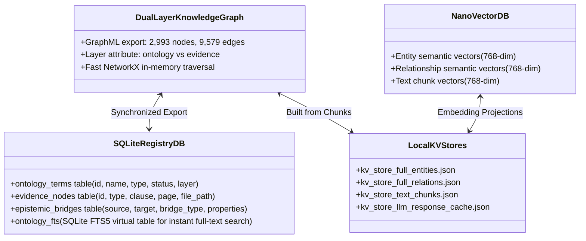
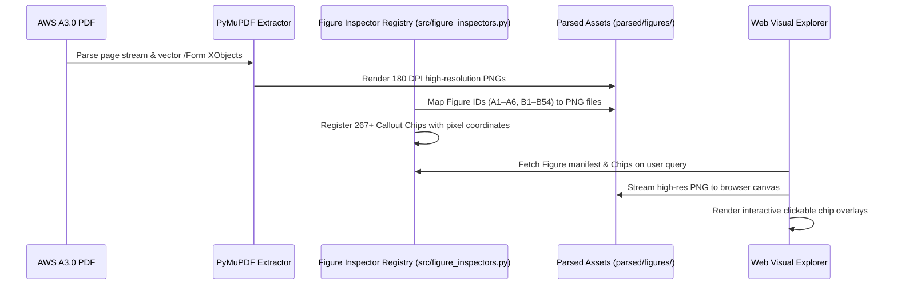

# System Architecture: AWS A3.0 Multimodal Prototype

## Guarded actual-runtime verification (2026-10-16)

The current increment was verified in the actual local app with an external
process-local provider-free guard, using the real registry/composer/projector,
resolver, catalog, inspector, assets and browser UI. API 19/19 and Chrome 8/8
smoke checks passed; all three Figure B6 images fetched/decoded in order and
retained distinct zoom targets. No application dependency was stubbed for this
running-app check. Generation remained disabled and the guard is not a new
repository configuration feature. The known favicon 404, failed frozen fresh
gates and semantic/latency gaps remain. Earlier unreloaded statements below
describe earlier checkpoints; aggregate limits are retained in the
[implementation receipt](claim_evidence_implementation.md).

## Element through-range boundary (2026-10-16)

The canonical element resolver accepts full-match bare numeric `through`
ranges and reuses endpoint/inventory/width/order checks before expansion.
Printed-page ranges retain their separate dash-only grammar; unsupported
repeated-kind, panel, suffix, mixed-prefix and unknown-member expressions still
fail whole. No evidence/support service or provider path changed. Compound
asset failures retain all source identities, declaration order, both diagnostics
and healthy shared render bytes without certifying claim meaning. The exposed
replay is DEVELOPMENT 4/6, 489/491; first fresh 3/6, 461/491 remains failed.

## Claim-associated evidence projection (2026-10-16)

The integration follow-up reuses per-asset validation for optional navigation
and legacy display, preserves source-only table identity, and consumes ordered
direct-inspection continuations. A shared hierarchy/page projection feeds both
claim binding and full-response generated-reference validation. Unresolved or
contradictory source identity withholds the generated answer while retaining
explicitly labeled diagnostic links. These gates establish identity, not semantic
support. Provider-free handler/core and synthetic Chrome fixtures pass; existing
apps remain unreloaded and original frozen acceptance remains unmet.

The query path attaches `claim_evidence_links` and
`claim_evidence_assessment` through the pure deterministic
`src/evidence_resolution.py` service. Complete references use the shared
manifest lexer; asset validation uses a per-record canonical seam while legacy
path lookup remains atomic. Exact selectors/native bindings are separate from
asset integrity and semantic support. Only the composed server route supplies a
reviewed fact view; generic generated claims retain unassessed support and have
no inferred evidence selector. Required reviewed failures produce HTTP 503.
The UI consumes ordered available assets and prevents late-response evidence
from replacing a newer request. [The bounded receipt](claim_evidence_implementation.md)
distinguishes tests, strict/amended development protocols, fresh heldout evidence,
offline timing and the remaining semantic/live-runtime gaps. Corpus/index/graph
schemas, provider behavior and persisted stores are unchanged.

`ordered_evidence.relationship` describes the canonical citation/navigation
reference role. `binding_evidence` separately retains each selected context's
relationship and selection role. Explicit navigation-only contexts cannot fill
required selected-source bindings, even when their identity metadata matches.
This separation fixes omitted provenance without promoting available assets to
semantic authority. The first fresh 2/6 gate remains recorded as failed; later
exposed-case replays do not establish new unseen coverage.

## Bounded answer composition and assessment (2026-10-16)

`src/query.py` now applies deterministic scope handling and the pure `src/grounded_answer.py` definition/alias composer before provider initialization. The terminology adapter supplies a reviewed bundle; the pure composer validates its spans, hashes and canonical anchors, preserves complete alternatives/conditions and returns exact claim-to-fact bindings. Unsupported intents retain the existing generation path. Responses distinguish outcome, composed/generated origin and hash-bound assessment scope; graph links and nullable coverage metrics cannot certify whole-answer truth. UI evidence rendering uses safe text and clears stale panels. Composed answers also expose an explicit `answer_policy_notes` scope limit outside factual claim bindings. [The implementation receipt](answer_grounding_implementation.md) separates the original two omissions from the repaired DEVELOPMENT replay, unchanged retrieval controls and browser functional passes with a retained favicon 404. Registry/source/store bytes were preserved; no new ingestion or cross-modal reasoning capability was added.

## Bounded live terminology lookup (2026-10-15)

`src/terminology_retrieval.py` validates a local ignored reviewed registry against the manifest and existing contextual chunk contents. After the contextual-index prerequisite and before model work, the hybrid path selects the longest whole reviewed headword; after reranking it reserves one result slot for the complete target/sense/provenance bundle. Unrelated queries preserve the existing output. `src/query.py` supplies the bundle to generation and adds matched-only resolution metadata; stale relevant evidence returns a source-free structured error and HTTP 503. Existing stores, graph projection and embeddings are not rebuilt. [Implementation, empirical results and limits](terminology_live_results.md) separate this three-headword lookup from full multimodal retrieval and generated-answer correctness.

## Chunk vector reader compatibility (2026-10-15)

`src/indexer.py` installs the instance-local `src/vector_reader_compat.py` reader on `rag.chunks_vdb`. It accepts validated stored numeric lists and native encoded vectors while preserving LightRAG 1.5.7 pending/redo/delete and lock behavior. Version and native-source guards require review before dependency upgrades. Stores, embedding dimensions and provider configuration are unchanged. [The bounded evaluation](vector_reader_compatibility.md) separates reader ranking, the current hybrid lane, and factually ungraded local answers.

This document specifies the technical architecture, data structures, storage layers, graph schema, epistemic verification pipeline, and runtime interfaces for the **AWS A3.0 Standalone Multimodal Prototype**.

## Bounded helper contracts (2026-10-15)

UI registry readers now reject invalid normalized y/x geometry and return copied views. The canonical source parser supports bounded numeric figure/table ranges; singular retrieval enrichment retains its prior valid query contract. `src/terminology_mappings.py` accepts supplied reviewed entry boundaries and verified compatible ontology rows, returns ordered per-target records, and projects only into a supplied in-memory directed multigraph. `project_terminology_mappings` is opt-in; that helper-only milestone left the full builder, SQL schema, persisted graphs, vectors and live query path unchanged. The subsequent live lookup is described above. [Historical helper evidence](helper_hardening_implementation.md) distinguish helper checks from source/answer certification.

## Source metadata contract (2026-10-15)

`config/aws_a30_2020_manifest.json` plus its canonical-hash receipt own document identity, source page labels, 10 section spans, 62 figure IDs, 11 table IDs and ordered source/asset bindings. The standard-library reader in `src/standard_manifest.py` validates the local PDF fingerprint and fails explicitly on invalid/stale required metadata. Config, citation/asset readers and future graph metadata project from it. Existing SQLite/GraphML/chunks/vectors remain unchanged retrieval inputs; cached figure/table locations cannot override the manifest. Unknown/group records cannot satisfy source-location grounding.

The UI registry still owns chips/categories, and `figure_bboxes.json` owns existing image-space geometry. All 94 PNG bindings match 180-DPI source renders; regions, cells/footnotes and semantic companion support remain unverified. Annex B retains conflicting applicability evidence. [Implementation receipt](declarative_manifest_implementation.md) separates source-location validation from answer correctness. The older architecture counts and verification claims below describe historical artifacts, not a new store audit or readiness finding.

---

## 1. System Overview & Data Flow

The system operates on an offline-first, multimodal, and epistemically grounded architecture designed to query and audit **AWS A3.0M/A3.0:2020 Standard Welding Terms and Definitions**.


---

## 2. The Dual-Layer Epistemic Graph Architecture

A core innovation in this prototype (completed in Card 07) is the complete structural separation of **what concepts mean** (the domain ontology) from **where and how they are proven** (the normative evidence).

### Layer 1: Domain Ontology Layer
Represents abstract welding domain knowledge independently of the document typography:
- **Node Labels**:
  - `:Concept`: Core welding, thermal, or physical concepts (e.g., *Complete Joint Penetration*, *Actual Throat*, *Thermal Gouging*).
  - `:Process`: Specific welding, thermal cutting, spraying, or allied processes (e.g., `GMAW-P`, `GTAW`, `SMAW`, `FOW`).
  - `:JointGeometry`: Edge preparations, angles, and fit-up characteristics (e.g., *Bevel Angle*, *Root Opening*, *Groove Face*).
  - `:Discontinuity`: Imperfections, flaws, and profile deviations (e.g., *Undercut*, *Overlap*, *Porosity*).
  - `:WeldSymbol`: Graphical weld symbol representations and standard signifiers.
  - `:TestPosition`: Standard qualification orientations (e.g., `1G`, `2F`, `5G`, `6GR`).
- **Node Properties**:
  - `name`: Standard canonical term name.
  - `description`: Formal technical explanation.
  - `standard_status`: Categorized as `standard`, `nonstandard` (e.g., deprecated shop slang), or `deprecated`.
  - `layer`: `"ontology"`.
- **Intra-Ontology Semantic Edges**:
  - `[:IS_A]` / `[:SUBPROCESS_OF]`: Process taxonomic hierarchy.
  - `[:HAS_GEOMETRY]`: Joint-to-feature relations.
  - `[:NONSTANDARD_FOR]`: Directed mapping from deprecated slang to normative standard terms (e.g., `short arc` $\to$ `short circuiting transfer`).
  - `[:CONTRASTS_WITH]`: Fine-grained disambiguation (e.g., `root opening` $\leftrightarrow$ `root face`).

### Layer 2: Normative Evidence Layer
Represents the physical, structural hierarchy of **AWS A3.0M/A3.0:2020**:
- **Node Labels**:
  - `:Document`: Master standard root node (`AWS A3.0M/A3.0:2020`).
  - `:Clause`: Formal document sections (Clause 1–4, Annex A–F).
  - `:Figure`: All 60 standard engineering drawings and classification charts.
  - `:Callout`: Specific labeled callout coordinates/chips on technical diagrams.
  - `:Table`: Master process matrices and historical revision tables.
  - `:TextChunk`: Verbatim, location-tagged text segments.
- **Node Properties**:
  - `id` / `figure_id` / `table_id` / `chunk_id`.
  - `printed_page` and `pdf_page`.
  - `image_file` or `text_file` relative paths on disk.
  - `layer`: `"evidence"`.
- **Intra-Evidence Structural Edges**:
  - `[:CONTAINS_CLAUSE]`: `:Document` $\to$ `:Clause`
  - `[:CONTAINS_FIGURE]`: `:Clause` $\to$ `:Figure`
  - `[:CONTAINS_TABLE]`: `:Clause` $\to$ `:Table`
  - `[:CONTAINS_CHUNK]`: `:Clause` $\to$ `:TextChunk`
  - `[:HAS_CALLOUT]`: `:Figure` $\to$ `:Callout`

### Inter-Layer Epistemic Grounding Bridges
These directed, typed edges cross the boundary between Layer 1 and Layer 2, providing verifiable mathematical proof that a technical claim is tethered to standard text or diagrams:
- `[:DEFINED_IN]`: `:Concept` $\to$ `:TextChunk` (cites exact clause, printed page, and quote).
- `[:ILLUSTRATED_BY]`: `:Concept` / `:JointGeometry` $\to$ `:Figure` or `:Callout` (links concept to exact visual callout chip).
- `[:TABULATED_IN]`: `:Process` $\to$ `:Table` (links letter code to process master table row).
- `[:JUSTIFIED_BY]`: `:Concept` $\to$ `:Clause` (links terms to committee rationale in Annex C).
- `[:HISTORICALLY_RECORDED_IN]`: `:Concept` $\to$ `:Table` (links revision history to Annex D tables).

---

## 3. Storage & Registry Implementation

The system deliberately avoids complex database servers (no Neo4j server, no Docker daemons) to maintain zero-cost local reproducibility.



1. **GraphML Substrate** ([`storage/dual_layer_knowledge_graph.graphml`](file:///C:/Users/kenai/aws-a30-prototype/storage/dual_layer_knowledge_graph.graphml)):
   - Total Nodes: **2,993** (2,522 Ontology + 471 Evidence).
   - Total Edges: **9,579** (3,254 Semantic + 512 Structural + 5,854 Epistemic Bridges).
   - Standard format loadable by Gephi, Cytoscape, NetworkX, and iGraph.
2. **SQLite Registry & FTS5** ([`storage/dual_layer_registry.db`](file:///C:/Users/kenai/aws-a30-prototype/storage/dual_layer_registry.db)):
   - Implements native SQLite `FTS5` full-text search index (`ontology_fts`) for sub-millisecond keyword lookup.
   - Foreign-key relational schema enforcing layer integrity and bridge consistency.
3. **Vector Indices & Contextual Embeddings**:
   - `storage/vdb_chunks.json`, `storage/vdb_entities.json`, `storage/vdb_relationships.json` (768-dim Gemini embeddings).
   - `storage/vdb_chunks_contextual.json`: 1024-dimensional contextual chunk embeddings generated offline via `BAAI/bge-large-en-v1.5` under Card 08.
4. **Local Response & Extraction Cache**:
   - `storage/kv_store_llm_response_cache.json` caches model inference, allowing repeat runs with zero cloud costs.

### 3.1 Architectural Alignment with Turbopuffer v3 ("RIP, Vector Database")

The storage architecture deliberately adopts the core tenets of Turbopuffer's *"RIP, Vector Database"* research:
1. **Vectors as Secondary Auxiliary Indices**: Vector spaces are not treated as primary keys or entity records. Canonical document identity, clause hierarchies, and ontology entities are anchored in the **Dual-Layer Epistemic Graph** and **SQLite FTS5 Registry** (`storage/dual_layer_registry.db`). Vector files (`storage/vdb_*.json`) are purely secondary, auxiliary lookup projections keyed by immutable canonical IDs.
2. **Mitigating Write & Storage Amplification**: Because multi-vector representations (such as our 1024-dim contextualized chunks) point to stable primary keys in the relational store, modifying graph edges, cross-references, or metadata never triggers vector index rebuilds or storage bloat.
3. **Decoupled Compute with Zero Server Daemons**: Rejects heavy standalone vector database daemons (e.g., Pinecone, Milvus, Qdrant) in favor of localized, zero-cost SQLite and appendable vector caches, guaranteeing fully offline, reproducible execution.
4. **Hybrid Retrieval with Reciprocal Rank Fusion (RRF)**: Deterministic full-text keyword indexing (SQLite FTS5) provides exact terminology enforcement (e.g., distinguishing "root opening" from "root face"), while contextual vectors provide semantic fallback, fused via RRF.

---

## 4. Multimodal Perception & Asset Pipeline

The PDF stores engineering diagrams as vector drawings inside `/Form` XObjects rather than embedded JPEG/PNG rasters. 



1. **High-Resolution Vector Rendering**:
   - PyMuPDF renders all 60 standard figures at 180 DPI, producing crisp technical diagrams without loss of legibility on fine line work and weld symbols.
   - Multi-figure PDF pages (e.g., `B16A`, `B16B`, `B16C` on page 113) are segmented into dedicated visual assets.
2. **Interactive Figure Inspector Registry** ([`src/figure_inspectors.py`](file:///C:/Users/kenai/aws-a30-prototype/src/figure_inspectors.py)):
   - Covers 100% of the 60 standard figures across 9 functional categories:
     - `Joint Anatomy & Grooves`: Figures B1–B15.
     - `Weld Positions & Test Fixtures`: Figures B16–B22 (including 1G, 2F, 5G, 6GR ring).
     - `Flange, Fillet & Plug Welds`: Figures B23–B31 (Fillet weld throats, leg sizes).
     - `Edge Welds & Surfacing`: Figures B32–B37.
     - `Resistance & Solid-State Welding`: Figures B38–B44 (Spot, seam, projection, friction stir).
     - `Brazing & Soldering Joints`: Figures B45–B50.
     - `Cutting & Gouging Profiles`: Figures B51–B54.
     - `Master Process Charts & Trees`: Annex A Figures A1–A6.
   - Encodes 267+ interactive callout chips with queries, labels, and semantic categories.

---

## 5. Auditable Epistemic Verifier Engine

The Epistemic Verifier ([`src/epistemic_verifier.py`](file:///C:/Users/kenai/aws-a30-prototype/src/epistemic_verifier.py)) audits candidate answers before or alongside user presentation.

### Verification Algorithm
```python
def verify_answer(query: str, answer_text: str, graph: nx.MultiDiGraph) -> EpistemicAudit:
    # 1. Detect if query is an Out-of-Scope Negative Control
    if is_out_of_scope(query) and indicates_abstention(answer_text):
        return EpistemicAudit(status="TRUTHFUL_ABSTENTION", provenance_score=1.0)
    
    # 2. Extract technical ontology concepts asserted in answer
    concepts = extract_asserted_concepts(answer_text)
    
    # 3. For every concept, traverse the graph for an unbroken bridge to Evidence
    grounded_concepts = []
    unbacked_concepts = []
    for concept in concepts:
        evidence_nodes = [
            v for u, v, d in graph.out_edges(concept, data=True)
            if d.get("bridge_type") in ["DEFINED_IN", "ILLUSTRATED_BY", "TABULATED_IN"]
        ]
        if evidence_nodes:
            grounded_concepts.append((concept, evidence_nodes))
        else:
            unbacked_concepts.append(concept)
            
    # 4. Compute Epistemic Provenance Score
    score = len(grounded_concepts) / len(concepts) if concepts else 1.0
    status = "VERIFIED_GROUNDED" if score >= 0.85 else "PROVISIONAL_PARTIAL"
    
    return EpistemicAudit(
        status=status,
        provenance_score=score,
        grounded=grounded_concepts,
        unbacked=unbacked_concepts
    )
```

---

## 6. Web Visual Explorer Application

The user interface ([`src/web.py`](file:///C:/Users/kenai/aws-a30-prototype/src/web.py)) is a lightweight single-page visual explorer served over HTTP (default port `8000`).

### UI Features:
1. **Interactive NLQ Search Bar**: Pre-loaded with suggestion chips for joint geometries, nonstandard terms, process matrices, and cross-modal queries.
2. **Dual-Layer Epistemic Provenance Panel**:
   - Status badge: `VERIFIED_GROUNDED (100%)` or `TRUTHFUL_ABSTENTION`.
   - Ontology Concept tags tagged by domain type (`:JointGeometry`, `:Process`, `:Discontinuity`).
   - Unbroken Evidence links showing exact `[:DEFINED_IN]` clauses and `[:ILLUSTRATED_BY]` figure numbers.
3. **Interactive Multimodal Diagram Canvas**:
   - Renders the high-resolution vector drawing with smooth zoom and pan controls.
   - Displays clickable **interactive callout chips** beneath the figure, allowing instant drill-down on anatomical features.
4. **Figure & Diagram Directory Drawer**:
   - Expandable side drawer indexing all 60 standard figures across Annex A and Annex B for direct exploration.

---

## 7. Gold Benchmark & Evaluation Subsystem

The automated benchmark harness ([`eval/test_scorer.py`](file:///C:/Users/kenai/aws-a30-prototype/eval/test_scorer.py)) tests the system against [`eval/gold_benchmark.json`](file:///C:/Users/kenai/aws-a30-prototype/eval/gold_benchmark.json):

| Modality Class | Count | Focus Areas Tested | Target Accuracy |
|---|:---:|---|:---:|
| **Text** | 8 | CJP, Adaptive Control, Throat definitions, Thermal gouging, Style rules, Interpretation procedures | 100.0% |
| **Nonstandard** | 5 | Root pass, Burn-through (melt-through), Short arc, Hydromatic welding, Flow welding | 100.0% |
| **Table** | 7 | GMAW-P, SMAW, ASP, Waveform AIP/TIE (Table D1), Cored solder (Table D4), Deleted terms (Table D6) | 100.0% |
| **Figure** | 18 | Figures A6, B4, B5, B6, B12, B16A, B19, B21 (6GR), B23J, B25, B26, B28, B33, B34, B35, B39, B40, B46, B51 | 100.0% |
| **Cross-Modal** | 2 | 1F pipe test position (Fig B20), Bevel angle & depth (Fig B6) | 100.0% |
| **Qualifier** | 2 | Root opening vs root face, Back weld vs backing weld sequence | 100.0% |
| **Abstention** | 8 | ASTM A36 preheat (D1.1), Porosity acceptance limits, E7018 yield strength, Fictitious Fig B120, Table A10 | 100.0% |
| **TOTAL** | **50** | **Comprehensive normative coverage across all 190 pages of AWS A3.0** | **100.0%** |

## Local API boundary update (2026-10-15)

Asset reads now use startup allowlists and file containment/identity checks. Model
clients enforce the selected engine's configured endpoint and disable redirects
and environment proxy inheritance. Exact Host/Origin and JSON request checks protect
the loopback API, with explicit production UI origins configurable server-side.
See [security boundary notes](security_boundary_notes.md) for contracts and limitations.
This update does not establish new retrieval or answer-accuracy results.

Missing contextual indexes now fail before database/model work with an explicit
`RETRIEVAL_INDEX_MISSING` result, HTTP 503 and CLI exit 1. Recovery is a trusted
operator action; the query path never starts an automatic rebuild.
