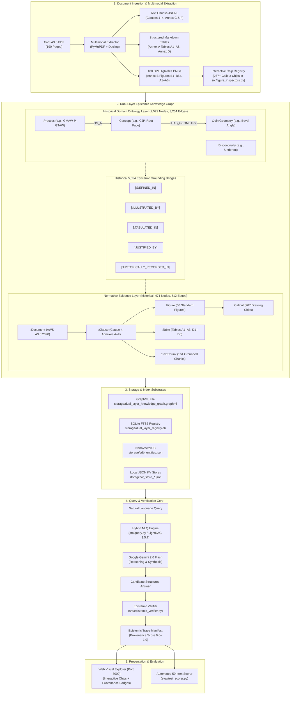
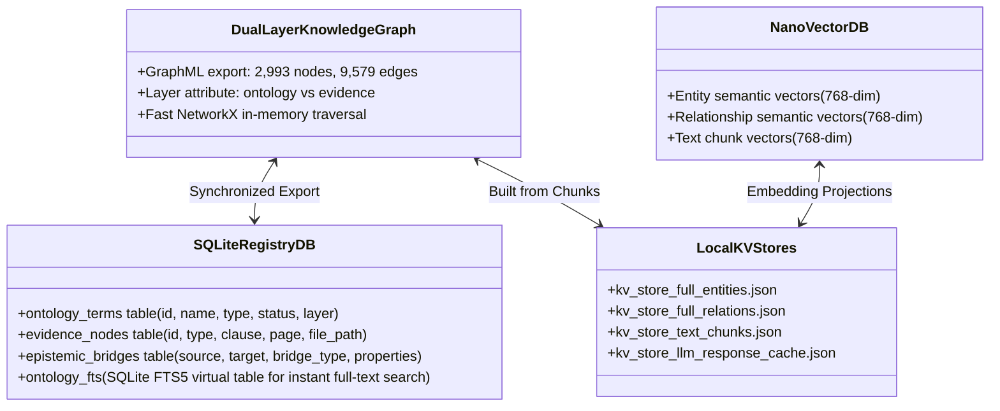
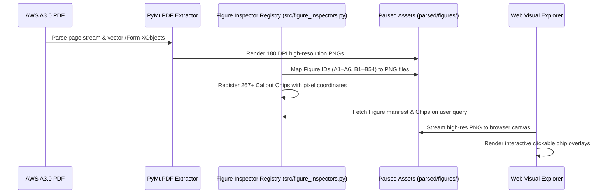

# System Architecture: AWS A3.0 Multimodal Prototype

## A2 finishing slice009 verified (2026-10-23)

The bounded A2 ingest/evidence slice and opt-in planner finishing pass are verified
on existing exposed questions. Default deterministic behavior is preserved; fresh
model selection, production Terra/Luna and unseen generalization remain unvalidated.
No new OCR/model/provider call, figure, framework or UI was introduced by009.

Optional `run_questions(..., source_observation_path=...)` / `query --source-observation`
adds source-bound canonical **candidate** figure evidence in the A2 adapter. Source,
page/crop/region/connector bindings and native PDF-rendered clip pixels are checked.
This authenticates provenance, not the AI observation's truth. Candidate evidence
and claims stay outside accepted proof catalogs/KG admission and completeness flags;
knowledge-only answers are not augmented. Text is rendered only for successful
evidence-layer `epistemic_limits`/`chart_layout` operations; otherwise the optional
candidate packet is separate. Omitting the option preserves prior behavior.

A conservative compiler guard reuses the existing deterministic relation intent
only for a ready single-part literal evidence path with exactly matching ordered
endpoints. It supplements, never replaces, original model operations and records
its origin. Membership, source-layout ancestry, physical common-root reachability
and semantic subtype remain distinct. Ambiguous/compound/ref-dependent batches are
not guessed; forced knowledge execution rejects the evidence-only layout operation.

Capability staging remains **text first, relationships second, multihop third**.
Known-source labels/codes and identity clarification are independently usable;
compound requests retain every relationship/path part. Qualified relationships
now include the optional candidate whole-A2 connector observation. Ordered source
paths and accepted physical support are demonstrated; model-requested accepted-KG
paths and semantic IS_A transitivity are not established. Candidate indentation and
AI observations never become accepted semantic facts through recognition or reachability.

One frozen cached005-plan replay: A2 content/delivery **16 PASS**; A1 **51 PASS**,
including three proper clarifications. This is compiler/executor recovery with
explicit deterministic supplementation and candidate evidence, not improved model
performance. Original007/008 plans, grades and artifacts remain unchanged. All51
deterministic A1 control answers/coverage/rows/paths/verdicts are unchanged, including
the known planning_unsupported versus source-limit metadata caveat. Runtime execution
still retains redundant failed/blocked requests; semantic completeness remains
UNASSESSED automatically. Do not equate content grades with all operations succeeding.

Validation:398 existing applicable software checks passed; independent focused code,
source and answer review passed. An offline wheel includes the runtime JSON contract
and excludes source assets/stores; sandbox build failures are retained separately
from the successful host build. Harness1.7.6, graph adapter1.4, instruction1.4/wire1.0;
no model has consumed instruction1.4. Source observations are optional read-only
attachments; existing graph/store admission decisions are unchanged.

Authorized Git closeout is conditional on these checks and a clean publication
review; its exact commit/PR/merge/sync receipt is kept in the Library report, not
fabricated here. Private PDFs/images/OCR/vision traces/stores/caches stay outside Git.
Rollback leaves the observation option unset and deterministic default enabled;
no reset, branch/worktree deletion or unrelated cleanup is required. AWS backend
correctness remains one slice at a time; no automatic A3, Navy Weld or Utopia work.
Report: `Figure_A2_Planner_Integration_002_Report.md`; private actual answers/receipts:
`storage/evidence_v2/a2_planner_009/`. GR remains optional, not a required harness.

## Preserved offline planner006 baseline

**Bounded offline simplification complete; hold planner adoption/publication.**
One replay used the unchanged005 saved plans: no model, OCR or external calls.
A2 content **15 PASS/1 PARTIAL**, delivery **14 PASS/2 PARTIAL**; A1 content
**50 PASS/1 PARTIAL**, delivery **48 PASS/3 PARTIAL**. A1's50 passes include three
appropriate identity clarifications, not50 factual answers. These are exposed
regressions and cached-plan replay, not fresh model or production acceptance.
All51 deterministic A1 control answers/coverage/rows/paths/verdicts are unchanged.

Runtime1.7.4 loads `src/evidence_chart_contract.json` through its Python loader:
contract1.0, instruction1.3, wire1.0. Prompt/profile/schema/compiler definitions
share that asset; explicit safeguards remain code. No model consumed instruction1.3.
`SKILL.md` routing/QA guidance remains developer/agent guidance, not automatic
runtime skill loading. Shared definitions reduce drift; they cannot prevent it.

Quote labels no longer require a character partition. Exact source/query bindings,
typed IDs/roles/budgets and result dependencies remain enforced. One batch retains
blocked operations, runs safe independent ones, and blocks failed dependents.
Exact equivalent operations can share execution without losing part/field mappings.
Explicit `chart_layout` alone requests whole-chart observations; empty IDs never
mean all nodes. Membership, layout, physical connectivity and semantic subtype
remain distinct. Dictionary candidates now also bind unresolved identity requests.

Execution coverage is separate from semantic answer completeness (`UNASSESSED`
until independent grading). Actual bound assertion status/rule/support qualifies
observations. Five returned paths have complete accepted literal/physical support,
including the A2 Allied→Thermal Cutting→Arc Cutting route; these are structural
certifications of evidence paths, not semantic IS_A transitivity or a new KG search.
No persisted observation/admission decision was changed. Source bytes, gold,67 raw
plans,109 frozen code files and463 prior005 artifacts passed preservation checks.

Remaining: A2-Q15 omits explicit source judgment about arrow directions and has
invalid partition/oversized operations; Q16 adds an empty redundant designation
follow-up. A1-QA002-14 answers a subtype question with a cross-chart path instead
of its relationship verdict. CQ003/QA002-10 contain the requested facts but retain
confusing redundant-operation warnings. No automatic repair/evaluation loop follows.
The known deterministic reason-label caveat is preserved with its unchanged controls.

AWS backend correctness stays slice by slice: A2 only plus A1 regressions, no UI,
A3, Navy Weld, Utopia, framework or model campaign. GR remains optional. Review
actual answers before further inference or publication. Source-aware ingest and
planner are logically separable, but shared API/traversal hunks require a deliberate
split; no two independently publishable commits or foundation PR were created.
Report: `Figure_A2_Planner_Integration_002_Report.md`; private receipts and all
answers: `storage/evidence_v2/a2_planner_006/`. No Git publication is authorized.

## Preserved fresh005 baseline

Fresh005 used67 natural-stop `deepseek-flash` planner calls with instruction1.2:
A2 content12 PASS/4 UNASSESSED, delivery10 PASS/2 PARTIAL/4 UNASSESSED;
A1 41 PASS/1 PARTIAL/9 UNASSESSED included two proper clarifications.
It executed52 graph queries (12 A2+40 A1), plus two zero-operation clarifications:
**52, not54 executions**. All original receipts/answers remain unchanged. The full
report is archived as `006/report_v5_before.md` and Library version5 of
`libfile_467be2fe46b08191be1c7380b658b958`; its raw ZIP remains
`libfile_a2abf18257b08191a21e3db693d4df18`. Neither005 nor006 establishes production
or unseen acceptance. The independent review's predicted scores and invented A2
Solid-State Cutting question were not adopted; actual source/receipts govern.

## Preserved offline004 baseline

004 replayed older saved plans, with zero new model calls: A2 delivery11/3/0/2
and content14/0/0/2; A1 43/6/0/2 included three appropriate clarifications.
It did not test instruction1.2 in a model. Its exact full report remains
`storage/evidence_v2/a2_planner_005/report_v4_before.md` (SHA256
`f0abc1ae5f14151d898acbaab87b16f8dbe82a178c0479c43c354b3bf9b6ffb0`), with historical checks/proof limits and prior Library version4.

## Preserved planner003 development baseline

The fresh instruction1.1 DeepSeek run completed67 natural-stop calls, with no
truncation/retry/fallback. A2 clear delivery/content:6 PASS/10 UNASSESSED; A1
complete-answer30/12/3/6, factual-data35/7/3/6. Plans were6/16 ready in A2 and45/51
in A1; nine evidence paths and no accepted-KG paths returned. This was a development
proxy, not production acceptance. Full answers/raw plans/report remain unchanged
in `storage/evidence_v2/a2_planner_004/report_v3_before.md` and prior003 artifacts;
archive SHA256 `14da3c37608c51fee0da312d6ef9c667d45782b8aab6d9f10026df337c303308`. Library version 3 retains that earlier report in version history. The replay above is not new model performance.

## Historical A2 planner002 (2026-10-23)

**Offline contract repair reviewed; fresh model validation is not authorized.**
Instruction revision `chart-llm-plan-instructions-1.1` keeps wire schema `1.0`;
per-operation restrictions and planned `reason=''` are explicit in prompt and
schema descriptions. Flat schema remains a structural superset; compiler guards/
admission are unchanged. Fifty focused checks passed; unchanged saved67-response
compiler replay confirms0 executable plans and identical first rejections. No
plan rewrite, new model call or model-improvement claim. Hold Git. Fresh validation
needs separate approval. The same Library file is now version2 with offline
findings; the original67-call record and Libraryv1 remain preserved.

**VALIDATION_PASS_COMPLETE_TYPED_PLAN_CONTRACT_NOT_READY.** Reuse the cached A2 source/store on
local `feat/a2-source-aware-ingest`, with baseline identities preserved in
`storage/evidence_v2/a2_planner_002/baseline_freeze.json`. Keep the unchanged 16 A2
development questions and 51 exposed A1 regressions; no successful model-plan/
answer acceptance or publication is claimed.

The opt-in model is a language-to-validated-plan adapter, not an evidence or
answer authority. Its input contains the question and source dictionary
names/codes/IDs only, with no graph edges, gold or previous answers. Validate typed
operations, identifier scopes and generic result dependencies before the existing
deterministic evidence/KG execution. Group/path follow-ups refer to actual prior
operation results. Admission, candidate semantics and source proof remain
unchanged; entity identity never promotes a relationship. Preserve the existing
route as the baseline and report unresolved intents/coverage honestly.

Runtime consumes the versioned `build_prompt`, operation contract, JSON schema
and validator in `src/evidence_chart_llm_plan.py`. The existing `.agents`
`evidence-graph-routing`/`evidence-graph-qa` skills are developer guidance read by
agents, not automatically loaded backend instructions. No new skill layer is added.

### Historical first local-attempt setup

STS succeeded in configured `us-gov-west-1`; SageMaker `list_endpoints` returned
AccessDenied/400 and Bedrock `list_inference_profiles` AccessDenied/403. Config
has no verified Terra/Luna endpoint/profile mapping and no new credentials were
introduced. Before inference the owner selected installed `qwen2.5:3b` text
Instruct (3.086B) / Ollama 0.40.4, digest
`357c53fb659c5076de1d65ccb0b397446227b71a42be9d1603d46168015c9e4b`.
No 8B calls occurred. This is an explicitly labelled proxy, not Terra/Luna: native
metadata context 32768, chosen runtime 16384, `num_predict=-1`, temperature 0,
seed 42. Record actual resource/stop limits instead of assuming cloud equivalence.

### Historical approval-block/local-attempt record — permission resolved

The following record predates the new explicit approval and final 67-call pass.
Its zero-DeepSeek-call and no-retry statements describe that earlier denied
launch only; they are not the current inference totals.

**A2 is not done and is not ready for closeout.** Automatic approval review
rejected the exact DeepSeek A2 CLI launch before `CreateProcess`: sending the
questions and private source-derived identity dictionary to `api.deepseek.com`
lacked explicit private-source-disclosure authorization. The action is known
**UNEXECUTED**, with zero DeepSeek inference calls; no retry or alternate path
was attempted. Existing authentication/model-list reads succeeded, but those
metadata reads did not authorize source-bearing inference.

Before any launch, explicit approval is needed to send the existing 16 A2/51 A1
questions, source-derived dictionary names/codes/IDs and operation contract/schema
to the existing `https://api.deepseek.com` endpoint using existing credentials.
No PDF/image, graph edges, gold or previous answers are part of that proposed
input. No new credential grant, private-data upload retry or bypass is authorized.
The pending proxy remains `deepseek-flash` (documented
`DeepSeek-V4.1-Flash-1017`), thinking disabled, temperature 0, JSON-object output
and the same strict contract/schema. Its planned explicit provider maximum is
393216 output tokens rather than the default 8K; native context is 1M. None of
these inference settings has been executed. `deepseek-v4-pro` was also listed;
legacy `deepseek-chat` was absent. This is operational failover, not a new bakeoff.

All 32 local request directories/attempts remain preserved, with 30 natural
completions. A1 request010 contains only `request.json`, no receipt or stream;
its execution is **UNCERTAIN/prepared-interrupted**, not confirmed generation.
The initial schema run's 16 A2/nine A1 natural responses lacked required fields;
The prepared tenth A1 attempt was interrupted during diagnosis; its actual model
execution cannot be established from the retained artifacts.
The flat-schema-only correction preserved all 67 prompts byte-for-byte, profiles,
validator and admission. The flat run's first five A2 backend answers were invalid
plans (`SINGLE_SUBJECT_REQUIRED`); the sixth repeated query text and was manually
client-stopped at 83,103 characters: this sixth flat A2 request has confirmed
repetitive generation. All 30 saved backend answers have zero operations, rows,
paths and claims; **no new semantic answers were produced**. The five flat plans
mixed literal IDs with a current-operation self-reference, violating prior-only
dependency/cardinality rules rather than missing source data. The
repetition watch now handles arbitrary periods; no local rerun or arbitrary
output-token ceiling follows from that software correction.

The opt-in runtime/backend integration and versioned `chart-llm-plan-1.0`
contract are implemented/reviewed, with flat schema encoding. Final applicable
software checks: **382 PASS in 10.49 s**, five known warnings; independent code
review CLEAR. These establish implementation checks, not successful model plans
or answer quality. Source/baseline hashes are unchanged and the deterministic A1
control's 51 answer strings and coverage are identical (44 complete/2 partial/
5 unanswered). The 16+51 model acceptance
run remains blocked/pending, not passed. Report
`Figure_A2_Planner_Integration_002_Report.md` is delivered to Library version 0
(`libfile_467be2fe46b08191be1c7380b658b958`); it includes the actual saved responses,
controls, independent audit and the precise blocked action.
Stop here: no more local trials, external inference retries, OCR/A3/UI/Navy Weld,
new questions/framework/skill workstream or Git publication.

### Final authorized validation pass — complete; contract not ready

New explicit private-source-disclosure approval resolved the previous launch
block. The known-unexecuted A2 launch was retried once and allowed, followed by
A1. The final pass made **67 DeepSeek calls (16 A2/51 A1)**: all naturally stopped,
with no API errors, truncation, inference retry or fallback. Every response model
was `deepseek-flash`. All original prompts, code and gold remained frozen; no
fixes or tuning occurred during this pass.

Raw JSON/schema validity was **67/67**, but typed executable plans were **0/67**.
All 67 results were unsupported/unanswered before execution, with zero operations,
retrieval, rows, paths or claims. A2 rejected plans: 12 `UNUSED_INFORMATION_FIELDS`,
three `FIELDS_INVALID`, one `SINGLE_SUBJECT_REQUIRED`. A1: 30 `FIELDS_INVALID`,
18 `UNUSED_INFORMATION_FIELDS`, one `SINGLE_SUBJECT_REQUIRED` and two
`PLANNED_PART_INVALID`. Source-answer grading is **UNASSESSED/NOT_RUN**, not a
0/67 semantic-accuracy score; end-to-end pipeline acceptance nevertheless fails.

That frozen live pass showed schema/prose/compiler usability defects and model planning/
adherence mistakes. The flat structural schema allows field arrays whose
operation-specific restrictions are implicit in prose and enforced by the
validator. Raw unexecuted plans also show wrong operation selection, ambiguity
handling and direct-versus-recursive list-depth choices. Do not blame the contract
or model capability alone, or call these executed OCR/KG/retrieval failures:
retrieval never ran. The next decision is generic contract/interface clarification
and simplification, not OCR changes, more questions or an automatic tuning loop.
No further implementation or publication is authorized.

Usage was 247737 input/22999 output tokens (270736 total; 136064 cache-hit/
111673 cache-miss input). Summed API latency was 148.573 s, median 2.204 s,
maximum 3.530 s. Published-rate billing estimate: USD0.03096–0.06192; invoice
unavailable. The prior 382 passing software checks remain valid because code is
unchanged; they do not establish contract usability. The deterministic A1 control
still has identical 51 answer strings and runtime 44 complete/2 partial/
5 unanswered; A2 source/QA001's 7 PASS/4 PARTIAL/5 FAIL baseline is unchanged.
A2 is not done and is not ready for Git closeout. Report
`Figure_A2_Planner_Integration_002_Report.md` is updated in the same Library file
`libfile_467be2fe46b08191be1c7380b658b958`, confirmed version1, including all 67 raw
backend answers and raw plans. Preserve all local attempts and the historical
approval-block record.

Use `planning-and-task-breakdown` and `using-agent-skills` Scope Discipline in the
existing plan; no separate drift framework. No OCR/A3/UI/Navy Weld/production
integration, new database/model/framework or benchmark expansion. Completion is
unchecked; preserve baseline001 and stop on real gaps without automatic tuning.

## Historical A2 source/QA001 (2026-10-23)

**STOP_AFTER_A2_DEVELOPMENT_PASS — SOURCE_INGEST_READY_NLQ_NOT_READY_FOR_CLOSEOUT.**
Work remains local/uncommitted on `feat/a2-source-aware-ingest`; main is unchanged
at `2d7b73813228c1cd6f907ca014a23693a888de81`. Hold publication: the source layer
works, but the actual A2 answer/completeness results below do not meet acceptance.

Figure A2 is **Master Chart of Allied Processes**, `figure:figure_a2`, PDF index
88 / viewer page 89 / printed page 76. Its normalized page crop
`[0.075, 0.10, 0.45, 0.89]` (`ymin,xmin,ymax,xmax`) excludes A3 on the same page.
Adapter `a2-source-aware-ingest-1.4` (`src/evidence_a2.py`) combines native vector
boxes/strokes with local OCR for outlined-font labels: eight OCR calls total
(cached initial PSM11 plus seven per-box PSM6); later derived projections used
zero OCR calls. This is hybrid source ingest, not independent image-only OCR.
No LLM/external calls occurred and no VLM was needed for the native geometry.
A2 vocabulary comes only from A2 observations; no A1 dictionary facts are imported.
The final graph has 38 nodes (seven boxes/31 printed rows), six undirected
physical connectors, 112 ACCEPTED/12 CANDIDATE/0 DISPUTED assertions and zero
accepted `IS_A`. All returned proofs/assertion references joined correctly;
231 support joins and zero candidate promotions were verified. Lower category
boxes have multilevel physical connections, not geometric containment inside
the thermal-cutting box. Indentation remains candidate.

After the code freeze, one fixed 16-question A2 batch and one existing 51-question
A1 regression ran. A2 independent content review found **7 PASS / 4 PARTIAL /
5 FAIL**, while runtime coverage was **3 complete / 11 partial / 2 unanswered**;
only three answers were clean on both content and coverage. Independent delivery/
coverage grading was **3 PASS / 8 PARTIAL / 5 FAIL**. False clarification/
unsupported warnings remain even on some content-complete answers. A1's 51 answer
strings and coverage are verbatim unchanged: 51 content PASS, runtime 44/2/5,
including the known `HO003-06` reason-label caveat. These are development/exposed
regressions, not unseen or production-model acceptance.

The initial full 287-check run had one legacy-helper contract failure. A minimal
post-QA compatibility patch fixed that caller contract; nine focused checks then
passed, followed by **287 PASS in 7.82 s** with five known warnings. The actual QA
results remain from the frozen pre-patch code; no QA rerun is claimed. Old/new
coverage-helper results matched for all 31 typed A2 operations. Source, code and final compatibility
review cleared; that review is not NLQ answer acceptance.
Source/image/question hashes and all original/intermediate artifacts are retained.
The completion drift check remained A2-only, with no new UI/framework/model,
question/gold mutation or automatic repair loop. Primary gaps are intent
composition, anaphora/path planning and honest coverage, not missing source OCR.
Next decision: a bounded language-to-typed-operation repair; do not start another
OCR change, framework bakeoff or automatic rerun. No commit/push/merge is authorized.
GR remains optional; Navy Weld/Utopia are deferred. The reported AWS GPT-5.6
Terra/Luna setup remains unverified; no production endpoint/model acceptance was
simulated. Preserve the closed A1/private records below. Report `Figure_A2_Source_Aware_Ingest_001_Report.md` is delivered to Library,
version 0 (`libfile_333e9b8fb2a48191ae37ac99fa0a2633`).

The working A2 path reuses the generic evidence binder, source-derived lexical
lookup, typed planner/traversal and versioned SQLite EG to KG store, while A1's
strict source wrapper remains compatible. Native geometry and observed OCR bind
labels, row enclosure and measured undirected connectors to source page/regions;
individual admission is recomputed on reads rather than granted by a receipt flag.
Multilevel category connections/path coverage are distinct from per-box process-row
enclosure. The remaining failures arise chiefly before or during intent composition
and answer coverage, not because those source records are absent. General forced-KG
children/descendants/parents still conservatively abstain; nested `row_partition`
is not implemented. No new database product, orchestration framework, OCR engine,
production model integration or semantic-subtype admission is established here.

## Preserved A1 records

**Git closeout record (2026-10-23): REVIEWED FEATURE; PR #11.**
The reviewed implementation is published in [PR #11](https://github.com/kaiello/aws-a30-prototype/pull/11).
Independent code/publication reviews approved and all 270 local checks passed.
The PR records the live publication/merge state; the separate closeout report
records exact local main/origin/GitHub synchronization and post-merge checks.
Preserve the bounded dictionary-assisted A1 scope, private artifacts and
unrelated work. The 003 result below remains the historical pre-publication
record; this closeout does not start the next slice.

**Historical pre-publication raster integration 003 (2026-10-23): BOUNDED_A1_INTEGRATION_READY_FOR_OWNER_REVIEW.**
Local/uncommitted `feat/a1-source-aware-ingest`, based on unchanged main
`039087d06d55860bda19c1c8ea3b55b678cb8e4a`; no commit/push/merge is authorized.
The actual retained-raster pipeline executed the existing 51 questions once:
**51 content PASS in auto and 51 content PASS in candidate-evidence view**,
with **51 native content PASS** unchanged. Auto answers match native after only
removing the explicit raster-provenance prefix; evidence answers add qualified
parent-layout details in 14 cases without changing facts. All 51 are exposed
regressions, not unseen/general QA or cross-figure acceptance. Runtime coverage
is separately 44 complete/2 partial/5 unanswered because ambiguity and source
limits remain explicit; this does not mean 51 complete factual answers.
The known native `HO003-06` shielding-gas reason-label caveat is preserved.
003 reused unchanged 002 OCR/model artifacts with **zero new OCR/model calls**.
Typed per-predicate automatic pixel/OCR checks admitted 287 assertions (189
literal facts, 90 row enclosures and eight physical connectors). The 29
indentation assertions remain candidate; no `IS_A` was accepted. All 226 raw
observations/proofs remain candidate. The 586 support joins include source-local
glyph corroboration for four low-confidence/corrected codes; dictionary matching
alone grants no admission. All eight measured connector stroke regions and box
contacts were independently checked against pixels; these are undirected
physical links, with no arrow direction or semantic subtype inferred.
Scoped completeness accounts for observed rows/pixel bands, measured borders,
fresh rectangle inventory, orphan ink/words and required projection edges.
Applicable scopes passed without native reference totals or expected QA answers.
The KG recomputes retained seed/pixels/graph and checks file hashes before
admission. These are automatic source checks, not human approval, mathematical
proof or authority from a receipt flag/hash alone.
The full 270 A1 software checks passed in 7.67 s; independent code/source/proof
and actual-answer review found no material blocker. Software counts support the
answer/evidence results, not substitute for them. Frozen runtime/source files
and all 72 prior artifacts remain unchanged; native/001/002 inputs, gold,
outputs and private source evidence are preserved. No post-output repair/replay,
extra benchmark/framework, tuning loop or automatic model retry occurred.
Ready for owner review of this bounded A1 integration only. AWS backend one
figure at a time; GR optional, Navy Weld/Utopia deferred, no UI/new models/services
or automatic Git publication. Final report delivered to Library, version 0
(`libfile_24260fa7fb7c8191bfd0d5fcce255cbf`).

**Historical dictionary-assisted ingest 002 (2026-10-23): NOT_READY_FOR_ACCEPTED_RASTER_QA; HOLD UNMERGED.**
Local/uncommitted `feat/a1-source-aware-ingest`, based on unchanged main
`039087d06d55860bda19c1c8ea3b55b678cb8e4a`; no commit/push/merge is authorized.
This bounded pass used the source-backed dictionary's 99 labels and 97 printed
codes to normalize observed OCR, preserving raw text, provenance and uncertainty.
It supplied no reference regions, boxes, relationships, unseen entities, gold
answers or accepted status. This is **dictionary-assisted ingestion**, unlike
independent attempt 001 retained below. Source comparison found all 99 nodes
(90 processes/eight categories/root) and 127 physical relations (90 enclosures,
29 indentation links/eight root connectors), with no missing/extra identities or
endpoint relations. Two connectors came from CV and six from VLM. The six VLM
relationship regions identify endpoint boxes rather than connecting strokes;
this is an unresolved evidence-localization gap, not fully verified anchors.
The only local `qwen3-vl:8b-instruct` / Ollama 0.40.4 call used six unresolved
tasks/seven referenced nodes plus pixels, naturally completing in 42.656 s with
8980 input/645 output tokens. Actual context was 32768, `num_predict=-1`,
temperature 0, seed 42; metadata supports 262144, not allocated for this run.
One end-to-end pass executed the existing 51 exposed questions in both raster
views. Unchanged content rubrics grade candidate-evidence answers **32 PASS /
2 PARTIAL / 17 FAIL**, and mixed auto-policy answers **16 PASS / 4 PARTIAL /
31 FAIL**. Auto includes evidence operations; these are not accepted-KG accuracy
scores. All 226 record proofs and 316 assertions remain candidate, with zero
accepted assertions and 570 valid support joins. Valid joins do not establish
correct stroke localization or answer completeness. `complete_chart=False`
blocks exhaustive lists even in evidence view; auto knowledge operations abstain
where identities/relations have not been admitted. No candidate was promoted to
raise scores. Native answers remain exact: **51 content PASS**, coverage
44 complete/2 partial/5 unanswered and the existing reason-label caveat.
The 254 software checks passed in 7.27 s; answer quality and evidence limitations
above determine readiness. Original inputs/gold, native/001 results, frozen code
and private source artifacts are preserved; no post-output repair/replay occurred.
Recommended next decision: address completeness/admission handling and connector
stroke anchors in a bounded follow-up. No further model call, automatic repair
cycle or new benchmark/framework starts from this result. AWS/A1 backend first,
one figure; GR optional, Navy Weld/Utopia deferred, no UI/new models/services.
Report `Figure_A1_Dictionary_Assisted_Ingest_002_Report.md` is delivered to
Library, version 0 (`libfile_508fed85d1d48191a9158ead2c695363`).

**Historical independent source-aware ingest 001 (2026-10-22):
NOT_READY_FOR_RASTER_QA; HOLD UNMERGED.** Local/uncommitted
`feat/a1-source-aware-ingest`, unchanged main
`039087d06d55860bda19c1c8ea3b55b678cb8e4a`; no publication is authorized.
The reviewed source-aware implementation passed 231 software checks in 6.56 s.
Native PDF text/vector ingest and one canonical 51-question pass preserve exact
007 answers: 51 content PASS, native coverage 44/2/5 with the existing reason-label
caveat, reader model NONE/zero calls. These are exposed regression controls.
The image-only PDF has zero native characters/vectors; its 300-DPI PNG is
2540 x 3287. One Tesseract 5.5 / OpenCV 4.12 extraction produced 410 words and
eight rectangles, but no resolved root/usable graph: original setup used zero
model calls and ran no raster QA. A separately recorded, reviewed generic
cached-observation continuation reused that OCR without threshold/gold changes.
Its only local vision call used `qwen3-vl:8b-instruct` / Ollama 0.40.4, context
32768, `num_predict=-1`, temperature 0, seed 42. After 315.156 s it ended
`done_reason=length`: input 21799 + output 10969 filled the configured window
(model metadata declares 262144; this is not that native ceiling). Incomplete
JSON was labeled `invalid_output` by the wrapper; context exhaustion is not an
answer-quality grade. No usable raster graph or accepted proposal resulted.
All 51 raster questions are **NOT_RUN**, semantic grades null, not 51 failures.
Source inspection found 73/90 correct name/code pairs, 7/8 true headings plus
one false root-fragment category, and 99 correct physical edges/no extras;
17 enclosures, 3 indentation links and 8 connectors are missing. Root words
exist in OCR but were misassigned and excluded from allowed bootstrap IDs, so
the current contract cannot express the correct root; larger context alone
cannot fix it. Partial model output also contains invalid IDs/link types;
these are diagnostics, not a complete model grade or salvageable QA result.
The main gaps are row/layout assignment and the input/output contract, not
established generic OCR/model inability. No post-model repair/retry occurred.
Native records and candidate-binding paths retain method/version/anchors/provenance/
uncertainty; the incomplete actual raster run remains raw observations/model
diagnostics, with no raster KG store created.
Raster extraction receives pixels/identity metadata, never reused native facts.
OCR/VLM observations remain candidates, not automatic accepted-KG admissions.
Further compact unresolved-only vision/contract/layout work needs the next bounded
decision. AWS/A1 one figure first; Navy Weld/Utopia deferred, GR optional; no UI,
new framework/install/cloud or automatic extra experiments. Report `Figure_A1_Source_Aware_Ingest_001_Report.md` is delivered to Library, version 0 (`libfile_d8ad457a723c8191a513ea866d462d33`).

## Historical validation 007 and PR #10 closeout (2026-10-22)

PR #10 merged at `039087d06d55860bda19c1c8ea3b55b678cb8e4a`; clean local/main
and online synchronization (0/0) were verified before this branch was prepared.
The following validation record predates that completed publication.

**Historical pre-publication validation 007 (2026-10-22):** Make the AWS
backend correct one bounded slice at a time; Navy Weld integration and Utopia
evaluation remain deferred. Targeted repair is complete in harness 1.7.1 /
planner 1.6.1 / lexicon 1.0: all 179 A1 software checks passed and independent
code/publication review approved. The forced-knowledge child-list/codes request
now safely abstains and legacy `parent_groups` compatibility is restored.
Four canonical CLI calls executed the same 51 questions once; all verbatim
answers match 005, unchanged gold gives 51 content PASS, and capture is unchanged.
All 51 are exposed development regressions, not unseen/general QA acceptance.
Native coverage remains 44 complete / 2 partial / 5 unanswered, with the documented
shielding-gas reason-label limitation; model/provider NONE, zero inference calls.
Source, dictionary, admission and prior results are unchanged. Commit/push, draft
PR, merge and local/online sync are authorized next; Git completion is not yet
claimed. Keep source/schema/ingest changes outside this closeout. No next slice
starts automatically.

## Historical pre-publication A1 completeness repair 005 result (2026-10-22)

**BOUNDED_EXPOSED_REGRESSION_PASS.** Local/uncommitted branch
`feat/a1-nlq-planning-completeness`, base/main
`7e6e80450dbdbc5ad8910462c8707b383eeae6ff`; ready for the owner's Git review/
closeout decision with the labeling limitation below; no publication is currently
authorized. Frozen harness 1.7.0 /
planner 1.6.0 / lexicon 1.0 correct generic follow-up/coverage binding and false
clarification/unsupported markers; source facts, the 196-entry dictionary,
aliases and evidence-to-knowledge admission remain unchanged.
One frozen execution of all 51 questions used four canonical CLI calls against
actual A1 source, model/provider NONE and zero inference/external calls.
Independent content/capture inspection grades original 31 **31 PASS**, exposed
eight **8 PASS**, exposed six **6 PASS**, and prior fresh six **6 PASS**:
**51 PASS / 0 PARTIAL / 0 FAIL**, versus 004's 50 PASS / 1 PARTIAL. Every actual
requested subpart was captured in this set. HO003-06 now includes its requested
designation/group follow-up alongside a legitimate source-limit abstention;
the false `state`, possessive-`s` and identification-marker warnings are gone.
HO001-07 keeps both requested lookups explicitly ambiguous with source choices.
The named spurious markers are gone; 46 answer strings are unchanged and five
changed. Runtime coverage remains a separate measure: 44 complete,
2 partial, 5 unanswered, reflecting three true ambiguity questions and four
source-limit questions (two composite partials), not failed content grades.
Native metadata is not perfect: HO003-06's legitimately unavailable shielding-gas
part is still labeled `planning_unsupported` /
`requested_information_field_not_supported`, rather than source-limit. Its
abstention and SMAW/AW follow-up answer are correct; the reason classification
remains a documented limitation, not an automatic new repair/replay.
All 51 are exposed development regressions, not unseen/general NLQ acceptance.
Twenty-four focused synthetic checks passed in 2.21 s; the known non-failing
pyreadline shutdown warning remains. Independent code review approved the freeze.
The original questions/rubrics/gold and prior raw artifacts remain immutable,
gold stayed outside execution, and frozen code/source identities are unchanged.
Internal trace audit checked 81 operations (39 knowledge / 42 evidence), 381
accepted-assertion references (143 unique), all SQL ACCEPTED, and 844 support
observations with full source scope/closure. All 71 candidate occurrences stayed
evidence-only; no accepted `IS_A`. Ten evidence paths contain 26 hops / 11 reverse
steps; no accepted-KG paths were returned in this auto run. Zero internal join,
source or structural issues were found and source/DB hashes stayed unchanged.
Twelve internal child-target bindings and all seven ambiguity parts were checked;
actual natural-language capture/content/support were independently graded above.
The full 51-answer report `Figure_A1_NLQ_Repair_005_Report.md` is finalized in
the parent task workspace and delivered to Library (version 0). Preserve 004/003
history below. Backend A1 only, GR optional; no UI, new models/NER/framework, external
inference, automatic experiments/repair loops, Git publication or deletion work.

## Historical A1 composition repair 004 result (2026-10-22)

**BOUNDED_REPAIR_EVALUATED_WITH_LANGUAGE_GAPS.** Local/uncommitted branch
`feat/a1-nlq-planning-completeness`, base/main
`7e6e80450dbdbc5ad8910462c8707b383eeae6ff`; no publication is authorized.
Frozen harness 1.6.0 / planner 1.5.0 / lexicon 1.0 repair generic child targets,
follow-ups, path direction, grouped row partitioning and coverage accounting.
Source facts, aliases and the evidence-to-knowledge admission boundary remain
unchanged; recognizing a name does not promote candidate layout to knowledge.
Four canonical CLI calls executed all 51 unchanged questions once against actual
A1 source, model/provider NONE and zero inference/external calls. Independent
content grades: original 31 **31 PASS**; exposed eight **8 PASS**; exposed six
**6 PASS**; prior fresh six **5 PASS / 1 PARTIAL**. Total **50 PASS / 1 PARTIAL /
0 FAIL**, versus 003's 45 PASS / 5 PARTIAL / 1 FAIL. All 51 are now exposed
development regressions; this is not fresh generalization or general QA acceptance.
Runtime coverage is complete for 43/51 versus 30/51 previously; runtime status is
not a semantic grade. HO003-06 still omits the requested SMAW designation/AW-group
follow-up and emits a false possessive-`s` warning. HO003-04 has full content but
a false `state`-to-SSW clarification; HO001-07 returns useful ambiguity choices
while retaining an unsupported identification clause. Hold readiness/publication
for the remaining language and coverage limits; do not automatically repair/replay.
Internal trace audit matched 79 operations (37 knowledge / 42 evidence) and 369
accepted-assertion references (140 unique) to SQLite; 71 candidate occurrences
stayed evidence-only. Ten evidence paths contain 26 hops / 11 reverse steps;
the auto run returned no accepted-KG paths. No internal proof, join, source-scope,
accepted-status, candidate-promotion or path-direction issue was found; source/DB
hashes stayed unchanged. Child-target checks validate executed plans, not whether
every requested natural-language part was captured.
Focused synthetic checks passed nine coverage cases in 1.60 s before two review
fixes, then 21 combined cases in 3.36 s before the final narrow delta; the single
affected list-scope check passed in 0.63 s after that delta. No full post-delta
21-case run is claimed. The actual CLI content grades above are separate evidence.
Preserve the 003 snapshot/raw/report baseline in
`storage/evidence_v2/a1_nlq_repair_baseline_004` and its historical record below.
Gold stayed outside execution and all earlier results remain immutable.
The full-answer report `Figure_A1_NLQ_Repair_004_Report.md` is finalized in the
parent task workspace; Library delivered (version 0). Backend A1 only; no UI, NER,
new models/framework, external inference, Git publication or deletion work.

## Historical A1 language-planning result 003 (2026-10-22)

**BOUNDED_SLICE_IMPLEMENTED_WITH_NLQ_GAPS.** Local/uncommitted branch
`feat/a1-nlq-planning-completeness`, base
`7e6e80450dbdbc5ad8910462c8707b383eeae6ff`; no commit, push or merge is authorized.
Harness 1.5.0 / planner 1.4.0 / lexicon 1.0 implement source-backed identity
linking, compositional intent planning, typed evidence-versus-knowledge operations
and per-part answer/unsupported/ambiguity receipts. The dictionary has 196 entries:
99 literal labels, 7 heading codes and 90 process codes; actual verified aliases
remain zero. Normalization is matching, not a source alias. Identity recognition
never admits a relationship; candidate indentation retains its evidence-only
qualification and knowledge still requires accepted assertions with source proof.
The frozen canonical backend ran each of 51 questions once, model/provider NONE,
zero model/external inference calls. Independent content grades, separate from
runtime statuses: original 31 **31 PASS**; exposed eight **6 PASS / 1 PARTIAL /
1 FAIL**; exposed six **4 PASS / 2 PARTIAL / 0 FAIL**; independently frozen fresh
six **4 PASS / 2 PARTIAL / 0 FAIL**. The first 45 are development regressions;
the last six were untuned for this pass and are now exposed, not general acceptance.
Trace audit covered 75 operations (36 knowledge / 39 evidence), 226 record
bindings and 336 accepted-assertion references (119 unique), with no join,
identity or candidate-authority issue. This auto run returned nine evidence-layer
paths / 23 hops and no accepted-KG `knowledge_paths`; the earlier explicit KG
integration remains a separate historical check, not a new result here.
Focused checks initially passed 12 and failed 2; direction-separator and scope
contract defects were fixed, then the two affected checks passed. Independent
review approved the freeze; no full post-fix suite is claimed. Code/source/runtime
identities stayed unchanged after freeze. Original questions/gold/raw results remain
immutable and grading stayed outside execution.
Remaining gaps include spurious unsupported tails/over-abstention in runtime
coverage, missing child sets or wrong parent targets, omitted follow-ups, path
direction and unsupported row partitioning. Coverage receipts are not proof that
every natural-language intent was understood or answered. **Stop after this pass;
no automatic repair/replay.** Backend A1 only, no UI, models, NER or new framework;
GR remains optional/unbenchmarked. General natural-language QA is not solved.
Final report: `Figure_A1_NLQ_Completeness_003_Report.md` in the parent workspace,
including all 51 exact backend answers. Library delivered (version 0).
Earlier records below are history.

## Historical bounded foundation publication closeout (2026-10-22)

The owner authorized publication after a focused existing-interface check and
independent review. The canonical backend CLI/API passed five boundary probes:
separate evidence observations and accepted assertions, a two-hop knowledge path
with complete source proof, candidate exclusion and missing-authority abstention.
No exposed MCP tool provides this route; the CLI/API is the verified interface.
The 13 focused admission/route/wrapper checks passed in 1.89 s; independent review
found no material blockers. Model/provider NONE, zero inference calls.
The subsequent PR review found a first-initialization recovery defect. Atomic
publication after staging validation fixes it; one regression reproduced the
failure and eight store checks passed in 1.39 s. Windows was exercised; the
non-overwriting POSIX publication branch received static review only.
This closes the bounded A1 epistemic foundation, not general natural-language QA.
The original 31 PASS and exposed/fresh failures below remain unchanged. Source,
gold, full raw evidence and runtime databases stay local and outside publication.
Prepare language planning/completeness on a separate branch; no new implementation
or automatic QA/model campaign is authorized by this closeout.

## Implemented bounded A1 EG -> KG contract (2026-10-22)

**BOUNDED_A1_EPISTEMIC_BOUNDARY_IMPLEMENTED_WITH_NLQ_GAPS.** Harness 1.4.0 /
planner 1.3.0 now uses two logical layers in a versioned SQLite working copy, with
five namespaced tables; prior registry bytes and native graph `6476c898439108dbeaf7b92f0be3946a3e0d3538d5c15afb860d1cf0e02cc4d2` (99 nodes/127 edges) remain unchanged.
The runtime has 226 source observations, 99 lexical concepts and 316 typed assertions:
287 ACCEPTED (99 PRINTED_LABEL,90 PRINTED_DESIGNATION,90 CHART_MEMBER_OF,
8 CHART_CONNECTED),29 CANDIDATE and 0 DISPUTED, with 570 support links / 0 real-A1
counterevidence references. No accepted `IS_A`; CANDIDATE_LAYOUT_PARENT stays candidate.
Accepted literal chart facts are source-scoped, not human-reviewed semantic types.
Read-time admission recomputes exact scope/rules/proof references from observations;
metadata hashes do not grant approval, and stale/tampered state fails closed.
Contrary functional values becoming disputed were tested only with invented fixtures;
there is no observed A1 dispute. This is the actual bounded A1 SQL/query boundary,
not a new DB product/framework, a full general KG or general NLQ acceptance.
Actual `--graph-qa` uses the store: auto designation/category/membership uses
knowledge, layout/other operations use evidence; `--query-layer knowledge|evidence`
is explicit. Knowledge hierarchy requests without admitted authority remain insufficient,
while direct evidence stays accessible. Knowledge paths traverse accepted CHART_CONNECTED/
CHART_MEMBER_OF with logical direction and complete proof closure, not an indentation subtype chain.
Across 55 operations (24 knowledge / 31 evidence), 232 KG assertion refs/93 unique
all matched persisted ACCEPTED records; 844 returned assertion occurrences and 636
proof observations matched full store closure with zero issues. One declared ungraded
actual KG integration traversed two logical steps (connection forward, membership
reverse) with five-record proof closure, excluding candidate-only nesting and `IS_A`.
Original 31 retained all 90 pairs / 29 candidate qualifications and31 PASS. Exposed
old 8 are DEVELOPMENT 2 PASS/3 PARTIAL/3 FAIL; new untuned fresh 6 are 2 PASS/2 PARTIAL/
2 FAIL. Four actual CLI executions occurred once each:46 questions including the
ungraded integration. Model/provider NONE, zero calls; no answer repair after freeze.
Initial 149 software checks passed in 2.76 s. Three material admission/completeness review
issues were corrected before freeze; post-fix 7 store tests passed in 1.09 s,6 affected
route/wrapper checks in 1.07 s and 2 invalid-input smokes passed. Independent review
approved the freeze; no full post-fix suite is claimed. Original 31 backend time
was 6.879 s versus first-slice 0.721 s, an illustrative validation-overhead measurement,
not an optimized production SLA. Code/source/old-result/runtime hashes stayed unchanged.
Keep backend A1 only, independent harness and GR optional/unbenchmarked: no UI,
models or corpus visual-retrieval claim. **Stop: no automatic repair/replay.**
Freeze: `storage/evidence_v2/a1_epistemic_freeze_002.json`; report finalized:
`Figure_A1_Epistemic_Layers_002_Report.md` in parent workspace; Library delivered (version 0).

Canonical integration is the A1 CLI `--graph-qa` route (auto or explicit
`--query-layer evidence|knowledge`). The general `query.async_query` v1/v2
model-reader pipeline remains unchanged. Pure `answer_graph` without a store is
an observation compatibility helper, not an accepted-KG path; no universal
production integration is claimed.

## Historical first-slice A1 evidence/path contract and limits (2026-10-22)

**DONE_WITH_FRESH_QA_GAPS; not general natural-language acceptance.** Canonical
loading authenticates source/edition/image/page/region bindings; caller-declared
graphs cannot establish authentication. Stable node/edge IDs, parents, complete
direct/recursive expansion, ordered common-ancestor operations and atomic
claim/evidence traces are implemented without changing the accepted graph:
`6476c898439108dbeaf7b92f0be3946a3e0d3538d5c15afb860d1cf0e02cc4d2`, 99 nodes/127 edges, 226 evidence bindings.
Candidate indentation remains unreviewed; citations or valid IDs alone are not support.
The source-binding audit covered 506 atomic claims and 1,058 references across
226 unique records, plus six path entries/17 hops/two reverse steps, with zero
structural inconsistencies. Original 90/90 pairs and 29 candidate qualifications
were retained. Actual ordered paths in the existing cases were source-validated;
new sibling/common-ancestor behavior has only synthetic, not fresh end-to-end QA coverage.
Focused core checks passed 42/42 (0.91 s); loader/CLI/scope checks passed 99/99
(1.09 s). Independent code/source review found no material findings or required fixes.
Each set ran once through the actual CLI: original 31 PASS, fresh eight 2 PASS /
3 PARTIAL / 3 FAIL. The original set already passed and 30 strings are unchanged.
Fresh gaps mainly concern planning/composition despite relevant evidence being
present; no source/OCR defect was established. Frozen code/source/input/gold/raw
identities remained unchanged during evaluation. Model/provider NONE, zero calls.
Keep this backend A1-only, vendor-neutral and GR optional/unbenchmarked: no UI,
new framework, Git publication or corpus visual-retrieval claim. No automatic repair/replay.
See the [local report](../../Figure_A1_Faithful_Relationships_Multihop_001_Report.md),
[freeze](../storage/evidence_v2/faithful_a1_freeze_001.json) and private
[grades](../storage/evidence_v2/faithful_a1_eval_001/grades.json); The report is delivered in Library (version 0); local evidence remains retained.


## Current local A1 query-completeness pass 004 (2026-10-21)

Post-review correction: planner `1.2.1` retains literal chart-relation operations
when evidence is also requested, applies the existing literal-mention guard to
pure meta questions, and trims follow-up clauses from selectors with `_body_end`.
The earlier 31-question result below was captured with planner `1.2.0` and remains
unchanged. The single focused check for this correction passed 3 cases in
0.67 s, with 21 unrelated cases deselected; no 31-question replay or model call
was run.

Branch `fix/a1-query-completeness`, base main `799112f`, preserves the source
adapter, graph, database, v1 default and opt-in CLI. Harness
`a1-graph-qa-1.2.0` / planner `1.2.0` repairs generic source-context/relation
grammar, direct/recursive view planning and answer composition. Child-result
category follow-ups retain their enclosure links; layout comparisons include
positive family placements; source-limit answers identify absent information
without asserting operating values or universal field applicability.

The one existing 31-question replay independently grades **QA001 15 PASS** and **QA002
16 PASS**, no failures, partials or regressions; model/provider NONE, zero calls.
Focused checks passed 33/33 in 0.77 s; no full suite. Q09 retrieves 5/5 required
nodes and 4/4 links; Q10 3/3 and 2/2; Q12 22/22 and 30/30, separating 12 direct
layout children from 21 recursive descendants. Q16 correctly returns
`insufficient_evidence`. See the [private report](../storage/evidence_v2/a1_qa_repair_004/report.md).

The two existing routing/QA skills were reused unchanged; no loader or framework
was added. Candidate indentation and runtime `semantic_validation:false` remain.
Known non-failing limits are bounded exposed grammar, a duplicate shared path
in Q10, and Q12's direct-first combined row union; its separate visible lists
retain source order. Prior raw runs/gold remain unchanged. Stop after this
DEVELOPMENT pass. The owner subsequently authorized Git/PR closeout and
local/online synchronization (2026-10-21), preserving these qualification limits.

Historical pass 003 publication note (2026-10-21): that prototype was authorized
for merge.
The v1 default and explicit v2/graph-QA opt-ins remain unchanged. The existing
source-support qualifications remain applicable; the QA002 failures below
describe that historical pass, superseded by the current replay above.

## Historical pass 003 repair and thin-skill boundary (2026-10-21)

Harness `1.1.0` adds span-aware literal subject resolution, typed multi-subject
planning and qualified direct/recursive traversal over the unchanged source
graph. No question-specific answer, source-semantic repair or candidate-to-reviewed
promotion is introduced. The two actual runs were once each, 15 QA001 and
16 QA002 questions, model/provider NONE with zero calls.

Independent grades are **QA001 15 PASS / 0 FAIL / 0 PARTIAL** and **QA002
9 PASS / 4 FAIL / 3 PARTIAL**. QA001 retains 90/90 correct supported source
pairs, 29 candidate-child qualifications and 7/7 lookup facts including bounded
negatives. QA002 resolves 13/13 mentions and 23/23 mappings correctly, while
layout 06–12 grades 4 PASS / 1 PARTIAL / 2 FAIL and source-limit 13–16 grades
0 PASS / 2 PARTIAL / 2 FAIL (3/11 criteria). QA002 PASS: 01–08, 11; PARTIAL:
09, 14, 16; FAIL: 10, 12, 13, 15. These are DEVELOPMENT grades on exposed sets;
no unseen/model benchmark is claimed. Focused checks passed 33/33 in 0.56 s;
no full-suite run is claimed. Preserve QA001 0/15 then 1.0 DEVELOPMENT 15/15,
and QA002 1.0's 0 PASS / 15 FAIL / 1 PARTIAL.

Unresolved operations still omit a broader-category subtask (Q09), reject selector
residue (Q10), gate a comparison (Q12), misread A1 context (Q13), omit positive
enclosure families (Q14), block a “Does” epistemic request (Q15), or omit concrete
missing fields after stating a source limit (Q16). No further repair or replay.
The [private report](../storage/evidence_v2/a1_qa_repair_003/report.md) retains details.

The graph is unchanged at 99 nodes / 127 edges, SHA-256
`6476c898439108dbeaf7b92f0be3946a3e0d3538d5c15afb860d1cf0e02cc4d2`;
all 168 prior receipt files and six protected sources are unchanged. Runtime
semantic validation stays false and indentation stays candidate. Independent
grading is external to execution and cannot alter graph/query facts.

The thin [routing](../.agents/skills/evidence-graph-routing/SKILL.md) skill invokes
`answer_graph`; raw caller graph JSON does not authenticate source. The thin
[QA](../.agents/skills/evidence-graph-qa/SKILL.md) skill invokes the canonical CLI
and records identities with existing tools. Each packages only `SKILL.md` and
`agents/openai.yaml`; no scratch wrappers/contracts, framework or automatic
backend skill loading is integrated. Other source loaders remain unimplemented.
Stop here: no further checks/infrastructure, figures/models, UI/cloud,
database/global-setting or Git publication change.

## Historical bounded A1 graph-QA evidence (2026-10-21)

Independent grading of the first explicit generic A1 graph-QA execution is
complete: **15/15 PASS, 0 FAIL, 0 UNASSESSED**. The first eight actual answer
strings and returned rows preserve **90/90 correct, supported source pairs**,
all retrieved with zero missing/extra pairs, duplicates, designation mismatches
or source-binding errors. All 29 indentation-derived children remain qualified
as candidate. The other seven facts are **7/7 correct and supported**. Both
negative verdicts were verified against the complete original chart and positive
membership elsewhere, not a closed-world assumption over a retrieved subset.

These are external grades for DEVELOPMENT on the 15 exposed owner questions.
They are not unseen validation or an LLM/model benchmark. The original frozen
baseline remains **0/15**, with `V2_READER_REQUIRED` and no answers. The new
execution used model/provider NONE and zero LLM calls. Raw runtime
`semantic_validation: false` is unchanged; independent grading PASS does not
change candidate-edge verification or assert runtime semantic certification.

The source graph stays exactly 99 nodes / 127 edges, full SHA-256
`6476c898439108dbeaf7b92f0be3946a3e0d3538d5c15afb860d1cf0e02cc4d2`.
Protected source, database and indices are unchanged. Generic operations remain
an explicit `src/evidence_a1_cli.py --graph-qa` opt-in using
`src/evidence_a1_graph_qa.py` version `a1-graph-qa-1.0`. Default packet mode, v1
and ordinary v2/extractive still retain their prior behavior.

The [final source-safe QA receipt](evidence_v2_a1_qa_001.md) separates baseline,
execution and independent grades; raw answers/full reports remain ignored.
Stop after this bounded A1 set. No automatic other-image/model run, UI/cloud
extension, commit, push or merge follows from these grades. Earlier pending
evaluation statements below record historical checkpoints.

## Historical A1 graph-QA execution checkpoint before grading (2026-10-21)

`src/evidence_a1_cli.py --graph-qa` is a separate opt-in execution path using
`src/evidence_a1_graph_qa.py`, version `a1-graph-qa-1.0`. It adds generic
operations over the existing graph, without hardcoded owner-question answers
or graph semantic repairs. Default packet mode, v1 and ordinary v2/extractive
behavior remain unchanged. The latter still returns `V2_READER_REQUIRED` for
these graph questions; the graph-QA opt-in does not validate a model reader.

The frozen baseline predates the QA code addition; its source graph is unchanged
at **99 nodes / 127 edges**, with an exact full SHA-256 match before/after.
Protected source, database and indices are unchanged. Only generic QA code and
the explicit CLI flag were added after baseline capture, with no source-graph
update. Preserve its original 15 unanswered `V2_READER_REQUIRED` results.

One actual opt-in CLI execution produced 15 `graph_answer` outputs,
model/provider NONE and zero LLM calls. Independent grading is PENDING, so
output count is not a pass count or proof of answer correctness/source support.
Measured wall time was 374.355 ms; engine total 120.446 ms comprised source
projection 89.930 ms, image validation 8.503 ms and graph QA 22.013 ms.
The 160 targeted synthetic checks passed in 2.01 s as software regressions,
not semantic/model evaluation.

The [source-safe QA receipt](evidence_v2_a1_qa_001.md) separates frozen baseline,
DEVELOPMENT execution and independent grading; full raw answers/reports stay in
ignored storage. Preserve the single-A1 identity, six-layer evidence trace and
private grading-only metadata boundary. No UI, cloud, other figure, model trial,
commit, push or merge was introduced by this graph-QA path.

## Historical A1 deterministic graph-QA authorization boundary (2026-10-21)

The execution dataset now contains the owner's 15 Figure A1 questions,
`A1-CQ-001` through `A1-CQ-015`. The owner authorized a bounded first QA/harness
run on this one canonical image. Earlier empty-dataset/setup-only restrictions
below describe the pre-question checkpoint; no UI or other-figure extension,
cloud/provider run, commit, push or merge follows from this change.

A baseline was frozen at ignored `storage/evidence_v2/a1_qa_run_001` before
the QA code addition; the source graph remained unchanged. All 15 actual v2 query results were
`V2_READER_REQUIRED`, with no answers and no LLM calls. For list requests 1–8,
the available graph exposed the root and eight category nodes but zero process
rows. Preserve the baseline as captured; later implementation traces must be
separate DEVELOPMENT evidence.

The authorized next capability is generic deterministic graph QA: reusable graph
selection/traversal, evidence retrieval and answer composition. Do not insert
question-specific answers or modify graph semantics to match expected grading.
Keep source facts, edition joins, traversal/selected evidence, complete packets
and composed claims separately traceable. Actual result metrics must precede any
pass, completeness or answer-support claim.

The last two questions' trailing “No” values belong exclusively to private
grading metadata. Exclude them from model/query prompts, retrieval data,
graph writes and answer logic. Keep full raw traces, answers and reports in
ignored storage; publish no such data through documentation. The
[source-safe QA summary](evidence_v2_a1_qa_001.md) will record aggregate behavior.
For deterministic graph answers, record model/provider NONE and no LLM call;
that result is not evidence of model reasoning accuracy. Keep the established
single-A1 source identity and all prior semantic failures/rubrics intact.

## Historical architecture setup boundary before owner CQs (2026-10-21)

The owner supplies future competency questions. The current backend contract is
setup readiness for Figure A1 only, with no further answer-accuracy grading,
model comparison or DeepSeek/local inference evaluation. None of the newly
approved five DeepSeek cases or single `qwen2.5vl:7b` trial started. Their prior
approval is not authority to restart evaluation under this new stop instruction.

A usable setup binds the canonical single image and edition to source-bound
labels/designations and qualified graph hierarchy, manifest metadata, read-only
database identities, actual graph-traversal retrieval and a complete evidence
packet. V2 CLI/harness input must accept the owner's later questions without
requiring an agent-authored question set. Figure A1 remains Master Chart of
Welding and Joining Processes at `parsed/figures/Figure_A1_p88.png`, PDF index 87,
viewer 88, printed 75. Existing SQLite/graph stores remain unchanged.

Only structural contracts are checked now: IDs and join keys, graph paths,
editions/source fingerprints, image identity, complete required evidence closure
and future-question input validation. These checks do not assess semantic answer
accuracy. The competency-question dataset is **EMPTY — owner pending**. The
agent-authored private A1 rubric is DEFERRED and is not an accepted owner CQ set.
Do not use it to initiate reading or answer grading.

Readiness may be reported as `READY_FOR_OWNER_COMPETENCY_QUESTIONS` only after
the setup is usable; otherwise preserve the exact structural/setup blocker.
The [A1 setup receipt](evidence_v2_a1_setup.md) records that evidence. Do not
advance to A2/B6 or other images, add UI work, select a new database/graph
framework, or commit/push/merge. Earlier evaluation results and failed semantic
gates below remain historical; no score is upgraded by setup readiness.

## Historical resolved Figure A1 evaluation boundary (2026-10-21)

The active source object is **Figure A1 — Master Chart of Welding and Joining
Processes**, bound to exactly `parsed/figures/Figure_A1_p88.png`, PDF index 87,
viewer page 88 and printed page 75. Table A1 is a separate two-page object on
printed pages 69–70, outside this projection. The earlier identity-pending
section records the pre-inspection state; it is no longer the current identity.

The source auditor confirmed eight category boxes. The legacy merged candidate
`annex_a_figures_a1_a2_a3_anatomy` contains incorrect AB/CAB expansions and mixes
figure identities; it must not supply unreviewed facts to the new single-A1
projection. The versioned Figure A1 source projection is under development.
Read the existing SQLite/graph only for bounded diagnostics and keep those stores
unchanged; no old graph or database write/migration is part of this correction.

Trace complete correct A1 graph facts/qualified relations through edition joins,
retrieval/expansion and packet construction into the reader together with the
exact image pixels. Independently assess the resulting answer for correctness
and source support. Graph completeness, image availability and valid generated
IDs remain distinct from semantic support. Retain the six-layer failure taxonomy.
This is backend-only work on one image; Table A1, B6, other images, UI changes
and new database/graph frameworks are excluded. Do not automatically advance
while the current-image gate is unresolved.

The earlier five-case DeepSeek budget does NOT authorize baseline generation
with this new A1 source. The installed `qwen2.5vl:7b` trial remains UNUSED and
pending; no result or allowance consumption is asserted. Existing provider,
install/settings/restart and Git restrictions remain in force.

## Historical A1-first identity inspection boundary (2026-10-21)

Work on one image at a time; validate the current image end to end before broadening coverage. A1's canonical
source identity is pending inspection: “Annex A” is a section label and does
not establish Table A1, Figure A1 or any image file as the requested object.
Resolve the edition fingerprint, object kind/ID, page/region and exact image
binding first. Until that join is established, mark identity unresolved and
withhold evidence-completeness or supported-answer claims.

For the confirmed current A1 image, trace source ingestion, graph facts and
qualified relations, database/edition joins, retrieval/ranking/expansion, packet
construction and reader reasoning separately. Correct source facts and selected
evidence must reach the reader with their conditions and actual image payload.
A supported current-image answer is the acceptance gate. Do not automatically
advance while this gate is unresolved; document a pass or exact blocker before
considering another image. No UI redesign/enhancement or new database/graph
framework is included.

B6 and unrelated comparisons are outside the immediate run. The original
multipage B6 rubric and prior failed results remain preserved but deferred.
All five earlier approved DeepSeek cases and the single installed
`qwen2.5vl:7b` trial remain UNUSED; none has started. The one local trial may
be applied to A1 after source identity and packet inspection. The earlier
five-case DeepSeek approval does not permit sending new A1 source material.
Earlier multi-case approval plans below are historical, not an instruction to
run those cases now. Provider/install/settings/restart and Git restrictions
remain in force.

## Backend-only v2.0 correctness and historical approval boundary (2026-10-21)

The active architecture work is source/graph data correctness, database structure
and edition joins, graph retrieval and qualified expansion, complete correct
packet delivery, and reader reasoning that produces supported answers. No UI
enhancement or redesign is included. The existing guarded web API's version flag
is compatibility plumbing only. Keep the current SQLite/manifest/graph spine;
choose no new database or graph framework without a measured, reproducible gap
and a comparison with the smallest viable correction to that spine.

Use the following failure taxonomy when tracing a query through the backend:

| Layer | Failure to demonstrate or repair |
|---|---|
| Source ingestion | Source fingerprint, extracted fact/cell/header/note, region or asset is missing, stale or incorrect. |
| Graph facts/relations | Concept/sense/fact, relation type, qualification or provenance is incorrect or unjustifiably promoted. |
| Database/edition joins | Evidence is joined to the wrong document, edition, source hash or locator; identities are orphaned or duplicated. |
| Retrieval/ranking/expansion | Correct required evidence is absent, misranked or excluded by seed selection, alias resolution or qualified graph expansion. |
| Packet construction | Selected evidence loses required qualifiers, exceptions, footnotes, continuation order or image bytes before reading. |
| Reader reasoning | A complete correct packet reaches the reader, but its answer is incomplete, incorrect, unsupported or fails faithful abstention. |

A valid evidence ID establishes identity, not entailment. Keep source and graph
provenance, edition join keys, selected retrieval/expansion records and the final
packet trace distinct from the model output. Attribute failures to the first
observed broken layer; do not diagnose reasoning from a packet that was already
wrong. Backend acceptance requires supported answers, not test counts alone.

The new bounded approval covers five frozen unchanged-v1 DeepSeek comparison
cases at the already configured provider and one trial of installed
`qwen2.5vl:7b`. Their outcomes remain pending. Do not broaden to other paid
cases/providers, install models/packages, change persistent settings, restart a
service or commit/push/publish/merge. Previous failed source/semantic results and
frozen grading remain unchanged; earlier local-only blocker statements describe
the pre-approval checkpoint.

## Reader runtime recovery and semantic boundary (2026-10-21)

The native local request now bounds context to 16384 tokens and output to 1024,
preserving all source image bytes. An inherited 262144 context caused the large
KV allocation; 8192 reached the runner but could not hold the complete input.
Safe numeric HTTP diagnostics, valid empty-claims abstention, canonical route
seed membership and case-aware table-code selectors are tested. Source locators
and captions sit next to each image payload; this does not certify page binding
or panel meaning. The original real source result is **4/6**, with **11/13 facts
correct and 10/13 supported**. Multipage reading still fails after an exposed
formatting replay. The [runtime receipt](evidence_v2_runtime_recovery.md) keeps
controlled reader modality effects separate from unchanged v1 live integration,
which has not been compared. V1 defaults and persisted settings are unchanged.
The [strict integration preflight](evidence_v2_live_comparison_blocker.md) narrows
that gap: one actual provider-free pair ran, while five inputs require the
configured external DeepSeek provider. Existing endpoint validation rejects
silent loopback redirection. That pre-approval checkpoint was a scope/configuration boundary, not a
missing index; no alternate model trial or provider change had been performed.

## Version 2 evidence slice (2026-10-21)

Local tag `v1.0` preserves `24bac45465bcb5c9ea14663f7a669927d5d2ed00`.
The local `v2/evidence-engine` branch adds a bounded opt-in path while the
existing manifest, SQLite registry, vectors, graph and default v1 behavior remain
the source spine and compatibility baseline. This task authorizes no commit,
push, publication or merge.

`src/evidence_sources.py` projects authorized source material into the
`src/evidence_v2.py` schema. Evidence IDs bind schema version, edition fingerprint,
kind, locator and content. Definitions retain headword/sense/alias information;
table rows retain headers, cells and footnotes; figure regions retain captions,
asset hashes, full-page geometry and source order. Versioned table rows retain
cell/header region locators as well as text. Required notes and continuation
orders survive retrieval. Qualified relationships provide bounded navigation,
not entailment. SQLite name matches remain candidate identity hints.

The in-memory `EvidenceStore` is a derived index with typed exact routes:
definition/alias, structured table, visual reader, comparison, explicit ambiguity
and missing evidence. Packets close over required evidence rather than truncating
at a top-k boundary. Ambiguous senses require clarification; incomplete,
unverified, stale or damaged required evidence withholds answering.

`src/evidence_reader.py` composes exact definition/table extracts or supplies the
complete packet to the approved local visual reader. The final request includes
the original validated PNG bytes for every ordered continuation. This is the
answering path; historical figure-extraction model calls do not establish this
contract. Generated claims require supplied evidence IDs and retain
`UNASSESSED` semantic support. `SOURCE_BOUND_EXTRACT` validates extraction
bindings only. Existing citations or graph paths never certify claim meaning.

The bounded source projection contains six native definition/alias entries,
Tables A2/A3 (133/134 rows from an explicit three-page native extraction), and
Figure B6's three full-page regions with its required applicability-conflict note.
The ignored `storage/evidence_v2/tables.v2.2.json` derivative is versioned and
source-fingerprint checked. It does not overwrite empty legacy Markdown or
publish licensed excerpts. No full ingestion, re-embedding or schema migration of
the existing SQLite/manifest spine is required.

Rollout uses `evidence_version="v2"` and `v2_reader="extractive"|"local"` on the
existing `run_query`/`async_query`, CLI and guarded `/api/query` interfaces.
The default remains v1. No browser UI changes are included; guarded API clients
can opt in explicitly. Local generation uses only configured loopback Ollama
and `VLM_MODEL`, with no request-authorized new endpoint or credentials. Rollback
selects `evidence_version="v1"`; preserve uncommitted work and local branch/tag.
The [schema contract](evidence_v2_schema.md),
[dependency contract](dependency_contract.md) and
[current receipt](evidence_v2_implementation.md) distinguish software regressions,
mocked synthesis, source extraction and real semantic/model validation. Historical
architecture and evidence claims below remain historical checkpoints.

## Guarded actual-runtime verification (2026-10-16)

The current increment was verified in the actual local app with an external
process-local provider-free guard, using the real registry/composer/projector,
resolver, catalog, inspector, assets and browser UI. API 19/19 and Chrome 8/8
smoke checks passed; all three Figure B6 images fetched/decoded in order and
retained distinct zoom targets. No application dependency was stubbed for this
running-app check. Generation remained disabled and the guard is not a new
repository configuration feature. The known favicon 404, failed frozen fresh
gates and semantic/latency gaps remain. Earlier unreloaded statements below
describe earlier checkpoints; aggregate limits are retained in the
[implementation receipt](claim_evidence_implementation.md).

## Element through-range boundary (2026-10-16)

The canonical element resolver accepts full-match bare numeric `through`
ranges and reuses endpoint/inventory/width/order checks before expansion.
Printed-page ranges retain their separate dash-only grammar; unsupported
repeated-kind, panel, suffix, mixed-prefix and unknown-member expressions still
fail whole. No evidence/support service or provider path changed. Compound
asset failures retain all source identities, declaration order, both diagnostics
and healthy shared render bytes without certifying claim meaning. The exposed
replay is DEVELOPMENT 4/6, 489/491; first fresh 3/6, 461/491 remains failed.

## Claim-associated evidence projection (2026-10-16)

The integration follow-up reuses per-asset validation for optional navigation
and legacy display, preserves source-only table identity, and consumes ordered
direct-inspection continuations. A shared hierarchy/page projection feeds both
claim binding and full-response generated-reference validation. Unresolved or
contradictory source identity withholds the generated answer while retaining
explicitly labeled diagnostic links. These gates establish identity, not semantic
support. Provider-free handler/core and synthetic Chrome fixtures pass; existing
apps remain unreloaded and original frozen acceptance remains unmet.

The query path attaches `claim_evidence_links` and
`claim_evidence_assessment` through the pure deterministic
`src/evidence_resolution.py` service. Complete references use the shared
manifest lexer; asset validation uses a per-record canonical seam while legacy
path lookup remains atomic. Exact selectors/native bindings are separate from
asset integrity and semantic support. Only the composed server route supplies a
reviewed fact view; generic generated claims retain unassessed support and have
no inferred evidence selector. Required reviewed failures produce HTTP 503.
The UI consumes ordered available assets and prevents late-response evidence
from replacing a newer request. [The bounded receipt](claim_evidence_implementation.md)
distinguishes tests, strict/amended development protocols, fresh heldout evidence,
offline timing and the remaining semantic/live-runtime gaps. Corpus/index/graph
schemas, provider behavior and persisted stores are unchanged.

`ordered_evidence.relationship` describes the canonical citation/navigation
reference role. `binding_evidence` separately retains each selected context's
relationship and selection role. Explicit navigation-only contexts cannot fill
required selected-source bindings, even when their identity metadata matches.
This separation fixes omitted provenance without promoting available assets to
semantic authority. The first fresh 2/6 gate remains recorded as failed; later
exposed-case replays do not establish new unseen coverage.

## Bounded answer composition and assessment (2026-10-16)

`src/query.py` now applies deterministic scope handling and the pure `src/grounded_answer.py` definition/alias composer before provider initialization. The terminology adapter supplies a reviewed bundle; the pure composer validates its spans, hashes and canonical anchors, preserves complete alternatives/conditions and returns exact claim-to-fact bindings. Unsupported intents retain the existing generation path. Responses distinguish outcome, composed/generated origin and hash-bound assessment scope; graph links and nullable coverage metrics cannot certify whole-answer truth. UI evidence rendering uses safe text and clears stale panels. Composed answers also expose an explicit `answer_policy_notes` scope limit outside factual claim bindings. [The implementation receipt](answer_grounding_implementation.md) separates the original two omissions from the repaired DEVELOPMENT replay, unchanged retrieval controls and browser functional passes with a retained favicon 404. Registry/source/store bytes were preserved; no new ingestion or cross-modal reasoning capability was added.

## Bounded live terminology lookup (2026-10-15)

`src/terminology_retrieval.py` validates a local ignored reviewed registry against the manifest and existing contextual chunk contents. After the contextual-index prerequisite and before model work, the hybrid path selects the longest whole reviewed headword; after reranking it reserves one result slot for the complete target/sense/provenance bundle. Unrelated queries preserve the existing output. `src/query.py` supplies the bundle to generation and adds matched-only resolution metadata; stale relevant evidence returns a source-free structured error and HTTP 503. Existing stores, graph projection and embeddings are not rebuilt. [Implementation, empirical results and limits](terminology_live_results.md) separate this three-headword lookup from full multimodal retrieval and generated-answer correctness.

## Chunk vector reader compatibility (2026-10-15)

`src/indexer.py` installs the instance-local `src/vector_reader_compat.py` reader on `rag.chunks_vdb`. It accepts validated stored numeric lists and native encoded vectors while preserving LightRAG 1.5.7 pending/redo/delete and lock behavior. Version and native-source guards require review before dependency upgrades. Stores, embedding dimensions and provider configuration are unchanged. [The bounded evaluation](vector_reader_compatibility.md) separates reader ranking, the current hybrid lane, and factually ungraded local answers.

This document specifies the technical architecture, data structures, storage layers, graph schema, epistemic verification pipeline, and runtime interfaces for the **AWS A3.0 Standalone Multimodal Prototype**.

## Bounded helper contracts (2026-10-15)

UI registry readers now reject invalid normalized y/x geometry and return copied views. The canonical source parser supports bounded numeric figure/table ranges; singular retrieval enrichment retains its prior valid query contract. `src/terminology_mappings.py` accepts supplied reviewed entry boundaries and verified compatible ontology rows, returns ordered per-target records, and projects only into a supplied in-memory directed multigraph. `project_terminology_mappings` is opt-in; that helper-only milestone left the full builder, SQL schema, persisted graphs, vectors and live query path unchanged. The subsequent live lookup is described above. [Historical helper evidence](helper_hardening_implementation.md) distinguish helper checks from source/answer certification.

## Source metadata contract (2026-10-15)

`config/aws_a30_2020_manifest.json` plus its canonical-hash receipt own document identity, source page labels, 10 section spans, 62 figure IDs, 11 table IDs and ordered source/asset bindings. The standard-library reader in `src/standard_manifest.py` validates the local PDF fingerprint and fails explicitly on invalid/stale required metadata. Config, citation/asset readers and future graph metadata project from it. Existing SQLite/GraphML/chunks/vectors remain unchanged retrieval inputs; cached figure/table locations cannot override the manifest. Unknown/group records cannot satisfy source-location grounding.

The UI registry still owns chips/categories, and `figure_bboxes.json` owns existing image-space geometry. All 94 PNG bindings match 180-DPI source renders; regions, cells/footnotes and semantic companion support remain unverified. Annex B retains conflicting applicability evidence. [Implementation receipt](declarative_manifest_implementation.md) separates source-location validation from answer correctness. The older architecture counts and verification claims below describe historical artifacts, not a new store audit or readiness finding.

---

## 1. System Overview & Data Flow

The system operates on an offline-first, multimodal, and epistemically grounded architecture designed to query and audit **AWS A3.0M/A3.0:2020 Standard Welding Terms and Definitions**.



---

## 2. The Dual-Layer Epistemic Graph Architecture

The intended architecture logically separates domain concepts/assertions from source observations, evidence and grounding links. Legacy logical tables exist; their presence does not establish a complete A1 assertion/admission/query boundary. The first A1 slice implemented the evidence foundation and traversal; the bounded A1 assertion/admission/query boundary is now implemented under the active owner scope. This does not complete a general ontology or semantic typing layer.

Read-only audit of the existing legacy SQLite registry found **2,480 ontology rows, 513 evidence rows and 5,826 bridge rows**. These are inventory counts, not reviewed semantic acceptance or counts for the new A1 assertion layer. The older diagram/GraphML figures below are historical snapshots of different artifacts.

### Layer 1: Domain Ontology Layer
Represents abstract welding domain knowledge independently of the document typography:
- **Node Labels**:
  - `:Concept`: Core welding, thermal, or physical concepts (e.g., *Complete Joint Penetration*, *Actual Throat*, *Thermal Gouging*).
  - `:Process`: Specific welding, thermal cutting, spraying, or allied processes (e.g., `GMAW-P`, `GTAW`, `SMAW`, `FOW`).
  - `:JointGeometry`: Edge preparations, angles, and fit-up characteristics (e.g., *Bevel Angle*, *Root Opening*, *Groove Face*).
  - `:Discontinuity`: Imperfections, flaws, and profile deviations (e.g., *Undercut*, *Overlap*, *Porosity*).
  - `:WeldSymbol`: Graphical weld symbol representations and standard signifiers.
  - `:TestPosition`: Standard qualification orientations (e.g., `1G`, `2F`, `5G`, `6GR`).
- **Node Properties**:
  - `name`: Standard canonical term name.
  - `description`: Formal technical explanation.
  - `standard_status`: Categorized as `standard`, `nonstandard` (e.g., deprecated shop slang), or `deprecated`.
  - `layer`: `"ontology"`.
- **Intra-Ontology Semantic Edges**:
  - `[:IS_A]` / `[:SUBPROCESS_OF]`: Process taxonomic hierarchy.
  - `[:HAS_GEOMETRY]`: Joint-to-feature relations.
  - `[:NONSTANDARD_FOR]`: Directed mapping from deprecated slang to normative standard terms (e.g., `short arc` $\to$ `short circuiting transfer`).
  - `[:CONTRASTS_WITH]`: Fine-grained disambiguation (e.g., `root opening` $\leftrightarrow$ `root face`).

### Layer 2: Normative Evidence Layer
Represents the physical, structural hierarchy of **AWS A3.0M/A3.0:2020**:
- **Node Labels**:
  - `:Document`: Master standard root node (`AWS A3.0M/A3.0:2020`).
  - `:Clause`: Formal document sections (Clause 1–4, Annex A–F).
  - `:Figure`: All 60 standard engineering drawings and classification charts.
  - `:Callout`: Specific labeled callout coordinates/chips on technical diagrams.
  - `:Table`: Master process matrices and historical revision tables.
  - `:TextChunk`: Verbatim, location-tagged text segments.
- **Node Properties**:
  - `id` / `figure_id` / `table_id` / `chunk_id`.
  - `printed_page` and `pdf_page`.
  - `image_file` or `text_file` relative paths on disk.
  - `layer`: `"evidence"`.
- **Intra-Evidence Structural Edges**:
  - `[:CONTAINS_CLAUSE]`: `:Document` $\to$ `:Clause`
  - `[:CONTAINS_FIGURE]`: `:Clause` $\to$ `:Figure`
  - `[:CONTAINS_TABLE]`: `:Clause` $\to$ `:Table`
  - `[:CONTAINS_CHUNK]`: `:Clause` $\to$ `:TextChunk`
  - `[:HAS_CALLOUT]`: `:Figure` $\to$ `:Callout`

### Inter-Layer Epistemic Grounding Bridges
These directed, typed edges record machine-checkable source/provenance links between Layer 1 and Layer 2. A valid link can establish identity/locator consistency; it is not mathematical proof of a claim or sufficient semantic support by itself. Admission also needs explicit scoped rules, supporting evidence and counterevidence handling:
- `[:DEFINED_IN]`: `:Concept` $\to$ `:TextChunk` (cites exact clause, printed page, and quote).
- `[:ILLUSTRATED_BY]`: `:Concept` / `:JointGeometry` $\to$ `:Figure` or `:Callout` (links concept to exact visual callout chip).
- `[:TABULATED_IN]`: `:Process` $\to$ `:Table` (links letter code to process master table row).
- `[:JUSTIFIED_BY]`: `:Concept` $\to$ `:Clause` (links terms to committee rationale in Annex C).
- `[:HISTORICALLY_RECORDED_IN]`: `:Concept` $\to$ `:Table` (links revision history to Annex D tables).

---

## 3. Storage & Registry Implementation

The system deliberately avoids complex database servers (no Neo4j server, no Docker daemons) to maintain zero-cost local reproducibility.



1. **GraphML Substrate** ([`storage/dual_layer_knowledge_graph.graphml`](file:///C:/Users/kenai/aws-a30-prototype/storage/dual_layer_knowledge_graph.graphml)):
   - Historical snapshot total nodes: **2,993** (2,522 Ontology + 471 Evidence).
   - Historical snapshot total edges: **9,579** (3,254 Semantic + 512 Structural + 5,854 Epistemic Bridges).
   - Standard format loadable by Gephi, Cytoscape, NetworkX, and iGraph.
2. **SQLite Registry & FTS5** ([`storage/dual_layer_registry.db`](file:///C:/Users/kenai/aws-a30-prototype/storage/dual_layer_registry.db)):
   - Implements native SQLite `FTS5` full-text search index (`ontology_fts`) for sub-millisecond keyword lookup.
   - Foreign-key relational schema enforcing layer integrity and bridge consistency.
3. **Vector Indices & Contextual Embeddings**:
   - `storage/vdb_chunks.json`, `storage/vdb_entities.json`, `storage/vdb_relationships.json` (768-dim Gemini embeddings).
   - `storage/vdb_chunks_contextual.json`: 1024-dimensional contextual chunk embeddings generated offline via `BAAI/bge-large-en-v1.5` under Card 08.
4. **Local Response & Extraction Cache**:
   - `storage/kv_store_llm_response_cache.json` caches model inference, allowing repeat runs with zero cloud costs.

### 3.1 Architectural Alignment with Turbopuffer v3 ("RIP, Vector Database")

The storage architecture deliberately adopts the core tenets of Turbopuffer's *"RIP, Vector Database"* research:
1. **Vectors as Secondary Auxiliary Indices**: Vector spaces are not treated as primary keys or entity records. Canonical document identity, clause hierarchies, and ontology entities are anchored in the **Dual-Layer Epistemic Graph** and **SQLite FTS5 Registry** (`storage/dual_layer_registry.db`). Vector files (`storage/vdb_*.json`) are purely secondary, auxiliary lookup projections keyed by immutable canonical IDs.
2. **Mitigating Write & Storage Amplification**: Because multi-vector representations (such as our 1024-dim contextualized chunks) point to stable primary keys in the relational store, modifying graph edges, cross-references, or metadata never triggers vector index rebuilds or storage bloat.
3. **Decoupled Compute with Zero Server Daemons**: Rejects heavy standalone vector database daemons (e.g., Pinecone, Milvus, Qdrant) in favor of localized, zero-cost SQLite and appendable vector caches, guaranteeing fully offline, reproducible execution.
4. **Hybrid Retrieval with Reciprocal Rank Fusion (RRF)**: Deterministic full-text keyword indexing (SQLite FTS5) provides exact terminology enforcement (e.g., distinguishing "root opening" from "root face"), while contextual vectors provide semantic fallback, fused via RRF.

---

## 4. Multimodal Perception & Asset Pipeline

The PDF stores engineering diagrams as vector drawings inside `/Form` XObjects rather than embedded JPEG/PNG rasters. 



1. **High-Resolution Vector Rendering**:
   - PyMuPDF renders all 60 standard figures at 180 DPI, producing crisp technical diagrams without loss of legibility on fine line work and weld symbols.
   - Multi-figure PDF pages (e.g., `B16A`, `B16B`, `B16C` on page 113) are segmented into dedicated visual assets.
2. **Interactive Figure Inspector Registry** ([`src/figure_inspectors.py`](file:///C:/Users/kenai/aws-a30-prototype/src/figure_inspectors.py)):
   - Covers 100% of the 60 standard figures across 9 functional categories:
     - `Joint Anatomy & Grooves`: Figures B1–B15.
     - `Weld Positions & Test Fixtures`: Figures B16–B22 (including 1G, 2F, 5G, 6GR ring).
     - `Flange, Fillet & Plug Welds`: Figures B23–B31 (Fillet weld throats, leg sizes).
     - `Edge Welds & Surfacing`: Figures B32–B37.
     - `Resistance & Solid-State Welding`: Figures B38–B44 (Spot, seam, projection, friction stir).
     - `Brazing & Soldering Joints`: Figures B45–B50.
     - `Cutting & Gouging Profiles`: Figures B51–B54.
     - `Master Process Charts & Trees`: Annex A Figures A1–A6.
   - Encodes 267+ interactive callout chips with queries, labels, and semantic categories.

---

## 5. Auditable Epistemic Verifier Engine

The Epistemic Verifier ([`src/epistemic_verifier.py`](file:///C:/Users/kenai/aws-a30-prototype/src/epistemic_verifier.py)) audits candidate answers before or alongside user presentation.

### Verification Algorithm
```python
def verify_answer(query: str, answer_text: str, graph: nx.MultiDiGraph) -> EpistemicAudit:
    # 1. Detect if query is an Out-of-Scope Negative Control
    if is_out_of_scope(query) and indicates_abstention(answer_text):
        return EpistemicAudit(status="TRUTHFUL_ABSTENTION", provenance_score=1.0)
    
    # 2. Extract technical ontology concepts asserted in answer
    concepts = extract_asserted_concepts(answer_text)
    
    # 3. For every concept, traverse the graph for an unbroken bridge to Evidence
    grounded_concepts = []
    unbacked_concepts = []
    for concept in concepts:
        evidence_nodes = [
            v for u, v, d in graph.out_edges(concept, data=True)
            if d.get("bridge_type") in ["DEFINED_IN", "ILLUSTRATED_BY", "TABULATED_IN"]
        ]
        if evidence_nodes:
            grounded_concepts.append((concept, evidence_nodes))
        else:
            unbacked_concepts.append(concept)
            
    # 4. Compute Epistemic Provenance Score
    score = len(grounded_concepts) / len(concepts) if concepts else 1.0
    status = "VERIFIED_GROUNDED" if score >= 0.85 else "PROVISIONAL_PARTIAL"
    
    return EpistemicAudit(
        status=status,
        provenance_score=score,
        grounded=grounded_concepts,
        unbacked=unbacked_concepts
    )
```

---

## 6. Web Visual Explorer Application

The user interface ([`src/web.py`](file:///C:/Users/kenai/aws-a30-prototype/src/web.py)) is a lightweight single-page visual explorer served over HTTP (default port `8000`).

### UI Features:
1. **Interactive NLQ Search Bar**: Pre-loaded with suggestion chips for joint geometries, nonstandard terms, process matrices, and cross-modal queries.
2. **Dual-Layer Epistemic Provenance Panel**:
   - Status badge: `VERIFIED_GROUNDED (100%)` or `TRUTHFUL_ABSTENTION`.
   - Ontology Concept tags tagged by domain type (`:JointGeometry`, `:Process`, `:Discontinuity`).
   - Unbroken Evidence links showing exact `[:DEFINED_IN]` clauses and `[:ILLUSTRATED_BY]` figure numbers.
3. **Interactive Multimodal Diagram Canvas**:
   - Renders the high-resolution vector drawing with smooth zoom and pan controls.
   - Displays clickable **interactive callout chips** beneath the figure, allowing instant drill-down on anatomical features.
4. **Figure & Diagram Directory Drawer**:
   - Expandable side drawer indexing all 60 standard figures across Annex A and Annex B for direct exploration.

---

## 7. Gold Benchmark & Evaluation Subsystem

The automated benchmark harness ([`eval/test_scorer.py`](file:///C:/Users/kenai/aws-a30-prototype/eval/test_scorer.py)) tests the system against [`eval/gold_benchmark.json`](file:///C:/Users/kenai/aws-a30-prototype/eval/gold_benchmark.json):

| Modality Class | Count | Focus Areas Tested | Target Accuracy |
|---|:---:|---|:---:|
| **Text** | 8 | CJP, Adaptive Control, Throat definitions, Thermal gouging, Style rules, Interpretation procedures | 100.0% |
| **Nonstandard** | 5 | Root pass, Burn-through (melt-through), Short arc, Hydromatic welding, Flow welding | 100.0% |
| **Table** | 7 | GMAW-P, SMAW, ASP, Waveform AIP/TIE (Table D1), Cored solder (Table D4), Deleted terms (Table D6) | 100.0% |
| **Figure** | 18 | Figures A6, B4, B5, B6, B12, B16A, B19, B21 (6GR), B23J, B25, B26, B28, B33, B34, B35, B39, B40, B46, B51 | 100.0% |
| **Cross-Modal** | 2 | 1F pipe test position (Fig B20), Bevel angle & depth (Fig B6) | 100.0% |
| **Qualifier** | 2 | Root opening vs root face, Back weld vs backing weld sequence | 100.0% |
| **Abstention** | 8 | ASTM A36 preheat (D1.1), Porosity acceptance limits, E7018 yield strength, Fictitious Fig B120, Table A10 | 100.0% |
| **TOTAL** | **50** | **Comprehensive normative coverage across all 190 pages of AWS A3.0** | **100.0%** |

## Local API boundary update (2026-10-15)

Asset reads now use startup allowlists and file containment/identity checks. Model
clients enforce the selected engine's configured endpoint and disable redirects
and environment proxy inheritance. Exact Host/Origin and JSON request checks protect
the loopback API, with explicit production UI origins configurable server-side.
See [security boundary notes](security_boundary_notes.md) for contracts and limitations.
This update does not establish new retrieval or answer-accuracy results.

Missing contextual indexes now fail before database/model work with an explicit
`RETRIEVAL_INDEX_MISSING` result, HTTP 503 and CLI exit 1. Recovery is a trusted
operator action; the query path never starts an automatic rebuild.
