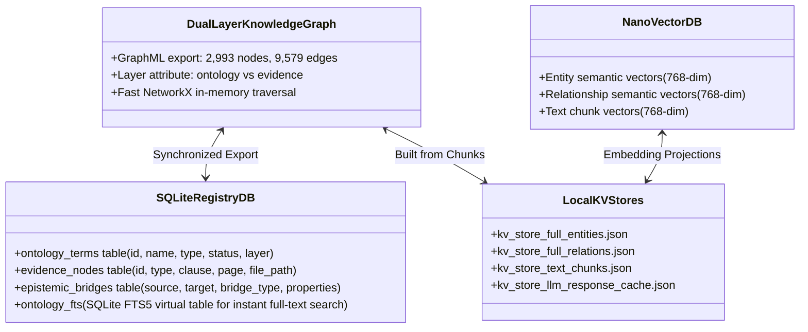
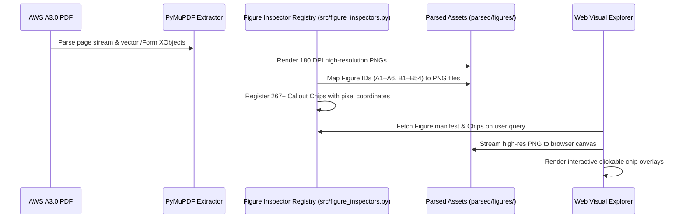

# System Architecture: AWS A3.0 Multimodal Prototype

## A1 bakeoff closeout and architecture boundary (2026-10-22)

The [canonical bakeoff summary](a1_bakeoff_results.md) captures bounded A1
backend findings, comparison limits and the vendor-neutral direction.
No vendor or framework adoption follows from this documentation closeout.
`GR` remains an optional, team-reported and unbenchmarked capability here;
it is not a mandatory foundation for the next architecture phase.
Relationship and multihop work is **PLANNED**, not implemented.
Current work is docs-only closeout and new-branch preparation, with no extended
implementation, UI change or further evaluation. Earlier architecture history remains.

## Current local A1 query-completeness pass 004 (2026-10-21)

Post-review correction: planner `1.2.1` retains literal chart-relation operations
when evidence is also requested, applies the existing literal-mention guard to
pure meta questions, and trims follow-up clauses from selectors with `_body_end`.
The earlier 31-question result below was captured with planner `1.2.0` and remains
unchanged. The single focused check for this correction passed 3 cases in
0.67 s, with 21 unrelated cases deselected; no 31-question replay or model call
was run.

Branch `fix/a1-query-completeness`, base main `799112f`, preserves the source
adapter, graph, database, v1 default and opt-in CLI. Harness
`a1-graph-qa-1.2.0` / planner `1.2.0` repairs generic source-context/relation
grammar, direct/recursive view planning and answer composition. Child-result
category follow-ups retain their enclosure links; layout comparisons include
positive family placements; source-limit answers identify absent information
without asserting operating values or universal field applicability.

The one existing 31-question replay independently grades **QA001 15 PASS** and **QA002
16 PASS**, no failures, partials or regressions; model/provider NONE, zero calls.
Focused checks passed 33/33 in 0.77 s; no full suite. Q09 retrieves 5/5 required
nodes and 4/4 links; Q10 3/3 and 2/2; Q12 22/22 and 30/30, separating 12 direct
layout children from 21 recursive descendants. Q16 correctly returns
`insufficient_evidence`. See the [private report](../storage/evidence_v2/a1_qa_repair_004/report.md).

The two existing routing/QA skills were reused unchanged; no loader or framework
was added. Candidate indentation and runtime `semantic_validation:false` remain.
Known non-failing limits are bounded exposed grammar, a duplicate shared path
in Q10, and Q12's direct-first combined row union; its separate visible lists
retain source order. Prior raw runs/gold remain unchanged. Stop after this
DEVELOPMENT pass. The owner subsequently authorized Git/PR closeout and
local/online synchronization (2026-10-21), preserving these qualification limits.

Historical pass 003 publication note (2026-10-21): that prototype was authorized
for merge.
The v1 default and explicit v2/graph-QA opt-ins remain unchanged. The existing
source-support qualifications remain applicable; the QA002 failures below
describe that historical pass, superseded by the current replay above.

## Historical pass 003 repair and thin-skill boundary (2026-10-21)

Harness `1.1.0` adds span-aware literal subject resolution, typed multi-subject
planning and qualified direct/recursive traversal over the unchanged source
graph. No question-specific answer, source-semantic repair or candidate-to-reviewed
promotion is introduced. The two actual runs were once each, 15 QA001 and
16 QA002 questions, model/provider NONE with zero calls.

Independent grades are **QA001 15 PASS / 0 FAIL / 0 PARTIAL** and **QA002
9 PASS / 4 FAIL / 3 PARTIAL**. QA001 retains 90/90 correct supported source
pairs, 29 candidate-child qualifications and 7/7 lookup facts including bounded
negatives. QA002 resolves 13/13 mentions and 23/23 mappings correctly, while
layout 06–12 grades 4 PASS / 1 PARTIAL / 2 FAIL and source-limit 13–16 grades
0 PASS / 2 PARTIAL / 2 FAIL (3/11 criteria). QA002 PASS: 01–08, 11; PARTIAL:
09, 14, 16; FAIL: 10, 12, 13, 15. These are DEVELOPMENT grades on exposed sets;
no unseen/model benchmark is claimed. Focused checks passed 33/33 in 0.56 s;
no full-suite run is claimed. Preserve QA001 0/15 then 1.0 DEVELOPMENT 15/15,
and QA002 1.0's 0 PASS / 15 FAIL / 1 PARTIAL.

Unresolved operations still omit a broader-category subtask (Q09), reject selector
residue (Q10), gate a comparison (Q12), misread A1 context (Q13), omit positive
enclosure families (Q14), block a “Does” epistemic request (Q15), or omit concrete
missing fields after stating a source limit (Q16). No further repair or replay.
The [private report](../storage/evidence_v2/a1_qa_repair_003/report.md) retains details.

The graph is unchanged at 99 nodes / 127 edges, SHA-256
`6476c898439108dbeaf7b92f0be3946a3e0d3538d5c15afb860d1cf0e02cc4d2`;
all 168 prior receipt files and six protected sources are unchanged. Runtime
semantic validation stays false and indentation stays candidate. Independent
grading is external to execution and cannot alter graph/query facts.

The thin [routing](../.agents/skills/evidence-graph-routing/SKILL.md) skill invokes
`answer_graph`; raw caller graph JSON does not authenticate source. The thin
[QA](../.agents/skills/evidence-graph-qa/SKILL.md) skill invokes the canonical CLI
and records identities with existing tools. Each packages only `SKILL.md` and
`agents/openai.yaml`; no scratch wrappers/contracts, framework or automatic
backend skill loading is integrated. Other source loaders remain unimplemented.
Stop here: no further checks/infrastructure, figures/models, UI/cloud,
database/global-setting or Git publication change.

## Historical bounded A1 graph-QA evidence (2026-10-21)

Independent grading of the first explicit generic A1 graph-QA execution is
complete: **15/15 PASS, 0 FAIL, 0 UNASSESSED**. The first eight actual answer
strings and returned rows preserve **90/90 correct, supported source pairs**,
all retrieved with zero missing/extra pairs, duplicates, designation mismatches
or source-binding errors. All 29 indentation-derived children remain qualified
as candidate. The other seven facts are **7/7 correct and supported**. Both
negative verdicts were verified against the complete original chart and positive
membership elsewhere, not a closed-world assumption over a retrieved subset.

These are external grades for DEVELOPMENT on the 15 exposed owner questions.
They are not unseen validation or an LLM/model benchmark. The original frozen
baseline remains **0/15**, with `V2_READER_REQUIRED` and no answers. The new
execution used model/provider NONE and zero LLM calls. Raw runtime
`semantic_validation: false` is unchanged; independent grading PASS does not
change candidate-edge verification or assert runtime semantic certification.

The source graph stays exactly 99 nodes / 127 edges, full SHA-256
`6476c898439108dbeaf7b92f0be3946a3e0d3538d5c15afb860d1cf0e02cc4d2`.
Protected source, database and indices are unchanged. Generic operations remain
an explicit `src/evidence_a1_cli.py --graph-qa` opt-in using
`src/evidence_a1_graph_qa.py` version `a1-graph-qa-1.0`. Default packet mode, v1
and ordinary v2/extractive still retain their prior behavior.

The [final source-safe QA receipt](evidence_v2_a1_qa_001.md) separates baseline,
execution and independent grades; raw answers/full reports remain ignored.
Stop after this bounded A1 set. No automatic other-image/model run, UI/cloud
extension, commit, push or merge follows from these grades. Earlier pending
evaluation statements below record historical checkpoints.

## Historical A1 graph-QA execution checkpoint before grading (2026-10-21)

`src/evidence_a1_cli.py --graph-qa` is a separate opt-in execution path using
`src/evidence_a1_graph_qa.py`, version `a1-graph-qa-1.0`. It adds generic
operations over the existing graph, without hardcoded owner-question answers
or graph semantic repairs. Default packet mode, v1 and ordinary v2/extractive
behavior remain unchanged. The latter still returns `V2_READER_REQUIRED` for
these graph questions; the graph-QA opt-in does not validate a model reader.

The frozen baseline predates the QA code addition; its source graph is unchanged
at **99 nodes / 127 edges**, with an exact full SHA-256 match before/after.
Protected source, database and indices are unchanged. Only generic QA code and
the explicit CLI flag were added after baseline capture, with no source-graph
update. Preserve its original 15 unanswered `V2_READER_REQUIRED` results.

One actual opt-in CLI execution produced 15 `graph_answer` outputs,
model/provider NONE and zero LLM calls. Independent grading is PENDING, so
output count is not a pass count or proof of answer correctness/source support.
Measured wall time was 374.355 ms; engine total 120.446 ms comprised source
projection 89.930 ms, image validation 8.503 ms and graph QA 22.013 ms.
The 160 targeted synthetic checks passed in 2.01 s as software regressions,
not semantic/model evaluation.

The [source-safe QA receipt](evidence_v2_a1_qa_001.md) separates frozen baseline,
DEVELOPMENT execution and independent grading; full raw answers/reports stay in
ignored storage. Preserve the single-A1 identity, six-layer evidence trace and
private grading-only metadata boundary. No UI, cloud, other figure, model trial,
commit, push or merge was introduced by this graph-QA path.

## Historical A1 deterministic graph-QA authorization boundary (2026-10-21)

The execution dataset now contains the owner's 15 Figure A1 questions,
`A1-CQ-001` through `A1-CQ-015`. The owner authorized a bounded first QA/harness
run on this one canonical image. Earlier empty-dataset/setup-only restrictions
below describe the pre-question checkpoint; no UI or other-figure extension,
cloud/provider run, commit, push or merge follows from this change.

A baseline was frozen at ignored `storage/evidence_v2/a1_qa_run_001` before
the QA code addition; the source graph remained unchanged. All 15 actual v2 query results were
`V2_READER_REQUIRED`, with no answers and no LLM calls. For list requests 1–8,
the available graph exposed the root and eight category nodes but zero process
rows. Preserve the baseline as captured; later implementation traces must be
separate DEVELOPMENT evidence.

The authorized next capability is generic deterministic graph QA: reusable graph
selection/traversal, evidence retrieval and answer composition. Do not insert
question-specific answers or modify graph semantics to match expected grading.
Keep source facts, edition joins, traversal/selected evidence, complete packets
and composed claims separately traceable. Actual result metrics must precede any
pass, completeness or answer-support claim.

The last two questions' trailing “No” values belong exclusively to private
grading metadata. Exclude them from model/query prompts, retrieval data,
graph writes and answer logic. Keep full raw traces, answers and reports in
ignored storage; publish no such data through documentation. The
[source-safe QA summary](evidence_v2_a1_qa_001.md) will record aggregate behavior.
For deterministic graph answers, record model/provider NONE and no LLM call;
that result is not evidence of model reasoning accuracy. Keep the established
single-A1 source identity and all prior semantic failures/rubrics intact.

## Historical architecture setup boundary before owner CQs (2026-10-21)

The owner supplies future competency questions. The current backend contract is
setup readiness for Figure A1 only, with no further answer-accuracy grading,
model comparison or DeepSeek/local inference evaluation. None of the newly
approved five DeepSeek cases or single `qwen2.5vl:7b` trial started. Their prior
approval is not authority to restart evaluation under this new stop instruction.

A usable setup binds the canonical single image and edition to source-bound
labels/designations and qualified graph hierarchy, manifest metadata, read-only
database identities, actual graph-traversal retrieval and a complete evidence
packet. V2 CLI/harness input must accept the owner's later questions without
requiring an agent-authored question set. Figure A1 remains Master Chart of
Welding and Joining Processes at `parsed/figures/Figure_A1_p88.png`, PDF index 87,
viewer 88, printed 75. Existing SQLite/graph stores remain unchanged.

Only structural contracts are checked now: IDs and join keys, graph paths,
editions/source fingerprints, image identity, complete required evidence closure
and future-question input validation. These checks do not assess semantic answer
accuracy. The competency-question dataset is **EMPTY — owner pending**. The
agent-authored private A1 rubric is DEFERRED and is not an accepted owner CQ set.
Do not use it to initiate reading or answer grading.

Readiness may be reported as `READY_FOR_OWNER_COMPETENCY_QUESTIONS` only after
the setup is usable; otherwise preserve the exact structural/setup blocker.
The [A1 setup receipt](evidence_v2_a1_setup.md) records that evidence. Do not
advance to A2/B6 or other images, add UI work, select a new database/graph
framework, or commit/push/merge. Earlier evaluation results and failed semantic
gates below remain historical; no score is upgraded by setup readiness.

## Historical resolved Figure A1 evaluation boundary (2026-10-21)

The active source object is **Figure A1 — Master Chart of Welding and Joining
Processes**, bound to exactly `parsed/figures/Figure_A1_p88.png`, PDF index 87,
viewer page 88 and printed page 75. Table A1 is a separate two-page object on
printed pages 69–70, outside this projection. The earlier identity-pending
section records the pre-inspection state; it is no longer the current identity.

The source auditor confirmed eight category boxes. The legacy merged candidate
`annex_a_figures_a1_a2_a3_anatomy` contains incorrect AB/CAB expansions and mixes
figure identities; it must not supply unreviewed facts to the new single-A1
projection. The versioned Figure A1 source projection is under development.
Read the existing SQLite/graph only for bounded diagnostics and keep those stores
unchanged; no old graph or database write/migration is part of this correction.

Trace complete correct A1 graph facts/qualified relations through edition joins,
retrieval/expansion and packet construction into the reader together with the
exact image pixels. Independently assess the resulting answer for correctness
and source support. Graph completeness, image availability and valid generated
IDs remain distinct from semantic support. Retain the six-layer failure taxonomy.
This is backend-only work on one image; Table A1, B6, other images, UI changes
and new database/graph frameworks are excluded. Do not automatically advance
while the current-image gate is unresolved.

The earlier five-case DeepSeek budget does NOT authorize baseline generation
with this new A1 source. The installed `qwen2.5vl:7b` trial remains UNUSED and
pending; no result or allowance consumption is asserted. Existing provider,
install/settings/restart and Git restrictions remain in force.

## Historical A1-first identity inspection boundary (2026-10-21)

Work on one image at a time; validate the current image end to end before broadening coverage. A1's canonical
source identity is pending inspection: “Annex A” is a section label and does
not establish Table A1, Figure A1 or any image file as the requested object.
Resolve the edition fingerprint, object kind/ID, page/region and exact image
binding first. Until that join is established, mark identity unresolved and
withhold evidence-completeness or supported-answer claims.

For the confirmed current A1 image, trace source ingestion, graph facts and
qualified relations, database/edition joins, retrieval/ranking/expansion, packet
construction and reader reasoning separately. Correct source facts and selected
evidence must reach the reader with their conditions and actual image payload.
A supported current-image answer is the acceptance gate. Do not automatically
advance while this gate is unresolved; document a pass or exact blocker before
considering another image. No UI redesign/enhancement or new database/graph
framework is included.

B6 and unrelated comparisons are outside the immediate run. The original
multipage B6 rubric and prior failed results remain preserved but deferred.
All five earlier approved DeepSeek cases and the single installed
`qwen2.5vl:7b` trial remain UNUSED; none has started. The one local trial may
be applied to A1 after source identity and packet inspection. The earlier
five-case DeepSeek approval does not permit sending new A1 source material.
Earlier multi-case approval plans below are historical, not an instruction to
run those cases now. Provider/install/settings/restart and Git restrictions
remain in force.

## Backend-only v2.0 correctness and historical approval boundary (2026-10-21)

The active architecture work is source/graph data correctness, database structure
and edition joins, graph retrieval and qualified expansion, complete correct
packet delivery, and reader reasoning that produces supported answers. No UI
enhancement or redesign is included. The existing guarded web API's version flag
is compatibility plumbing only. Keep the current SQLite/manifest/graph spine;
choose no new database or graph framework without a measured, reproducible gap
and a comparison with the smallest viable correction to that spine.

Use the following failure taxonomy when tracing a query through the backend:

| Layer | Failure to demonstrate or repair |
|---|---|
| Source ingestion | Source fingerprint, extracted fact/cell/header/note, region or asset is missing, stale or incorrect. |
| Graph facts/relations | Concept/sense/fact, relation type, qualification or provenance is incorrect or unjustifiably promoted. |
| Database/edition joins | Evidence is joined to the wrong document, edition, source hash or locator; identities are orphaned or duplicated. |
| Retrieval/ranking/expansion | Correct required evidence is absent, misranked or excluded by seed selection, alias resolution or qualified graph expansion. |
| Packet construction | Selected evidence loses required qualifiers, exceptions, footnotes, continuation order or image bytes before reading. |
| Reader reasoning | A complete correct packet reaches the reader, but its answer is incomplete, incorrect, unsupported or fails faithful abstention. |

A valid evidence ID establishes identity, not entailment. Keep source and graph
provenance, edition join keys, selected retrieval/expansion records and the final
packet trace distinct from the model output. Attribute failures to the first
observed broken layer; do not diagnose reasoning from a packet that was already
wrong. Backend acceptance requires supported answers, not test counts alone.

The new bounded approval covers five frozen unchanged-v1 DeepSeek comparison
cases at the already configured provider and one trial of installed
`qwen2.5vl:7b`. Their outcomes remain pending. Do not broaden to other paid
cases/providers, install models/packages, change persistent settings, restart a
service or commit/push/publish/merge. Previous failed source/semantic results and
frozen grading remain unchanged; earlier local-only blocker statements describe
the pre-approval checkpoint.

## Reader runtime recovery and semantic boundary (2026-10-21)

The native local request now bounds context to 16384 tokens and output to 1024,
preserving all source image bytes. An inherited 262144 context caused the large
KV allocation; 8192 reached the runner but could not hold the complete input.
Safe numeric HTTP diagnostics, valid empty-claims abstention, canonical route
seed membership and case-aware table-code selectors are tested. Source locators
and captions sit next to each image payload; this does not certify page binding
or panel meaning. The original real source result is **4/6**, with **11/13 facts
correct and 10/13 supported**. Multipage reading still fails after an exposed
formatting replay. The [runtime receipt](evidence_v2_runtime_recovery.md) keeps
controlled reader modality effects separate from unchanged v1 live integration,
which has not been compared. V1 defaults and persisted settings are unchanged.
The [strict integration preflight](evidence_v2_live_comparison_blocker.md) narrows
that gap: one actual provider-free pair ran, while five inputs require the
configured external DeepSeek provider. Existing endpoint validation rejects
silent loopback redirection. That pre-approval checkpoint was a scope/configuration boundary, not a
missing index; no alternate model trial or provider change had been performed.

## Version 2 evidence slice (2026-10-21)

Local tag `v1.0` preserves `24bac45465bcb5c9ea14663f7a669927d5d2ed00`.
The local `v2/evidence-engine` branch adds a bounded opt-in path while the
existing manifest, SQLite registry, vectors, graph and default v1 behavior remain
the source spine and compatibility baseline. This task authorizes no commit,
push, publication or merge.

`src/evidence_sources.py` projects authorized source material into the
`src/evidence_v2.py` schema. Evidence IDs bind schema version, edition fingerprint,
kind, locator and content. Definitions retain headword/sense/alias information;
table rows retain headers, cells and footnotes; figure regions retain captions,
asset hashes, full-page geometry and source order. Versioned table rows retain
cell/header region locators as well as text. Required notes and continuation
orders survive retrieval. Qualified relationships provide bounded navigation,
not entailment. SQLite name matches remain candidate identity hints.

The in-memory `EvidenceStore` is a derived index with typed exact routes:
definition/alias, structured table, visual reader, comparison, explicit ambiguity
and missing evidence. Packets close over required evidence rather than truncating
at a top-k boundary. Ambiguous senses require clarification; incomplete,
unverified, stale or damaged required evidence withholds answering.

`src/evidence_reader.py` composes exact definition/table extracts or supplies the
complete packet to the approved local visual reader. The final request includes
the original validated PNG bytes for every ordered continuation. This is the
answering path; historical figure-extraction model calls do not establish this
contract. Generated claims require supplied evidence IDs and retain
`UNASSESSED` semantic support. `SOURCE_BOUND_EXTRACT` validates extraction
bindings only. Existing citations or graph paths never certify claim meaning.

The bounded source projection contains six native definition/alias entries,
Tables A2/A3 (133/134 rows from an explicit three-page native extraction), and
Figure B6's three full-page regions with its required applicability-conflict note.
The ignored `storage/evidence_v2/tables.v2.2.json` derivative is versioned and
source-fingerprint checked. It does not overwrite empty legacy Markdown or
publish licensed excerpts. No full ingestion, re-embedding or schema migration of
the existing SQLite/manifest spine is required.

Rollout uses `evidence_version="v2"` and `v2_reader="extractive"|"local"` on the
existing `run_query`/`async_query`, CLI and guarded `/api/query` interfaces.
The default remains v1. No browser UI changes are included; guarded API clients
can opt in explicitly. Local generation uses only configured loopback Ollama
and `VLM_MODEL`, with no request-authorized new endpoint or credentials. Rollback
selects `evidence_version="v1"`; preserve uncommitted work and local branch/tag.
The [schema contract](evidence_v2_schema.md),
[dependency contract](dependency_contract.md) and
[current receipt](evidence_v2_implementation.md) distinguish software regressions,
mocked synthesis, source extraction and real semantic/model validation. Historical
architecture and evidence claims below remain historical checkpoints.

## Guarded actual-runtime verification (2026-10-16)

The current increment was verified in the actual local app with an external
process-local provider-free guard, using the real registry/composer/projector,
resolver, catalog, inspector, assets and browser UI. API 19/19 and Chrome 8/8
smoke checks passed; all three Figure B6 images fetched/decoded in order and
retained distinct zoom targets. No application dependency was stubbed for this
running-app check. Generation remained disabled and the guard is not a new
repository configuration feature. The known favicon 404, failed frozen fresh
gates and semantic/latency gaps remain. Earlier unreloaded statements below
describe earlier checkpoints; aggregate limits are retained in the
[implementation receipt](claim_evidence_implementation.md).

## Element through-range boundary (2026-10-16)

The canonical element resolver accepts full-match bare numeric `through`
ranges and reuses endpoint/inventory/width/order checks before expansion.
Printed-page ranges retain their separate dash-only grammar; unsupported
repeated-kind, panel, suffix, mixed-prefix and unknown-member expressions still
fail whole. No evidence/support service or provider path changed. Compound
asset failures retain all source identities, declaration order, both diagnostics
and healthy shared render bytes without certifying claim meaning. The exposed
replay is DEVELOPMENT 4/6, 489/491; first fresh 3/6, 461/491 remains failed.

## Claim-associated evidence projection (2026-10-16)

The integration follow-up reuses per-asset validation for optional navigation
and legacy display, preserves source-only table identity, and consumes ordered
direct-inspection continuations. A shared hierarchy/page projection feeds both
claim binding and full-response generated-reference validation. Unresolved or
contradictory source identity withholds the generated answer while retaining
explicitly labeled diagnostic links. These gates establish identity, not semantic
support. Provider-free handler/core and synthetic Chrome fixtures pass; existing
apps remain unreloaded and original frozen acceptance remains unmet.

The query path attaches `claim_evidence_links` and
`claim_evidence_assessment` through the pure deterministic
`src/evidence_resolution.py` service. Complete references use the shared
manifest lexer; asset validation uses a per-record canonical seam while legacy
path lookup remains atomic. Exact selectors/native bindings are separate from
asset integrity and semantic support. Only the composed server route supplies a
reviewed fact view; generic generated claims retain unassessed support and have
no inferred evidence selector. Required reviewed failures produce HTTP 503.
The UI consumes ordered available assets and prevents late-response evidence
from replacing a newer request. [The bounded receipt](claim_evidence_implementation.md)
distinguishes tests, strict/amended development protocols, fresh heldout evidence,
offline timing and the remaining semantic/live-runtime gaps. Corpus/index/graph
schemas, provider behavior and persisted stores are unchanged.

`ordered_evidence.relationship` describes the canonical citation/navigation
reference role. `binding_evidence` separately retains each selected context's
relationship and selection role. Explicit navigation-only contexts cannot fill
required selected-source bindings, even when their identity metadata matches.
This separation fixes omitted provenance without promoting available assets to
semantic authority. The first fresh 2/6 gate remains recorded as failed; later
exposed-case replays do not establish new unseen coverage.

## Bounded answer composition and assessment (2026-10-16)

`src/query.py` now applies deterministic scope handling and the pure `src/grounded_answer.py` definition/alias composer before provider initialization. The terminology adapter supplies a reviewed bundle; the pure composer validates its spans, hashes and canonical anchors, preserves complete alternatives/conditions and returns exact claim-to-fact bindings. Unsupported intents retain the existing generation path. Responses distinguish outcome, composed/generated origin and hash-bound assessment scope; graph links and nullable coverage metrics cannot certify whole-answer truth. UI evidence rendering uses safe text and clears stale panels. Composed answers also expose an explicit `answer_policy_notes` scope limit outside factual claim bindings. [The implementation receipt](answer_grounding_implementation.md) separates the original two omissions from the repaired DEVELOPMENT replay, unchanged retrieval controls and browser functional passes with a retained favicon 404. Registry/source/store bytes were preserved; no new ingestion or cross-modal reasoning capability was added.

## Bounded live terminology lookup (2026-10-15)

`src/terminology_retrieval.py` validates a local ignored reviewed registry against the manifest and existing contextual chunk contents. After the contextual-index prerequisite and before model work, the hybrid path selects the longest whole reviewed headword; after reranking it reserves one result slot for the complete target/sense/provenance bundle. Unrelated queries preserve the existing output. `src/query.py` supplies the bundle to generation and adds matched-only resolution metadata; stale relevant evidence returns a source-free structured error and HTTP 503. Existing stores, graph projection and embeddings are not rebuilt. [Implementation, empirical results and limits](terminology_live_results.md) separate this three-headword lookup from full multimodal retrieval and generated-answer correctness.

## Chunk vector reader compatibility (2026-10-15)

`src/indexer.py` installs the instance-local `src/vector_reader_compat.py` reader on `rag.chunks_vdb`. It accepts validated stored numeric lists and native encoded vectors while preserving LightRAG 1.5.7 pending/redo/delete and lock behavior. Version and native-source guards require review before dependency upgrades. Stores, embedding dimensions and provider configuration are unchanged. [The bounded evaluation](vector_reader_compatibility.md) separates reader ranking, the current hybrid lane, and factually ungraded local answers.

This document specifies the technical architecture, data structures, storage layers, graph schema, epistemic verification pipeline, and runtime interfaces for the **AWS A3.0 Standalone Multimodal Prototype**.

## Bounded helper contracts (2026-10-15)

UI registry readers now reject invalid normalized y/x geometry and return copied views. The canonical source parser supports bounded numeric figure/table ranges; singular retrieval enrichment retains its prior valid query contract. `src/terminology_mappings.py` accepts supplied reviewed entry boundaries and verified compatible ontology rows, returns ordered per-target records, and projects only into a supplied in-memory directed multigraph. `project_terminology_mappings` is opt-in; that helper-only milestone left the full builder, SQL schema, persisted graphs, vectors and live query path unchanged. The subsequent live lookup is described above. [Historical helper evidence](helper_hardening_implementation.md) distinguish helper checks from source/answer certification.

## Source metadata contract (2026-10-15)

`config/aws_a30_2020_manifest.json` plus its canonical-hash receipt own document identity, source page labels, 10 section spans, 62 figure IDs, 11 table IDs and ordered source/asset bindings. The standard-library reader in `src/standard_manifest.py` validates the local PDF fingerprint and fails explicitly on invalid/stale required metadata. Config, citation/asset readers and future graph metadata project from it. Existing SQLite/GraphML/chunks/vectors remain unchanged retrieval inputs; cached figure/table locations cannot override the manifest. Unknown/group records cannot satisfy source-location grounding.

The UI registry still owns chips/categories, and `figure_bboxes.json` owns existing image-space geometry. All 94 PNG bindings match 180-DPI source renders; regions, cells/footnotes and semantic companion support remain unverified. Annex B retains conflicting applicability evidence. [Implementation receipt](declarative_manifest_implementation.md) separates source-location validation from answer correctness. The older architecture counts and verification claims below describe historical artifacts, not a new store audit or readiness finding.

---

## 1. System Overview & Data Flow

The system operates on an offline-first, multimodal, and epistemically grounded architecture designed to query and audit **AWS A3.0M/A3.0:2020 Standard Welding Terms and Definitions**.


---

## 2. The Dual-Layer Epistemic Graph Architecture

A core innovation in this prototype (completed in Card 07) is the complete structural separation of **what concepts mean** (the domain ontology) from **where and how they are proven** (the normative evidence).

### Layer 1: Domain Ontology Layer
Represents abstract welding domain knowledge independently of the document typography:
- **Node Labels**:
  - `:Concept`: Core welding, thermal, or physical concepts (e.g., *Complete Joint Penetration*, *Actual Throat*, *Thermal Gouging*).
  - `:Process`: Specific welding, thermal cutting, spraying, or allied processes (e.g., `GMAW-P`, `GTAW`, `SMAW`, `FOW`).
  - `:JointGeometry`: Edge preparations, angles, and fit-up characteristics (e.g., *Bevel Angle*, *Root Opening*, *Groove Face*).
  - `:Discontinuity`: Imperfections, flaws, and profile deviations (e.g., *Undercut*, *Overlap*, *Porosity*).
  - `:WeldSymbol`: Graphical weld symbol representations and standard signifiers.
  - `:TestPosition`: Standard qualification orientations (e.g., `1G`, `2F`, `5G`, `6GR`).
- **Node Properties**:
  - `name`: Standard canonical term name.
  - `description`: Formal technical explanation.
  - `standard_status`: Categorized as `standard`, `nonstandard` (e.g., deprecated shop slang), or `deprecated`.
  - `layer`: `"ontology"`.
- **Intra-Ontology Semantic Edges**:
  - `[:IS_A]` / `[:SUBPROCESS_OF]`: Process taxonomic hierarchy.
  - `[:HAS_GEOMETRY]`: Joint-to-feature relations.
  - `[:NONSTANDARD_FOR]`: Directed mapping from deprecated slang to normative standard terms (e.g., `short arc` $\to$ `short circuiting transfer`).
  - `[:CONTRASTS_WITH]`: Fine-grained disambiguation (e.g., `root opening` $\leftrightarrow$ `root face`).

### Layer 2: Normative Evidence Layer
Represents the physical, structural hierarchy of **AWS A3.0M/A3.0:2020**:
- **Node Labels**:
  - `:Document`: Master standard root node (`AWS A3.0M/A3.0:2020`).
  - `:Clause`: Formal document sections (Clause 1–4, Annex A–F).
  - `:Figure`: All 60 standard engineering drawings and classification charts.
  - `:Callout`: Specific labeled callout coordinates/chips on technical diagrams.
  - `:Table`: Master process matrices and historical revision tables.
  - `:TextChunk`: Verbatim, location-tagged text segments.
- **Node Properties**:
  - `id` / `figure_id` / `table_id` / `chunk_id`.
  - `printed_page` and `pdf_page`.
  - `image_file` or `text_file` relative paths on disk.
  - `layer`: `"evidence"`.
- **Intra-Evidence Structural Edges**:
  - `[:CONTAINS_CLAUSE]`: `:Document` $\to$ `:Clause`
  - `[:CONTAINS_FIGURE]`: `:Clause` $\to$ `:Figure`
  - `[:CONTAINS_TABLE]`: `:Clause` $\to$ `:Table`
  - `[:CONTAINS_CHUNK]`: `:Clause` $\to$ `:TextChunk`
  - `[:HAS_CALLOUT]`: `:Figure` $\to$ `:Callout`

### Inter-Layer Epistemic Grounding Bridges
These directed, typed edges cross the boundary between Layer 1 and Layer 2, providing verifiable mathematical proof that a technical claim is tethered to standard text or diagrams:
- `[:DEFINED_IN]`: `:Concept` $\to$ `:TextChunk` (cites exact clause, printed page, and quote).
- `[:ILLUSTRATED_BY]`: `:Concept` / `:JointGeometry` $\to$ `:Figure` or `:Callout` (links concept to exact visual callout chip).
- `[:TABULATED_IN]`: `:Process` $\to$ `:Table` (links letter code to process master table row).
- `[:JUSTIFIED_BY]`: `:Concept` $\to$ `:Clause` (links terms to committee rationale in Annex C).
- `[:HISTORICALLY_RECORDED_IN]`: `:Concept` $\to$ `:Table` (links revision history to Annex D tables).

---

## 3. Storage & Registry Implementation

The system deliberately avoids complex database servers (no Neo4j server, no Docker daemons) to maintain zero-cost local reproducibility.



1. **GraphML Substrate** ([`storage/dual_layer_knowledge_graph.graphml`](file:///C:/Users/kenai/aws-a30-prototype/storage/dual_layer_knowledge_graph.graphml)):
   - Total Nodes: **2,993** (2,522 Ontology + 471 Evidence).
   - Total Edges: **9,579** (3,254 Semantic + 512 Structural + 5,854 Epistemic Bridges).
   - Standard format loadable by Gephi, Cytoscape, NetworkX, and iGraph.
2. **SQLite Registry & FTS5** ([`storage/dual_layer_registry.db`](file:///C:/Users/kenai/aws-a30-prototype/storage/dual_layer_registry.db)):
   - Implements native SQLite `FTS5` full-text search index (`ontology_fts`) for sub-millisecond keyword lookup.
   - Foreign-key relational schema enforcing layer integrity and bridge consistency.
3. **Vector Indices & Contextual Embeddings**:
   - `storage/vdb_chunks.json`, `storage/vdb_entities.json`, `storage/vdb_relationships.json` (768-dim Gemini embeddings).
   - `storage/vdb_chunks_contextual.json`: 1024-dimensional contextual chunk embeddings generated offline via `BAAI/bge-large-en-v1.5` under Card 08.
4. **Local Response & Extraction Cache**:
   - `storage/kv_store_llm_response_cache.json` caches model inference, allowing repeat runs with zero cloud costs.

### 3.1 Architectural Alignment with Turbopuffer v3 ("RIP, Vector Database")

The storage architecture deliberately adopts the core tenets of Turbopuffer's *"RIP, Vector Database"* research:
1. **Vectors as Secondary Auxiliary Indices**: Vector spaces are not treated as primary keys or entity records. Canonical document identity, clause hierarchies, and ontology entities are anchored in the **Dual-Layer Epistemic Graph** and **SQLite FTS5 Registry** (`storage/dual_layer_registry.db`). Vector files (`storage/vdb_*.json`) are purely secondary, auxiliary lookup projections keyed by immutable canonical IDs.
2. **Mitigating Write & Storage Amplification**: Because multi-vector representations (such as our 1024-dim contextualized chunks) point to stable primary keys in the relational store, modifying graph edges, cross-references, or metadata never triggers vector index rebuilds or storage bloat.
3. **Decoupled Compute with Zero Server Daemons**: Rejects heavy standalone vector database daemons (e.g., Pinecone, Milvus, Qdrant) in favor of localized, zero-cost SQLite and appendable vector caches, guaranteeing fully offline, reproducible execution.
4. **Hybrid Retrieval with Reciprocal Rank Fusion (RRF)**: Deterministic full-text keyword indexing (SQLite FTS5) provides exact terminology enforcement (e.g., distinguishing "root opening" from "root face"), while contextual vectors provide semantic fallback, fused via RRF.

---

## 4. Multimodal Perception & Asset Pipeline

The PDF stores engineering diagrams as vector drawings inside `/Form` XObjects rather than embedded JPEG/PNG rasters. 



1. **High-Resolution Vector Rendering**:
   - PyMuPDF renders all 60 standard figures at 180 DPI, producing crisp technical diagrams without loss of legibility on fine line work and weld symbols.
   - Multi-figure PDF pages (e.g., `B16A`, `B16B`, `B16C` on page 113) are segmented into dedicated visual assets.
2. **Interactive Figure Inspector Registry** ([`src/figure_inspectors.py`](file:///C:/Users/kenai/aws-a30-prototype/src/figure_inspectors.py)):
   - Covers 100% of the 60 standard figures across 9 functional categories:
     - `Joint Anatomy & Grooves`: Figures B1–B15.
     - `Weld Positions & Test Fixtures`: Figures B16–B22 (including 1G, 2F, 5G, 6GR ring).
     - `Flange, Fillet & Plug Welds`: Figures B23–B31 (Fillet weld throats, leg sizes).
     - `Edge Welds & Surfacing`: Figures B32–B37.
     - `Resistance & Solid-State Welding`: Figures B38–B44 (Spot, seam, projection, friction stir).
     - `Brazing & Soldering Joints`: Figures B45–B50.
     - `Cutting & Gouging Profiles`: Figures B51–B54.
     - `Master Process Charts & Trees`: Annex A Figures A1–A6.
   - Encodes 267+ interactive callout chips with queries, labels, and semantic categories.

---

## 5. Auditable Epistemic Verifier Engine

The Epistemic Verifier ([`src/epistemic_verifier.py`](file:///C:/Users/kenai/aws-a30-prototype/src/epistemic_verifier.py)) audits candidate answers before or alongside user presentation.

### Verification Algorithm
```python
def verify_answer(query: str, answer_text: str, graph: nx.MultiDiGraph) -> EpistemicAudit:
    # 1. Detect if query is an Out-of-Scope Negative Control
    if is_out_of_scope(query) and indicates_abstention(answer_text):
        return EpistemicAudit(status="TRUTHFUL_ABSTENTION", provenance_score=1.0)
    
    # 2. Extract technical ontology concepts asserted in answer
    concepts = extract_asserted_concepts(answer_text)
    
    # 3. For every concept, traverse the graph for an unbroken bridge to Evidence
    grounded_concepts = []
    unbacked_concepts = []
    for concept in concepts:
        evidence_nodes = [
            v for u, v, d in graph.out_edges(concept, data=True)
            if d.get("bridge_type") in ["DEFINED_IN", "ILLUSTRATED_BY", "TABULATED_IN"]
        ]
        if evidence_nodes:
            grounded_concepts.append((concept, evidence_nodes))
        else:
            unbacked_concepts.append(concept)
            
    # 4. Compute Epistemic Provenance Score
    score = len(grounded_concepts) / len(concepts) if concepts else 1.0
    status = "VERIFIED_GROUNDED" if score >= 0.85 else "PROVISIONAL_PARTIAL"
    
    return EpistemicAudit(
        status=status,
        provenance_score=score,
        grounded=grounded_concepts,
        unbacked=unbacked_concepts
    )
```

---

## 6. Web Visual Explorer Application

The user interface ([`src/web.py`](file:///C:/Users/kenai/aws-a30-prototype/src/web.py)) is a lightweight single-page visual explorer served over HTTP (default port `8000`).

### UI Features:
1. **Interactive NLQ Search Bar**: Pre-loaded with suggestion chips for joint geometries, nonstandard terms, process matrices, and cross-modal queries.
2. **Dual-Layer Epistemic Provenance Panel**:
   - Status badge: `VERIFIED_GROUNDED (100%)` or `TRUTHFUL_ABSTENTION`.
   - Ontology Concept tags tagged by domain type (`:JointGeometry`, `:Process`, `:Discontinuity`).
   - Unbroken Evidence links showing exact `[:DEFINED_IN]` clauses and `[:ILLUSTRATED_BY]` figure numbers.
3. **Interactive Multimodal Diagram Canvas**:
   - Renders the high-resolution vector drawing with smooth zoom and pan controls.
   - Displays clickable **interactive callout chips** beneath the figure, allowing instant drill-down on anatomical features.
4. **Figure & Diagram Directory Drawer**:
   - Expandable side drawer indexing all 60 standard figures across Annex A and Annex B for direct exploration.

---

## 7. Gold Benchmark & Evaluation Subsystem

The automated benchmark harness ([`eval/test_scorer.py`](file:///C:/Users/kenai/aws-a30-prototype/eval/test_scorer.py)) tests the system against [`eval/gold_benchmark.json`](file:///C:/Users/kenai/aws-a30-prototype/eval/gold_benchmark.json):

| Modality Class | Count | Focus Areas Tested | Target Accuracy |
|---|:---:|---|:---:|
| **Text** | 8 | CJP, Adaptive Control, Throat definitions, Thermal gouging, Style rules, Interpretation procedures | 100.0% |
| **Nonstandard** | 5 | Root pass, Burn-through (melt-through), Short arc, Hydromatic welding, Flow welding | 100.0% |
| **Table** | 7 | GMAW-P, SMAW, ASP, Waveform AIP/TIE (Table D1), Cored solder (Table D4), Deleted terms (Table D6) | 100.0% |
| **Figure** | 18 | Figures A6, B4, B5, B6, B12, B16A, B19, B21 (6GR), B23J, B25, B26, B28, B33, B34, B35, B39, B40, B46, B51 | 100.0% |
| **Cross-Modal** | 2 | 1F pipe test position (Fig B20), Bevel angle & depth (Fig B6) | 100.0% |
| **Qualifier** | 2 | Root opening vs root face, Back weld vs backing weld sequence | 100.0% |
| **Abstention** | 8 | ASTM A36 preheat (D1.1), Porosity acceptance limits, E7018 yield strength, Fictitious Fig B120, Table A10 | 100.0% |
| **TOTAL** | **50** | **Comprehensive normative coverage across all 190 pages of AWS A3.0** | **100.0%** |

## Local API boundary update (2026-10-15)

Asset reads now use startup allowlists and file containment/identity checks. Model
clients enforce the selected engine's configured endpoint and disable redirects
and environment proxy inheritance. Exact Host/Origin and JSON request checks protect
the loopback API, with explicit production UI origins configurable server-side.
See [security boundary notes](security_boundary_notes.md) for contracts and limitations.
This update does not establish new retrieval or answer-accuracy results.

Missing contextual indexes now fail before database/model work with an explicit
`RETRIEVAL_INDEX_MISSING` result, HTTP 503 and CLI exit 1. Recovery is a trusted
operator action; the query path never starts an automatic rebuild.
