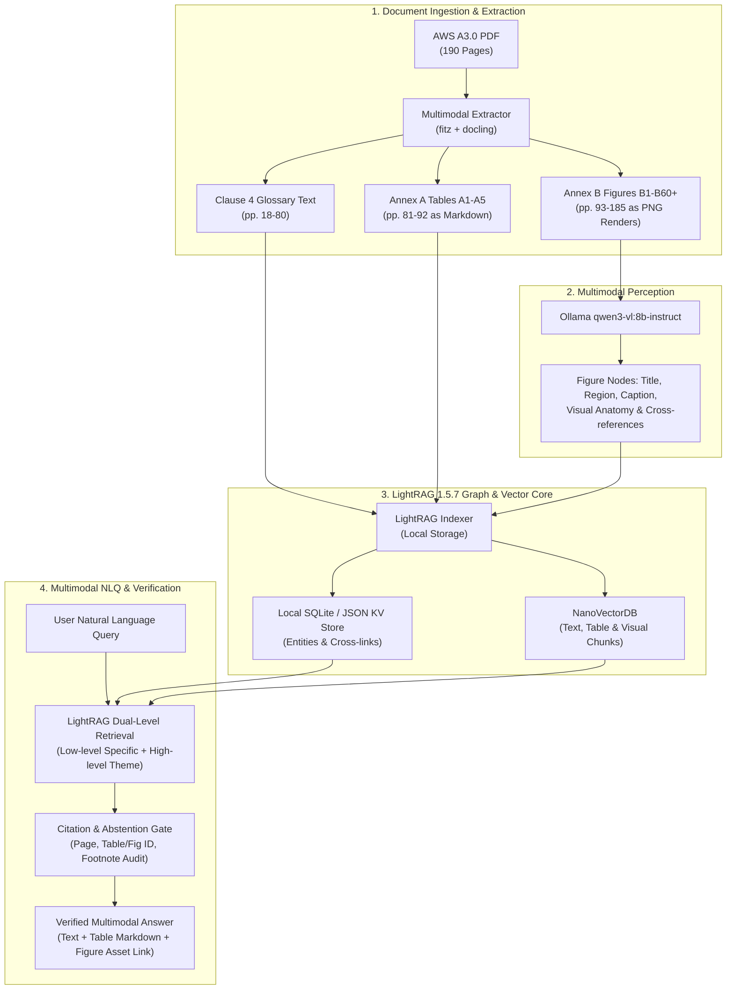

# Implementation Plan: Standalone AWS A3.0 Multimodal NLQ Prototype

## Goal Description
Build a clean-slate, standalone prototype for Natural Language Querying (NLQ) over the full 190-page **AWS A3.0M/A3.0:2020 Standard Welding Terms and Definitions** (`C:\Users\kenai\OneDrive\Documents\Projects\weld\corpus\AWS A3.0MA3 - Standard Welding Terms and Definitions.pdf`). 

The prototype will provide full multimodal search and retrieval—answering queries that span text definitions (Clause 4), process classification tables (Annex A), and engineering diagrams (Annex B vector drawings), with exact source citations and faithful abstentions.

This project is completely separate from previous migration checkouts, legacy worktrees, and the 9-document Neo4j corpus.

---

## User Review Required

> [!IMPORTANT]
> **Resolution of the RAG-Anything / LightRAG Version Wrinkle**:
> Our investigation of the upstream HKUDS repositories revealed that **RAG-Anything was permanently merged upstream into LightRAG v1.5.0 in May 2026**. RAG-Anything's standalone repo is frozen with `lightrag-hku < 1.5`, whereas LightRAG `1.5.7` has native multimodal document processing with built-in **Docling** and sidecar format support.
> **Decision**: We will pin `lightrag-hku>=1.5.7` directly with Docling/PyMuPDF, avoiding the deprecated standalone wrapper while fulfilling the intended RAG-Anything multimodal architecture.

> [!IMPORTANT]
> **Model Backend Selection (Local vs. Hybrid)**:
> Environmental reconnaissance detected:
> - **Ollama is already running locally** with vision models (`qwen3-vl:8b-instruct`, `qwen2.5vl:7b`) and reasoning models (`deepseek-r1:latest`).
> - `DEEPSEEK_API_KEY` is present in the environment for cloud text inference.
> - **Proposed Configuration**: Use `DEEPSEEK_API_KEY` (or local `deepseek-r1`) for primary text reasoning/entity extraction, and local Ollama `qwen3-vl:8b-instruct` for visual figure analysis.

> [!WARNING]
> **Project Directory Location**:
> To guarantee complete isolation from the existing `weld` git repository and legacy scripts, we propose creating the project at `C:\Users\kenai\aws-a30-prototype`.

---

## Open Questions

> [!NOTE]
> 1. **Project Directory**: Do you approve creating the standalone workspace at `C:\Users\kenai\aws-a30-prototype`, or do you prefer another directory?
> 2. **Inference Mode**: Do you prefer **Hybrid mode** (DeepSeek API for text + local Ollama for VLM vision) or **100% Local mode** (all Ollama models, zero cloud calls)?

---

## System Architecture



---

## Proposed Changes

### Component 1: Environment & Project Scaffolding

#### [NEW] `pyproject.toml`
Defines dependencies, strictly pinned:
```toml
[project]
name = "aws-a30-prototype"
version = "0.1.0"
description = "Standalone Multimodal NLQ Prototype for AWS A3.0"
requires-python = ">=3.11"
dependencies = [
    "lightrag-hku>=1.5.7",
    "pymupdf>=1.24.0",
    "docling>=2.0.0",
    "openai>=1.30.0",
    "pydantic>=2.7.0",
    "rich>=13.7.0",
    "python-dotenv>=1.0.0"
]
```

#### [NEW] Directory Structure
```text
C:\Users\kenai\aws-a30-prototype/
├── data/
│   └── AWS_A3.0_2020.pdf             # Copied from OneDrive source
├── parsed/
│   ├── text_chunks.jsonl              # Clauses 1-4 with exact section/page anchors
│   ├── tables/                        # Tables A1-A5 in structured Markdown
│   └── figures/                       # Rendered Annex B figures (.png + metadata JSON)
├── storage/                           # Local LightRAG indexes (zero external servers)
│   ├── kv_store_default.json
│   ├── vdb_entities.json
│   └── vdb_relationships.json
├── eval/
│   ├── gold_benchmark.json            # 12 multimodal evaluation queries
│   └── test_scorer.py                 # Scorer verifying support, citations, & abstentions
└── src/
    ├── __init__.py
    ├── config.py                      # Model endpoints & paths
    ├── extract.py                     # High-fidelity fitz/docling extractor
    ├── indexer.py                     # LightRAG multimodal ingestion
    ├── query.py                       # NLQ engine with graph traversal
    └── citation_checker.py            # Exact citation resolver
```

---

### Component 2: Multimodal Extraction Pipeline

#### [NEW] `src/extract.py`
High-fidelity extraction using `fitz` and `docling`:
1. **Annex B Figures (Pages 93–185)**:
   - Detect figure headers using regex: `Figure B\d+.*`.
   - Render page/sub-regions at 180 DPI via `fitz.Page.get_pixmap()`.
   - Send figure renders to Ollama `qwen3-vl:8b-instruct` to extract:
     - Joint type, bevel anatomy, root dimensions, part labels.
     - Textual cross-reference anchors (`"Illustrated in Clause 4 under 'groove weld'"`).
   - Save image to `parsed/figures/Figure_B<N>.png` and metadata to `parsed/figures/Figure_B<N>.json`.
2. **Annex A Tables (Pages 81–92)**:
   - Extract Tables A1–A5 using `docling` or `pdfplumber`.
   - Output structured Markdown preserving multi-column process letters (e.g. `SMAW`, `GMAW-P`) and normative notes.
3. **Clause 4 Glossary (Pages 18–80)**:
   - Extract term definitions with page numbers, printed page numbers, and embedded cross-links (`"See Figure B..."`, `"See Table A..."`).

---

### Component 3: LightRAG Multimodal Ingestion

#### [NEW] `src/indexer.py`
Instantiates `LightRAG` configured for local storage:
- Ingests text blocks with explicit location tags: `[AWS A3.0:2020 Clause 4, p. 48]`.
- Ingests tables with title headers and footnotes intact.
- Ingests figure nodes with visual descriptions and file URI links.
- Uses `DEEPSEEK_API_KEY` (or local model) for entity-relationship extraction.
- Graph automatically links terms $\leftrightarrow$ tables $\leftrightarrow$ figures via text references.

---

### Component 4: Multimodal NLQ Engine & Citation Resolver

#### [NEW] `src/query.py` & `src/citation_checker.py`
- Implements hybrid retrieval (vector similarity + knowledge graph traversal).
- When a query asks for a visual joint or process:
  - Retrieves the governing definition chunk.
  - Traverses the graph edge to fetch the associated Annex B figure asset and Annex A table.
- Emits response formatted as:
  1. Direct answer with qualifications.
  2. Table excerpt (if applicable).
  3. Figure link & visual anatomical breakdown (if applicable).
  4. Verified source citations down to Page, Clause, and Element ID.

---

### Component 5: 12-Question Multimodal Benchmark

#### [NEW] `eval/gold_benchmark.json`
Curated challenge set covering all modalities and failure modes:

| ID | Modality | Query | Target Citation / Evidence | Expected Behavior |
| :---: | :--- | :--- | :--- | :--- |
| `Q01` | Text | "Define complete joint penetration (CJP)." | Clause 4, p. 22 | Return exact standard definition |
| `Q02` | Text | "What is the nonstandard term for root pass?" | Clause 4, p. 55 | Identify nonstandard vs preferred term |
| `Q03` | Table | "What is the letter designation for gas metal arc welding - pulsed arc?" | Annex A, Table A1, p. 69 (`GMAW-P`) | Exact table cell retrieval |
| `Q04` | Table | "Which welding processes fall under resistance welding in Table A1?" | Annex A, Table A1, p. 70 | Multi-row table synthesis |
| `Q05` | Figure | "What are the components of a groove face and root edge?" | Annex B, Figure B5, p. 86 (PDF p. 98) | Return Figure B5 image asset + label parts |
| `Q06` | Figure | "Show the joint root configurations for butt joints." | Annex B, Figure B4, p. 85 (PDF p. 97) | Return Figure B4 image asset |
| `Q07` | Cross-Modal | "Explain 1F pipe welding test position and show its orientation." | Clause 4 (definition) + Figure B20 (diagram) | Fuse text definition with Figure B20 visual |
| `Q08` | Cross-Modal | "What is a bevel angle and how is it illustrated?" | Clause 4 (definition) + Figure B6 (diagram) | Fuse text definition with Figure B6 visual |
| `Q09` | Qualifier | "What is the distinction between root opening and root face?" | Clause 4 + Figures B4 & B5 | Distinguish dimensions and boundary conditions |
| `Q10` | Qualifier | "Under what conditions is a backing weld distinguished from a back weld?" | Clause 4 (back weld vs backing weld) | Respect sequence/application qualifier |
| `Q11` | Abstention | "What are the ultrasonic testing acceptance limits for porosities in welds?" | None (Out of scope of AWS A3.0) | **Must cleanly abstain** |
| `Q12` | Abstention | "What are the tensile strength requirements for E7018 electrodes?" | None (Covered in AWS A5.1, not A3.0) | **Must cleanly abstain** |

---

## Verification Plan

### Automated Tests
1. **Extraction Validation**:
   ```pwsh
   python src/extract.py --verify-only
   ```
   *Expected*: Confirms extraction of 64 glossary pages, Tables A1–A5, and $\ge 60$ rendered Annex B figures.
2. **Index Integrity Check**:
   ```pwsh
   python src/indexer.py --dry-run
   ```
   *Expected*: Verifies local LightRAG storage files are initialized without network errors or database connection dependencies.
3. **Benchmark Execution & Citation Audit**:
   ```pwsh
   python eval/test_scorer.py --benchmark eval/gold_benchmark.json
   ```
   *Expected*:
   - Evaluates all 12 queries.
   - Verifies citation accuracy (claim $\rightarrow$ page/element).
   - Verifies 100% correct abstention on `Q11` and `Q12` (zero hallucinated standards).

### Manual Verification
- Run an interactive query via CLI:
  ```pwsh
  python src/query.py "Explain a 1F pipe position and show its diagram"
  ```
- Inspect that output contains the text definition, cites Clause 4 & Figure B20, and prints a local image link `parsed/figures/Figure_B20.png` that opens to the correct diagram.
