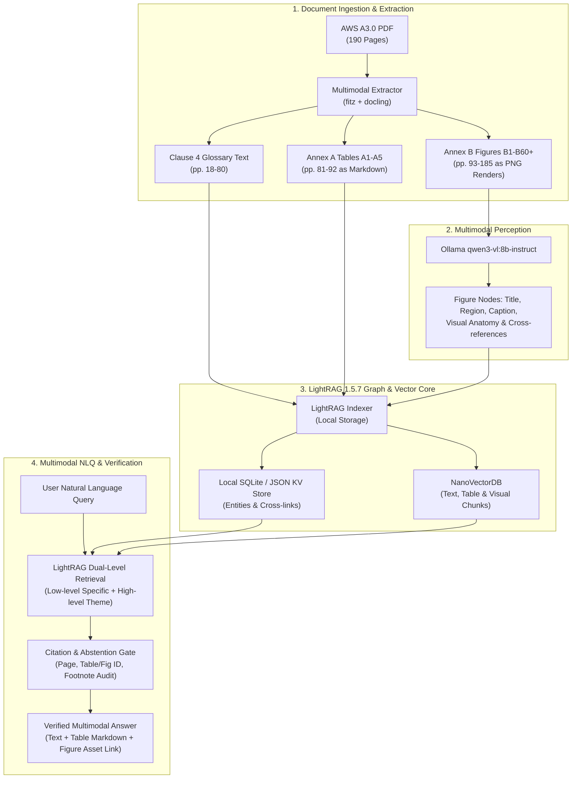

# Implementation Plan: Standalone AWS A3.0 Multimodal NLQ Prototype

## A1 bakeoff documentation closeout (2026-10-22)

Use the [canonical bakeoff summary](a1_bakeoff_results.md) as the record of
bounded A1 backend findings and comparison limits. Keep the next plan vendor-neutral;
no vendor or framework adoption is approved by this closeout.
`GR` is optional, team-reported and unbenchmarked here, not a mandatory foundation.
The next relationship and multihop phase is **PLANNED**, not implemented.
The present step is docs-only closeout and preparation of a new branch.
No extended implementation, UI work or additional evaluation is part of this step.
Preserve prior milestones, results and their historical authorization boundaries below.

## Current local A1 pass 004 complete: stop after one replay (2026-10-21)

1. Created `fix/a1-query-completeness` from clean synced main `799112f`.
   Preserved all pass 001/002/003 raw outputs and graders.
2. Used the existing routing/QA skills unchanged to repair generic parsing,
   direct versus recursive planning and complete answers for the seven gaps.
   Source graph/database and v1 default are unchanged; candidate indentation
   remains layout evidence rather than reviewed semantic subtype.
3. Focused changed-code checks passed 33/33 in 0.77 s; no full suite. Ran the
   existing 15-question QA001 and 16-question QA002 once with harness
   `a1-graph-qa-1.2.0` / planner `1.2.0`, model/provider NONE, zero calls.
   Independent source/trace grading: **QA001 15 PASS; QA002 16 PASS**, no
   failures, partials or regressions. Q16's explicit insufficient-evidence
   response passes on its supported explanation. Details are in the
   [private report](../storage/evidence_v2/a1_qa_repair_004/report.md).
4. Stop and report. This is DEVELOPMENT on exposed questions, with bounded
   grammar and candidate semantics, not unseen/model acceptance. No additional
   repair/replay loop, CQs/framework, UI, figure, model, database change or skill
   infrastructure. The owner subsequently authorized commit, push, PR merge
   and local/online synchronization of this completed repair (2026-10-21).
   Preserve its recorded development results; earlier approval is historical.

Historical pass 003 publication note (2026-10-21): the owner approved commit/push/merge and a final
pull/synchronization check. Preserve all original baselines and bounded QA
results; no additional repair or evaluation loop is part of publication.

## Historical pass 003 result: stop and report remaining failures (2026-10-21)

One harness `1.1.0` repair pass is complete. Both sets ran exactly once, model/
provider NONE and zero calls. Independent results: **QA001 15 PASS / 0 FAIL /
0 PARTIAL**; **QA002 9 PASS / 4 FAIL / 3 PARTIAL**. Focused 33/33 checks passed
in 0.56 s; no full-suite run is claimed. This is DEVELOPMENT on the exposed
31 total questions, not unseen or model evaluation.

1. Preserve QA001's 0/15 pre-capability baseline and 1.0 DEVELOPMENT 15/15.
   QA002's 1.0 result remains 0 PASS / 15 FAIL / 1 PARTIAL. Private raw captures,
   gold and [the report](../storage/evidence_v2/a1_qa_repair_003/report.md) remain
   ignored under `storage/evidence_v2/a1_qa_repair_003`.
2. Record QA001's 90/90 correct supported source pairs, 29 candidate children
   still qualified, and 7/7 lookup facts including two bounded negatives.
   QA002 multi-name resolution has 13/13 mentions and 23/23 mappings correct;
   layout 06–12 grades 4 PASS / 1 PARTIAL / 2 FAIL and source-limit 13–16 grades
   0 PASS / 2 PARTIAL / 2 FAIL (3/11 criteria). QA002 passes 01–08, 11; partials
   are 09, 14, 16; failures are 10, 12, 13, 15.
3. Report unresolved broader-category coverage (Q09), false selector residue
   (Q10), comparison gate (Q12), A1-context selector (Q13), omitted positive
   families (Q14), generic “Does”/epistemic parse (Q15), and omitted concrete
   missing fields after a correct limit (Q16). Do not start another repair/replay.
4. Preserve the unchanged 99-node / 127-edge source graph, SHA-256
   `6476c898439108dbeaf7b92f0be3946a3e0d3538d5c15afb860d1cf0e02cc4d2`,
   all 168 prior receipt files and six protected sources. Keep candidate
   qualifications/runtime semantic validation false; grades remain external.
5. Deliver only thin instructions/metadata for
   [routing](../.agents/skills/evidence-graph-routing/SKILL.md) and
   [QA](../.agents/skills/evidence-graph-qa/SKILL.md), invoking existing code.
   No wrappers/contracts/framework or automatic backend loading is packaged.
   Stop now: no further checks/infrastructure, other image/model run, UI/cloud,
   new database/global setting or Git publication.

## Historical bounded A1 checkpoint and stop (2026-10-21)

The first generic A1 graph-QA run has completed independent grading:
**15/15 PASS, 0 FAIL, 0 UNASSESSED**. For the first eight actual answer strings
and returned rows, all **90/90 source pairs** were correctly retrieved, correct
and supported. There were no missing/extra pairs, duplicates, designation
mismatches or source-binding errors; all 29 indented children retain candidate
qualification. The other seven facts are **7/7 correct and supported**. The two
negative verdicts were verified against the complete original chart and positive
membership elsewhere, not inferred from absence in partial retrieval.

1. Preserve the original **0/15** unanswered baseline, the separate first
   DEVELOPMENT execution and the final independent grades in the
   [source-safe QA receipt](evidence_v2_a1_qa_001.md). Keep raw answers, full
   reports and grading-only metadata in ignored storage.
2. Preserve the exact source graph: 99 nodes / 127 edges, full SHA-256
   `6476c898439108dbeaf7b92f0be3946a3e0d3538d5c15afb860d1cf0e02cc4d2`.
   No source-graph/semantic repairs occurred; protected source, database and
   indices remain unchanged. Only generic QA code and the explicit CLI flag
   were added after the frozen baseline.
3. Describe the implemented capability precisely: `src/evidence_a1_cli.py
   --graph-qa`, backed by `src/evidence_a1_graph_qa.py` version
   `a1-graph-qa-1.0`. Default packet mode, v1 and ordinary v2/extractive remain
   unchanged. The deterministic run used model/provider NONE and zero LLM calls.
4. Keep the result labeled DEVELOPMENT on these 15 exposed owner questions,
   not unseen validation or an LLM benchmark. Raw runtime
   `semantic_validation: false` stays unchanged. External PASS grades do not
   upgrade candidate graph edges or manufacture runtime semantic verification.
5. **Stop after this bounded set.** Do not automatically run another image,
   model, comparison or replay. Stay Figure A1/backend-only, with no UI, cloud,
   commit, push or merge. Preserve all older failures and frozen rubrics.

## Historical A1 execution checkpoint before independent grading (2026-10-21)

The generic opt-in CLI QA has executed once on all 15 owner A1 questions.
It returned 15 `graph_answer` outputs, model/provider NONE and zero LLM calls.
Independent grading remains PENDING. Do not report 15 passes or establish
answer correctness, completeness or source support from execution status alone.
The targeted 160 synthetic checks passed in 2.01 s; they establish software
regressions only.

1. Preserve the frozen baseline at ignored
   `storage/evidence_v2/a1_qa_run_001`. It predates the generic QA code addition;
   the source graph never changed: 99 nodes / 127 edges, exact full SHA-256 match
   before/after. Protected source, database and indices also remain unchanged.
   Its 15 unanswered `V2_READER_REQUIRED` results stay original, separate from
   the later DEVELOPMENT graph-QA answers. No graph semantic repair occurred.
2. Record the implemented opt-in separately: `src/evidence_a1_cli.py --graph-qa`
   uses `src/evidence_a1_graph_qa.py`, version `a1-graph-qa-1.0`. Only generic QA
   code and the explicit CLI flag were added after the baseline. Default packet
   mode and v1 are unchanged; ordinary v2/extractive still returns
   `V2_READER_REQUIRED` for these graph questions.
3. Preserve the actual measured execution: wall 374.355 ms; engine total
   120.446 ms (source projection 89.930 ms, image validation 8.503 ms, graph QA
   22.013 ms). Keep raw traces/answers/reports ignored and record source-safe
   aggregate evidence in [evidence_v2_a1_qa_001.md](evidence_v2_a1_qa_001.md).
4. Await independent grading before any pass/support claim. Keep the original
   rubric and the last two grading-only “No” values outside prompts, graph
   updates and answer logic; do not tune source semantics to the exposed set.

Stay on the single A1 image, backend only. No UI, cloud, other figures,
commit/push/merge or model allowance consumption is part of this deterministic
execution. Earlier model evaluations and source failures remain historical.

## Historical bounded first owner-CQ graph-QA plan (2026-10-21)

The owner supplied 15 Figure A1 questions, IDs `A1-CQ-001` through
`A1-CQ-015`, and authorized the bounded first QA/harness run. The earlier empty
owner-pending dataset/setup stop below is historical. Remain on this one A1
image, backend only: no UI, cloud calls, other figures, commit, push or merge.

1. Preserve the baseline already frozen before the QA code addition; the source graph remained unchanged at
   ignored `storage/evidence_v2/a1_qa_run_001`. All 15 actual v2 queries returned
   `V2_READER_REQUIRED` without answers. List requests 1–8 had only the root and
   eight category nodes, with zero process rows. There were no LLM calls. Do not
   overwrite or retrospectively rerun this baseline as if unchanged.
2. Add generic deterministic graph-QA selection/traversal and answer composition
   after that baseline. Implement reusable capabilities rather than answers
   hardcoded to the 15 questions. Make no graph semantic repair to satisfy the
   expected rubric; preserve source/graph state and trace exact retrieval paths,
   selected evidence, packet contents and answer bindings.
3. Execute only the bounded first QA/harness scope when the implementation is
   usable, keeping its output separately labeled DEVELOPMENT. Record actual
   case outcomes before asserting a pass, coverage or supported-answer gain.
   Deterministic graph answers use model/provider NONE and no LLM call; do not
   call that a model-comparison or LLM-evaluation result.
4. Keep the last two questions' trailing “No” values exclusively in private
   grading metadata, outside execution prompts, retrieval hints, graph updates
   and answer logic. Keep full raw traces, answers and reports in ignored
   storage, with a source-safe aggregate summary in
   [evidence_v2_a1_qa_001.md](evidence_v2_a1_qa_001.md).

No further model/provider, unrelated figure or automatic scope expansion is
implied. Preserve all prior semantic failures and frozen questions/rubrics. This
plan does not claim first-QA success while the actual metrics remain pending.

## Historical setup plan before owner competency questions (2026-10-21)

The latest owner stop point supersedes the evaluation plans below. Set everything
up; the owner will provide competency questions. Stop all new CQ generation,
answer-accuracy grading, model comparisons and DeepSeek/local inference
evaluations. None of the newly approved five DeepSeek cases or one installed
`qwen2.5vl:7b` trial started, and those unused allowances must not be consumed now.

1. Finish Figure A1's canonical single-image/source-edition binding, source-bound
   labels/designations and qualified graph hierarchy. The object is Master Chart
   of Welding and Joining Processes at `parsed/figures/Figure_A1_p88.png`, PDF
   index 87 / viewer 88 / printed 75. Keep existing SQLite/graph stores unchanged.
2. Make manifest/read-only database bindings, actual graph-traversal retrieval
   and complete evidence-packet construction usable for that one image. Exclude
   Table A1, A2, B6 and unrelated images; add no UI or new database/graph framework.
3. Prepare v2 CLI/harness input for the owner's future competency questions.
   The CQ dataset is **EMPTY — owner pending**. Keep the agent-authored private
   A1 rubric DEFERRED; it is not an accepted owner CQ set and must not trigger
   reader inference or grading.
4. Verify structural contracts only: IDs, joins, graph paths, source editions and
   fingerprints, exact image bindings, required evidence closure and input
   validation. Report these as setup evidence, never semantic answer accuracy.
5. Stop at `READY_FOR_OWNER_COMPETENCY_QUESTIONS` only if the setup is usable.
   Otherwise report an exact setup blocker. Record the actual state and evidence
   in [evidence_v2_a1_setup.md](evidence_v2_a1_setup.md), then wait for the owner.
   Do not advance automatically to A2/B6 or invent substitute questions.

No commit, push or merge is authorized. Preserve all earlier failures, frozen
rubrics and model results as historical evidence; the current setup milestone
does not replace them or assert a supported-answer pass.

## Historical resolved Figure A1 evaluation plan (2026-10-21)

Source inspection resolved the current object as **Figure A1 — Master Chart of
Welding and Joining Processes**, one image at
`parsed/figures/Figure_A1_p88.png` (PDF index 87 / viewer page 88 / printed page 75).
Table A1 is separate, spans printed pages 69–70 and is not included. The former
identity-pending plan below is retained as a historical checkpoint.

1. Build the new versioned single-A1 source projection from the resolved image
   and source bindings. The source auditor confirmed eight category boxes.
   Explicitly reject the incorrect AB/CAB expansions in legacy merged candidate
   `annex_a_figures_a1_a2_a3_anatomy`; do not transplant its mixed-figure facts.
   This projection remains under development. Keep old SQLite and graph stores
   unchanged, with no migration or writes to legacy records.
2. Measure whether complete correct A1 graph evidence, qualified relations and
   exact image pixels pass through database/edition joins, retrieval/expansion
   and packet construction into the reader. Use the six-layer failure trace to
   locate evidence defects before attributing an answer error to reasoning.
3. Independently grade answer correctness and source support for this one image.
   Do not claim success from test counts, IDs, available pixels or generation
   alone. Do not automatically advance while the current gate is unresolved;
   record a supported pass or precise blocker before considering another image.

Exclude Table A1, B6, unrelated cases, UI work and new database/graph frameworks.
DeepSeek baseline generation for this new A1 source is NOT authorized under the
earlier five-case budget. The one installed `qwen2.5vl:7b` trial remains UNUSED
and pending, with no model result or allowance consumption asserted. Preserve
previous semantic failures and frozen rubrics; make no old SQLite/graph writes,
new provider/install/persistent-setting/restart or commit/push/merge changes.

## Historical A1-first identification plan (2026-10-21)

This latest scope supersedes the pending multi-case plan below. Run no B6 or
unrelated cases. Keep the original multipage B6 rubric, results and failures
frozen and deferred. The immediate unit of work is the current A1 image:

1. Resolve A1's source identity from the authorized source. Identity is currently
   pending inspection. “Annex A” does not establish an object named A1; verify
   whether the requested object is a table, figure or image, then bind its exact
   edition fingerprint, canonical ID and page/region/image locator. Stop at an
   explicit identity blocker if that evidence is unavailable.
2. Inspect that one image's source facts, graph facts/qualified relations and
   database/edition joins. Use the existing spine; introduce no new database or
   graph framework and perform no UI redesign or enhancement.
3. Check retrieval/ranking/expansion and packet construction for that same image.
   Confirm all required correct evidence and conditions, together with the actual
   image payload, enter the reader. Attribute failures to the six backend layers
   rather than treating every wrong answer as reasoning failure.
4. Evaluate the current image's answer for correctness and source support. Do not
   automatically advance while its gate is unresolved; record a supported pass
   or an exact blocker before considering the next image.

The previous five external DeepSeek cases and one installed `qwen2.5vl:7b`
trial are all UNUSED; none has started under that approval. The one local trial
may be used for A1 after source identity and the current-image packet are verified.
Do not claim the allowance consumed or a result obtained until execution evidence
exists. Prior five-case DeepSeek permission does not authorize sending new A1
source. No other paid cases, provider/destination, installation, persistent
settings change, service restart, commit, push or merge is authorized. Earlier
pending comparison/trial plans below are retained as historical scope only.

## Historical backend comparison plan and unused approval (2026-10-21)

The owner's current v2.0 goal is supported backend answers: correct graph/data,
database structure and edition joins, graph retrieval/expansion, and complete
correct evidence entering the reader. No UI enhancements or redesign are planned.
Existing guarded web API version-flag compatibility is the only web work in scope.

For each frozen case, inspect the source-to-answer trace in this order and record
the first evidenced failure without hiding later independently observed faults:

1. **Source ingestion:** validate the authorized source edition/fingerprint and
   extracted facts, table structure, notes, regions and assets.
2. **Graph facts/relations:** check concept/sense identity, facts, qualified
   relations and provenance; do not promote candidate edges to source support.
3. **Database/edition joins:** verify document/edition/hash/locator keys, matching
   rows and relationship endpoints; reject orphan, duplicate or cross-edition joins.
4. **Retrieval/ranking/expansion:** check selected seeds, ranking, alias routing
   and qualified graph traversal against the complete required evidence set.
5. **Packet construction:** verify required facts, qualifications, exceptions,
   footnotes, ordered continuations and actual image payloads reach the reader.
6. **Reader reasoning:** grade correctness, completeness, support and abstention
   only after checking the actual input packet; separate reasoning from retrieval
   failures and keep generated evidence-ID binding distinct from semantic support.

Use measured case traces to prioritize the smallest backend correction. Retain
SQLite, the manifest and current graph projections; do not choose a new database
or graph framework without a demonstrated gap and comparative measurements.
Software tests remain required regression checks, but supported answers determine
success. Preserve frozen questions, labels, rubrics and all earlier failures;
reused cases and exposed repairs remain DEVELOPMENT evidence.

New trusted approval authorizes exactly five frozen unchanged-v1 comparison cases
through the existing configured DeepSeek provider and one trial of already
installed `qwen2.5vl:7b`. Results are pending. Execute only that bounded allowance:
no other paid cases, new providers, installs, persistent settings changes or
service restart; no commit, push, publication or merge. This exception resolves
the earlier local-only provider blocker only for the named comparison/trial.
Document actual results, usage, latency, cost and layer attribution in the current
receipt before considering any further intervention.

## Runtime recovery outcome and remaining work (2026-10-21)

The complete image packet now runs on the already installed local vision model
with per-request context 16384/output 1024. Original six source cases graded 4/6;
the missing-row selector is repaired separately as DEVELOPMENT. The multipage
model answer remains incomplete after one exposed formatting replay. Do not
close step 3's semantic gate or repeat inference blindly. Remaining work is a
deliberately bounded quality intervention with independent/fresh evaluation,
plus an unchanged live v1/v2 integration comparison. Read the
[current recovery receipt](evidence_v2_runtime_recovery.md) for exact model,
resource diagnostics, original/replay separation and measured latency/cost.
Continue to preserve v1 defaults, `main`, local work and the no-commit/no-push scope.

The [unchanged-v1 preflight](evidence_v2_live_comparison_blocker.md) executed the
one permitted actual source-composed pair. Completing its five other frozen
inputs required the now-resolved decision on existing DeepSeek cloud requests; a loopback v1
provider variant would be a separately labeled experiment. The recommended
one-model development trial is installed `qwen2.5vl:7b` with context 16384 and
all original images. That one trial is now authorized; its result is pending.

## Active local v2 execution plan (2026-10-21)

The current plan is one bounded local slice. The original proposal and its open
questions below are historical context, not a request for renewed permission or
authority to repeat full extraction, indexing, cloud calls or publication.

1. Preserve baseline `24bac45465bcb5c9ea14663f7a669927d5d2ed00` with the
   nonconflicting local annotated `v1.0` tag and document its limitations: A2/A3
   legacy exports have no cells, generated answering is text-only, and historical
   limited terminology/benchmark results do not establish full multimodal accuracy.
2. Create/reuse local `v2/evidence-engine` from that baseline, leaving `main`
   unchanged. Preserve unrelated work. Do not commit, push, publish, merge, delete
   branches or move existing tags in this task.
3. Implement and verify the evidence model, typed routes and complete-packet
   reader behind `evidence_version="v2"`; v1 remains the default. Close the
   packet over conditions, exceptions, notes, headers, footnotes and required
   ordered continuations. Supply actual image bytes during local visual answering
   and bind generated claims to packet IDs without upgrading semantic support.

The slice uses six native definition/alias entries, Tables A2/A3 and Figure B6's
three full-page continuations. Explicit targeted native re-extraction of the three
A2/A3 source pages writes only ignored `storage/evidence_v2/tables.v2.2.json`
(133/134 rows); preserve the heading-only Markdown and source discrepancies.
Missing/stale source remains an explicit blocker. Existing manifest metadata and
read-only SQLite remain authoritative; no new database/UI/framework is planned.
Use only the existing configured local reader and installed model, with no new
credentials or private-data destinations.

Freeze identical v1/v2 inputs for definitions/senses, table evidence, multipage
figure, crossmodal comparison and missing evidence. Separate software
regressions, injected/mock synthesis and real source/model semantic validation.
Record latency, usage and cost only where executable; retain null/unassessed
measurements and blockers rather than inventing results. Build/schema/direct
package contracts and original redistributable fixtures must exclude licensed
source and private raw answers.

Final step status and executed results belong in
[evidence_v2_implementation.md](evidence_v2_implementation.md); implementation
alone or synthetic passes do not close step 3's model/source validation gates.
Rollback selects `--evidence-version v1` or omits the flag. Keep local work,
branch and baseline tag intact; do not switch a dirty checkout. Review the
[schema](evidence_v2_schema.md) and [dependency limits](dependency_contract.md)
before broadening coverage or changing the reader contract.

## Historical initial proposal

## Goal Description
Build a clean-slate, standalone prototype for Natural Language Querying (NLQ) over the full 190-page **AWS A3.0M/A3.0:2020 Standard Welding Terms and Definitions** (`C:\Users\kenai\OneDrive\Documents\Projects\weld\corpus\AWS A3.0MA3 - Standard Welding Terms and Definitions.pdf`). 

The prototype will provide full multimodal search and retrieval—answering queries that span text definitions (Clause 4), process classification tables (Annex A), and engineering diagrams (Annex B vector drawings), with exact source citations and faithful abstentions.

This project is completely separate from previous migration checkouts, legacy worktrees, and the 9-document Neo4j corpus.

---

## User Review Required

> [!IMPORTANT]
> **Resolution of the RAG-Anything / LightRAG Version Wrinkle**:
> Our investigation of the upstream HKUDS repositories revealed that **RAG-Anything was permanently merged upstream into LightRAG v1.5.0 in May 2026**. RAG-Anything's standalone repo is frozen with `lightrag-hku < 1.5`, whereas LightRAG `1.5.7` has native multimodal document processing with built-in **Docling** and sidecar format support.
> **Decision**: We will pin `lightrag-hku>=1.5.7` directly with Docling/PyMuPDF, avoiding the deprecated standalone wrapper while fulfilling the intended RAG-Anything multimodal architecture.

> [!IMPORTANT]
> **Model Backend Selection (Local vs. Hybrid)**:
> Environmental reconnaissance detected:
> - **Ollama is already running locally** with vision models (`qwen3-vl:8b-instruct`, `qwen2.5vl:7b`) and reasoning models (`deepseek-r1:latest`).
> - `DEEPSEEK_API_KEY` is present in the environment for cloud text inference.
> - **Proposed Configuration**: Use `DEEPSEEK_API_KEY` (or local `deepseek-r1`) for primary text reasoning/entity extraction, and local Ollama `qwen3-vl:8b-instruct` for visual figure analysis.

> [!WARNING]
> **Project Directory Location**:
> To guarantee complete isolation from the existing `weld` git repository and legacy scripts, we propose creating the project at `C:\Users\kenai\aws-a30-prototype`.

---

## Open Questions

> [!NOTE]
> 1. **Project Directory**: Do you approve creating the standalone workspace at `C:\Users\kenai\aws-a30-prototype`, or do you prefer another directory?
> 2. **Inference Mode**: Do you prefer **Hybrid mode** (DeepSeek API for text + local Ollama for VLM vision) or **100% Local mode** (all Ollama models, zero cloud calls)?

---

## System Architecture



---

## Proposed Changes

### Component 1: Environment & Project Scaffolding

#### [NEW] `pyproject.toml`
Defines dependencies, strictly pinned:
```toml
[project]
name = "aws-a30-prototype"
version = "0.1.0"
description = "Standalone Multimodal NLQ Prototype for AWS A3.0"
requires-python = ">=3.11"
dependencies = [
    "lightrag-hku>=1.5.7",
    "pymupdf>=1.24.0",
    "docling>=2.0.0",
    "openai>=1.30.0",
    "pydantic>=2.7.0",
    "rich>=13.7.0",
    "python-dotenv>=1.0.0"
]
```

#### [NEW] Directory Structure
```text
C:\Users\kenai\aws-a30-prototype/
├── data/
│   └── AWS_A3.0_2020.pdf             # Copied from OneDrive source
├── parsed/
│   ├── text_chunks.jsonl              # Clauses 1-4 with exact section/page anchors
│   ├── tables/                        # Tables A1-A5 in structured Markdown
│   └── figures/                       # Rendered Annex B figures (.png + metadata JSON)
├── storage/                           # Local LightRAG indexes (zero external servers)
│   ├── kv_store_default.json
│   ├── vdb_entities.json
│   └── vdb_relationships.json
├── eval/
│   ├── gold_benchmark.json            # 12 multimodal evaluation queries
│   └── test_scorer.py                 # Scorer verifying support, citations, & abstentions
└── src/
    ├── __init__.py
    ├── config.py                      # Model endpoints & paths
    ├── extract.py                     # High-fidelity fitz/docling extractor
    ├── indexer.py                     # LightRAG multimodal ingestion
    ├── query.py                       # NLQ engine with graph traversal
    └── citation_checker.py            # Exact citation resolver
```

---

### Component 2: Multimodal Extraction Pipeline

#### [NEW] `src/extract.py`
High-fidelity extraction using `fitz` and `docling`:
1. **Annex B Figures (Pages 93–185)**:
   - Detect figure headers using regex: `Figure B\d+.*`.
   - Render page/sub-regions at 180 DPI via `fitz.Page.get_pixmap()`.
   - Send figure renders to Ollama `qwen3-vl:8b-instruct` to extract:
     - Joint type, bevel anatomy, root dimensions, part labels.
     - Textual cross-reference anchors (`"Illustrated in Clause 4 under 'groove weld'"`).
   - Save image to `parsed/figures/Figure_B<N>.png` and metadata to `parsed/figures/Figure_B<N>.json`.
2. **Annex A Tables (Pages 81–92)**:
   - Extract Tables A1–A5 using `docling` or `pdfplumber`.
   - Output structured Markdown preserving multi-column process letters (e.g. `SMAW`, `GMAW-P`) and normative notes.
3. **Clause 4 Glossary (Pages 18–80)**:
   - Extract term definitions with page numbers, printed page numbers, and embedded cross-links (`"See Figure B..."`, `"See Table A..."`).

---

### Component 3: LightRAG Multimodal Ingestion

#### [NEW] `src/indexer.py`
Instantiates `LightRAG` configured for local storage:
- Ingests text blocks with explicit location tags: `[AWS A3.0:2020 Clause 4, p. 48]`.
- Ingests tables with title headers and footnotes intact.
- Ingests figure nodes with visual descriptions and file URI links.
- Uses `DEEPSEEK_API_KEY` (or local model) for entity-relationship extraction.
- Graph automatically links terms $\leftrightarrow$ tables $\leftrightarrow$ figures via text references.

---

### Component 4: Multimodal NLQ Engine & Citation Resolver

#### [NEW] `src/query.py` & `src/citation_checker.py`
- Implements hybrid retrieval (vector similarity + knowledge graph traversal).
- When a query asks for a visual joint or process:
  - Retrieves the governing definition chunk.
  - Traverses the graph edge to fetch the associated Annex B figure asset and Annex A table.
- Emits response formatted as:
  1. Direct answer with qualifications.
  2. Table excerpt (if applicable).
  3. Figure link & visual anatomical breakdown (if applicable).
  4. Verified source citations down to Page, Clause, and Element ID.

---

### Component 5: 12-Question Multimodal Benchmark

#### [NEW] `eval/gold_benchmark.json`
Curated challenge set covering all modalities and failure modes:

| ID | Modality | Query | Target Citation / Evidence | Expected Behavior |
| :---: | :--- | :--- | :--- | :--- |
| `Q01` | Text | "Define complete joint penetration (CJP)." | Clause 4, p. 22 | Return exact standard definition |
| `Q02` | Text | "What is the nonstandard term for root pass?" | Clause 4, p. 55 | Identify nonstandard vs preferred term |
| `Q03` | Table | "What is the letter designation for gas metal arc welding - pulsed arc?" | Annex A, Table A1, p. 69 (`GMAW-P`) | Exact table cell retrieval |
| `Q04` | Table | "Which welding processes fall under resistance welding in Table A1?" | Annex A, Table A1, p. 70 | Multi-row table synthesis |
| `Q05` | Figure | "What are the components of a groove face and root edge?" | Annex B, Figure B5, p. 86 (PDF p. 98) | Return Figure B5 image asset + label parts |
| `Q06` | Figure | "Show the joint root configurations for butt joints." | Annex B, Figure B4, p. 85 (PDF p. 97) | Return Figure B4 image asset |
| `Q07` | Cross-Modal | "Explain 1F pipe welding test position and show its orientation." | Clause 4 (definition) + Figure B20 (diagram) | Fuse text definition with Figure B20 visual |
| `Q08` | Cross-Modal | "What is a bevel angle and how is it illustrated?" | Clause 4 (definition) + Figure B6 (diagram) | Fuse text definition with Figure B6 visual |
| `Q09` | Qualifier | "What is the distinction between root opening and root face?" | Clause 4 + Figures B4 & B5 | Distinguish dimensions and boundary conditions |
| `Q10` | Qualifier | "Under what conditions is a backing weld distinguished from a back weld?" | Clause 4 (back weld vs backing weld) | Respect sequence/application qualifier |
| `Q11` | Abstention | "What are the ultrasonic testing acceptance limits for porosities in welds?" | None (Out of scope of AWS A3.0) | **Must cleanly abstain** |
| `Q12` | Abstention | "What are the tensile strength requirements for E7018 electrodes?" | None (Covered in AWS A5.1, not A3.0) | **Must cleanly abstain** |

---

## Verification Plan

### Automated Tests
1. **Extraction Validation**:
   ```pwsh
   python src/extract.py --verify-only
   ```
   *Expected*: Confirms extraction of 64 glossary pages, Tables A1–A5, and $\ge 60$ rendered Annex B figures.
2. **Index Integrity Check**:
   ```pwsh
   python src/indexer.py --dry-run
   ```
   *Expected*: Verifies local LightRAG storage files are initialized without network errors or database connection dependencies.
3. **Benchmark Execution & Citation Audit**:
   ```pwsh
   python eval/test_scorer.py --benchmark eval/gold_benchmark.json
   ```
   *Expected*:
   - Evaluates all 12 queries.
   - Verifies citation accuracy (claim $\rightarrow$ page/element).
   - Verifies 100% correct abstention on `Q11` and `Q12` (zero hallucinated standards).

### Manual Verification
- Run an interactive query via CLI:
  ```pwsh
  python src/query.py "Explain a 1F pipe position and show its diagram"
  ```
- Inspect that output contains the text definition, cites Clause 4 & Figure B20, and prints a local image link `parsed/figures/Figure_B20.png` that opens to the correct diagram.

---

## Component 6: Next-Gen Contextual Embedding & Storage Research (Turbopuffer v3 & Perplexity Context-Bench)

### 1. Architectural Insights from Turbopuffer v3 ("RIP, Vector Database")
* **Core Takeaway**: Primary keying on ANN vector addresses creates catastrophic write amplification and storage bloat for multi-vector or structured documents.
* **Prototype Alignment**: The prototype’s **Card 07 Dual-Layer Epistemic Graph** already adopted this principle: primary indexing is governed by the **Domain Ontology & Normative Evidence Graph** and an embedded **SQLite Registry with FTS5** (`storage/dual_layer_registry.db`). Vectors remain strictly a secondary, auxiliary lookup index.
* **Future Enhancement**: Maintain zero-cost, localized SQLite and GraphML storage without introducing heavy standalone vector database server dependencies.

### 2. Methodological Insights from Perplexity ("Contextual Embedding: Beyond the Gold Passage")
* **Core Takeaway**: Real-world technical queries cannot be satisfied by a single isolated "gold chunk". An answer chunk without its supporting context (scope, applicability, revision status, table headers, exceptions) is ambiguous and unverifiable.
* **The "Answer Route" Paradigm**: Each query requires an **Answer Route = (Answer Chunk + Supporting Evidence Group)**.
* **Evaluation Framework (Context-Bench)**: Evaluates multi-stage retrieval metrics:
  - `Document@1`: Disambiguates between near-identical sibling documents or revisions.
  - `Answer@K`: Retrieves the primary answer-bearing chunk.
  - `Evidence Recall@K`: Retrieves all supporting chunks (definitions, table headers, figures, committee rationale) necessary to substantiate the answer.
  - `All-Evidence@K`: Full recovery of the complete evidence bundle.

---

## Card 08 Delivery Plan: Contextual Embeddings & Answer Route Bundles

- [ ] **1. Answer Route Resolver (`src/answer_routes.py`)**: Programmatically bundle primary definition chunks with their associated evidence group (figures, callouts, parent clause conditions, committee rationale) using the existing 5,854 epistemic bridges.
- [ ] **2. Late Chunking Ingestion Pipeline (`src/contextual_indexer.py`)**: Implement late chunking across whole clauses to allow chunk representations to attend across full document boundaries before pooling.
- [ ] **3. Multi-Stage Benchmark Metrics (`eval/test_scorer.py`)**: Expand the 50-item benchmark to evaluate `Document@1`, `Answer@K`, `Evidence Recall@K`, and `All-Evidence@10`.
- [ ] **4. Web Visual Explorer Answer Route UI (`src/web.py`)**: Render the full verified Answer Route bundle directly in the result inspector.
