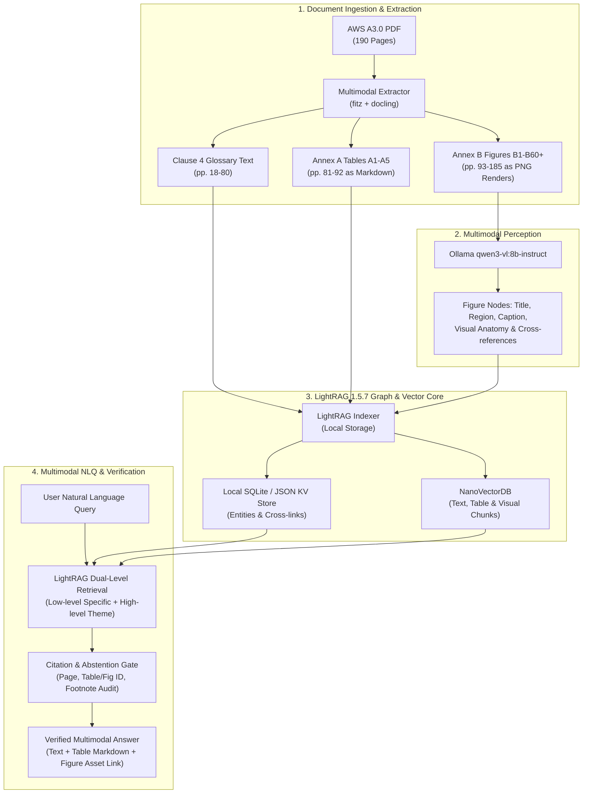

# Implementation Plan: Standalone AWS A3.0 Multimodal NLQ Prototype

## A2 finishing slice009 verified (2026-10-23)

The bounded A2 ingest/evidence slice and opt-in planner finishing pass are verified
on existing exposed questions. Default deterministic behavior is preserved; fresh
model selection, production Terra/Luna and unseen generalization remain unvalidated.
No new OCR/model/provider call, figure, framework or UI was introduced by009.

Optional `run_questions(..., source_observation_path=...)` / `qa --source-observation`
adds source-bound canonical **candidate** figure evidence in the A2 adapter. Source,
page/crop/region/connector bindings and native PDF-rendered clip pixels are checked.
This authenticates provenance, not the AI observation's truth. Candidate evidence
and claims stay outside accepted proof catalogs/KG admission and completeness flags;
knowledge-only answers are not augmented. Text is rendered only for successful
evidence-layer `epistemic_limits`/`chart_layout` operations; otherwise the optional
candidate packet is separate. Omitting the option preserves prior behavior.

A conservative compiler guard reuses the existing deterministic relation intent
only for a ready single-part literal evidence path with exactly matching ordered
endpoints. It supplements, never replaces, original model operations and records
its origin. Membership, source-layout ancestry, physical common-root reachability
and semantic subtype remain distinct. Ambiguous/compound/ref-dependent batches are
not guessed; forced knowledge execution rejects the evidence-only layout operation.

Capability staging remains **text first, relationships second, multihop third**.
Known-source labels/codes and identity clarification are independently usable;
compound requests retain every relationship/path part. Qualified relationships
now include the optional candidate whole-A2 connector observation. Ordered source
paths and accepted physical support are demonstrated; model-requested accepted-KG
paths and semantic IS_A transitivity are not established. Candidate indentation and
AI observations never become accepted semantic facts through recognition or reachability.

One frozen cached005-plan replay: A2 content/delivery **16 PASS**; A1 **51 PASS**,
including three proper clarifications. This is compiler/executor recovery with
explicit deterministic supplementation and candidate evidence, not improved model
performance. Original007/008 plans, grades and artifacts remain unchanged. All51
deterministic A1 control answers/coverage/rows/paths/verdicts are unchanged, including
the known planning_unsupported versus source-limit metadata caveat. Runtime execution
still retains redundant failed/blocked requests; semantic completeness remains
UNASSESSED automatically. Do not equate content grades with all operations succeeding.

Validation:398 existing applicable software checks passed; independent focused code,
source and answer review passed. An offline wheel includes the runtime JSON contract
and excludes source assets/stores; sandbox build failures are retained separately
from the successful host build. Harness1.7.6, graph adapter1.4, instruction1.4/wire1.0;
no model has consumed instruction1.4. Source observations are optional read-only
attachments; existing graph/store admission decisions are unchanged.

Authorized Git closeout is conditional on these checks and a clean publication
review; its exact commit/PR/merge/sync receipt is kept in the Library report, not
fabricated here. Private PDFs/images/OCR/vision traces/stores/caches stay outside Git.
Rollback leaves the observation option unset and deterministic default enabled;
no reset, branch/worktree deletion or unrelated cleanup is required. AWS backend
correctness remains one slice at a time; no automatic A3, Navy Weld or Utopia work.
Report: `Figure_A2_Planner_Integration_002_Report.md`; private actual answers/receipts:
`storage/evidence_v2/a2_planner_009/`. GR remains optional, not a required harness.

## Preserved offline planner006 baseline

**Bounded offline simplification complete; hold planner adoption/publication.**
One replay used the unchanged005 saved plans: no model, OCR or external calls.
A2 content **15 PASS/1 PARTIAL**, delivery **14 PASS/2 PARTIAL**; A1 content
**50 PASS/1 PARTIAL**, delivery **48 PASS/3 PARTIAL**. A1's50 passes include three
appropriate identity clarifications, not50 factual answers. These are exposed
regressions and cached-plan replay, not fresh model or production acceptance.
All51 deterministic A1 control answers/coverage/rows/paths/verdicts are unchanged.

Runtime1.7.4 loads `src/evidence_chart_contract.json` through its Python loader:
contract1.0, instruction1.3, wire1.0. Prompt/profile/schema/compiler definitions
share that asset; explicit safeguards remain code. No model consumed instruction1.3.
`SKILL.md` routing/QA guidance remains developer/agent guidance, not automatic
runtime skill loading. Shared definitions reduce drift; they cannot prevent it.

Quote labels no longer require a character partition. Exact source/query bindings,
typed IDs/roles/budgets and result dependencies remain enforced. One batch retains
blocked operations, runs safe independent ones, and blocks failed dependents.
Exact equivalent operations can share execution without losing part/field mappings.
Explicit `chart_layout` alone requests whole-chart observations; empty IDs never
mean all nodes. Membership, layout, physical connectivity and semantic subtype
remain distinct. Dictionary candidates now also bind unresolved identity requests.

Execution coverage is separate from semantic answer completeness (`UNASSESSED`
until independent grading). Actual bound assertion status/rule/support qualifies
observations. Five returned paths have complete accepted literal/physical support,
including the A2 Allied→Thermal Cutting→Arc Cutting route; these are structural
certifications of evidence paths, not semantic IS_A transitivity or a new KG search.
No persisted observation/admission decision was changed. Source bytes, gold,67 raw
plans,109 frozen code files and463 prior005 artifacts passed preservation checks.

Remaining: A2-Q15 omits explicit source judgment about arrow directions and has
invalid partition/oversized operations; Q16 adds an empty redundant designation
follow-up. A1-QA002-14 answers a subtype question with a cross-chart path instead
of its relationship verdict. CQ003/QA002-10 contain the requested facts but retain
confusing redundant-operation warnings. No automatic repair/evaluation loop follows.
The known deterministic reason-label caveat is preserved with its unchanged controls.

AWS backend correctness stays slice by slice: A2 only plus A1 regressions, no UI,
A3, Navy Weld, Utopia, framework or model campaign. GR remains optional. Review
actual answers before further inference or publication. Source-aware ingest and
planner are logically separable, but shared API/traversal hunks require a deliberate
split; no two independently publishable commits or foundation PR were created.
Report: `Figure_A2_Planner_Integration_002_Report.md`; private receipts and all
answers: `storage/evidence_v2/a2_planner_006/`. No Git publication is authorized.

## Preserved fresh005 baseline

Fresh005 used67 natural-stop `deepseek-flash` planner calls with instruction1.2:
A2 content12 PASS/4 UNASSESSED, delivery10 PASS/2 PARTIAL/4 UNASSESSED;
A1 41 PASS/1 PARTIAL/9 UNASSESSED included two proper clarifications.
It executed52 graph queries (12 A2+40 A1), plus two zero-operation clarifications:
**52, not54 executions**. All original receipts/answers remain unchanged. The full
report is archived as `006/report_v5_before.md` and Library version5 of
`libfile_467be2fe46b08191be1c7380b658b958`; its raw ZIP remains
`libfile_a2abf18257b08191a21e3db693d4df18`. Neither005 nor006 establishes production
or unseen acceptance. The independent review's predicted scores and invented A2
Solid-State Cutting question were not adopted; actual source/receipts govern.

## Preserved offline004 baseline

004 replayed older saved plans, with zero new model calls: A2 delivery11/3/0/2
and content14/0/0/2; A1 43/6/0/2 included three appropriate clarifications.
It did not test instruction1.2 in a model. Its exact full report remains
`storage/evidence_v2/a2_planner_005/report_v4_before.md` (SHA256
`f0abc1ae5f14151d898acbaab87b16f8dbe82a178c0479c43c354b3bf9b6ffb0`), with historical checks/proof limits and prior Library version4.

## Preserved planner003 development baseline

The fresh instruction1.1 DeepSeek run completed67 natural-stop calls, with no
truncation/retry/fallback. A2 clear delivery/content:6 PASS/10 UNASSESSED; A1
complete-answer30/12/3/6, factual-data35/7/3/6. Plans were6/16 ready in A2 and45/51
in A1; nine evidence paths and no accepted-KG paths returned. This was a development
proxy, not production acceptance. Full answers/raw plans/report remain unchanged
in `storage/evidence_v2/a2_planner_004/report_v3_before.md` and prior003 artifacts;
archive SHA256 `14da3c37608c51fee0da312d6ef9c667d45782b8aab6d9f10026df337c303308`. Library version 3 retains that earlier report in version history. The replay above is not new model performance.

## Historical A2 planner002 (2026-10-23)

**Offline contract repair reviewed; fresh model validation is not authorized.**
Instruction revision `chart-llm-plan-instructions-1.1` keeps wire schema `1.0`;
per-operation restrictions and planned `reason=''` are explicit in prompt and
schema descriptions. Flat schema remains a structural superset; compiler guards/
admission are unchanged. Fifty focused checks passed; unchanged saved67-response
compiler replay confirms0 executable plans and identical first rejections. No
plan rewrite, new model call or model-improvement claim. Hold Git. Fresh validation
needs separate approval. The same Library file is now version2 with offline
findings; the original67-call record and Libraryv1 remain preserved.

**VALIDATION_PASS_COMPLETE_TYPED_PLAN_CONTRACT_NOT_READY.** Work locally on
`feat/a2-source-aware-ingest`; no publication is authorized. Reuse the cached A2
source/store, unchanged 16 A2 development questions and 51 exposed A1 regressions.
The ignored `storage/evidence_v2/a2_planner_002/baseline_freeze.json` preserves
baseline identities/results. No successful 002 model acceptance is claimed. These
known questions do not establish unseen or production-model acceptance.

Pre-implementation scope/drift check: fix language-to-operation interpretation,
generic group/path result references and requested-part coverage only. Preserve
the deterministic evidence/KG executor, source facts and admission boundary.
Model input is the question plus source dictionary names/codes/IDs, never graph
edges, gold or previous answers. No OCR/A3/UI/Navy Weld/production integration,
new questions, framework or benchmark. This uses `planning-and-task-breakdown`
and Scope Discipline in `using-agent-skills`, not a dedicated drift skill.

The backend consumes the versioned `build_prompt`, operation contract, JSON
schema and validator in `src/evidence_chart_llm_plan.py`. Existing `.agents`
`evidence-graph-routing`/`evidence-graph-qa` skills are developer guidance read by
agents, not automatically loaded backend prompts. No new skill workstream is planned.

### Historical first local-attempt setup

Cloud target remains blocked: STS succeeded in `us-gov-west-1`, but SageMaker
`list_endpoints` returned AccessDenied/400 and Bedrock `list_inference_profiles`
AccessDenied/403. No verified Terra/Luna mapping exists in config and no new
credentials were introduced. The planned installed-local
`qwen2.5:3b` text Instruct (3.086B) / Ollama 0.40.4 route was selected by the owner
before inference; no 8B calls occurred. Digest:
`357c53fb659c5076de1d65ccb0b397446227b71a42be9d1603d46168015c9e4b`.
It is a **proxy, not Terra/Luna**: native metadata context 32768, chosen runtime
16384, `num_predict=-1`, temperature 0, seed 42. Record actual input/output,
resource limits and stop reasons; do not claim production-model equivalence.

### Historical approval-block/local-attempt record — permission resolved

The following record predates the new explicit approval and final 67-call pass.
Its zero-DeepSeek-call and no-retry statements describe that earlier denied
launch only; they are not the current inference totals.

**A2 is not done and is not ready for closeout.** Automatic approval review
rejected the exact DeepSeek A2 CLI launch before `CreateProcess`: sending the
questions and private source-derived identity dictionary to `api.deepseek.com`
lacked explicit private-source-disclosure authorization. The action is known
**UNEXECUTED**, with zero DeepSeek inference calls; no retry or alternate path
was attempted. Existing authentication/model-list reads succeeded, but those
metadata reads did not authorize source-bearing inference.

Before any launch, explicit approval is needed to send the existing 16 A2/51 A1
questions, source-derived dictionary names/codes/IDs and operation contract/schema
to the existing `https://api.deepseek.com` endpoint using existing credentials.
No PDF/image, graph edges, gold or previous answers are part of that proposed
input. No new credential grant, private-data upload retry or bypass is authorized.
The pending proxy remains `deepseek-flash` (documented
`DeepSeek-V4.1-Flash-1017`), thinking disabled, temperature 0, JSON-object output
and the same strict contract/schema. Its planned explicit provider maximum is
393216 output tokens rather than the default 8K; native context is 1M. None of
these inference settings has been executed. `deepseek-v4-pro` was also listed;
legacy `deepseek-chat` was absent. This is operational failover, not a new bakeoff.

All 32 local request directories/attempts remain preserved, with 30 natural
completions. A1 request010 contains only `request.json`, no receipt or stream;
its execution is **UNCERTAIN/prepared-interrupted**, not confirmed generation.
The initial schema run's 16 A2/nine A1 natural responses lacked required fields;
The prepared tenth A1 attempt was interrupted during diagnosis; its actual model
execution cannot be established from the retained artifacts.
The flat-schema-only correction preserved all 67 prompts byte-for-byte, profiles,
validator and admission. The flat run's first five A2 backend answers were invalid
plans (`SINGLE_SUBJECT_REQUIRED`); the sixth repeated query text and was manually
client-stopped at 83,103 characters: this sixth flat A2 request has confirmed
repetitive generation. All 30 saved backend answers have zero operations, rows,
paths and claims; **no new semantic answers were produced**. The five flat plans
mixed literal IDs with a current-operation self-reference, violating prior-only
dependency/cardinality rules rather than missing source data. The
repetition watch now handles arbitrary periods; no local rerun or arbitrary
output-token ceiling follows from that software correction.

The opt-in runtime/backend integration and versioned `chart-llm-plan-1.0`
contract are implemented/reviewed, with flat schema encoding. Final applicable
software checks: **382 PASS in 10.49 s**, five known warnings; independent code
review CLEAR. These establish implementation checks, not successful model plans
or answer quality. Source/baseline hashes are unchanged and the deterministic A1
control's 51 answer strings and coverage are identical (44 complete/2 partial/
5 unanswered). The 16+51 model acceptance
run remains blocked/pending, not passed. Report
`Figure_A2_Planner_Integration_002_Report.md` is delivered to Library version 0
(`libfile_467be2fe46b08191be1c7380b658b958`); it includes the actual saved responses,
controls, independent audit and the precise blocked action.
Stop here: no more local trials, external inference retries, OCR/A3/UI/Navy Weld,
new questions/framework/skill workstream or Git publication.

### Final authorized validation pass — complete; contract not ready

New explicit private-source-disclosure approval resolved the previous launch
block. The known-unexecuted A2 launch was retried once and allowed, followed by
A1. The final pass made **67 DeepSeek calls (16 A2/51 A1)**: all naturally stopped,
with no API errors, truncation, inference retry or fallback. Every response model
was `deepseek-flash`. All original prompts, code and gold remained frozen; no
fixes or tuning occurred during this pass.

Raw JSON/schema validity was **67/67**, but typed executable plans were **0/67**.
All 67 results were unsupported/unanswered before execution, with zero operations,
retrieval, rows, paths or claims. A2 rejected plans: 12 `UNUSED_INFORMATION_FIELDS`,
three `FIELDS_INVALID`, one `SINGLE_SUBJECT_REQUIRED`. A1: 30 `FIELDS_INVALID`,
18 `UNUSED_INFORMATION_FIELDS`, one `SINGLE_SUBJECT_REQUIRED` and two
`PLANNED_PART_INVALID`. Source-answer grading is **UNASSESSED/NOT_RUN**, not a
0/67 semantic-accuracy score; end-to-end pipeline acceptance nevertheless fails.

That frozen live pass showed schema/prose/compiler usability defects and model planning/
adherence mistakes. The flat structural schema allows field arrays whose
operation-specific restrictions are implicit in prose and enforced by the
validator. Raw unexecuted plans also show wrong operation selection, ambiguity
handling and direct-versus-recursive list-depth choices. Do not blame the contract
or model capability alone, or call these executed OCR/KG/retrieval failures:
retrieval never ran. The next decision is generic contract/interface clarification
and simplification, not OCR changes, more questions or an automatic tuning loop.
No further implementation or publication is authorized.

Usage was 247737 input/22999 output tokens (270736 total; 136064 cache-hit/
111673 cache-miss input). Summed API latency was 148.573 s, median 2.204 s,
maximum 3.530 s. Published-rate billing estimate: USD0.03096–0.06192; invoice
unavailable. The prior 382 passing software checks remain valid because code is
unchanged; they do not establish contract usability. The deterministic A1 control
still has identical 51 answer strings and runtime 44 complete/2 partial/
5 unanswered; A2 source/QA001's 7 PASS/4 PARTIAL/5 FAIL baseline is unchanged.
A2 is not done and is not ready for Git closeout. Report
`Figure_A2_Planner_Integration_002_Report.md` is updated in the same Library file
`libfile_467be2fe46b08191be1c7380b658b958`, confirmed version1, including all 67 raw
backend answers and raw plans. Preserve all local attempts and the historical
approval-block record.

- [x] **1. Implement/review the opt-in typed planner contract — done.** The
  versioned prompt/schema, source-scoped IDs, operation allowlist, argument limits
  and strict validator are in the existing runtime. Model output cannot supply
  facts, arbitrary SQL, hidden edges or gold; code review cleared this boundary.
- [x] **2. Wire generic result references/coverage — implemented and reviewed.**
  Group/path dependencies consume actual operation results, preserve admission
  and fail explicitly on invalid or unsupported parts; no question-ID dispatch.
  Software support does not prove the attempted model captured every intent.
- [ ] **3. Model acceptance on the unchanged 16 A2/51 A1 cohort — final pass complete; NOT MET.**
  The newly authorized DeepSeek pass completed all 67 calls once, with 67/67
  structurally valid JSON documents but 0/67 executable typed plans. All responses
  remained unsupported/unanswered before retrieval, so source-answer grades are
  UNASSESSED/NOT_RUN; no semantic accuracy or retrieval failure is inferred.
  The approval block is resolved and preserved as history. Keep the original
  prompts/gold/code and all local attempts; no tuning or automatic additional run.
- [x] **4. Complete software review/document the bounded stop — done.** Prior
  applicable checks passed 382/382 in 10.49 s (five known warnings), independent
  code review cleared, and unchanged code/source retain those implementation
  checks. A1 answers/coverage and the A2 source baseline are unchanged. Model
  contract usability/acceptance still fails. The same Library report is confirmed
  updated to version1 with all 67 raw backend answers and raw plans. Next decision: generic contract/interface
  clarification, not OCR/more questions or an automatic tuning/publication loop.

## Historical A2 source/QA001 (2026-10-23)

**STOP_AFTER_A2_DEVELOPMENT_PASS — SOURCE_INGEST_READY_NLQ_NOT_READY_FOR_CLOSEOUT.**
Work remains local/uncommitted on `feat/a2-source-aware-ingest`; main is unchanged
at `2d7b73813228c1cd6f907ca014a23693a888de81`. Hold publication: the source layer
works, but the actual A2 answer/completeness results below do not meet acceptance.

Figure A2 is **Master Chart of Allied Processes**, `figure:figure_a2`, PDF index
88 / viewer page 89 / printed page 76. Its normalized page crop
`[0.075, 0.10, 0.45, 0.89]` (`ymin,xmin,ymax,xmax`) excludes A3 on the same page.
Adapter `a2-source-aware-ingest-1.4` (`src/evidence_a2.py`) combines native vector
boxes/strokes with local OCR for outlined-font labels: eight OCR calls total
(cached initial PSM11 plus seven per-box PSM6); later derived projections used
zero OCR calls. This is hybrid source ingest, not independent image-only OCR.
No LLM/external calls occurred and no VLM was needed for the native geometry.
A2 vocabulary comes only from A2 observations; no A1 dictionary facts are imported.
The final graph has 38 nodes (seven boxes/31 printed rows), six undirected
physical connectors, 112 ACCEPTED/12 CANDIDATE/0 DISPUTED assertions and zero
accepted `IS_A`. All returned proofs/assertion references joined correctly;
231 support joins and zero candidate promotions were verified. Lower category
boxes have multilevel physical connections, not geometric containment inside
the thermal-cutting box. Indentation remains candidate.

After the code freeze, one fixed 16-question A2 batch and one existing 51-question
A1 regression ran. A2 independent content review found **7 PASS / 4 PARTIAL /
5 FAIL**, while runtime coverage was **3 complete / 11 partial / 2 unanswered**;
only three answers were clean on both content and coverage. Independent delivery/
coverage grading was **3 PASS / 8 PARTIAL / 5 FAIL**. False clarification/
unsupported warnings remain even on some content-complete answers. A1's 51 answer
strings and coverage are verbatim unchanged: 51 content PASS, runtime 44/2/5,
including the known `HO003-06` reason-label caveat. These are development/exposed
regressions, not unseen or production-model acceptance.

The initial full 287-check run had one legacy-helper contract failure. A minimal
post-QA compatibility patch fixed that caller contract; nine focused checks then
passed, followed by **287 PASS in 7.82 s** with five known warnings. The actual QA
results remain from the frozen pre-patch code; no QA rerun is claimed. Old/new
coverage-helper results matched for all 31 typed A2 operations. Source, code and final compatibility
review cleared; that review is not NLQ answer acceptance.
Source/image/question hashes and all original/intermediate artifacts are retained.
The completion drift check remained A2-only, with no new UI/framework/model,
question/gold mutation or automatic repair loop. Primary gaps are intent
composition, anaphora/path planning and honest coverage, not missing source OCR.
Next decision: a bounded language-to-typed-operation repair; do not start another
OCR change, framework bakeoff or automatic rerun. No commit/push/merge is authorized.
GR remains optional; Navy Weld/Utopia are deferred. The reported AWS GPT-5.6
Terra/Luna setup remains unverified; no production endpoint/model acceptance was
simulated. Preserve the closed A1/private records below. Report `Figure_A2_Source_Aware_Ingest_001_Report.md` is delivered to Library,
version 0 (`libfile_333e9b8fb2a48191ae37ac99fa0a2633`).

### Four ordered implementation tasks — bounded result

- [x] **1. Authenticate/crop/inspect A2 and freeze development CQs — structurally done.**
  Dependency: verified main/base and source/crop contract. The selected A2 chart
  excludes A3; source/image and the 16 execution-only IDs/texts were frozen,
  with grading separate. Native text is incomplete because labels are outlined;
  native boxes/strokes plus observed local OCR are the actual routes. Acceptance
  and verification: source identity, crop, route, hashes and direct source-image
  inspection are recorded; no expected answer entered ingestion. The questions
  are development evidence, not an unseen acceptance set.

- [x] **2. Extract/verify/persist source evidence through EG to KG — structurally done.**
  Dependency: task 1. Source-backed labels/codes, process-row enclosure and
  multilevel category connections/path coverage are persisted with full page/crop,
  method and uncertainty proof. Lower category boxes are physically connected,
  not geometrically nested inside the thermal-cutting box. Final projection:
  `storage/evidence_v2/a2_ingest_001/final_projection_005/graph.json`, SHA256
  `a5b82349ce35089bffed5626b5b9e1ad9aa96952c70ba651d4249db1d7524157`.
  Verification: 38 nodes/seven boxes/31 printed rows, six undirected connectors,
  112 ACCEPTED/12 CANDIDATE/0 DISPUTED assertions, 231 support joins, zero accepted
  `IS_A` and no candidate promotions. Source-image/proof review cleared. All raw
  and derived intermediate artifacts remain; eight OCR calls total, zero LLM or
  external calls. A2 names/codes derive from A2 observations, not A1 facts.

- [ ] **3. Reuse typed retrieval/run fixed answers — execution done; answer acceptance NOT MET.**
  Dependency: task 2 and frozen implementation. Harness 1.7.2/planner 1.6.2 ran
  one A2 batch of 16 and one A1 batch of 51, with no QA rerun. Independent A2
  content review: 7 PASS/4 PARTIAL/5 FAIL; coverage: 3 complete/11 partial/
  2 unanswered, with only three clean in both measures. A1 actual answers and
  coverage stayed verbatim unchanged (51 content PASS; 44/2/5 runtime and the
  existing HO003-06 reason-label caveat). Acceptance requires every requested
  part to be answered with sufficient evidence or correctly qualified, not
  merely a runnable graph or valid IDs. That requirement remains unmet:
  A2-DEV001-01/02/05 fail group enumeration, 09 physical-neighbor planning and
  10 the indented-child list. Partials 13/14/15/16 miss group-anaphor/path,
  explicit operating fields, arrow-limit and reverse-category-path parts.
  Cases 03/04/08/11 have source content but false unsupported/clarification
  warnings. General forced-KG children/descendants/parents abstain conservatively;
  nested `row_partition` remains unsupported. Source/grading review separately
  corrected an old vacuum/plasma indentation interpretation: the source supports
  the observed 12 layout links; original gold was retained and case02 still FAILS,
  so the erratum did not improve the reported score.

- [x] **4. Complete bounded review/software/docs and document the stop — known NLQ blockers remain.**
  Dependency: task 3 frozen results, not satisfaction of its answer acceptance.
  Source/code review and actual answer/proof inspection cleared structural scope;
  final compatibility review cleared and the full-answer Library report is delivered. Initial
  full software run: 286 PASS/1 legacy-helper contract FAIL. A minimal compatibility
  patch after the QA freeze restored the minimal legacy caller; the failing case
  plus eight core checks passed, then all 287 checks passed in 7.82 s (five known
  warnings). This was not a semantic QA fix. All 31 typed A2 operations have
  identical old/new coverage-helper results; final-patch QA answers were not
  regenerated. Frozen QA/code provenance and the patch distinction are explicit.
  Verification: source/image/question hashes and returned proof/assertion joins
  remain valid, with no candidate promotion. The pre/post drift check kept A2-only
  source-aware backend scope, A1 regressions and the existing framework: no UI,
  other figure, model installation, external endpoint, gold mutation or repeated
  tuning. Hold publication. Next decision is a bounded intent/composition/coverage
  repair using the existing source/store, not a new OCR or framework bakeoff.

### Reproduction interface and stopping point

The completed fixed batch used the canonical adapter below. This documents the
interface; `<NEWignoredpath>` must be unused and does not authorize another run:

```powershell
python -B -m src.evidence_a2 --root . query --graph storage/evidence_v2/a2_ingest_001/final_projection_005/graph.json --input storage/evidence_v2/a2_ingest_001/evaluation/questions.json --output <NEWignoredpath> --layer auto
```

No new CQ, automatic repair loop, publication or production-model check follows
from this pass. The source-aware ingest works; the A2 answer/completeness slice
is not ready for closeout. `Figure_A2_Source_Aware_Ingest_001_Report.md` is
delivered to Library, version 0 (`libfile_333e9b8fb2a48191ae37ac99fa0a2633`).

## Preserved A1 records

**Git closeout record (2026-10-23): REVIEWED FEATURE; PR #11.**
The reviewed implementation is published in [PR #11](https://github.com/kaiello/aws-a30-prototype/pull/11).
Independent code/publication reviews approved and all 270 local checks passed.
The PR records the live publication/merge state; the separate closeout report
records exact local main/origin/GitHub synchronization and post-merge checks.
Preserve the bounded dictionary-assisted A1 scope, private artifacts and
unrelated work. The 003 result below remains the historical pre-publication
record; this closeout does not start the next slice.

**Historical pre-publication raster integration 003 (2026-10-23): BOUNDED_A1_INTEGRATION_READY_FOR_OWNER_REVIEW.**
Local/uncommitted `feat/a1-source-aware-ingest`, based on unchanged main
`039087d06d55860bda19c1c8ea3b55b678cb8e4a`; no commit/push/merge is authorized.
The actual retained-raster pipeline executed the existing 51 questions once:
**51 content PASS in auto and 51 content PASS in candidate-evidence view**,
with **51 native content PASS** unchanged. Auto answers match native after only
removing the explicit raster-provenance prefix; evidence answers add qualified
parent-layout details in 14 cases without changing facts. All 51 are exposed
regressions, not unseen/general QA or cross-figure acceptance. Runtime coverage
is separately 44 complete/2 partial/5 unanswered because ambiguity and source
limits remain explicit; this does not mean 51 complete factual answers.
The known native `HO003-06` shielding-gas reason-label caveat is preserved.
003 reused unchanged 002 OCR/model artifacts with **zero new OCR/model calls**.
Typed per-predicate automatic pixel/OCR checks admitted 287 assertions (189
literal facts, 90 row enclosures and eight physical connectors). The 29
indentation assertions remain candidate; no `IS_A` was accepted. All 226 raw
observations/proofs remain candidate. The 586 support joins include source-local
glyph corroboration for four low-confidence/corrected codes; dictionary matching
alone grants no admission. All eight measured connector stroke regions and box
contacts were independently checked against pixels; these are undirected
physical links, with no arrow direction or semantic subtype inferred.
Scoped completeness accounts for observed rows/pixel bands, measured borders,
fresh rectangle inventory, orphan ink/words and required projection edges.
Applicable scopes passed without native reference totals or expected QA answers.
The KG recomputes retained seed/pixels/graph and checks file hashes before
admission. These are automatic source checks, not human approval, mathematical
proof or authority from a receipt flag/hash alone.
The full 270 A1 software checks passed in 7.67 s; independent code/source/proof
and actual-answer review found no material blocker. Software counts support the
answer/evidence results, not substitute for them. Frozen runtime/source files
and all 72 prior artifacts remain unchanged; native/001/002 inputs, gold,
outputs and private source evidence are preserved. No post-output repair/replay,
extra benchmark/framework, tuning loop or automatic model retry occurred.
Ready for owner review of this bounded A1 integration only. AWS backend one
figure at a time; GR optional, Navy Weld/Utopia deferred, no UI/new models/services
or automatic Git publication. Final report delivered to Library, version 0
(`libfile_24260fa7fb7c8191bfd0d5fcce255cbf`).

**Historical dictionary-assisted ingest 002 (2026-10-23): NOT_READY_FOR_ACCEPTED_RASTER_QA; HOLD UNMERGED.**
Local/uncommitted `feat/a1-source-aware-ingest`, based on unchanged main
`039087d06d55860bda19c1c8ea3b55b678cb8e4a`; no commit/push/merge is authorized.
This bounded pass used the source-backed dictionary's 99 labels and 97 printed
codes to normalize observed OCR, preserving raw text, provenance and uncertainty.
It supplied no reference regions, boxes, relationships, unseen entities, gold
answers or accepted status. This is **dictionary-assisted ingestion**, unlike
independent attempt 001 retained below. Source comparison found all 99 nodes
(90 processes/eight categories/root) and 127 physical relations (90 enclosures,
29 indentation links/eight root connectors), with no missing/extra identities or
endpoint relations. Two connectors came from CV and six from VLM. The six VLM
relationship regions identify endpoint boxes rather than connecting strokes;
this is an unresolved evidence-localization gap, not fully verified anchors.
The only local `qwen3-vl:8b-instruct` / Ollama 0.40.4 call used six unresolved
tasks/seven referenced nodes plus pixels, naturally completing in 42.656 s with
8980 input/645 output tokens. Actual context was 32768, `num_predict=-1`,
temperature 0, seed 42; metadata supports 262144, not allocated for this run.
One end-to-end pass executed the existing 51 exposed questions in both raster
views. Unchanged content rubrics grade candidate-evidence answers **32 PASS /
2 PARTIAL / 17 FAIL**, and mixed auto-policy answers **16 PASS / 4 PARTIAL /
31 FAIL**. Auto includes evidence operations; these are not accepted-KG accuracy
scores. All 226 record proofs and 316 assertions remain candidate, with zero
accepted assertions and 570 valid support joins. Valid joins do not establish
correct stroke localization or answer completeness. `complete_chart=False`
blocks exhaustive lists even in evidence view; auto knowledge operations abstain
where identities/relations have not been admitted. No candidate was promoted to
raise scores. Native answers remain exact: **51 content PASS**, coverage
44 complete/2 partial/5 unanswered and the existing reason-label caveat.
The 254 software checks passed in 7.27 s; answer quality and evidence limitations
above determine readiness. Original inputs/gold, native/001 results, frozen code
and private source artifacts are preserved; no post-output repair/replay occurred.
Recommended next decision: address completeness/admission handling and connector
stroke anchors in a bounded follow-up. No further model call, automatic repair
cycle or new benchmark/framework starts from this result. AWS/A1 backend first,
one figure; GR optional, Navy Weld/Utopia deferred, no UI/new models/services.
Report `Figure_A1_Dictionary_Assisted_Ingest_002_Report.md` is delivered to
Library, version 0 (`libfile_508fed85d1d48191a9158ead2c695363`).

**Historical independent source-aware ingest 001 (2026-10-22):
NOT_READY_FOR_RASTER_QA; HOLD UNMERGED.** Local/uncommitted
`feat/a1-source-aware-ingest`, unchanged main
`039087d06d55860bda19c1c8ea3b55b678cb8e4a`; no publication is authorized.
The reviewed source-aware implementation passed 231 software checks in 6.56 s.
Native PDF text/vector ingest and one canonical 51-question pass preserve exact
007 answers: 51 content PASS, native coverage 44/2/5 with the existing reason-label
caveat, reader model NONE/zero calls. These are exposed regression controls.
The image-only PDF has zero native characters/vectors; its 300-DPI PNG is
2540 x 3287. One Tesseract 5.5 / OpenCV 4.12 extraction produced 410 words and
eight rectangles, but no resolved root/usable graph: original setup used zero
model calls and ran no raster QA. A separately recorded, reviewed generic
cached-observation continuation reused that OCR without threshold/gold changes.
Its only local vision call used `qwen3-vl:8b-instruct` / Ollama 0.40.4, context
32768, `num_predict=-1`, temperature 0, seed 42. After 315.156 s it ended
`done_reason=length`: input 21799 + output 10969 filled the configured window
(model metadata declares 262144; this is not that native ceiling). Incomplete
JSON was labeled `invalid_output` by the wrapper; context exhaustion is not an
answer-quality grade. No usable raster graph or accepted proposal resulted.
All 51 raster questions are **NOT_RUN**, semantic grades null, not 51 failures.
Source inspection found 73/90 correct name/code pairs, 7/8 true headings plus
one false root-fragment category, and 99 correct physical edges/no extras;
17 enclosures, 3 indentation links and 8 connectors are missing. Root words
exist in OCR but were misassigned and excluded from allowed bootstrap IDs, so
the current contract cannot express the correct root; larger context alone
cannot fix it. Partial model output also contains invalid IDs/link types;
these are diagnostics, not a complete model grade or salvageable QA result.
The main gaps are row/layout assignment and the input/output contract, not
established generic OCR/model inability. No post-model repair/retry occurred.
Native records and candidate-binding paths retain method/version/anchors/provenance/
uncertainty; the incomplete actual raster run remains raw observations/model
diagnostics, with no raster KG store created.
Raster extraction receives pixels/identity metadata, never reused native facts.
OCR/VLM observations remain candidates, not automatic accepted-KG admissions.
Further compact unresolved-only vision/contract/layout work needs the next bounded
decision. AWS/A1 one figure first; Navy Weld/Utopia deferred, GR optional; no UI,
new framework/install/cloud or automatic extra experiments. Report `Figure_A1_Source_Aware_Ingest_001_Report.md` is delivered to Library, version 0 (`libfile_d8ad457a723c8191a513ea866d462d33`).

## Source-aware ingest CLI/API

Version 1.2 adds `--integrate-raster <retained-ingest-result>` for the bounded
003 path. It accepts retained local artifacts and existing questions, with no
new extraction/model options. The source-backed admission checks recompute the
actual evidence; this is not manual approval or trust in a prior receipt flag.
The completed, independently graded bounded pass used this integration interface:

```powershell
python -B -m src.evidence_a1_ingest --root . --integrate-raster storage/evidence_v2/a1_dictionary_ingest_002/raster_run/ingest_result.json --run-dir storage/evidence_v2/a1_raster_integration_003/run --questions storage/evidence_v2/a1_source_ingest_001/questions_51.json
```

The new explicit assisted route adds `--dictionary-assisted` and optional
`--questions <execution-only-CQ-file>` to the same CLI. `--questions` runs the
existing backend after extraction in both accepted-auto and candidate-evidence
views; it does not change admission or establish extraction completeness.
An unused private output directory is required. The following shows the same
interface used for the completed bounded pass; `_NEW` is a reproduction target,
not authorization for another model/QA run:

```powershell
python -B -m src.evidence_a1_ingest --root . --input-pdf storage/evidence_v2/a1_source_ingest_001/raster_input/a1_image_only.pdf --parent-binding storage/evidence_v2/a1_source_ingest_001/raster_input/parent_binding.json --dictionary-assisted --vision --questions storage/evidence_v2/a1_source_ingest_001/questions_51.json --run-dir storage/evidence_v2/a1_dictionary_ingest_002/raster_NEW
```

The commands below also describe the preserved independent/native interfaces.
Their historical image-only input restrictions do not prohibit the explicitly
labelled vocabulary assistance above.

The opt-in entry point is [`src/evidence_a1_ingest.py`](../src/evidence_a1_ingest.py),
version `a1-source-aware-ingest-1.2`; canonical defaults are unchanged. The
raster/CV adapter is [`evidence_a1_raster.py`](../src/evidence_a1_raster.py) and the
installed-local candidate reader is [`evidence_a1_vision.py`](../src/evidence_a1_vision.py).
Reference commands from the checkout root follow. `_NEW` directories/outputs must
be unused under ignored `storage/evidence_v2`; these are interfaces, not extra
trials or permission to repeat the closed model attempt.

```powershell
python -B -m src.evidence_a1_ingest --root . --prepare --run-dir storage/evidence_v2/a1_prepare_NEW
python -B -m src.evidence_a1_ingest --root . --input-pdf data/AWS_A3.0_2020.pdf --parent-binding storage/evidence_v2/a1_prepare_NEW/parent_binding.json --run-dir storage/evidence_v2/a1_native_NEW
python -B -m src.evidence_a1_ingest --root . --input-pdf storage/evidence_v2/a1_prepare_NEW/a1_image_only.pdf --parent-binding storage/evidence_v2/a1_prepare_NEW/parent_binding.json --run-dir storage/evidence_v2/a1_raster_NEW
python -B -m src.evidence_a1_ingest --root . --resume-raster storage/evidence_v2/a1_source_ingest_001/raster_run/ingest_result.json --vision --run-dir storage/evidence_v2/a1_resume_NEW
python -B -m src.evidence_a1_cli --root . --input storage/evidence_v2/a1_source_ingest_001/questions_51.json --graph-qa --query-layer auto --output storage/evidence_v2/a1_native_51_NEW.json
```

The native/raster selector is the actual input PDF inspection. `--vision` is
opt-in on raster ingest. The independent route exits before inference when its
initial graph is unavailable; the assisted route can pass a partial OCR projection
and all observed root-word IDs to the validated vision fallback.
`--resume-raster` requires `--vision` and a prior immutable
`RASTER_GRAPH_UNAVAILABLE` result with zero model calls; it reuses cached
OCR/pixels without another OCR pass. It cannot accept new extraction inputs.
Existing APIs are `inspect_page`, `prepare_raster_source`, `ingest_source`,
`resume_raster_structure` and `answer_raster_questions(..., runtime_relpath=...)`.
The raster-QA API requires a usable extracted graph; without one it returns
`NOT_RUN_EXTRACTION_GRAPH_UNAVAILABLE`. **Raster QA was not executed in 001.**
In 002, `--questions` wrote both `accepted_auto` and `candidate_evidence` results
into the run directory. The latter is qualified observation retrieval; neither
view bypasses admission or assumes extraction completeness.

## Historical validation 007 and PR #10 closeout (2026-10-22)

PR #10 merged at `039087d06d55860bda19c1c8ea3b55b678cb8e4a`; clean local/main
and online synchronization (0/0) were verified before this branch was prepared.
The following validation record predates that completed publication.

**Historical pre-publication validation 007 (2026-10-22):** Make the AWS
backend correct one bounded slice at a time; Navy Weld integration and Utopia
evaluation remain deferred. Targeted repair is complete in harness 1.7.1 /
planner 1.6.1 / lexicon 1.0: all 179 A1 software checks passed and independent
code/publication review approved. The forced-knowledge child-list/codes request
now safely abstains and legacy `parent_groups` compatibility is restored.
Four canonical CLI calls executed the same 51 questions once; all verbatim
answers match 005, unchanged gold gives 51 content PASS, and capture is unchanged.
All 51 are exposed development regressions, not unseen/general QA acceptance.
Native coverage remains 44 complete / 2 partial / 5 unanswered, with the documented
shielding-gas reason-label limitation; model/provider NONE, zero inference calls.
Source, dictionary, admission and prior results are unchanged. Commit/push, draft
PR, merge and local/online sync are authorized next; Git completion is not yet
claimed. Keep source/schema/ingest changes outside this closeout. No next slice
starts automatically.

## Historical pre-publication A1 completeness repair 005 result (2026-10-22)

**BOUNDED_EXPOSED_REGRESSION_PASS.** Local/uncommitted branch
`feat/a1-nlq-planning-completeness`, base/main
`7e6e80450dbdbc5ad8910462c8707b383eeae6ff`; ready for the owner's Git review/
closeout decision with the labeling limitation below; no publication is currently
authorized. Frozen harness 1.7.0 /
planner 1.6.0 / lexicon 1.0 correct generic follow-up/coverage binding and false
clarification/unsupported markers; source facts, the 196-entry dictionary,
aliases and evidence-to-knowledge admission remain unchanged.
One frozen execution of all 51 questions used four canonical CLI calls against
actual A1 source, model/provider NONE and zero inference/external calls.
Independent content/capture inspection grades original 31 **31 PASS**, exposed
eight **8 PASS**, exposed six **6 PASS**, and prior fresh six **6 PASS**:
**51 PASS / 0 PARTIAL / 0 FAIL**, versus 004's 50 PASS / 1 PARTIAL. Every actual
requested subpart was captured in this set. HO003-06 now includes its requested
designation/group follow-up alongside a legitimate source-limit abstention;
the false `state`, possessive-`s` and identification-marker warnings are gone.
HO001-07 keeps both requested lookups explicitly ambiguous with source choices.
The named spurious markers are gone; 46 answer strings are unchanged and five
changed. Runtime coverage remains a separate measure: 44 complete,
2 partial, 5 unanswered, reflecting three true ambiguity questions and four
source-limit questions (two composite partials), not failed content grades.
Native metadata is not perfect: HO003-06's legitimately unavailable shielding-gas
part is still labeled `planning_unsupported` /
`requested_information_field_not_supported`, rather than source-limit. Its
abstention and SMAW/AW follow-up answer are correct; the reason classification
remains a documented limitation, not an automatic new repair/replay.
All 51 are exposed development regressions, not unseen/general NLQ acceptance.
Twenty-four focused synthetic checks passed in 2.21 s; the known non-failing
pyreadline shutdown warning remains. Independent code review approved the freeze.
The original questions/rubrics/gold and prior raw artifacts remain immutable,
gold stayed outside execution, and frozen code/source identities are unchanged.
Internal trace audit checked 81 operations (39 knowledge / 42 evidence), 381
accepted-assertion references (143 unique), all SQL ACCEPTED, and 844 support
observations with full source scope/closure. All 71 candidate occurrences stayed
evidence-only; no accepted `IS_A`. Ten evidence paths contain 26 hops / 11 reverse
steps; no accepted-KG paths were returned in this auto run. Zero internal join,
source or structural issues were found and source/DB hashes stayed unchanged.
Twelve internal child-target bindings and all seven ambiguity parts were checked;
actual natural-language capture/content/support were independently graded above.
The full 51-answer report `Figure_A1_NLQ_Repair_005_Report.md` is finalized in
the parent task workspace and delivered to Library (version 0). Preserve 004/003
history below. Backend A1 only, GR optional; no UI, new models/NER/framework, external
inference, automatic experiments/repair loops, Git publication or deletion work.

## Historical A1 composition repair 004 result (2026-10-22)

**BOUNDED_REPAIR_EVALUATED_WITH_LANGUAGE_GAPS.** Local/uncommitted branch
`feat/a1-nlq-planning-completeness`, base/main
`7e6e80450dbdbc5ad8910462c8707b383eeae6ff`; no publication is authorized.
Frozen harness 1.6.0 / planner 1.5.0 / lexicon 1.0 repair generic child targets,
follow-ups, path direction, grouped row partitioning and coverage accounting.
Source facts, aliases and the evidence-to-knowledge admission boundary remain
unchanged; recognizing a name does not promote candidate layout to knowledge.
Four canonical CLI calls executed all 51 unchanged questions once against actual
A1 source, model/provider NONE and zero inference/external calls. Independent
content grades: original 31 **31 PASS**; exposed eight **8 PASS**; exposed six
**6 PASS**; prior fresh six **5 PASS / 1 PARTIAL**. Total **50 PASS / 1 PARTIAL /
0 FAIL**, versus 003's 45 PASS / 5 PARTIAL / 1 FAIL. All 51 are now exposed
development regressions; this is not fresh generalization or general QA acceptance.
Runtime coverage is complete for 43/51 versus 30/51 previously; runtime status is
not a semantic grade. HO003-06 still omits the requested SMAW designation/AW-group
follow-up and emits a false possessive-`s` warning. HO003-04 has full content but
a false `state`-to-SSW clarification; HO001-07 returns useful ambiguity choices
while retaining an unsupported identification clause. Hold readiness/publication
for the remaining language and coverage limits; do not automatically repair/replay.
Internal trace audit matched 79 operations (37 knowledge / 42 evidence) and 369
accepted-assertion references (140 unique) to SQLite; 71 candidate occurrences
stayed evidence-only. Ten evidence paths contain 26 hops / 11 reverse steps;
the auto run returned no accepted-KG paths. No internal proof, join, source-scope,
accepted-status, candidate-promotion or path-direction issue was found; source/DB
hashes stayed unchanged. Child-target checks validate executed plans, not whether
every requested natural-language part was captured.
Focused synthetic checks passed nine coverage cases in 1.60 s before two review
fixes, then 21 combined cases in 3.36 s before the final narrow delta; the single
affected list-scope check passed in 0.63 s after that delta. No full post-delta
21-case run is claimed. The actual CLI content grades above are separate evidence.
Preserve the 003 snapshot/raw/report baseline in
`storage/evidence_v2/a1_nlq_repair_baseline_004` and its historical record below.
Gold stayed outside execution and all earlier results remain immutable.
The full-answer report `Figure_A1_NLQ_Repair_004_Report.md` is finalized in the
parent task workspace; Library delivered (version 0). Backend A1 only; no UI, NER,
new models/framework, external inference, Git publication or deletion work.

## Historical A1 language-planning result 003 (2026-10-22)

**BOUNDED_SLICE_IMPLEMENTED_WITH_NLQ_GAPS.** Local/uncommitted branch
`feat/a1-nlq-planning-completeness`, base
`7e6e80450dbdbc5ad8910462c8707b383eeae6ff`; no commit, push or merge is authorized.
Harness 1.5.0 / planner 1.4.0 / lexicon 1.0 implement source-backed identity
linking, compositional intent planning, typed evidence-versus-knowledge operations
and per-part answer/unsupported/ambiguity receipts. The dictionary has 196 entries:
99 literal labels, 7 heading codes and 90 process codes; actual verified aliases
remain zero. Normalization is matching, not a source alias. Identity recognition
never admits a relationship; candidate indentation retains its evidence-only
qualification and knowledge still requires accepted assertions with source proof.
The frozen canonical backend ran each of 51 questions once, model/provider NONE,
zero model/external inference calls. Independent content grades, separate from
runtime statuses: original 31 **31 PASS**; exposed eight **6 PASS / 1 PARTIAL /
1 FAIL**; exposed six **4 PASS / 2 PARTIAL / 0 FAIL**; independently frozen fresh
six **4 PASS / 2 PARTIAL / 0 FAIL**. The first 45 are development regressions;
the last six were untuned for this pass and are now exposed, not general acceptance.
Trace audit covered 75 operations (36 knowledge / 39 evidence), 226 record
bindings and 336 accepted-assertion references (119 unique), with no join,
identity or candidate-authority issue. This auto run returned nine evidence-layer
paths / 23 hops and no accepted-KG `knowledge_paths`; the earlier explicit KG
integration remains a separate historical check, not a new result here.
Focused checks initially passed 12 and failed 2; direction-separator and scope
contract defects were fixed, then the two affected checks passed. Independent
review approved the freeze; no full post-fix suite is claimed. Code/source/runtime
identities stayed unchanged after freeze. Original questions/gold/raw results remain
immutable and grading stayed outside execution.
Remaining gaps include spurious unsupported tails/over-abstention in runtime
coverage, missing child sets or wrong parent targets, omitted follow-ups, path
direction and unsupported row partitioning. Coverage receipts are not proof that
every natural-language intent was understood or answered. **Stop after this pass;
no automatic repair/replay.** Backend A1 only, no UI, models, NER or new framework;
GR remains optional/unbenchmarked. General natural-language QA is not solved.
Final report: `Figure_A1_NLQ_Completeness_003_Report.md` in the parent workspace,
including all 51 exact backend answers. Library delivered (version 0).
Earlier records below are history.

### Prepared implementation steps (retained)

1. Inspect failures at the language boundary, independently of correct graph
   retrieval: varied wording, abbreviation meaning, requested paths, ambiguous
   names, enclosing categories and combined intent omissions. Preserve all prior
   raw answers and grades; the original 31, exposed eight and now-exposed six
   are development/regression evidence, not fresh acceptance questions.
2. Build source-backed canonical-name/acronym/alias identity lookup and explicit
   entity linking, without inventing aliases or promoting relationships. Capture
   every intent and subquestion before planning. Map requested entities and
   subparts into the existing typed operations
   (designation, categories, direct children, descendants, parents, ordered paths,
   comparison and source limits). Keep explicit unresolved/ambiguous parts.
   Select evidence versus accepted knowledge deliberately. Reuse the current
   deterministic executor and validated IDs; no phrase-to-answer hardcoding,
   generated SQL, invented relationships or silent loss of a requested intent.
   NER is optional later work only if measured recognition gaps justify it;
   it is not a required dependency or installation for this plan.
3. Compose every requested subanswer from its actual retrieved result and full
   supporting source path. Missing authority must produce a qualified limit;
   a correct abbreviation alone cannot satisfy a request for category and path.
4. Freeze one bounded implementation and independent untuned questions before
   viewing results, with gold outside execution. Run focused changed-code checks
   and one meaningful end-to-end pass; inspect answers and evidence separately.
   Stop and report remaining gaps instead of another automatic repair loop.

Backend only; Figure A1 and one image first. The evaluation harness remains
vendor-neutral and GR optional, neither required nor benchmarked here. No UI,
OCR workstream, new graph/database/framework, other figures, provider/model setup,
framework bakeoff or automatic publication. Any later authorized local inference
must disclose runtime context/resource limits and stop reason without an
artificial generated-output cap. This plan does not launch inference.


## Historical bounded foundation publication closeout (2026-10-22)

The owner authorized publication after a focused existing-interface check and
independent review. The canonical backend CLI/API passed five boundary probes:
separate evidence observations and accepted assertions, a two-hop knowledge path
with complete source proof, candidate exclusion and missing-authority abstention.
No exposed MCP tool provides this route; the CLI/API is the verified interface.
The 13 focused admission/route/wrapper checks passed in 1.89 s; independent review
found no material blockers. Model/provider NONE, zero inference calls.
The subsequent PR review found a first-initialization recovery defect. Atomic
publication after staging validation fixes it; one regression reproduced the
failure and eight store checks passed in 1.39 s. Windows was exercised; the
non-overwriting POSIX publication branch received static review only.
This closes the bounded A1 epistemic foundation, not general natural-language QA.
The original 31 PASS and exposed/fresh failures below remain unchanged. Source,
gold, full raw evidence and runtime databases stay local and outside publication.
Prepare language planning/completeness on a separate branch; no new implementation
or automatic QA/model campaign is authorized by this closeout.

## Final bounded EG -> KG checkpoint (2026-10-22)

**BOUNDED_A1_EPISTEMIC_BOUNDARY_IMPLEMENTED_WITH_NLQ_GAPS.** The bounded A1
assertion/admission/query boundary now works in actual SQL and CLI routes;
this is not full general KG or general natural-language acceptance.
Versioned SQLite runtime: 226 observations, 99 concepts, 316 assertions,
287 ACCEPTED/29 CANDIDATE/0 DISPUTED,570 support links / 0 real counterrefs.
Accepted source-scoped literal facts do not imply human-reviewed semantic types;
no accepted `IS_A`, and candidate indentation stays candidate. Admission is
recomputed from observations/scope/rule/proof refs; metadata hashes are not approval.
Accepted-only knowledge routes and direct evidence routes are available, including
one actual ungraded two-step knowledge-path integration with full proof closure.
Four CLI executions ran once each: original 31 PASS, exposed old 8 DEVELOPMENT
2 PASS/3 PARTIAL/3 FAIL, new untuned fresh 6 2 PASS/2 PARTIAL/2 FAIL, plus that
one ungraded integration (46 questions total). Model/provider NONE, zero calls.
The audit matched accepted assertions/full proof closure without structural issues;
original 90 pairs / 29 candidate qualifications and all frozen identities were preserved.
Initial 149 checks passed in 2.76 s; 3 material review issues were fixed before freeze,
then 7 store tests in 1.09 s,6 route/wrapper checks in 1.07 s and 2 invalid-input smokes passed.
Independent review approved the freeze; no full post-fix suite or new generalization claim.
Original 31 backend time 6.879 s vs first-slice 0.721 s illustrates validation overhead;
no optimization/repair followed freeze. Source registry/native graph remain unchanged.
Keep backend A1 only, GR optional, harness independent: no new framework/DB product,
UI, models or corpus visual recall. **Stop: no automatic repair/replay.**
Freeze `storage/evidence_v2/a1_epistemic_freeze_002.json`; report finalized:
`Figure_A1_Epistemic_Layers_002_Report.md` in parent workspace, Library delivered (version 0).
The original preparation plan and first-slice record below remain preserved.

Canonical integration is the A1 CLI `--graph-qa` route (auto or explicit
`--query-layer evidence|knowledge`). The general `query.async_query` v1/v2
model-reader pipeline remains unchanged. Pure `answer_graph` without a store is
an observation compatibility helper, not an accepted-KG path; no universal
production integration is claimed.

## Historical first-slice implementation checkpoint (2026-10-22)

**DONE_WITH_FRESH_QA_GAPS; not general natural-language acceptance.** The original
uncommitted preparation plan below is retained unchanged as the planning baseline.
The A1-only backend slice implemented authenticated source loading, stable node/
edge evidence IDs, complete qualified expansion, ordered common-ancestor operations
and atomic traces. Native graph 99 nodes/127 edges and 226 bindings remain intact;
candidate indentation stays unreviewed and caller graphs cannot authenticate source.
Focused checks: 42/42 in 0.91 s plus 99/99 in 1.09 s; independent code/source review
found no material findings or required fixes. Actual CLI ran once per set:
original 31 PASS (QA001 15 / QA002 16), fresh eight 2 PASS / 3 PARTIAL / 3 FAIL.
The original set already passed; 30 strings are unchanged. Existing ordered paths
are source-validated, while new sibling/common-ancestor paths are synthetic-only,
without fresh end-to-end QA acceptance. The audit found zero structural inconsistencies
across 506 claims/1,058 references/226 records and six paths/17 hops/two reverse steps.
Fresh gaps are mainly planning/composition despite evidence being present, not an
established source/OCR defect. Preserve the freeze, original questions/gold/raw runs
and private grades. Model/provider NONE, zero calls; no UI, models, Git publication,
new framework or corpus visual-retrieval claim. Keep GR optional/unbenchmarked.
**Stop: no automatic repair or replay.** The [local report](../../Figure_A1_Faithful_Relationships_Multihop_001_Report.md),
[freeze receipt](../storage/evidence_v2/faithful_a1_freeze_001.json) and private
[grades](../storage/evidence_v2/faithful_a1_eval_001/grades.json) retain the evidence;
The report is delivered in Library (version 0); local evidence remains retained.

## Historical preparation: A1 relationships and multihop plan (2026-10-22)

**Readiness: plan prepared; implementation and new evaluations have not started.**
Branch `feat/a1-faithful-relationships-multihop` starts from verified main
`1b4e04e5017acf018b48482cb784486d18544309` after the documentation-only bakeoff closeout.
Keep the existing backend and source/store baseline usable. Work on Figure A1 only,
one image at a time, with backend correctness as the goal and no UI work.

### One bounded implementation slice

1. **Establish the actual baseline.** Inspect A1's accepted canonical graph, source
   image/locator, edition bindings and existing retrieval operations. The canonical
   graph and the experimental fused graph are different artifacts: bakeoff fusion
   failures do not establish defects in the accepted graph. Preserve source facts,
   identifiers and earlier outputs; do not copy the failed vendor graph or re-run OCR.
2. **Keep relationships faithful to the figure.** Carry the supporting region and
   source/edition identity for enclosure, visible connectors and observed indentation.
   Preserve order and intermediate groups. Distinguish observed layout, candidate
   parentage and reviewed semantic relations; indentation alone must not become a
   verified subtype assertion. Report ambiguous or missing source support explicitly.
3. **Retrieve complete qualified paths.** Reuse existing typed operations and the
   manifest/SQLite spine for direct children, descendants, parents and ordered paths.
   Scope every hop to the selected source/edition and relation status. Include every
   required intermediate node and edge, detect incomplete expansion and preserve
   all requested entities/intents. Do not infer a source-level negative from a missing
   edge or a top-k subset. No new database, graph framework or generated SQL.
4. **Deliver evidence to the answer stage.** Build a complete single-image packet
   with relationship evidence, locators, qualifications and unresolved parts. Bind
   claims to evidence identifiers and inspect the actual reader input. Citations,
   node counts and successful generation are not substitutes for support. Distinguish
   source/ingestion, relation, join, retrieval, packet and reader failures.
5. **Keep adapters optional.** The evaluation harness stays vendor-neutral and
   separate from production orchestration. GR, visual and graph retrieval remain
   interchangeable possibilities; GR was not benchmarked here. Do not import the
   separate unexecuted LightRAG layout repair, adopt a bakeoff stack, or automatically
   promote the earlier dirty LLM-planner work. Reuse existing code where it fits.

### Verification and stopping point

- Run only focused existing checks needed for the changed backend code, then the
  original 31 A1 regression questions once after the bounded slice. Preserve the
  original questions, grading and raw baselines; do not patch answers to fit them.
- Keep fresh questions untuned and separate from development replays. Freeze their
  wording and source-grounded expectations before viewing outputs, with gold outside
  retrieval, graph updates and generation. Fresh questions are pending; do not invent
  acceptance results or claim generalization from the exposed 31.
- Inspect correct/complete evidence entering the reader separately from final answer
  correctness and support. Preserve raw answers, paths, evidence identifiers and
  unresolved parts. Any future inference needs a declared local configuration and
  call budget; disclose actual context limits, avoid artificial output-token quotas
  and stop nonproductive repetition. No inference is authorized by plan preparation.
- Stop after this slice and its single evaluation pass. Report remaining failures or
  source ambiguities before another repair loop. Competing-figure visual recall,
  additional figures, OCR work, service deployments and framework bakeoffs are deferred.

The prepared branch is ready for focused implementation review. This planning change
is local and uncommitted; no substantial implementation, model call or new QA has run.

## A1 bakeoff documentation closeout (2026-10-22)

Use the [canonical bakeoff summary](a1_bakeoff_results.md) as the record of
bounded A1 backend findings and comparison limits. Keep the next plan vendor-neutral;
no vendor or framework adoption is approved by this closeout.
`GR` is optional, team-reported and unbenchmarked here, not a mandatory foundation.
The next relationship and multihop phase is **PLANNED**, not implemented.
The present step is docs-only closeout and preparation of a new branch.
No extended implementation, UI work or additional evaluation is part of this step.
Preserve prior milestones, results and their historical authorization boundaries below.

## Current local A1 pass 004 complete: stop after one replay (2026-10-21)

1. Created `fix/a1-query-completeness` from clean synced main `799112f`.
   Preserved all pass 001/002/003 raw outputs and graders.
2. Used the existing routing/QA skills unchanged to repair generic parsing,
   direct versus recursive planning and complete answers for the seven gaps.
   Source graph/database and v1 default are unchanged; candidate indentation
   remains layout evidence rather than reviewed semantic subtype.
3. Focused changed-code checks passed 33/33 in 0.77 s; no full suite. Ran the
   existing 15-question QA001 and 16-question QA002 once with harness
   `a1-graph-qa-1.2.0` / planner `1.2.0`, model/provider NONE, zero calls.
   Independent source/trace grading: **QA001 15 PASS; QA002 16 PASS**, no
   failures, partials or regressions. Q16's explicit insufficient-evidence
   response passes on its supported explanation. Details are in the
   [private report](../storage/evidence_v2/a1_qa_repair_004/report.md).
4. Stop and report. This is DEVELOPMENT on exposed questions, with bounded
   grammar and candidate semantics, not unseen/model acceptance. No additional
   repair/replay loop, CQs/framework, UI, figure, model, database change or skill
   infrastructure. The owner subsequently authorized commit, push, PR merge
   and local/online synchronization of this completed repair (2026-10-21).
   Preserve its recorded development results; earlier approval is historical.

Historical pass 003 publication note (2026-10-21): the owner approved commit/push/merge and a final
pull/synchronization check. Preserve all original baselines and bounded QA
results; no additional repair or evaluation loop is part of publication.

## Historical pass 003 result: stop and report remaining failures (2026-10-21)

One harness `1.1.0` repair pass is complete. Both sets ran exactly once, model/
provider NONE and zero calls. Independent results: **QA001 15 PASS / 0 FAIL /
0 PARTIAL**; **QA002 9 PASS / 4 FAIL / 3 PARTIAL**. Focused 33/33 checks passed
in 0.56 s; no full-suite run is claimed. This is DEVELOPMENT on the exposed
31 total questions, not unseen or model evaluation.

1. Preserve QA001's 0/15 pre-capability baseline and 1.0 DEVELOPMENT 15/15.
   QA002's 1.0 result remains 0 PASS / 15 FAIL / 1 PARTIAL. Private raw captures,
   gold and [the report](../storage/evidence_v2/a1_qa_repair_003/report.md) remain
   ignored under `storage/evidence_v2/a1_qa_repair_003`.
2. Record QA001's 90/90 correct supported source pairs, 29 candidate children
   still qualified, and 7/7 lookup facts including two bounded negatives.
   QA002 multi-name resolution has 13/13 mentions and 23/23 mappings correct;
   layout 06–12 grades 4 PASS / 1 PARTIAL / 2 FAIL and source-limit 13–16 grades
   0 PASS / 2 PARTIAL / 2 FAIL (3/11 criteria). QA002 passes 01–08, 11; partials
   are 09, 14, 16; failures are 10, 12, 13, 15.
3. Report unresolved broader-category coverage (Q09), false selector residue
   (Q10), comparison gate (Q12), A1-context selector (Q13), omitted positive
   families (Q14), generic “Does”/epistemic parse (Q15), and omitted concrete
   missing fields after a correct limit (Q16). Do not start another repair/replay.
4. Preserve the unchanged 99-node / 127-edge source graph, SHA-256
   `6476c898439108dbeaf7b92f0be3946a3e0d3538d5c15afb860d1cf0e02cc4d2`,
   all 168 prior receipt files and six protected sources. Keep candidate
   qualifications/runtime semantic validation false; grades remain external.
5. Deliver only thin instructions/metadata for
   [routing](../.agents/skills/evidence-graph-routing/SKILL.md) and
   [QA](../.agents/skills/evidence-graph-qa/SKILL.md), invoking existing code.
   No wrappers/contracts/framework or automatic backend loading is packaged.
   Stop now: no further checks/infrastructure, other image/model run, UI/cloud,
   new database/global setting or Git publication.

## Historical bounded A1 checkpoint and stop (2026-10-21)

The first generic A1 graph-QA run has completed independent grading:
**15/15 PASS, 0 FAIL, 0 UNASSESSED**. For the first eight actual answer strings
and returned rows, all **90/90 source pairs** were correctly retrieved, correct
and supported. There were no missing/extra pairs, duplicates, designation
mismatches or source-binding errors; all 29 indented children retain candidate
qualification. The other seven facts are **7/7 correct and supported**. The two
negative verdicts were verified against the complete original chart and positive
membership elsewhere, not inferred from absence in partial retrieval.

1. Preserve the original **0/15** unanswered baseline, the separate first
   DEVELOPMENT execution and the final independent grades in the
   [source-safe QA receipt](evidence_v2_a1_qa_001.md). Keep raw answers, full
   reports and grading-only metadata in ignored storage.
2. Preserve the exact source graph: 99 nodes / 127 edges, full SHA-256
   `6476c898439108dbeaf7b92f0be3946a3e0d3538d5c15afb860d1cf0e02cc4d2`.
   No source-graph/semantic repairs occurred; protected source, database and
   indices remain unchanged. Only generic QA code and the explicit CLI flag
   were added after the frozen baseline.
3. Describe the implemented capability precisely: `src/evidence_a1_cli.py
   --graph-qa`, backed by `src/evidence_a1_graph_qa.py` version
   `a1-graph-qa-1.0`. Default packet mode, v1 and ordinary v2/extractive remain
   unchanged. The deterministic run used model/provider NONE and zero LLM calls.
4. Keep the result labeled DEVELOPMENT on these 15 exposed owner questions,
   not unseen validation or an LLM benchmark. Raw runtime
   `semantic_validation: false` stays unchanged. External PASS grades do not
   upgrade candidate graph edges or manufacture runtime semantic verification.
5. **Stop after this bounded set.** Do not automatically run another image,
   model, comparison or replay. Stay Figure A1/backend-only, with no UI, cloud,
   commit, push or merge. Preserve all older failures and frozen rubrics.

## Historical A1 execution checkpoint before independent grading (2026-10-21)

The generic opt-in CLI QA has executed once on all 15 owner A1 questions.
It returned 15 `graph_answer` outputs, model/provider NONE and zero LLM calls.
Independent grading remains PENDING. Do not report 15 passes or establish
answer correctness, completeness or source support from execution status alone.
The targeted 160 synthetic checks passed in 2.01 s; they establish software
regressions only.

1. Preserve the frozen baseline at ignored
   `storage/evidence_v2/a1_qa_run_001`. It predates the generic QA code addition;
   the source graph never changed: 99 nodes / 127 edges, exact full SHA-256 match
   before/after. Protected source, database and indices also remain unchanged.
   Its 15 unanswered `V2_READER_REQUIRED` results stay original, separate from
   the later DEVELOPMENT graph-QA answers. No graph semantic repair occurred.
2. Record the implemented opt-in separately: `src/evidence_a1_cli.py --graph-qa`
   uses `src/evidence_a1_graph_qa.py`, version `a1-graph-qa-1.0`. Only generic QA
   code and the explicit CLI flag were added after the baseline. Default packet
   mode and v1 are unchanged; ordinary v2/extractive still returns
   `V2_READER_REQUIRED` for these graph questions.
3. Preserve the actual measured execution: wall 374.355 ms; engine total
   120.446 ms (source projection 89.930 ms, image validation 8.503 ms, graph QA
   22.013 ms). Keep raw traces/answers/reports ignored and record source-safe
   aggregate evidence in [evidence_v2_a1_qa_001.md](evidence_v2_a1_qa_001.md).
4. Await independent grading before any pass/support claim. Keep the original
   rubric and the last two grading-only “No” values outside prompts, graph
   updates and answer logic; do not tune source semantics to the exposed set.

Stay on the single A1 image, backend only. No UI, cloud, other figures,
commit/push/merge or model allowance consumption is part of this deterministic
execution. Earlier model evaluations and source failures remain historical.

## Historical bounded first owner-CQ graph-QA plan (2026-10-21)

The owner supplied 15 Figure A1 questions, IDs `A1-CQ-001` through
`A1-CQ-015`, and authorized the bounded first QA/harness run. The earlier empty
owner-pending dataset/setup stop below is historical. Remain on this one A1
image, backend only: no UI, cloud calls, other figures, commit, push or merge.

1. Preserve the baseline already frozen before the QA code addition; the source graph remained unchanged at
   ignored `storage/evidence_v2/a1_qa_run_001`. All 15 actual v2 queries returned
   `V2_READER_REQUIRED` without answers. List requests 1–8 had only the root and
   eight category nodes, with zero process rows. There were no LLM calls. Do not
   overwrite or retrospectively rerun this baseline as if unchanged.
2. Add generic deterministic graph-QA selection/traversal and answer composition
   after that baseline. Implement reusable capabilities rather than answers
   hardcoded to the 15 questions. Make no graph semantic repair to satisfy the
   expected rubric; preserve source/graph state and trace exact retrieval paths,
   selected evidence, packet contents and answer bindings.
3. Execute only the bounded first QA/harness scope when the implementation is
   usable, keeping its output separately labeled DEVELOPMENT. Record actual
   case outcomes before asserting a pass, coverage or supported-answer gain.
   Deterministic graph answers use model/provider NONE and no LLM call; do not
   call that a model-comparison or LLM-evaluation result.
4. Keep the last two questions' trailing “No” values exclusively in private
   grading metadata, outside execution prompts, retrieval hints, graph updates
   and answer logic. Keep full raw traces, answers and reports in ignored
   storage, with a source-safe aggregate summary in
   [evidence_v2_a1_qa_001.md](evidence_v2_a1_qa_001.md).

No further model/provider, unrelated figure or automatic scope expansion is
implied. Preserve all prior semantic failures and frozen questions/rubrics. This
plan does not claim first-QA success while the actual metrics remain pending.

## Historical setup plan before owner competency questions (2026-10-21)

The latest owner stop point supersedes the evaluation plans below. Set everything
up; the owner will provide competency questions. Stop all new CQ generation,
answer-accuracy grading, model comparisons and DeepSeek/local inference
evaluations. None of the newly approved five DeepSeek cases or one installed
`qwen2.5vl:7b` trial started, and those unused allowances must not be consumed now.

1. Finish Figure A1's canonical single-image/source-edition binding, source-bound
   labels/designations and qualified graph hierarchy. The object is Master Chart
   of Welding and Joining Processes at `parsed/figures/Figure_A1_p88.png`, PDF
   index 87 / viewer 88 / printed 75. Keep existing SQLite/graph stores unchanged.
2. Make manifest/read-only database bindings, actual graph-traversal retrieval
   and complete evidence-packet construction usable for that one image. Exclude
   Table A1, A2, B6 and unrelated images; add no UI or new database/graph framework.
3. Prepare v2 CLI/harness input for the owner's future competency questions.
   The CQ dataset is **EMPTY — owner pending**. Keep the agent-authored private
   A1 rubric DEFERRED; it is not an accepted owner CQ set and must not trigger
   reader inference or grading.
4. Verify structural contracts only: IDs, joins, graph paths, source editions and
   fingerprints, exact image bindings, required evidence closure and input
   validation. Report these as setup evidence, never semantic answer accuracy.
5. Stop at `READY_FOR_OWNER_COMPETENCY_QUESTIONS` only if the setup is usable.
   Otherwise report an exact setup blocker. Record the actual state and evidence
   in [evidence_v2_a1_setup.md](evidence_v2_a1_setup.md), then wait for the owner.
   Do not advance automatically to A2/B6 or invent substitute questions.

No commit, push or merge is authorized. Preserve all earlier failures, frozen
rubrics and model results as historical evidence; the current setup milestone
does not replace them or assert a supported-answer pass.

## Historical resolved Figure A1 evaluation plan (2026-10-21)

Source inspection resolved the current object as **Figure A1 — Master Chart of
Welding and Joining Processes**, one image at
`parsed/figures/Figure_A1_p88.png` (PDF index 87 / viewer page 88 / printed page 75).
Table A1 is separate, spans printed pages 69–70 and is not included. The former
identity-pending plan below is retained as a historical checkpoint.

1. Build the new versioned single-A1 source projection from the resolved image
   and source bindings. The source auditor confirmed eight category boxes.
   Explicitly reject the incorrect AB/CAB expansions in legacy merged candidate
   `annex_a_figures_a1_a2_a3_anatomy`; do not transplant its mixed-figure facts.
   This projection remains under development. Keep old SQLite and graph stores
   unchanged, with no migration or writes to legacy records.
2. Measure whether complete correct A1 graph evidence, qualified relations and
   exact image pixels pass through database/edition joins, retrieval/expansion
   and packet construction into the reader. Use the six-layer failure trace to
   locate evidence defects before attributing an answer error to reasoning.
3. Independently grade answer correctness and source support for this one image.
   Do not claim success from test counts, IDs, available pixels or generation
   alone. Do not automatically advance while the current gate is unresolved;
   record a supported pass or precise blocker before considering another image.

Exclude Table A1, B6, unrelated cases, UI work and new database/graph frameworks.
DeepSeek baseline generation for this new A1 source is NOT authorized under the
earlier five-case budget. The one installed `qwen2.5vl:7b` trial remains UNUSED
and pending, with no model result or allowance consumption asserted. Preserve
previous semantic failures and frozen rubrics; make no old SQLite/graph writes,
new provider/install/persistent-setting/restart or commit/push/merge changes.

## Historical A1-first identification plan (2026-10-21)

This latest scope supersedes the pending multi-case plan below. Run no B6 or
unrelated cases. Keep the original multipage B6 rubric, results and failures
frozen and deferred. The immediate unit of work is the current A1 image:

1. Resolve A1's source identity from the authorized source. Identity is currently
   pending inspection. “Annex A” does not establish an object named A1; verify
   whether the requested object is a table, figure or image, then bind its exact
   edition fingerprint, canonical ID and page/region/image locator. Stop at an
   explicit identity blocker if that evidence is unavailable.
2. Inspect that one image's source facts, graph facts/qualified relations and
   database/edition joins. Use the existing spine; introduce no new database or
   graph framework and perform no UI redesign or enhancement.
3. Check retrieval/ranking/expansion and packet construction for that same image.
   Confirm all required correct evidence and conditions, together with the actual
   image payload, enter the reader. Attribute failures to the six backend layers
   rather than treating every wrong answer as reasoning failure.
4. Evaluate the current image's answer for correctness and source support. Do not
   automatically advance while its gate is unresolved; record a supported pass
   or an exact blocker before considering the next image.

The previous five external DeepSeek cases and one installed `qwen2.5vl:7b`
trial are all UNUSED; none has started under that approval. The one local trial
may be used for A1 after source identity and the current-image packet are verified.
Do not claim the allowance consumed or a result obtained until execution evidence
exists. Prior five-case DeepSeek permission does not authorize sending new A1
source. No other paid cases, provider/destination, installation, persistent
settings change, service restart, commit, push or merge is authorized. Earlier
pending comparison/trial plans below are retained as historical scope only.

## Historical backend comparison plan and unused approval (2026-10-21)

The owner's current v2.0 goal is supported backend answers: correct graph/data,
database structure and edition joins, graph retrieval/expansion, and complete
correct evidence entering the reader. No UI enhancements or redesign are planned.
Existing guarded web API version-flag compatibility is the only web work in scope.

For each frozen case, inspect the source-to-answer trace in this order and record
the first evidenced failure without hiding later independently observed faults:

1. **Source ingestion:** validate the authorized source edition/fingerprint and
   extracted facts, table structure, notes, regions and assets.
2. **Graph facts/relations:** check concept/sense identity, facts, qualified
   relations and provenance; do not promote candidate edges to source support.
3. **Database/edition joins:** verify document/edition/hash/locator keys, matching
   rows and relationship endpoints; reject orphan, duplicate or cross-edition joins.
4. **Retrieval/ranking/expansion:** check selected seeds, ranking, alias routing
   and qualified graph traversal against the complete required evidence set.
5. **Packet construction:** verify required facts, qualifications, exceptions,
   footnotes, ordered continuations and actual image payloads reach the reader.
6. **Reader reasoning:** grade correctness, completeness, support and abstention
   only after checking the actual input packet; separate reasoning from retrieval
   failures and keep generated evidence-ID binding distinct from semantic support.

Use measured case traces to prioritize the smallest backend correction. Retain
SQLite, the manifest and current graph projections; do not choose a new database
or graph framework without a demonstrated gap and comparative measurements.
Software tests remain required regression checks, but supported answers determine
success. Preserve frozen questions, labels, rubrics and all earlier failures;
reused cases and exposed repairs remain DEVELOPMENT evidence.

New trusted approval authorizes exactly five frozen unchanged-v1 comparison cases
through the existing configured DeepSeek provider and one trial of already
installed `qwen2.5vl:7b`. Results are pending. Execute only that bounded allowance:
no other paid cases, new providers, installs, persistent settings changes or
service restart; no commit, push, publication or merge. This exception resolves
the earlier local-only provider blocker only for the named comparison/trial.
Document actual results, usage, latency, cost and layer attribution in the current
receipt before considering any further intervention.

## Runtime recovery outcome and remaining work (2026-10-21)

The complete image packet now runs on the already installed local vision model
with per-request context 16384/output 1024. Original six source cases graded 4/6;
the missing-row selector is repaired separately as DEVELOPMENT. The multipage
model answer remains incomplete after one exposed formatting replay. Do not
close step 3's semantic gate or repeat inference blindly. Remaining work is a
deliberately bounded quality intervention with independent/fresh evaluation,
plus an unchanged live v1/v2 integration comparison. Read the
[current recovery receipt](evidence_v2_runtime_recovery.md) for exact model,
resource diagnostics, original/replay separation and measured latency/cost.
Continue to preserve v1 defaults, `main`, local work and the no-commit/no-push scope.

The [unchanged-v1 preflight](evidence_v2_live_comparison_blocker.md) executed the
one permitted actual source-composed pair. Completing its five other frozen
inputs required the now-resolved decision on existing DeepSeek cloud requests; a loopback v1
provider variant would be a separately labeled experiment. The recommended
one-model development trial is installed `qwen2.5vl:7b` with context 16384 and
all original images. That one trial is now authorized; its result is pending.

## Active local v2 execution plan (2026-10-21)

The current plan is one bounded local slice. The original proposal and its open
questions below are historical context, not a request for renewed permission or
authority to repeat full extraction, indexing, cloud calls or publication.

1. Preserve baseline `24bac45465bcb5c9ea14663f7a669927d5d2ed00` with the
   nonconflicting local annotated `v1.0` tag and document its limitations: A2/A3
   legacy exports have no cells, generated answering is text-only, and historical
   limited terminology/benchmark results do not establish full multimodal accuracy.
2. Create/reuse local `v2/evidence-engine` from that baseline, leaving `main`
   unchanged. Preserve unrelated work. Do not commit, push, publish, merge, delete
   branches or move existing tags in this task.
3. Implement and verify the evidence model, typed routes and complete-packet
   reader behind `evidence_version="v2"`; v1 remains the default. Close the
   packet over conditions, exceptions, notes, headers, footnotes and required
   ordered continuations. Supply actual image bytes during local visual answering
   and bind generated claims to packet IDs without upgrading semantic support.

The slice uses six native definition/alias entries, Tables A2/A3 and Figure B6's
three full-page continuations. Explicit targeted native re-extraction of the three
A2/A3 source pages writes only ignored `storage/evidence_v2/tables.v2.2.json`
(133/134 rows); preserve the heading-only Markdown and source discrepancies.
Missing/stale source remains an explicit blocker. Existing manifest metadata and
read-only SQLite remain authoritative; no new database/UI/framework is planned.
Use only the existing configured local reader and installed model, with no new
credentials or private-data destinations.

Freeze identical v1/v2 inputs for definitions/senses, table evidence, multipage
figure, crossmodal comparison and missing evidence. Separate software
regressions, injected/mock synthesis and real source/model semantic validation.
Record latency, usage and cost only where executable; retain null/unassessed
measurements and blockers rather than inventing results. Build/schema/direct
package contracts and original redistributable fixtures must exclude licensed
source and private raw answers.

Final step status and executed results belong in
[evidence_v2_implementation.md](evidence_v2_implementation.md); implementation
alone or synthetic passes do not close step 3's model/source validation gates.
Rollback selects `--evidence-version v1` or omits the flag. Keep local work,
branch and baseline tag intact; do not switch a dirty checkout. Review the
[schema](evidence_v2_schema.md) and [dependency limits](dependency_contract.md)
before broadening coverage or changing the reader contract.

## Historical initial proposal

## Goal Description
Build a clean-slate, standalone prototype for Natural Language Querying (NLQ) over the full 190-page **AWS A3.0M/A3.0:2020 Standard Welding Terms and Definitions** (`C:\Users\kenai\OneDrive\Documents\Projects\weld\corpus\AWS A3.0MA3 - Standard Welding Terms and Definitions.pdf`). 

The prototype will provide full multimodal search and retrieval—answering queries that span text definitions (Clause 4), process classification tables (Annex A), and engineering diagrams (Annex B vector drawings), with exact source citations and faithful abstentions.

This project is completely separate from previous migration checkouts, legacy worktrees, and the 9-document Neo4j corpus.

---

## User Review Required

> [!IMPORTANT]
> **Resolution of the RAG-Anything / LightRAG Version Wrinkle**:
> Our investigation of the upstream HKUDS repositories revealed that **RAG-Anything was permanently merged upstream into LightRAG v1.5.0 in May 2026**. RAG-Anything's standalone repo is frozen with `lightrag-hku < 1.5`, whereas LightRAG `1.5.7` has native multimodal document processing with built-in **Docling** and sidecar format support.
> **Decision**: We will pin `lightrag-hku>=1.5.7` directly with Docling/PyMuPDF, avoiding the deprecated standalone wrapper while fulfilling the intended RAG-Anything multimodal architecture.

> [!IMPORTANT]
> **Model Backend Selection (Local vs. Hybrid)**:
> Environmental reconnaissance detected:
> - **Ollama is already running locally** with vision models (`qwen3-vl:8b-instruct`, `qwen2.5vl:7b`) and reasoning models (`deepseek-r1:latest`).
> - `DEEPSEEK_API_KEY` is present in the environment for cloud text inference.
> - **Proposed Configuration**: Use `DEEPSEEK_API_KEY` (or local `deepseek-r1`) for primary text reasoning/entity extraction, and local Ollama `qwen3-vl:8b-instruct` for visual figure analysis.

> [!WARNING]
> **Project Directory Location**:
> To guarantee complete isolation from the existing `weld` git repository and legacy scripts, we propose creating the project at `C:\Users\kenai\aws-a30-prototype`.

---

## Open Questions

> [!NOTE]
> 1. **Project Directory**: Do you approve creating the standalone workspace at `C:\Users\kenai\aws-a30-prototype`, or do you prefer another directory?
> 2. **Inference Mode**: Do you prefer **Hybrid mode** (DeepSeek API for text + local Ollama for VLM vision) or **100% Local mode** (all Ollama models, zero cloud calls)?

---

## System Architecture



---

## Proposed Changes

### Component 1: Environment & Project Scaffolding

#### [NEW] `pyproject.toml`
Defines dependencies, strictly pinned:
```toml
[project]
name = "aws-a30-prototype"
version = "0.1.0"
description = "Standalone Multimodal NLQ Prototype for AWS A3.0"
requires-python = ">=3.11"
dependencies = [
    "lightrag-hku>=1.5.7",
    "pymupdf>=1.24.0",
    "docling>=2.0.0",
    "openai>=1.30.0",
    "pydantic>=2.7.0",
    "rich>=13.7.0",
    "python-dotenv>=1.0.0"
]
```

#### [NEW] Directory Structure
```text
C:\Users\kenai\aws-a30-prototype/
├── data/
│   └── AWS_A3.0_2020.pdf             # Copied from OneDrive source
├── parsed/
│   ├── text_chunks.jsonl              # Clauses 1-4 with exact section/page anchors
│   ├── tables/                        # Tables A1-A5 in structured Markdown
│   └── figures/                       # Rendered Annex B figures (.png + metadata JSON)
├── storage/                           # Local LightRAG indexes (zero external servers)
│   ├── kv_store_default.json
│   ├── vdb_entities.json
│   └── vdb_relationships.json
├── eval/
│   ├── gold_benchmark.json            # 12 multimodal evaluation queries
│   └── test_scorer.py                 # Scorer verifying support, citations, & abstentions
└── src/
    ├── __init__.py
    ├── config.py                      # Model endpoints & paths
    ├── extract.py                     # High-fidelity fitz/docling extractor
    ├── indexer.py                     # LightRAG multimodal ingestion
    ├── query.py                       # NLQ engine with graph traversal
    └── citation_checker.py            # Exact citation resolver
```

---

### Component 2: Multimodal Extraction Pipeline

#### [NEW] `src/extract.py`
High-fidelity extraction using `fitz` and `docling`:
1. **Annex B Figures (Pages 93–185)**:
   - Detect figure headers using regex: `Figure B\d+.*`.
   - Render page/sub-regions at 180 DPI via `fitz.Page.get_pixmap()`.
   - Send figure renders to Ollama `qwen3-vl:8b-instruct` to extract:
     - Joint type, bevel anatomy, root dimensions, part labels.
     - Textual cross-reference anchors (`"Illustrated in Clause 4 under 'groove weld'"`).
   - Save image to `parsed/figures/Figure_B<N>.png` and metadata to `parsed/figures/Figure_B<N>.json`.
2. **Annex A Tables (Pages 81–92)**:
   - Extract Tables A1–A5 using `docling` or `pdfplumber`.
   - Output structured Markdown preserving multi-column process letters (e.g. `SMAW`, `GMAW-P`) and normative notes.
3. **Clause 4 Glossary (Pages 18–80)**:
   - Extract term definitions with page numbers, printed page numbers, and embedded cross-links (`"See Figure B..."`, `"See Table A..."`).

---

### Component 3: LightRAG Multimodal Ingestion

#### [NEW] `src/indexer.py`
Instantiates `LightRAG` configured for local storage:
- Ingests text blocks with explicit location tags: `[AWS A3.0:2020 Clause 4, p. 48]`.
- Ingests tables with title headers and footnotes intact.
- Ingests figure nodes with visual descriptions and file URI links.
- Uses `DEEPSEEK_API_KEY` (or local model) for entity-relationship extraction.
- Graph automatically links terms $\leftrightarrow$ tables $\leftrightarrow$ figures via text references.

---

### Component 4: Multimodal NLQ Engine & Citation Resolver

#### [NEW] `src/query.py` & `src/citation_checker.py`
- Implements hybrid retrieval (vector similarity + knowledge graph traversal).
- When a query asks for a visual joint or process:
  - Retrieves the governing definition chunk.
  - Traverses the graph edge to fetch the associated Annex B figure asset and Annex A table.
- Emits response formatted as:
  1. Direct answer with qualifications.
  2. Table excerpt (if applicable).
  3. Figure link & visual anatomical breakdown (if applicable).
  4. Verified source citations down to Page, Clause, and Element ID.

---

### Component 5: 12-Question Multimodal Benchmark

#### [NEW] `eval/gold_benchmark.json`
Curated challenge set covering all modalities and failure modes:

| ID | Modality | Query | Target Citation / Evidence | Expected Behavior |
| :---: | :--- | :--- | :--- | :--- |
| `Q01` | Text | "Define complete joint penetration (CJP)." | Clause 4, p. 22 | Return exact standard definition |
| `Q02` | Text | "What is the nonstandard term for root pass?" | Clause 4, p. 55 | Identify nonstandard vs preferred term |
| `Q03` | Table | "What is the letter designation for gas metal arc welding - pulsed arc?" | Annex A, Table A1, p. 69 (`GMAW-P`) | Exact table cell retrieval |
| `Q04` | Table | "Which welding processes fall under resistance welding in Table A1?" | Annex A, Table A1, p. 70 | Multi-row table synthesis |
| `Q05` | Figure | "What are the components of a groove face and root edge?" | Annex B, Figure B5, p. 86 (PDF p. 98) | Return Figure B5 image asset + label parts |
| `Q06` | Figure | "Show the joint root configurations for butt joints." | Annex B, Figure B4, p. 85 (PDF p. 97) | Return Figure B4 image asset |
| `Q07` | Cross-Modal | "Explain 1F pipe welding test position and show its orientation." | Clause 4 (definition) + Figure B20 (diagram) | Fuse text definition with Figure B20 visual |
| `Q08` | Cross-Modal | "What is a bevel angle and how is it illustrated?" | Clause 4 (definition) + Figure B6 (diagram) | Fuse text definition with Figure B6 visual |
| `Q09` | Qualifier | "What is the distinction between root opening and root face?" | Clause 4 + Figures B4 & B5 | Distinguish dimensions and boundary conditions |
| `Q10` | Qualifier | "Under what conditions is a backing weld distinguished from a back weld?" | Clause 4 (back weld vs backing weld) | Respect sequence/application qualifier |
| `Q11` | Abstention | "What are the ultrasonic testing acceptance limits for porosities in welds?" | None (Out of scope of AWS A3.0) | **Must cleanly abstain** |
| `Q12` | Abstention | "What are the tensile strength requirements for E7018 electrodes?" | None (Covered in AWS A5.1, not A3.0) | **Must cleanly abstain** |

---

## Verification Plan

### Automated Tests
1. **Extraction Validation**:
   ```pwsh
   python src/extract.py --verify-only
   ```
   *Expected*: Confirms extraction of 64 glossary pages, Tables A1–A5, and $\ge 60$ rendered Annex B figures.
2. **Index Integrity Check**:
   ```pwsh
   python src/indexer.py --dry-run
   ```
   *Expected*: Verifies local LightRAG storage files are initialized without network errors or database connection dependencies.
3. **Benchmark Execution & Citation Audit**:
   ```pwsh
   python eval/test_scorer.py --benchmark eval/gold_benchmark.json
   ```
   *Expected*:
   - Evaluates all 12 queries.
   - Verifies citation accuracy (claim $\rightarrow$ page/element).
   - Verifies 100% correct abstention on `Q11` and `Q12` (zero hallucinated standards).

### Manual Verification
- Run an interactive query via CLI:
  ```pwsh
  python src/query.py "Explain a 1F pipe position and show its diagram"
  ```
- Inspect that output contains the text definition, cites Clause 4 & Figure B20, and prints a local image link `parsed/figures/Figure_B20.png` that opens to the correct diagram.

---

## Component 6: Next-Gen Contextual Embedding & Storage Research (Turbopuffer v3 & Perplexity Context-Bench)

### 1. Architectural Insights from Turbopuffer v3 ("RIP, Vector Database")
* **Core Takeaway**: Primary keying on ANN vector addresses creates catastrophic write amplification and storage bloat for multi-vector or structured documents.
* **Prototype Alignment**: The prototype’s **Card 07 Dual-Layer Epistemic Graph** already adopted this principle: primary indexing is governed by the **Domain Ontology & Normative Evidence Graph** and an embedded **SQLite Registry with FTS5** (`storage/dual_layer_registry.db`). Vectors remain strictly a secondary, auxiliary lookup index.
* **Future Enhancement**: Maintain zero-cost, localized SQLite and GraphML storage without introducing heavy standalone vector database server dependencies.

### 2. Methodological Insights from Perplexity ("Contextual Embedding: Beyond the Gold Passage")
* **Core Takeaway**: Real-world technical queries cannot be satisfied by a single isolated "gold chunk". An answer chunk without its supporting context (scope, applicability, revision status, table headers, exceptions) is ambiguous and unverifiable.
* **The "Answer Route" Paradigm**: Each query requires an **Answer Route = (Answer Chunk + Supporting Evidence Group)**.
* **Evaluation Framework (Context-Bench)**: Evaluates multi-stage retrieval metrics:
  - `Document@1`: Disambiguates between near-identical sibling documents or revisions.
  - `Answer@K`: Retrieves the primary answer-bearing chunk.
  - `Evidence Recall@K`: Retrieves all supporting chunks (definitions, table headers, figures, committee rationale) necessary to substantiate the answer.
  - `All-Evidence@K`: Full recovery of the complete evidence bundle.

---

## Card 08 Delivery Plan: Contextual Embeddings & Answer Route Bundles

- [ ] **1. Answer Route Resolver (`src/answer_routes.py`)**: Programmatically bundle primary definition chunks with their associated evidence group (figures, callouts, parent clause conditions, committee rationale) using the existing 5,854 epistemic bridges.
- [ ] **2. Late Chunking Ingestion Pipeline (`src/contextual_indexer.py`)**: Implement late chunking across whole clauses to allow chunk representations to attend across full document boundaries before pooling.
- [ ] **3. Multi-Stage Benchmark Metrics (`eval/test_scorer.py`)**: Expand the 50-item benchmark to evaluate `Document@1`, `Answer@K`, `Evidence Recall@K`, and `All-Evidence@10`.
- [ ] **4. Web Visual Explorer Answer Route UI (`src/web.py`)**: Render the full verified Answer Route bundle directly in the result inspector.
