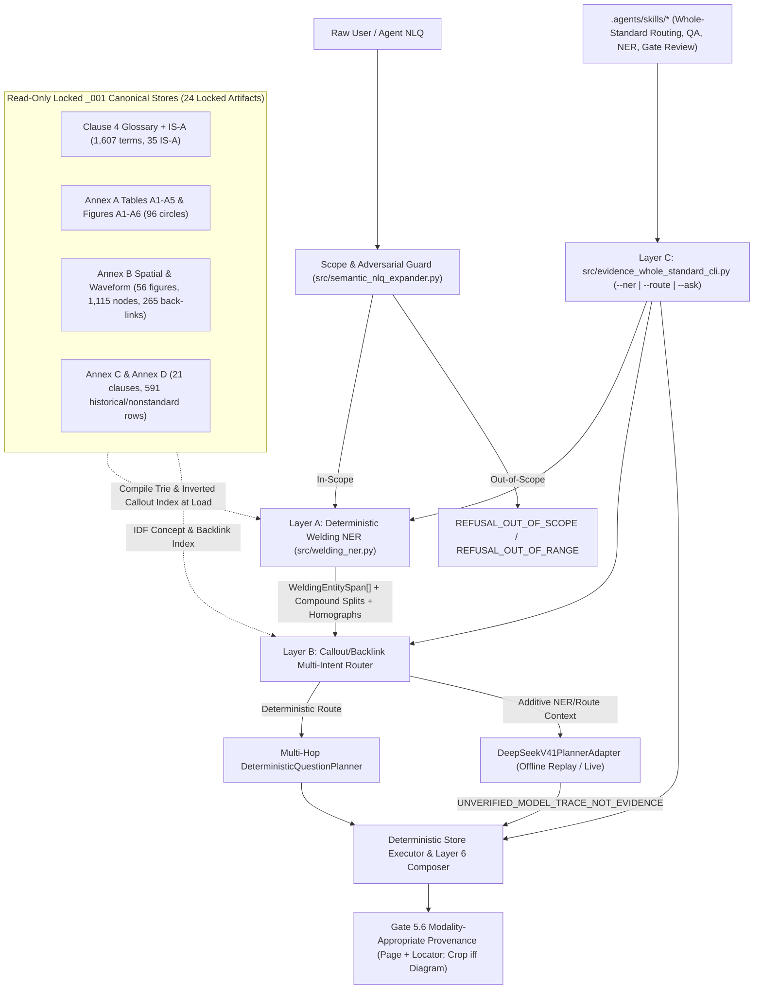

# Gate 6.0 Architecture & Forensic Gap Audit: Welding Domain NER, Callout/Backlink Multi-Intent Routing, Agent Skills & GitOps Hygiene

**Standard:** `AWS A3.0M/A3.0:2020` (*Standard Welding Terms and Definitions*, 190 PDF pages / 162 ingested canonical store pages)  
**Audited Baseline:** `main` at commit `dd22331` (Post-Gate 5.6 Epistemic & Manifest Calibration; `1,468 passed, 8 skipped, 0 failures, 0 warnings`; `24/24` SHA-256 locked artifacts)  
**Target Milestone:** **Gate 6.0 (`feat/gate-6-0-ner-routing-skills`)**

---

## 1. Executive Architectural Decision

Following the completion of **Gate 5.5** (Store-Derived Semantic Expansion & `DeepSeek-V4.1-Flash-1017` NLQ Integration) and **Gate 5.6** (190-Page Coverage Manifest, Latency Telemetry & Modality-Appropriate Provenance), further ad-hoc regex synonym additions yield diminishing returns and risk routing collisions.

A forensic audit of `src/semantic_nlq_expander.py`, `src/evidence_phase4_bakeoff.py`, `.agents/skills/`, and repository Git topology demonstrates that the optimal next milestone is **Gate 6.0 — Deterministic Welding Domain NER + Callout/Backlink-Indexed Multi-Intent Routing + Agent Retrieval Skills (with Step-0 GitOps Branch Hygiene)**:

1. **Deterministic Welding Domain NER (`src/welding_ner.py`):** Replaces heuristic 5-item regex phrase scraping with a store-compiled, non-overlapping longest-match entity recognizer emitting character-offset typed spans (`WeldingEntitySpan`), dynamic `<BASE>-<SUFFIX>` compound code decomposition (e.g., `PAW-AU` $\rightarrow$ `PAW` in `Table A1` + `-AU` in `Table A4`), and explicit homograph/polysemy candidates (e.g., `AB` *adhesive bonding* vs. *arc brazing*; `1F` `[pipe]` vs. `[plate]`).
2. **Callout- & Backlink-Indexed Multi-Intent Router (`src/semantic_nlq_expander.py` + `src/evidence_phase4_bakeoff.py`):** Indexes all **1,115** accepted Annex B spatial callout nodes and numbered legend keys, **96** Annex A chart process circles, and **265** Clause 4 figure back-links, upgrading `DeterministicQuestionPlanner` from single-winner `if/elif` routing to multi-entity, multi-hop action plan synthesis.
3. **Whole-Standard CLI & Agent Skills (`src/evidence_whole_standard_cli.py` + `.agents/skills/`):** Replaces frozen Phase-0 Figure-A1-only skill instructions with whole-standard deterministic `--ner`, `--route`, and `--ask` tooling across all 6 canonical stores.
4. **GitOps Branch Hygiene & Release Tagging (`10` `origin` branches $\rightarrow$ `1` clean `main`):** Stamps `v1.5.6-gate-5-6-calibrated` on `dd22331` and prunes 9 fully merged remote branches on `origin` plus 10 merged non-worktree local branches before opening `feat/gate-6-0-ner-routing-skills`.

---

## 2. Forensic Codebase Gap Audit (`main` @ `dd22331`)

### Gap 1: Span-Blind Heuristic Term Extraction & Unhandled Compound Designations
* **Location:** `src/semantic_nlq_expander.py:488–555` (`extract_candidate_terms`) and `856–881` (`check_unknown_term`).
* **Findings:**
  1. `extract_candidate_terms` relies on 8 syntactic regex frames followed by a linear scan over `self.all_recognized_lexicon` capped at **5 matches** (`if len(candidates) >= 5: break`), returning raw strings without character offsets (`start_char`, `end_char`), entity categories, or syntactic role boundaries.
  2. **Dynamic Compound Designations Fail Exact Lookup:** AWS A3.0 Clause 4 / Table A1 / Table A4 permits combining any valid process letter designation with an application mode suffix (`<PROCESS>-<MODE>`, e.g., `PAW-AU`, `GTAW-ME`, `ESW-AU`, `FCAW-G-SA`, `OFC-A-MA`). Only pre-enumerated strings exist in `abbrev_to_canonical`; unseen valid combinations are missed instead of decomposing deterministically into `Table A1/A5` + `Table A4` sub-entities.
  3. **Homograph & Domain-Qualifier Collisions:**
     * `AB` designates **arc brazing** in `Table A1` (p. 78) and **adhesive bonding** in `Figure A6` / `Clause 4`.
     * Welding test positions (`1G`–`6GR`, `1F`–`6F`) and bracketed Clause 4 qualifiers (`[pipe]`, `[plate]`, `[resistance welding]`, `[thermal spraying]`, `[brazing]`) distinguish multiple normative definitions and `Figure B16A` vs. `Figure B16B` vs. `Figure B16C`.
     * Multi-part-of-speech headwords in Clause 4 (e.g., `braze` noun vs. `braze` verb; `tack weld` noun vs. verb) require dual-entry emission when queried without POS qualification.
  4. **Unreachable Dead Code & Cold-Start Empty-Store Singleton Bug:**
     * Lines `856–881` in `src/semantic_nlq_expander.py` duplicate lines `829–854` immediately after an unconditional `return` statement.
     * In `src/semantic_nlq_expander.py:73–98, 888–896`, calling `get_semantic_expander()` standalone (`stores=None`) before `get_whole_standard_stores()` runs initializes `SemanticExpander` against `self.stores = {}` and sets `self._initialized = True` with zero lexicon entries. Both `SemanticExpander` and `WeldingNER` must self-hydrate via `get_whole_standard_stores()` whenever `stores` is omitted.

### Gap 2: Title-Only Spatial Diagram Indexing for ID-Free Annex B Queries
* **Location:** `src/semantic_nlq_expander.py:432–478` and `683–700`.
* **Findings:**
  1. While the 7 Archetype 4 waveform figures (`Figures B44–B45, B49–B51, B53–B54`) have an interval phrase dictionary (`waveform_intervals_index`), the **49 Archetype 3 spatial diagrams** are indexed **only by verbatim `official_title`** (plus a single manual patch for `"edge shape"` $\rightarrow$ `Figure B7` at line 698).
  2. Consequently, ID-free conceptual queries asking about interior callout terminology miss the authoritative figure whenever the phrase does not appear in the figure title:
     * `Figure B25` is titled `"Weld Sizes"` — an ID-free query asking *"Which diagram illustrates theoretical throat, effective throat, and actual throat?"* fails title lookup unless `Figure B25`'s callout nodes are indexed.
     * `Figure B33` is titled `"Crack Types"` — numbered legend keys `1`–`13` (*crater crack*, *throat crack*, *toe crack*, *underbead crack*, *root crack*, *longitudinal crack*, *transverse crack*) live inside the store's node inventory, not in `official_title`.
     * `Figure B46` is titled `"Schematic of the Friction Stir Welding Process"` — interior labels (*advancing side*, *retreating side*, *thermomechanically affected zone (TMAZ)*, *tool shoulder*, *probe*, *weld nugget*) require node-level inverted indexing.
     * `Figure B12` (`"End Dam, Shelf, Split Pipe Backing, Sump, Starting Weld Tab, and Runoff Tab"`) and `Figures B16A–C` (position codes `1G`–`6GR`, `1F`–`4F`) benefit from both callout indexing and **265 Clause 4 figure back-links** (`"see Figure B..."` edges in `glossary_store.json` / `annex_b_complete_unified_store.json`).

### Gap 3: Single-Winner `if/elif` Division Routing in `DeterministicQuestionPlanner`
* **Location:** `src/evidence_phase4_bakeoff.py:220–350` (`plan_whole_standard_question`).
* **Findings:**
  1. When a natural-language query has no explicit `"Figure ..."` and `"Table ..."` multi-hop keywords, `plan_whole_standard_question` cascades through a mutually exclusive `if / elif` chain that assigns a **single** `target_division` (`annex_c_d`, `annex_a_tables`, `annex_a_charts`, `annex_b_waveform`, `annex_b_spatial`, or `clause4_glossary`).
  2. Multi-entity conversational queries—such as *"Compare historical atomic hydrogen welding with modern GTAW-P and identify which diagram shows pulsed welding upslope and downslope intervals"* or *"What does PAW-AU stand for and where is plasma arc welding positioned in the fusion welding classification chart?"*—contain multiple typed entities spanning 2–3 divisions (`Annex D` + `Table A1/A4` + `Figure A4` / `Figure B53`).
  3. Driven by non-overlapping `WeldingEntitySpan` tokens, the planner can deterministically emit an ordered multi-operation plan covering every recognized entity intent while strictly honoring Gate 5.6's conditional diagram-crop rule (`requires_diagram_crop = True` if and only if at least one executed operation resolves against `Figures A1–A6` or `Figures B1–B54`).

### Gap 4: Frozen Phase-0 Agent Skills & Missing Whole-Standard CLI
* **Location:** `.agents/skills/*/SKILL.md`.
* **Findings:**
  1. `.agents/skills/evidence-graph-routing/SKILL.md` and `.agents/skills/evidence-graph-qa/SKILL.md` still state: *"At this checkpoint, the only implemented source adapter is Figure A1. Other source adapters are unimplemented"* and route exclusively through `python -m src.evidence_chart_cli --question ...`.
  2. `.agents/skills/aws-a30-lead-developer/SKILL.md` and `.agents/skills/aws-a30-gate-review/SKILL.md` still reference October 23 commit `71088ce`, `398` unit tests, and `src.evidence_chart_preflight` rather than `dd22331`, `1,468` passing tests, `24/24` locked SHA-256 artifacts, and `src.evidence_whole_standard_preflight`.
  3. Agents lack a single deterministic CLI (`python -B -m src.evidence_whole_standard_cli`) exposing `--ner`, `--route`, and `--ask` across the complete 162-page ingested standard.

---

## 3. Forensic GitOps Branch, Worktree & Release Tag Audit

Inspection of `origin` (`git fetch --prune origin`, `git branch -r --no-merged main`) and local worktrees (`git worktree list`, `git for-each-ref`) at `main` (`dd22331`) reveals **10 remote branches on GitHub (`origin`)** and **17 local branches**:

### 3.1 GitHub Remote Branches (`origin` — 10 Total; 0 Unmerged)

`git branch -r --no-merged main` returns **0 branches**. Every single non-`main` branch on GitHub is already 100% merged into `main` (`dd22331`) and therefore requires **release tagging + deletion** (no merges needed):

| # | Remote Branch (`origin/*`) | Tip SHA | Category | Ancestor of `main` (`dd22331`)? | Required GitOps Action |
| :- | :--- | :--- | :--- | :---: | :--- |
| 1 | `origin/main` | `dd22331` | Canonical Production Branch | **HEAD** | **KEEP** & tag `v1.5.6-gate-5-6-calibrated` |
| 2 | `origin/feat/gate-5-6-epistemic-manifest-calibration` | `533f03b` | Active Gate 5.6 Branch | Yes (`dd22331`) | **DELETE** on `origin` (merged) |
| 3 | `origin/feat/gate-5-5-semantic-nlq` | `0da90dc` | Active Gate 5.5 Branch | Yes (`e31b8e2`) | **DELETE** on `origin` (merged) |
| 4 | `origin/feat/gate-5-production-hardening` | `0da90dc` | Active Gate 5 Branch (same SHA as 5.5) | Yes (`e31b8e2`) | **DELETE** on `origin` (merged) |
| 5 | `origin/feat/gate-5-4-deepseek-planner-replay` | `933cb60` | Active Gate 5.4 Branch | Yes (`e31b8e2`) | **DELETE** on `origin` (merged) |
| 6 | `origin/feat/gate-3d-phase3-live-holdout` | `e0fd74d` | Active Gate 3D Branch | Yes (`263bfdb`) | **DELETE** on `origin` (merged) |
| 7 | `origin/feat/gate-3b-annex-b-archetype3-b1-b6` | `d8fb23d` | Stale Gate 3B Branch | Yes | **DELETE** on `origin` (merged) |
| 8 | `origin/feat/gate-3a-clause4-glossary-is-a` | `728ceed` | Stale Gate 3A Branch | Yes | **DELETE** on `origin` (merged) |
| 9 | `origin/fix/a1-query-completeness` | `00457fe` | Stale Phase 0 Fix Branch | Yes | **DELETE** on `origin` (merged) |
| 10 | `origin/plan/helper-hardening-20261015` | `cd7cce5` | Stale Phase 0 Plan Branch | Yes | **DELETE** on `origin` (merged) |

### 3.2 Local Branches & Sibling Worktrees (17 Total)

| Category | Branches | Count | Disposition |
| :--- | :--- | :---: | :--- |
| **Canonical Active Worktree** | `main` (`dd22331`) in `.../aws-a2-source-aware-ingest` | 1 | **KEEP** (active repository workspace) |
| **Merged Non-Worktree Local Branches** | `docs/a1-bakeoff-findings` (`3a79b94`), `feat/a1-a2-relationship-readiness` (`bc51eae`), `feat/a2-source-aware-ingest` (`6d02ee2`), `feat/gate-5-4-deepseek-planner-replay` (`933cb60`), `feat/gate-5-5-semantic-nlq` (`0da90dc`), `feat/gate-5-6-epistemic-manifest-calibration` (`533f03b`), `feat/gate-5-production-hardening` (`0da90dc`), `fix/a1-query-completeness` (`00457fe`), `plan/declarative-manifest-20261015` (`987e583`), `plan/helper-hardening-20261015` (`cd7cce5`) | 10 | **DELETE** safely via `git branch -d` (all 100% merged into `main`) |
| **Merged Sibling Worktree Branches** | `feat/a1-validated-llm-planner` (`0c6a0e1`), `feat/a1-faithful-relationships-multihop` (`3e390fe`), `feat/a1-nlq-planning-completeness` (`76b08b2`), `feat/a1-source-aware-ingest` (`c4f030c`), `fix/a1-lightrag-extraction` (`0c6a0e1`) | 5 | **LEAVE UNTOUCHED** (checked out in separate sibling directories outside active workspace) |
| **Unmerged Historical Archive Worktree** | `bakeoff/a1-multimodal-hybrid` (`b9f7763`, `"chore: preserve bounded Figure A1 bakeoff record"`) in `.../aws-a1-bakeoff` | 1 | **PRESERVE AS ARCHIVE** — **DO NOT MERGE** into `main` and **DO NOT FORCE-DELETE** |

### 3.3 Release Tagging & Ongoing Branch Lifecycle Policy
1. **Pre-Cleanup Anchor Tag:** Before deleting merged branches, create annotated tag `v1.5.6-gate-5-6-calibrated` at `main` (`dd22331`) and push it to `origin` (joining `v1.0` and `v1.0.0-aws-a30-complete`).
2. **Post-Merge Feature Branch Cleanup:** Upon completing Gate 6.0 and merging `feat/gate-6-0-ner-routing-skills` `--no-ff` into `main`, tag `v1.6.0-ner-routing-skills`, push `main` and the tag to `origin`, and immediately delete `feat/gate-6-0-ner-routing-skills` both locally (`git branch -d`) and remotely (`git push origin --delete`) so `origin` remains at **1 clean branch (`main`)**.

---

## 4. Gate 6.0 Unified Four-Layer Architecture

### Layer A: Deterministic Welding Domain NER (`src/welding_ner.py`)
* **Zero External ML Dependencies, Zero Network Calls:** Compiled in-memory (< 30 ms cold start, < 0.5 ms per query warm) directly from the 6 locked `_001` JSON stores.
* **11 Typed Entity Categories:**
  1. `PROCESS_CODE` (`SMAW`, `GTAW`, `PAW`, `FSW`, `CW`, `CAC-A`, `OFC-A`, `AHW`, `FOW`, ...)
  2. `MODE_SUFFIX` (`-AD`, `-AU`, `-MA`, `-ME`, `-RO`, `-SA` — all 6 suffixes from `Table A4`, p. 74)
  3. `COMPOUND_DESIGNATION` (dynamically parsed `<PROCESS_CODE>-<MODE_SUFFIX>` per `Table A4`'s `XXXX-YY` note, or `<PROCESS_CODE>-<VARIANT>-<MODE_SUFFIX>`, e.g., `PAW-AU`, `GTAW-MA`, `GTAW-P-AU`, `FCAW-G-SA`, populated with `sub_components` referencing both `Table A1/A5` and `Table A4`)
  4. `PROCESS_TERM` (canonical Clause 4 / Table A1–A2 / Figure A1–A6 process names)
  5. `NONSTANDARD_OR_HISTORICAL` (Annex C/D & Clause 4 lightface synonyms, e.g., *heliarc*, *stick welding*, *atomic hydrogen welding*, *gas pocket*, *button weld*)
  6. `WELD_POSITION` (`1G`–`6GR`, `1F`–`6F`, *flat welding position*, *horizontal fixed position*, ...)
  7. `DOMAIN_QUALIFIER` (`[pipe]`, `[plate]`, `[resistance welding]`, `[brazing]`, `[thermal spraying]`, `[soldering]`)
  8. `DIAGRAM_CALLOUT` (accepted interior labels and numbered legend terms across `Figures B1–B52`, e.g., *theoretical throat*, *effective throat*, *underbead crack*, *toe crack*, *thermomechanically affected zone*, *runoff tab*, *split pipe backing*)
  9. `WAVEFORM_INTERVAL` (Archetype 4 cycle/trace terms across `Figures B44–B45, B49–B51, B53–B54`, e.g., *upslope*, *downslope*, *squeeze time*, *quench time*, *temper time*, *crater fill time*)
  10. `STANDARD_LOCATOR` (explicit `Clause 4`, `Table A1`–`A5`, `Figure A1`–`A6`, `Figure B1`–`B54`, `Annex C`, `Annex D` citations, including out-of-range detection like `Figure A7` or `Figure B55`)
  11. `GLOSSARY_TERM` (remaining boldface Clause 4 headwords & morphological inflections)
* **Ambiguity & Homograph Tracking:** When a surface token maps to multiple distinct store concepts (e.g., `AB` $\rightarrow$ `["arc brazing (Table A1)", "adhesive bonding (Figure A6 / Clause 4)"]`; `1F` without plate/pipe context; `braze` noun vs. verb), `WeldingEntitySpan.ambiguity_candidates` enumerates all normative candidates so the router either disambiguates using adjacent `DOMAIN_QUALIFIER` spans or retrieves both senses transparently instead of silently dropping one.

### Layer B: Callout/Backlink Inverted Index & Multi-Intent Router
* **Complete Annex B Callout & Backlink Coverage:**
  * Indexes all `1,115` accepted spatial nodes/keys in `annex_b_complete_unified_store.json`, `7` waveform stores in `annex_b_archetype4_unified_store.json`, `96` process circles across `Figures A1–A6`, and `265` Clause 4 `"see Figure B..."` back-links.
  * Ranks candidate figures for ID-free queries using deterministic **IDF-weighted span coverage** (specific multi-word callouts like `"theoretical throat"` + `"effective throat"` outscore generic words like `"weld"` or `"groove"`), with deterministic tie-breaking by matched span length and canonical figure order.
* **Multi-Intent Action Plan Generation:**
  * `DeterministicQuestionPlanner` inspects the `WeldingNERReceipt` and ranked figure/table targets to emit **1..N ordered store operations** whenever multiple distinct divisions or comparative intents are present in a single query.
  * Preserves 100% backward compatibility on all prior benchmarks (`Annex A Holdout 30/30`, `Gate 3D`, `Gate 4 / 4B`, `Gate 5 Hardening 10/10`, `Gate 5.5 NLQ 15/15`, `Gate 5.6 Provenance`).
  * Preserves all 8 existing `DeepSeek-V4.1-Flash-1017` replay cassette keys in `storage/model_replays/deepseek_v4_1_flash_1017/` untouched while adding 2 new Gate 6.0 multi-intent replay cassettes.

### Layer C: Whole-Standard CLI & `.agents/skills/` Modernization
* **`src/evidence_whole_standard_cli.py`:** Unified offline CLI supporting:
  * `--ner "<query>"` (outputs `WeldingNERReceipt` JSON/markdown),
  * `--route "<query>"` (outputs NER spans + ranked target divisions/figures/tables + planned operations without executing answer composition),
  * `--ask "<query>"` (executes full multi-store retrieval, Layer 6 deterministic composition, and Gate 5.6 modality-appropriate provenance),
  * `--planner deterministic|deepseek-replay` and `--json`.
* **Updated `.agents/skills/` Suite:**
  * Update `.agents/skills/evidence-graph-routing/SKILL.md` and `.agents/skills/evidence-graph-qa/SKILL.md` from Figure-A1-only to whole-standard `AWS A3.0M/A3.0:2020` routing & QA (while keeping `src.evidence_chart_cli` documented for legacy Figure A1 chart-only inspection).
  * Update `.agents/skills/aws-a30-lead-developer/SKILL.md` and `.agents/skills/aws-a30-gate-review/SKILL.md` to current Gate 5.6 / Gate 6.0 invariants (`src.evidence_whole_standard_preflight`, version-bound `_001` store immutability, modality-appropriate provenance, anti-drift regexes).
  * Add `.agents/skills/aws-a30-ner-and-routing/SKILL.md` dedicated to Welding NER inspection, compound code resolution, homograph disambiguation, and ID-free spatial/waveform routing.

### Layer D: Frozen Gate 6.0 Benchmark (`phase6_ner_routing_001`) & Verification Suite
* **20-Question Frozen Benchmark (`storage/evidence_v2/phase6_ner_routing_001/`):**
  * Slice 1 (`G60-NER01`–`G60-NER04`): Dynamic Compound Designations (`PAW-AU`, `GTAW-ME`, `FCAW-G-SA`, `OFC-A-MA`).
  * Slice 2 (`G60-NER05`–`G60-NER08`): ID-Free Spatial Diagram Callouts (`Figure B25` throats, `Figure B33` crack types, `Figure B46` FSW zones/keys, `Figure B12` tabs/sump/split pipe backing).
  * Slice 3 (`G60-NER09`–`G60-NER12`): Homograph & Domain Qualifier Disambiguation (`AB` dual resolution, `1G`/`1F` plate vs. pipe across `Figures B16A–C`, multi-POS Clause 4 headwords).
  * Slice 4 (`G60-NER13`–`G60-NER16`): Multi-Entity Cross-Store Comparisons (historical `Annex D` + active `Table A1/A4` + `Figure A4/B53`).
  * Slice 5 (`G60-NER17`–`G60-NER20`): Invalid Compound Suffix / Out-of-Scope / False-Premise Boundary Tests (e.g., invalid suffix `-ZZ` on a valid process code `GTAW-ZZ` $\rightarrow$ explicit abstention on invalid suffix while identifying `GTAW` + `Table A4`'s 6 valid suffixes).
