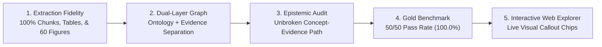

# Project Goal: AWS A3.0 Multimodal NLQ & Epistemic Knowledge System

## A2 finishing slice009 verified (2026-10-23)

The bounded A2 ingest/evidence slice and opt-in planner finishing pass are verified
on existing exposed questions. Default deterministic behavior is preserved; fresh
model selection, production Terra/Luna and unseen generalization remain unvalidated.
No new OCR/model/provider call, figure, framework or UI was introduced by009.

Optional `run_questions(..., source_observation_path=...)` / `qa --source-observation`
adds source-bound canonical **candidate** figure evidence in the A2 adapter. Source,
page/crop/region/connector bindings and native PDF-rendered clip pixels are checked.
This authenticates provenance, not the AI observation's truth. Candidate evidence
and claims stay outside accepted proof catalogs/KG admission and completeness flags;
knowledge-only answers are not augmented. Text is rendered only for successful
evidence-layer `epistemic_limits`/`chart_layout` operations; otherwise the optional
candidate packet is separate. Omitting the option preserves prior behavior.

A conservative compiler guard reuses the existing deterministic relation intent
only for a ready single-part literal evidence path with exactly matching ordered
endpoints. It supplements, never replaces, original model operations and records
its origin. Membership, source-layout ancestry, physical common-root reachability
and semantic subtype remain distinct. Ambiguous/compound/ref-dependent batches are
not guessed; forced knowledge execution rejects the evidence-only layout operation.

Capability staging remains **text first, relationships second, multihop third**.
Known-source labels/codes and identity clarification are independently usable;
compound requests retain every relationship/path part. Qualified relationships
now include the optional candidate whole-A2 connector observation. Ordered source
paths and accepted physical support are demonstrated; model-requested accepted-KG
paths and semantic IS_A transitivity are not established. Candidate indentation and
AI observations never become accepted semantic facts through recognition or reachability.

One frozen cached005-plan replay: A2 content/delivery **16 PASS**; A1 **51 PASS**,
including three proper clarifications. This is compiler/executor recovery with
explicit deterministic supplementation and candidate evidence, not improved model
performance. Original007/008 plans, grades and artifacts remain unchanged. All51
deterministic A1 control answers/coverage/rows/paths/verdicts are unchanged, including
the known planning_unsupported versus source-limit metadata caveat. Runtime execution
still retains redundant failed/blocked requests; semantic completeness remains
UNASSESSED automatically. Do not equate content grades with all operations succeeding.

Validation:398 existing applicable software checks passed; independent focused code,
source and answer review passed. An offline wheel includes the runtime JSON contract
and excludes source assets/stores; sandbox build failures are retained separately
from the successful host build. Harness1.7.6, graph adapter1.4, instruction1.4/wire1.0;
no model has consumed instruction1.4. Source observations are optional read-only
attachments; existing graph/store admission decisions are unchanged.

Authorized Git closeout is conditional on these checks and a clean publication
review; its exact commit/PR/merge/sync receipt is kept in the Library report, not
fabricated here. Private PDFs/images/OCR/vision traces/stores/caches stay outside Git.
Rollback leaves the observation option unset and deterministic default enabled;
no reset, branch/worktree deletion or unrelated cleanup is required. AWS backend
correctness remains one slice at a time; no automatic A3, Navy Weld or Utopia work.
Report: `Figure_A2_Planner_Integration_002_Report.md`; private actual answers/receipts:
`storage/evidence_v2/a2_planner_009/`. GR remains optional, not a required harness.

## Preserved offline planner006 baseline

**Bounded offline simplification complete; hold planner adoption/publication.**
One replay used the unchanged005 saved plans: no model, OCR or external calls.
A2 content **15 PASS/1 PARTIAL**, delivery **14 PASS/2 PARTIAL**; A1 content
**50 PASS/1 PARTIAL**, delivery **48 PASS/3 PARTIAL**. A1's50 passes include three
appropriate identity clarifications, not50 factual answers. These are exposed
regressions and cached-plan replay, not fresh model or production acceptance.
All51 deterministic A1 control answers/coverage/rows/paths/verdicts are unchanged.

Runtime1.7.4 loads `src/evidence_chart_contract.json` through its Python loader:
contract1.0, instruction1.3, wire1.0. Prompt/profile/schema/compiler definitions
share that asset; explicit safeguards remain code. No model consumed instruction1.3.
`SKILL.md` routing/QA guidance remains developer/agent guidance, not automatic
runtime skill loading. Shared definitions reduce drift; they cannot prevent it.

Quote labels no longer require a character partition. Exact source/query bindings,
typed IDs/roles/budgets and result dependencies remain enforced. One batch retains
blocked operations, runs safe independent ones, and blocks failed dependents.
Exact equivalent operations can share execution without losing part/field mappings.
Explicit `chart_layout` alone requests whole-chart observations; empty IDs never
mean all nodes. Membership, layout, physical connectivity and semantic subtype
remain distinct. Dictionary candidates now also bind unresolved identity requests.

Execution coverage is separate from semantic answer completeness (`UNASSESSED`
until independent grading). Actual bound assertion status/rule/support qualifies
observations. Five returned paths have complete accepted literal/physical support,
including the A2 Allied→Thermal Cutting→Arc Cutting route; these are structural
certifications of evidence paths, not semantic IS_A transitivity or a new KG search.
No persisted observation/admission decision was changed. Source bytes, gold,67 raw
plans,109 frozen code files and463 prior005 artifacts passed preservation checks.

Remaining: A2-Q15 omits explicit source judgment about arrow directions and has
invalid partition/oversized operations; Q16 adds an empty redundant designation
follow-up. A1-QA002-14 answers a subtype question with a cross-chart path instead
of its relationship verdict. CQ003/QA002-10 contain the requested facts but retain
confusing redundant-operation warnings. No automatic repair/evaluation loop follows.
The known deterministic reason-label caveat is preserved with its unchanged controls.

AWS backend correctness stays slice by slice: A2 only plus A1 regressions, no UI,
A3, Navy Weld, Utopia, framework or model campaign. GR remains optional. Review
actual answers before further inference or publication. Source-aware ingest and
planner are logically separable, but shared API/traversal hunks require a deliberate
split; no two independently publishable commits or foundation PR were created.
Report: `Figure_A2_Planner_Integration_002_Report.md`; private receipts and all
answers: `storage/evidence_v2/a2_planner_006/`. No Git publication is authorized.

## Preserved fresh005 baseline

Fresh005 used67 natural-stop `deepseek-flash` planner calls with instruction1.2:
A2 content12 PASS/4 UNASSESSED, delivery10 PASS/2 PARTIAL/4 UNASSESSED;
A1 41 PASS/1 PARTIAL/9 UNASSESSED included two proper clarifications.
It executed52 graph queries (12 A2+40 A1), plus two zero-operation clarifications:
**52, not54 executions**. All original receipts/answers remain unchanged. The full
report is archived as `006/report_v5_before.md` and Library version5 of
`libfile_467be2fe46b08191be1c7380b658b958`; its raw ZIP remains
`libfile_a2abf18257b08191a21e3db693d4df18`. Neither005 nor006 establishes production
or unseen acceptance. The independent review's predicted scores and invented A2
Solid-State Cutting question were not adopted; actual source/receipts govern.

## Preserved offline004 baseline

004 replayed older saved plans, with zero new model calls: A2 delivery11/3/0/2
and content14/0/0/2; A1 43/6/0/2 included three appropriate clarifications.
It did not test instruction1.2 in a model. Its exact full report remains
`storage/evidence_v2/a2_planner_005/report_v4_before.md` (SHA256
`f0abc1ae5f14151d898acbaab87b16f8dbe82a178c0479c43c354b3bf9b6ffb0`), with historical checks/proof limits and prior Library version4.

## Preserved planner003 development baseline

The fresh instruction1.1 DeepSeek run completed67 natural-stop calls, with no
truncation/retry/fallback. A2 clear delivery/content:6 PASS/10 UNASSESSED; A1
complete-answer30/12/3/6, factual-data35/7/3/6. Plans were6/16 ready in A2 and45/51
in A1; nine evidence paths and no accepted-KG paths returned. This was a development
proxy, not production acceptance. Full answers/raw plans/report remain unchanged
in `storage/evidence_v2/a2_planner_004/report_v3_before.md` and prior003 artifacts;
archive SHA256 `14da3c37608c51fee0da312d6ef9c667d45782b8aab6d9f10026df337c303308`. Library version 3 retains that earlier report in version history. The replay above is not new model performance.

## Historical A2 planner002 (2026-10-23)

**Offline contract repair reviewed; fresh model validation is not authorized.**
Instruction revision `chart-llm-plan-instructions-1.1` keeps wire schema `1.0`;
per-operation restrictions and planned `reason=''` are explicit in prompt and
schema descriptions. Flat schema remains a structural superset; compiler guards/
admission are unchanged. Fifty focused checks passed; unchanged saved67-response
compiler replay confirms0 executable plans and identical first rejections. No
plan rewrite, new model call or model-improvement claim. Hold Git. Fresh validation
needs separate approval. The same Library file is now version2 with offline
findings; the original67-call record and Libraryv1 remain preserved.

**VALIDATION_PASS_COMPLETE_TYPED_PLAN_CONTRACT_NOT_READY.** The current local
`feat/a2-source-aware-ingest` goal is correct question interpretation and complete
supported answers over the cached A2 source, not another ingest or framework
workstream. Keep the unchanged 16 A2 questions, 51 exposed A1 regressions and
`storage/evidence_v2/a2_planner_002/baseline_freeze.json`; baseline001 remains below.

Use an opt-in model question-to-validated-plan adapter, including generic result
references for group/path follow-ups. Model inputs are only the question and
source dictionary names/codes/IDs, without graph edges, gold or prior answers.
The deterministic evidence/KG executor and existing admission rules determine
facts. Success requires every requested part to be answered with evidence or
honestly unresolved; valid schema alone is not answer success. Validation is
complete, but model-plan/answer acceptance is not met.

The versioned runtime prompt/operation contract/JSON schema and validation live
in `src/evidence_chart_llm_plan.py` (`build_prompt`). Existing `.agents`
`evidence-graph-routing`/`evidence-graph-qa` skills guide developers/agents; the
backend does not automatically load them. No new skill workstream is part of this goal.

### Historical first local-attempt setup

STS succeeded in `us-gov-west-1`, but SageMaker endpoint discovery was denied
(AccessDenied/400) and Bedrock profile discovery denied (AccessDenied/403), with
no Terra/Luna mapping verified in config or new credentials. Planned installed
`qwen2.5:3b` text Instruct (3.086B) / Ollama 0.40.4 was selected by the owner
before inference; no 8B calls occurred. Digest:
`357c53fb659c5076de1d65ccb0b397446227b71a42be9d1603d46168015c9e4b`.
It is a local proxy, **not Terra/Luna**: native metadata context 32768, chosen
runtime 16384, `num_predict=-1`, temperature 0, seed 42. This cannot establish
production-model acceptance. Stop on actual gaps without repeated tuning.

### Historical approval-block/local-attempt record — permission resolved

The following record predates the new explicit approval and final 67-call pass.
Its zero-DeepSeek-call and no-retry statements describe that earlier denied
launch only; they are not the current inference totals.

**A2 is not done and is not ready for closeout.** Automatic approval review
rejected the exact DeepSeek A2 CLI launch before `CreateProcess`: sending the
questions and private source-derived identity dictionary to `api.deepseek.com`
lacked explicit private-source-disclosure authorization. The action is known
**UNEXECUTED**, with zero DeepSeek inference calls; no retry or alternate path
was attempted. Existing authentication/model-list reads succeeded, but those
metadata reads did not authorize source-bearing inference.

Before any launch, explicit approval is needed to send the existing 16 A2/51 A1
questions, source-derived dictionary names/codes/IDs and operation contract/schema
to the existing `https://api.deepseek.com` endpoint using existing credentials.
No PDF/image, graph edges, gold or previous answers are part of that proposed
input. No new credential grant, private-data upload retry or bypass is authorized.
The pending proxy remains `deepseek-flash` (documented
`DeepSeek-V4.1-Flash-1017`), thinking disabled, temperature 0, JSON-object output
and the same strict contract/schema. Its planned explicit provider maximum is
393216 output tokens rather than the default 8K; native context is 1M. None of
these inference settings has been executed. `deepseek-v4-pro` was also listed;
legacy `deepseek-chat` was absent. This is operational failover, not a new bakeoff.

All 32 local request directories/attempts remain preserved, with 30 natural
completions. A1 request010 contains only `request.json`, no receipt or stream;
its execution is **UNCERTAIN/prepared-interrupted**, not confirmed generation.
The initial schema run's 16 A2/nine A1 natural responses lacked required fields;
The prepared tenth A1 attempt was interrupted during diagnosis; its actual model
execution cannot be established from the retained artifacts.
The flat-schema-only correction preserved all 67 prompts byte-for-byte, profiles,
validator and admission. The flat run's first five A2 backend answers were invalid
plans (`SINGLE_SUBJECT_REQUIRED`); the sixth repeated query text and was manually
client-stopped at 83,103 characters: this sixth flat A2 request has confirmed
repetitive generation. All 30 saved backend answers have zero operations, rows,
paths and claims; **no new semantic answers were produced**. The five flat plans
mixed literal IDs with a current-operation self-reference, violating prior-only
dependency/cardinality rules rather than missing source data. The
repetition watch now handles arbitrary periods; no local rerun or arbitrary
output-token ceiling follows from that software correction.

The opt-in runtime/backend integration and versioned `chart-llm-plan-1.0`
contract are implemented/reviewed, with flat schema encoding. Final applicable
software checks: **382 PASS in 10.49 s**, five known warnings; independent code
review CLEAR. These establish implementation checks, not successful model plans
or answer quality. Source/baseline hashes are unchanged and the deterministic A1
control's 51 answer strings and coverage are identical (44 complete/2 partial/
5 unanswered). The 16+51 model acceptance
run remains blocked/pending, not passed. Report
`Figure_A2_Planner_Integration_002_Report.md` is delivered to Library version 0
(`libfile_467be2fe46b08191be1c7380b658b958`); it includes the actual saved responses,
controls, independent audit and the precise blocked action.
Stop here: no more local trials, external inference retries, OCR/A3/UI/Navy Weld,
new questions/framework/skill workstream or Git publication.

### Final authorized validation pass — complete; contract not ready

New explicit private-source-disclosure approval resolved the previous launch
block. The known-unexecuted A2 launch was retried once and allowed, followed by
A1. The final pass made **67 DeepSeek calls (16 A2/51 A1)**: all naturally stopped,
with no API errors, truncation, inference retry or fallback. Every response model
was `deepseek-flash`. All original prompts, code and gold remained frozen; no
fixes or tuning occurred during this pass.

Raw JSON/schema validity was **67/67**, but typed executable plans were **0/67**.
All 67 results were unsupported/unanswered before execution, with zero operations,
retrieval, rows, paths or claims. A2 rejected plans: 12 `UNUSED_INFORMATION_FIELDS`,
three `FIELDS_INVALID`, one `SINGLE_SUBJECT_REQUIRED`. A1: 30 `FIELDS_INVALID`,
18 `UNUSED_INFORMATION_FIELDS`, one `SINGLE_SUBJECT_REQUIRED` and two
`PLANNED_PART_INVALID`. Source-answer grading is **UNASSESSED/NOT_RUN**, not a
0/67 semantic-accuracy score; end-to-end pipeline acceptance nevertheless fails.

That frozen live pass showed schema/prose/compiler usability defects and model planning/
adherence mistakes. The flat structural schema allows field arrays whose
operation-specific restrictions are implicit in prose and enforced by the
validator. Raw unexecuted plans also show wrong operation selection, ambiguity
handling and direct-versus-recursive list-depth choices. Do not blame the contract
or model capability alone, or call these executed OCR/KG/retrieval failures:
retrieval never ran. The next decision is generic contract/interface clarification
and simplification, not OCR changes, more questions or an automatic tuning loop.
No further implementation or publication is authorized.

Usage was 247737 input/22999 output tokens (270736 total; 136064 cache-hit/
111673 cache-miss input). Summed API latency was 148.573 s, median 2.204 s,
maximum 3.530 s. Published-rate billing estimate: USD0.03096–0.06192; invoice
unavailable. The prior 382 passing software checks remain valid because code is
unchanged; they do not establish contract usability. The deterministic A1 control
still has identical 51 answer strings and runtime 44 complete/2 partial/
5 unanswered; A2 source/QA001's 7 PASS/4 PARTIAL/5 FAIL baseline is unchanged.
A2 is not done and is not ready for Git closeout. Report
`Figure_A2_Planner_Integration_002_Report.md` is updated in the same Library file
`libfile_467be2fe46b08191be1c7380b658b958`, confirmed version1, including all 67 raw
backend answers and raw plans. Preserve all local attempts and the historical
approval-block record.

Planning uses `planning-and-task-breakdown` plus Scope Discipline from
`using-agent-skills`; no dedicated drift framework is added. No OCR, A3, UI,
Navy Weld, production integration, new benchmark or publication is authorized.

## Historical A2 source/QA001 (2026-10-23)

**STOP_AFTER_A2_DEVELOPMENT_PASS — SOURCE_INGEST_READY_NLQ_NOT_READY_FOR_CLOSEOUT.**
Work remains local/uncommitted on `feat/a2-source-aware-ingest`; main is unchanged
at `2d7b73813228c1cd6f907ca014a23693a888de81`. Hold publication: the source layer
works, but the actual A2 answer/completeness results below do not meet acceptance.

Figure A2 is **Master Chart of Allied Processes**, `figure:figure_a2`, PDF index
88 / viewer page 89 / printed page 76. Its normalized page crop
`[0.075, 0.10, 0.45, 0.89]` (`ymin,xmin,ymax,xmax`) excludes A3 on the same page.
Adapter `a2-source-aware-ingest-1.4` (`src/evidence_a2.py`) combines native vector
boxes/strokes with local OCR for outlined-font labels: eight OCR calls total
(cached initial PSM11 plus seven per-box PSM6); later derived projections used
zero OCR calls. This is hybrid source ingest, not independent image-only OCR.
No LLM/external calls occurred and no VLM was needed for the native geometry.
A2 vocabulary comes only from A2 observations; no A1 dictionary facts are imported.
The final graph has 38 nodes (seven boxes/31 printed rows), six undirected
physical connectors, 112 ACCEPTED/12 CANDIDATE/0 DISPUTED assertions and zero
accepted `IS_A`. All returned proofs/assertion references joined correctly;
231 support joins and zero candidate promotions were verified. Lower category
boxes have multilevel physical connections, not geometric containment inside
the thermal-cutting box. Indentation remains candidate.

After the code freeze, one fixed 16-question A2 batch and one existing 51-question
A1 regression ran. A2 independent content review found **7 PASS / 4 PARTIAL /
5 FAIL**, while runtime coverage was **3 complete / 11 partial / 2 unanswered**;
only three answers were clean on both content and coverage. Independent delivery/
coverage grading was **3 PASS / 8 PARTIAL / 5 FAIL**. False clarification/
unsupported warnings remain even on some content-complete answers. A1's 51 answer
strings and coverage are verbatim unchanged: 51 content PASS, runtime 44/2/5,
including the known `HO003-06` reason-label caveat. These are development/exposed
regressions, not unseen or production-model acceptance.

The initial full 287-check run had one legacy-helper contract failure. A minimal
post-QA compatibility patch fixed that caller contract; nine focused checks then
passed, followed by **287 PASS in 7.82 s** with five known warnings. The actual QA
results remain from the frozen pre-patch code; no QA rerun is claimed. Old/new
coverage-helper results matched for all 31 typed A2 operations. Source, code and final compatibility
review cleared; that review is not NLQ answer acceptance.
Source/image/question hashes and all original/intermediate artifacts are retained.
The completion drift check remained A2-only, with no new UI/framework/model,
question/gold mutation or automatic repair loop. Primary gaps are intent
composition, anaphora/path planning and honest coverage, not missing source OCR.
Next decision: a bounded language-to-typed-operation repair; do not start another
OCR change, framework bakeoff or automatic rerun. No commit/push/merge is authorized.
GR remains optional; Navy Weld/Utopia are deferred. The reported AWS GPT-5.6
Terra/Luna setup remains unverified; no production endpoint/model acceptance was
simulated. Preserve the closed A1/private records below. Report `Figure_A2_Source_Aware_Ingest_001_Report.md` is delivered to Library,
version 0 (`libfile_333e9b8fb2a48191ae37ac99fa0a2633`).

The source-ingest milestone is structurally complete, but full A2 backend-answer
acceptance is not. The 7/4/5 content result and only three clean content/coverage
answers prevent closeout despite valid source records and passing software
checks. Reuse the working data/store; the smallest next decision concerns
language-to-operation composition and complete subquestion answers. Keep physical
connections, per-row enclosure and candidate indentation distinct from semantic
subtype, and retain all unsupported/ambiguous portions honestly.

## Preserved A1 records

**Git closeout record (2026-10-23): REVIEWED FEATURE; PR #11.**
The reviewed implementation is published in [PR #11](https://github.com/kaiello/aws-a30-prototype/pull/11).
Independent code/publication reviews approved and all 270 local checks passed.
The PR records the live publication/merge state; the separate closeout report
records exact local main/origin/GitHub synchronization and post-merge checks.
Preserve the bounded dictionary-assisted A1 scope, private artifacts and
unrelated work. The 003 result below remains the historical pre-publication
record; this closeout does not start the next slice.

**Historical pre-publication raster integration 003 (2026-10-23): BOUNDED_A1_INTEGRATION_READY_FOR_OWNER_REVIEW.**
Local/uncommitted `feat/a1-source-aware-ingest`, based on unchanged main
`039087d06d55860bda19c1c8ea3b55b678cb8e4a`; no commit/push/merge is authorized.
The actual retained-raster pipeline executed the existing 51 questions once:
**51 content PASS in auto and 51 content PASS in candidate-evidence view**,
with **51 native content PASS** unchanged. Auto answers match native after only
removing the explicit raster-provenance prefix; evidence answers add qualified
parent-layout details in 14 cases without changing facts. All 51 are exposed
regressions, not unseen/general QA or cross-figure acceptance. Runtime coverage
is separately 44 complete/2 partial/5 unanswered because ambiguity and source
limits remain explicit; this does not mean 51 complete factual answers.
The known native `HO003-06` shielding-gas reason-label caveat is preserved.
003 reused unchanged 002 OCR/model artifacts with **zero new OCR/model calls**.
Typed per-predicate automatic pixel/OCR checks admitted 287 assertions (189
literal facts, 90 row enclosures and eight physical connectors). The 29
indentation assertions remain candidate; no `IS_A` was accepted. All 226 raw
observations/proofs remain candidate. The 586 support joins include source-local
glyph corroboration for four low-confidence/corrected codes; dictionary matching
alone grants no admission. All eight measured connector stroke regions and box
contacts were independently checked against pixels; these are undirected
physical links, with no arrow direction or semantic subtype inferred.
Scoped completeness accounts for observed rows/pixel bands, measured borders,
fresh rectangle inventory, orphan ink/words and required projection edges.
Applicable scopes passed without native reference totals or expected QA answers.
The KG recomputes retained seed/pixels/graph and checks file hashes before
admission. These are automatic source checks, not human approval, mathematical
proof or authority from a receipt flag/hash alone.
The full 270 A1 software checks passed in 7.67 s; independent code/source/proof
and actual-answer review found no material blocker. Software counts support the
answer/evidence results, not substitute for them. Frozen runtime/source files
and all 72 prior artifacts remain unchanged; native/001/002 inputs, gold,
outputs and private source evidence are preserved. No post-output repair/replay,
extra benchmark/framework, tuning loop or automatic model retry occurred.
Ready for owner review of this bounded A1 integration only. AWS backend one
figure at a time; GR optional, Navy Weld/Utopia deferred, no UI/new models/services
or automatic Git publication. Final report delivered to Library, version 0
(`libfile_24260fa7fb7c8191bfd0d5fcce255cbf`).

**Historical dictionary-assisted ingest 002 (2026-10-23): NOT_READY_FOR_ACCEPTED_RASTER_QA; HOLD UNMERGED.**
Local/uncommitted `feat/a1-source-aware-ingest`, based on unchanged main
`039087d06d55860bda19c1c8ea3b55b678cb8e4a`; no commit/push/merge is authorized.
This bounded pass used the source-backed dictionary's 99 labels and 97 printed
codes to normalize observed OCR, preserving raw text, provenance and uncertainty.
It supplied no reference regions, boxes, relationships, unseen entities, gold
answers or accepted status. This is **dictionary-assisted ingestion**, unlike
independent attempt 001 retained below. Source comparison found all 99 nodes
(90 processes/eight categories/root) and 127 physical relations (90 enclosures,
29 indentation links/eight root connectors), with no missing/extra identities or
endpoint relations. Two connectors came from CV and six from VLM. The six VLM
relationship regions identify endpoint boxes rather than connecting strokes;
this is an unresolved evidence-localization gap, not fully verified anchors.
The only local `qwen3-vl:8b-instruct` / Ollama 0.40.4 call used six unresolved
tasks/seven referenced nodes plus pixels, naturally completing in 42.656 s with
8980 input/645 output tokens. Actual context was 32768, `num_predict=-1`,
temperature 0, seed 42; metadata supports 262144, not allocated for this run.
One end-to-end pass executed the existing 51 exposed questions in both raster
views. Unchanged content rubrics grade candidate-evidence answers **32 PASS /
2 PARTIAL / 17 FAIL**, and mixed auto-policy answers **16 PASS / 4 PARTIAL /
31 FAIL**. Auto includes evidence operations; these are not accepted-KG accuracy
scores. All 226 record proofs and 316 assertions remain candidate, with zero
accepted assertions and 570 valid support joins. Valid joins do not establish
correct stroke localization or answer completeness. `complete_chart=False`
blocks exhaustive lists even in evidence view; auto knowledge operations abstain
where identities/relations have not been admitted. No candidate was promoted to
raise scores. Native answers remain exact: **51 content PASS**, coverage
44 complete/2 partial/5 unanswered and the existing reason-label caveat.
The 254 software checks passed in 7.27 s; answer quality and evidence limitations
above determine readiness. Original inputs/gold, native/001 results, frozen code
and private source artifacts are preserved; no post-output repair/replay occurred.
Recommended next decision: address completeness/admission handling and connector
stroke anchors in a bounded follow-up. No further model call, automatic repair
cycle or new benchmark/framework starts from this result. AWS/A1 backend first,
one figure; GR optional, Navy Weld/Utopia deferred, no UI/new models/services.
Report `Figure_A1_Dictionary_Assisted_Ingest_002_Report.md` is delivered to
Library, version 0 (`libfile_508fed85d1d48191a9158ead2c695363`).

**Historical independent source-aware ingest 001 (2026-10-22):
NOT_READY_FOR_RASTER_QA; HOLD UNMERGED.** Local/uncommitted
`feat/a1-source-aware-ingest`, unchanged main
`039087d06d55860bda19c1c8ea3b55b678cb8e4a`; no publication is authorized.
The reviewed source-aware implementation passed 231 software checks in 6.56 s.
Native PDF text/vector ingest and one canonical 51-question pass preserve exact
007 answers: 51 content PASS, native coverage 44/2/5 with the existing reason-label
caveat, reader model NONE/zero calls. These are exposed regression controls.
The image-only PDF has zero native characters/vectors; its 300-DPI PNG is
2540 x 3287. One Tesseract 5.5 / OpenCV 4.12 extraction produced 410 words and
eight rectangles, but no resolved root/usable graph: original setup used zero
model calls and ran no raster QA. A separately recorded, reviewed generic
cached-observation continuation reused that OCR without threshold/gold changes.
Its only local vision call used `qwen3-vl:8b-instruct` / Ollama 0.40.4, context
32768, `num_predict=-1`, temperature 0, seed 42. After 315.156 s it ended
`done_reason=length`: input 21799 + output 10969 filled the configured window
(model metadata declares 262144; this is not that native ceiling). Incomplete
JSON was labeled `invalid_output` by the wrapper; context exhaustion is not an
answer-quality grade. No usable raster graph or accepted proposal resulted.
All 51 raster questions are **NOT_RUN**, semantic grades null, not 51 failures.
Source inspection found 73/90 correct name/code pairs, 7/8 true headings plus
one false root-fragment category, and 99 correct physical edges/no extras;
17 enclosures, 3 indentation links and 8 connectors are missing. Root words
exist in OCR but were misassigned and excluded from allowed bootstrap IDs, so
the current contract cannot express the correct root; larger context alone
cannot fix it. Partial model output also contains invalid IDs/link types;
these are diagnostics, not a complete model grade or salvageable QA result.
The main gaps are row/layout assignment and the input/output contract, not
established generic OCR/model inability. No post-model repair/retry occurred.
Native records and candidate-binding paths retain method/version/anchors/provenance/
uncertainty; the incomplete actual raster run remains raw observations/model
diagnostics, with no raster KG store created.
Raster extraction receives pixels/identity metadata, never reused native facts.
OCR/VLM observations remain candidates, not automatic accepted-KG admissions.
Further compact unresolved-only vision/contract/layout work needs the next bounded
decision. AWS/A1 one figure first; Navy Weld/Utopia deferred, GR optional; no UI,
new framework/install/cloud or automatic extra experiments. Report `Figure_A1_Source_Aware_Ingest_001_Report.md` is delivered to Library, version 0 (`libfile_d8ad457a723c8191a513ea866d462d33`).

## Historical validation 007 and PR #10 closeout (2026-10-22)

PR #10 merged at `039087d06d55860bda19c1c8ea3b55b678cb8e4a`; clean local/main
and online synchronization (0/0) were verified before this branch was prepared.
The following validation record predates that completed publication.

**Historical pre-publication validation 007 (2026-10-22):** Make the AWS
backend correct one bounded slice at a time; Navy Weld integration and Utopia
evaluation remain deferred. Targeted repair is complete in harness 1.7.1 /
planner 1.6.1 / lexicon 1.0: all 179 A1 software checks passed and independent
code/publication review approved. The forced-knowledge child-list/codes request
now safely abstains and legacy `parent_groups` compatibility is restored.
Four canonical CLI calls executed the same 51 questions once; all verbatim
answers match 005, unchanged gold gives 51 content PASS, and capture is unchanged.
All 51 are exposed development regressions, not unseen/general QA acceptance.
Native coverage remains 44 complete / 2 partial / 5 unanswered, with the documented
shielding-gas reason-label limitation; model/provider NONE, zero inference calls.
Source, dictionary, admission and prior results are unchanged. Commit/push, draft
PR, merge and local/online sync are authorized next; Git completion is not yet
claimed. Keep source/schema/ingest changes outside this closeout. No next slice
starts automatically.

## Historical pre-publication A1 completeness repair 005 result (2026-10-22)

**BOUNDED_EXPOSED_REGRESSION_PASS.** Local/uncommitted branch
`feat/a1-nlq-planning-completeness`, base/main
`7e6e80450dbdbc5ad8910462c8707b383eeae6ff`; ready for the owner's Git review/
closeout decision with the labeling limitation below; no publication is currently
authorized. Frozen harness 1.7.0 /
planner 1.6.0 / lexicon 1.0 correct generic follow-up/coverage binding and false
clarification/unsupported markers; source facts, the 196-entry dictionary,
aliases and evidence-to-knowledge admission remain unchanged.
One frozen execution of all 51 questions used four canonical CLI calls against
actual A1 source, model/provider NONE and zero inference/external calls.
Independent content/capture inspection grades original 31 **31 PASS**, exposed
eight **8 PASS**, exposed six **6 PASS**, and prior fresh six **6 PASS**:
**51 PASS / 0 PARTIAL / 0 FAIL**, versus 004's 50 PASS / 1 PARTIAL. Every actual
requested subpart was captured in this set. HO003-06 now includes its requested
designation/group follow-up alongside a legitimate source-limit abstention;
the false `state`, possessive-`s` and identification-marker warnings are gone.
HO001-07 keeps both requested lookups explicitly ambiguous with source choices.
The named spurious markers are gone; 46 answer strings are unchanged and five
changed. Runtime coverage remains a separate measure: 44 complete,
2 partial, 5 unanswered, reflecting three true ambiguity questions and four
source-limit questions (two composite partials), not failed content grades.
Native metadata is not perfect: HO003-06's legitimately unavailable shielding-gas
part is still labeled `planning_unsupported` /
`requested_information_field_not_supported`, rather than source-limit. Its
abstention and SMAW/AW follow-up answer are correct; the reason classification
remains a documented limitation, not an automatic new repair/replay.
All 51 are exposed development regressions, not unseen/general NLQ acceptance.
Twenty-four focused synthetic checks passed in 2.21 s; the known non-failing
pyreadline shutdown warning remains. Independent code review approved the freeze.
The original questions/rubrics/gold and prior raw artifacts remain immutable,
gold stayed outside execution, and frozen code/source identities are unchanged.
Internal trace audit checked 81 operations (39 knowledge / 42 evidence), 381
accepted-assertion references (143 unique), all SQL ACCEPTED, and 844 support
observations with full source scope/closure. All 71 candidate occurrences stayed
evidence-only; no accepted `IS_A`. Ten evidence paths contain 26 hops / 11 reverse
steps; no accepted-KG paths were returned in this auto run. Zero internal join,
source or structural issues were found and source/DB hashes stayed unchanged.
Twelve internal child-target bindings and all seven ambiguity parts were checked;
actual natural-language capture/content/support were independently graded above.
The full 51-answer report `Figure_A1_NLQ_Repair_005_Report.md` is finalized in
the parent task workspace and delivered to Library (version 0). Preserve 004/003
history below. Backend A1 only, GR optional; no UI, new models/NER/framework, external
inference, automatic experiments/repair loops, Git publication or deletion work.

## Historical A1 composition repair 004 result (2026-10-22)

**BOUNDED_REPAIR_EVALUATED_WITH_LANGUAGE_GAPS.** Local/uncommitted branch
`feat/a1-nlq-planning-completeness`, base/main
`7e6e80450dbdbc5ad8910462c8707b383eeae6ff`; no publication is authorized.
Frozen harness 1.6.0 / planner 1.5.0 / lexicon 1.0 repair generic child targets,
follow-ups, path direction, grouped row partitioning and coverage accounting.
Source facts, aliases and the evidence-to-knowledge admission boundary remain
unchanged; recognizing a name does not promote candidate layout to knowledge.
Four canonical CLI calls executed all 51 unchanged questions once against actual
A1 source, model/provider NONE and zero inference/external calls. Independent
content grades: original 31 **31 PASS**; exposed eight **8 PASS**; exposed six
**6 PASS**; prior fresh six **5 PASS / 1 PARTIAL**. Total **50 PASS / 1 PARTIAL /
0 FAIL**, versus 003's 45 PASS / 5 PARTIAL / 1 FAIL. All 51 are now exposed
development regressions; this is not fresh generalization or general QA acceptance.
Runtime coverage is complete for 43/51 versus 30/51 previously; runtime status is
not a semantic grade. HO003-06 still omits the requested SMAW designation/AW-group
follow-up and emits a false possessive-`s` warning. HO003-04 has full content but
a false `state`-to-SSW clarification; HO001-07 returns useful ambiguity choices
while retaining an unsupported identification clause. Hold readiness/publication
for the remaining language and coverage limits; do not automatically repair/replay.
Internal trace audit matched 79 operations (37 knowledge / 42 evidence) and 369
accepted-assertion references (140 unique) to SQLite; 71 candidate occurrences
stayed evidence-only. Ten evidence paths contain 26 hops / 11 reverse steps;
the auto run returned no accepted-KG paths. No internal proof, join, source-scope,
accepted-status, candidate-promotion or path-direction issue was found; source/DB
hashes stayed unchanged. Child-target checks validate executed plans, not whether
every requested natural-language part was captured.
Focused synthetic checks passed nine coverage cases in 1.60 s before two review
fixes, then 21 combined cases in 3.36 s before the final narrow delta; the single
affected list-scope check passed in 0.63 s after that delta. No full post-delta
21-case run is claimed. The actual CLI content grades above are separate evidence.
Preserve the 003 snapshot/raw/report baseline in
`storage/evidence_v2/a1_nlq_repair_baseline_004` and its historical record below.
Gold stayed outside execution and all earlier results remain immutable.
The full-answer report `Figure_A1_NLQ_Repair_004_Report.md` is finalized in the
parent task workspace; Library delivered (version 0). Backend A1 only; no UI, NER,
new models/framework, external inference, Git publication or deletion work.

## Historical A1 language-planning result 003 (2026-10-22)

**BOUNDED_SLICE_IMPLEMENTED_WITH_NLQ_GAPS.** Local/uncommitted branch
`feat/a1-nlq-planning-completeness`, base
`7e6e80450dbdbc5ad8910462c8707b383eeae6ff`; no commit, push or merge is authorized.
Harness 1.5.0 / planner 1.4.0 / lexicon 1.0 implement source-backed identity
linking, compositional intent planning, typed evidence-versus-knowledge operations
and per-part answer/unsupported/ambiguity receipts. The dictionary has 196 entries:
99 literal labels, 7 heading codes and 90 process codes; actual verified aliases
remain zero. Normalization is matching, not a source alias. Identity recognition
never admits a relationship; candidate indentation retains its evidence-only
qualification and knowledge still requires accepted assertions with source proof.
The frozen canonical backend ran each of 51 questions once, model/provider NONE,
zero model/external inference calls. Independent content grades, separate from
runtime statuses: original 31 **31 PASS**; exposed eight **6 PASS / 1 PARTIAL /
1 FAIL**; exposed six **4 PASS / 2 PARTIAL / 0 FAIL**; independently frozen fresh
six **4 PASS / 2 PARTIAL / 0 FAIL**. The first 45 are development regressions;
the last six were untuned for this pass and are now exposed, not general acceptance.
Trace audit covered 75 operations (36 knowledge / 39 evidence), 226 record
bindings and 336 accepted-assertion references (119 unique), with no join,
identity or candidate-authority issue. This auto run returned nine evidence-layer
paths / 23 hops and no accepted-KG `knowledge_paths`; the earlier explicit KG
integration remains a separate historical check, not a new result here.
Focused checks initially passed 12 and failed 2; direction-separator and scope
contract defects were fixed, then the two affected checks passed. Independent
review approved the freeze; no full post-fix suite is claimed. Code/source/runtime
identities stayed unchanged after freeze. Original questions/gold/raw results remain
immutable and grading stayed outside execution.
Remaining gaps include spurious unsupported tails/over-abstention in runtime
coverage, missing child sets or wrong parent targets, omitted follow-ups, path
direction and unsupported row partitioning. Coverage receipts are not proof that
every natural-language intent was understood or answered. **Stop after this pass;
no automatic repair/replay.** Backend A1 only, no UI, models, NER or new framework;
GR remains optional/unbenchmarked. General natural-language QA is not solved.
Final report: `Figure_A1_NLQ_Completeness_003_Report.md` in the parent workspace,
including all 51 exact backend answers. Library delivered (version 0).
Earlier records below are history.

## Historical bounded foundation publication closeout (2026-10-22)

The owner authorized publication after a focused existing-interface check and
independent review. The canonical backend CLI/API passed five boundary probes:
separate evidence observations and accepted assertions, a two-hop knowledge path
with complete source proof, candidate exclusion and missing-authority abstention.
No exposed MCP tool provides this route; the CLI/API is the verified interface.
The 13 focused admission/route/wrapper checks passed in 1.89 s; independent review
found no material blockers. Model/provider NONE, zero inference calls.
The subsequent PR review found a first-initialization recovery defect. Atomic
publication after staging validation fixes it; one regression reproduced the
failure and eight store checks passed in 1.39 s. Windows was exercised; the
non-overwriting POSIX publication branch received static review only.
This closes the bounded A1 epistemic foundation, not general natural-language QA.
The original 31 PASS and exposed/fresh failures below remain unchanged. Source,
gold, full raw evidence and runtime databases stay local and outside publication.
Prepare language planning/completeness on a separate branch; no new implementation
or automatic QA/model campaign is authorized by this closeout.

## Bounded A1 epistemic outcome and remaining scope (2026-10-22)

**BOUNDED_A1_EPISTEMIC_BOUNDARY_IMPLEMENTED_WITH_NLQ_GAPS.** The intended two
logical layers now operate for A1 through a versioned SQLite copy and actual CLI
routes, rather than a geometry-only substitute. Separate concepts/assertions,
support and admission states link knowledge back to authenticated source observations.
There are 226 observations/99 lexical concepts/316 assertions: 287 ACCEPTED,
29 CANDIDATE,0 DISPUTED; no accepted semantic `IS_A` or human semantic approval.
Accepted source-scoped literal facts differ from general semantic typing.
Original 31 remain31 PASS. Exposed old 8 remain2 PASS/3 PARTIAL/3 FAIL and are
DEVELOPMENT; new untuned fresh 6 grade2 PASS/2 PARTIAL/2 FAIL. Each set and one
ungraded integration ran once:46 questions, model/provider NONE, zero calls.
Full evidence/assertion closure passed structural audit, but the new fresh results
retain NLQ gaps: this is not full general KG completion or general NL acceptance.
Preserve original registry/graph/freeze and all old results. Keep backend A1 only,
vendor-neutral harness/optional unbenchmarked GR; no UI, new models,
new framework or corpus visual-retrieval claim. **Stop without automatic repair/replay.**
Report finalized: `Figure_A1_Epistemic_Layers_002_Report.md` is in the parent workspace;
Library delivered (version 0). Prior first-slice results below retain their own scope.

Canonical integration is the A1 CLI `--graph-qa` route (auto or explicit
`--query-layer evidence|knowledge`). The general `query.async_query` v1/v2
model-reader pipeline remains unchanged. Pure `answer_graph` without a store is
an observation compatibility helper, not an accepted-KG path; no universal
production integration is claimed.

## Historical first-slice A1 outcome and remaining gaps (2026-10-22)

**DONE_WITH_FRESH_QA_GAPS; not general natural-language acceptance.** Stable
node/edge source evidence, authenticated canonical loading, complete qualified
expansion, ordered multihop operations and atomic claim traces are implemented.
The accepted 99-node/127-edge graph and 226 evidence bindings remain intact;
candidate indentation does not become reviewed semantic subtype authority.
Focused checks passed 42/42 (0.91 s) and 99/99 (1.09 s); independent review found
no material findings or required fixes. Actual CLI runs occurred once per set:
original 31 PASS; fresh eight 2 PASS / 3 PARTIAL / 3 FAIL. Original questions were
already passing; 30 answer strings are unchanged, so this is not a new accuracy gain.
Most fresh gaps concern unsupported wording and planning/composition: missing
broader/parent groups, lost direct/indented partition, or safe but unexplained
ambiguity despite useful retrieved evidence. No source/OCR defect was established.
Existing ordered multihop was source-validated; new sibling/common-ancestor
operations have synthetic coverage only, not fresh end-to-end acceptance.
Model/provider NONE, zero calls; backend A1 only, GR optional/unbenchmarked,
vendor-neutral harness, no UI/Git publication or corpus visual-retrieval claim.
Stop without automatic repair/replay. The [local report](../../Figure_A1_Faithful_Relationships_Multihop_001_Report.md)
and private frozen grades retain results; The report is delivered in Library (version 0); local evidence remains retained.

## Current local A1 pass 004: requested answers complete (2026-10-21)

Branch `fix/a1-query-completeness`, base main `799112f`, completes the seven
identified parsing/composition gaps with generic operations. Harness
`a1-graph-qa-1.2.0` / planner `1.2.0` independently grades **QA001 15 PASS** and
**QA002 16 PASS**, no failures, partials or regressions. The existing 31 questions
ran once, model/provider NONE, zero calls. Focused checks passed 33/33 in 0.77 s;
no full suite. The goal is supported complete answers, including Q16's correct
insufficient-evidence explanation, rather than successful route counts.

QA001 retains 90/90 source pairs, 29 qualified candidate children and 7/7 lookup
facts. QA002 retains 13/13 mentions, 23/23 mappings and meets 11/11 limits
criteria. See the [private report](../storage/evidence_v2/a1_qa_repair_004/report.md).
This is DEVELOPMENT on exposed questions with bounded grammar, not general or
LLM acceptance. Source graph/database, v1 default and prior runs/graders remain
unchanged; candidate layout stays distinct from reviewed semantic subtype.
The two existing thin skills were reused unchanged. Stop further repair/replay
work. The owner subsequently authorized committing, pushing, PR merging and
local/online synchronization of this completed repair (2026-10-21); publication
does not broaden the demonstrated answer coverage or source authority.

Historical pass 003 publication note (2026-10-21): the owner approved commit, push, merge and local
synchronization of this prototype. The bounded DEVELOPMENT results and seven
remaining QA002 gaps below are unchanged; publication is not release acceptance.

## Historical pass 003: original set retained, follow-up gaps remained (2026-10-21)

Harness `1.1.0` independently grades **15 PASS / 0 FAIL / 0 PARTIAL** on QA001
and **9 PASS / 4 FAIL / 3 PARTIAL** on QA002. Preserve QA001's original 0/15
pre-capability baseline and 1.0 DEVELOPMENT 15/15; QA002 1.0 remains
0 PASS / 15 FAIL / 1 PARTIAL. This one 31-question repair pass is DEVELOPMENT
on exposed questions, not unseen validation or an LLM benchmark. Both sets ran
once, model/provider NONE and zero calls; focused checks were 33/33 in 0.56 s.
No full-suite result is claimed.

QA001 retains 90/90 correct supported source pairs, 29 qualified candidate
children and 7/7 lookup facts including two bounded negatives. QA002's
multi-name resolution is correct for 13/13 mentions and 23/23 mappings.
Layout questions 06–12 grade 4 PASS / 1 PARTIAL / 2 FAIL; source-limit questions
13–16 grade 0 PASS / 2 PARTIAL / 2 FAIL (3/11 criteria). QA002 passes 01–08, 11;
09, 14, 16 are partial; 10, 12, 13, 15 fail. Full details stay in the
[private report](../storage/evidence_v2/a1_qa_repair_003/report.md).

Remaining limits concern broader-category coverage (Q09), false selector residue
(Q10), comparison scope (Q12), A1-context selection (Q13), omitted positive
families despite a qualified semantic limit (Q14), generic “Does”/epistemic
parsing (Q15), and omitted concrete missing fields despite a correct limit (Q16).
Stop after this pass; no more repairs or replays.

Source graph 99 nodes / 127 edges and SHA-256
`6476c898439108dbeaf7b92f0be3946a3e0d3538d5c15afb860d1cf0e02cc4d2`
remain unchanged, as do 168 prior receipt files and six protected sources.
The thin [routing](../.agents/skills/evidence-graph-routing/SKILL.md) and
[QA](../.agents/skills/evidence-graph-qa/SKILL.md) skills contain only instructions
and metadata for existing code, not a wrapper framework or automatic backend
loader. Keep candidate semantics and private grading separate, A1-only source
scope, and no extra checks, UI/model/cloud, database/global configuration or Git
publication.

## Historical bounded A1 result: 15/15 independently graded PASS (2026-10-21)

The owner's 15 Figure A1 questions now have independent grades:
**15 PASS / 0 FAIL / 0 UNASSESSED**. For the first eight actual answer strings
and rows, all **90/90 source pairs** were retrieved correctly and are correct
and supported, with no missing/extra pairs, duplicates, designation mismatches
or source-binding errors. All 29 indented child qualifications remain candidate.
The other seven facts are **7/7 correct and supported**; both negative verdicts
were verified using the complete original chart plus positive foreign-category
membership, rather than treating a retrieval omission as evidence of absence.

This closes only the bounded first generic graph-QA DEVELOPMENT set on these
15 exposed questions. It is not unseen validation, corpus-wide acceptance or an
LLM benchmark. The original baseline **0/15** remains frozen. The new execution
used model/provider NONE and zero LLM calls. Raw runtime
`semantic_validation: false` remains unchanged; external PASS grading does not
upgrade candidate edges to verified graph semantics.

The source graph is unchanged at 99 nodes / 127 edges, full SHA-256
`6476c898439108dbeaf7b92f0be3946a3e0d3538d5c15afb860d1cf0e02cc4d2`.
Protected source, database and indices remain unchanged. Only the explicit
`--graph-qa` capability was added after baseline; v1, default packet mode and
ordinary v2/extractive remain unchanged. See the
[final source-safe QA receipt](evidence_v2_a1_qa_001.md).

Stop after this bounded set: no other image, model run, automatic replay or
comparison. Stay backend-only, preserve prior failures/private grading records,
and perform no UI, cloud, commit, push or merge work.

## Historical A1 execution result before independent grading (2026-10-21)

The bounded first CLI graph-QA execution produced 15 `graph_answer` outputs for
the owner's 15 Figure A1 questions, with model/provider NONE and zero LLM calls.
Independent answer grading is PENDING; no 15/15 pass, correctness, coverage or
source-support claim is established. The targeted 160 synthetic checks passed
in 2.01 s and remain software regression evidence only.

The execution measured wall time 374.355 ms and engine time 120.446 ms
(source projection 89.930 ms, image validation 8.503 ms, graph QA 22.013 ms).
The [first QA receipt](evidence_v2_a1_qa_001.md) owns aggregate execution/grading
status; raw answers and full reports remain in ignored storage.

The frozen baseline predates only the generic QA code addition. The source
graph stayed exactly **99 nodes / 127 edges**, with an identical full SHA-256;
protected source, database and indices are unchanged. No source-graph update or
graph semantic repair was made. Keep the original baseline's unanswered
`V2_READER_REQUIRED` results distinct from the first DEVELOPMENT graph answers.

The new capability is the separate explicit opt-in
`src/evidence_a1_cli.py --graph-qa`, using `src/evidence_a1_graph_qa.py`
(`a1-graph-qa-1.0`). Default packet mode, v1 and the ordinary v2/extractive path
are unchanged; ordinary v2 still requires a reader for these graph questions.
The current goal remains supported answers, which await independent grading.
Retain the single-A1/backend-only scope and private grading-data boundary; do
not advance to another figure or consume an inference allowance. No UI, cloud,
commit, push or merge is in scope.

## Historical authorization for first owner-CQ graph QA (2026-10-21)

The owner supplied 15 Figure A1 competency questions, IDs `A1-CQ-001` through
`A1-CQ-015`, and requests the bounded first QA/harness run. The previous empty
owner-pending dataset and setup-only stop are historical. The immediate goal is
to exercise generic deterministic graph QA on this one image and report its
actual evidence/answer behavior, with no UI, cloud or other-figure work.

The frozen baseline at ignored `storage/evidence_v2/a1_qa_run_001` predates the QA code addition; the source graph
remained unchanged. All 15 actual v2 queries returned `V2_READER_REQUIRED`
without answers; list requests 1–8 had only the root plus eight category nodes
and zero process rows. The baseline made no LLM calls. Preserve its results as
original failures/limitations and keep all later first-QA output DEVELOPMENT.

Generic deterministic graph selection/traversal and answer composition may now
be added after the baseline without changing the source graph. Do not hardcode answers to owner question IDs/text
or repair graph semantics to match grading expectations. The last two trailing
“No” values are private grading metadata, never execution prompts or graph
updates. Await actual result metrics before claiming pass, coverage or support.

Full raw output, answers and reports remain in ignored storage; the
[source-safe QA summary](evidence_v2_a1_qa_001.md) owns the aggregate result.
When graph answers need no inference, model/provider is NONE: this is not an
LLM evaluation. Stay on Figure A1's single image, preserve frozen rubrics and
older failures, and perform no commit, push or merge.

## Historical setup goal before owner questions (2026-10-21)

The owner will supply the competency questions. The current deliverable is a
usable Figure A1 backend setup, not a new answer-accuracy or model-comparison
result. All DeepSeek/local inference evaluations are stopped. None of the newly
approved five DeepSeek cases or the one installed `qwen2.5vl:7b` trial started.
Do not generate substitute questions, resume inference or spend that allowance.

Prepare the canonical Figure A1 single image and edition binding; source-bound
labels/designations and qualified graph hierarchy; manifest plus read-only
SQLite bindings; actual graph-traversal retrieval and complete evidence packet;
and a v2 CLI/harness that accepts the owner's future questions. Figure A1 is
Master Chart of Welding and Joining Processes at
`parsed/figures/Figure_A1_p88.png` (PDF index 87 / viewer 88 / printed 75).
Table A1, A2, B6 and other images are outside this setup unit.

The competency-question dataset is **EMPTY — owner pending**. The agent-authored
private A1 rubric remains DEFERRED, not an accepted competency-question set.
Readiness checks cover IDs, joins, graph paths, source editions/fingerprints,
image bindings, evidence closure and input validation only. Structural success
does not establish semantic answer accuracy or independent answer support.

The stopping state is `READY_FOR_OWNER_COMPETENCY_QUESTIONS` only when the setup
is usable; otherwise retain a precise setup blocker. Record the actual state
and structural evidence in [the A1 setup receipt](evidence_v2_a1_setup.md).
Do not advance to A2/B6. Retain backend-only scope, no UI/new database or graph
framework, unchanged existing stores and no commit/push/merge. Earlier semantic
failures, frozen questions/rubrics and evaluation plans below remain historical.

## Historical Figure A1 evaluation goal (2026-10-21)

The selected object is **Figure A1 — Master Chart of Welding and Joining
Processes**, a single image at `parsed/figures/Figure_A1_p88.png` (PDF index 87,
viewer page 88, printed page 75). Identity is resolved. Table A1 is a different
two-page object on printed pages 69–70 and is outside this single-image scope.
The previous identity-pending wording below remains a historical checkpoint.

The acceptance goal is complete correct Figure A1 graph evidence and pixels
entering the reader, followed by independent grading of answer correctness and
source support. The source auditor confirmed eight category boxes. Incorrect
AB/CAB expansions in legacy merged candidate
`annex_a_figures_a1_a2_a3_anatomy` must not become facts in the new projection.
A versioned A1 source projection is under development; existing SQLite/graph
stores remain unchanged. Implementation or successful generation alone does not
close the supported-answer gate.

Stay backend-only and on this one image. Exclude Table A1, B6 and unrelated
cases; introduce no UI work or new database/graph framework. Do not automatically
advance while A1's gate is unresolved; preserve a supported pass or exact blocker.
DeepSeek baseline generation for A1 is NOT covered by the earlier five-case
budget. The single installed `qwen2.5vl:7b` trial remains UNUSED and pending.
Prior semantic failures, frozen rubrics and current Git/provider restrictions
remain intact.

## Historical A1-first identity checkpoint (2026-10-21)

The immediate v2 goal is a supported backend answer for A1, with source/data,
graph, database/edition joins, retrieval/expansion and final reader input checked
for the current image. A1's source identity is pending inspection. “Annex A”
is a section, not proof of an object A1; do not assume a table, figure or file
identity. Confirm its exact edition, canonical object and source/image locator
before claiming retrieval completeness or reading correctness.

Do not run B6 or unrelated cases. Defer the original multipage B6 rubric while
retaining its frozen cases, scores and failures. One image is the work unit:
do not automatically advance while the current image's supported-answer gate
is unresolved. Record a supported pass or a precise blocker before considering
a next image. Backend correctness remains the objective; no UI enhancements,
redesign or new database/graph framework is in scope.

The five earlier DeepSeek comparison cases and the one installed
`qwen2.5vl:7b` trial are all UNUSED; none has begun under that approval. The
single local trial may apply to A1 after identity and packet inspection. The
previous five-case DeepSeek permission does not authorize sending this new A1
source. Do not infer a model result, spent allowance or new provider authority.
Prior pending validation plans below are historical and superseded by A1 first;
all prior semantic failures and frozen rubrics remain preserved.

## Backend acceptance goal and historical unused approval (2026-10-21)

V2.0 is backend-only. Its objective is correct graph/data facts, database and
edition joins, graph retrieval and expansion, and complete correct evidence
reaching the answer reader so answers are correct and supported by that evidence.
No UI enhancements or redesign are in scope; the existing guarded web API
version flag serves compatibility only. Software pass counts establish contracts
and regressions, while the acceptance decision depends on supported answers.

Record each failure separately as **source ingestion**, **graph facts/relations**,
**database/edition joins**, **retrieval/ranking/expansion**, **packet construction**
or **reader reasoning**. Diagnose from source to answer: a correct packet with a
wrong answer is a reader failure; evidence missing before generation requires a
source, graph, join, retrieval or packet correction. Preserve the source and
packet trace used for that attribution instead of changing the grading rubric.

Retain the existing SQLite/manifest/graph spine. A new database or graph framework
requires a measured gap and evidence that a bounded correction to the current
structure cannot meet the requirement; framework replacement is not the goal.

The owner has now authorized five frozen unchanged-v1 cases through the existing
DeepSeek provider and one trial of installed `qwen2.5vl:7b`. Results for this
bounded approval remain pending. It authorizes no additional paid cases, new
provider, installation, persistent setting, service restart, commit, push,
publication or merge. All original semantic failures and frozen rubrics remain
part of the acceptance record. The prior local-only comparison blocker below
is a historical pre-approval checkpoint, not the present permission boundary.

## Current bounded v2 status after runtime recovery (2026-10-21)

Local implementation and actual complete-packet image answering now run. The
original source gate remains **4/6 cases**, **11/13 facts correct**, **10/13
source-supported**; it is not complete semantic acceptance. The deterministic
negative-control repair passes an exposed development replay, while the
multipage model replay still fails. Full unchanged v1 live comparison, unseen
semantic validation and broader source coverage remain open. See
[runtime recovery and measured evidence](evidence_v2_runtime_recovery.md).
Baseline/tag/branch and no-commit/no-push scope remain unchanged.
One identical-input actual v1/v2 reviewed-source pair now ran without providers.
At that pre-approval checkpoint, five unchanged v1 generation cases were blocked
by configured DeepSeek cloud under local-only scope; see the
[comparison decision](evidence_v2_live_comparison_blocker.md). No new model trial had run.

## Current bounded v2 goal (2026-10-21)

Preserve the local v1 baseline and build one complete evidence-to-reader slice
behind an opt-in versioned interface. Local annotated tag `v1.0` identifies
`24bac45465bcb5c9ea14663f7a669927d5d2ed00`; work is on
`v2/evidence-engine`, while `main` remains unchanged. This is an experimental
local prototype, with no production-readiness claim and no commit, push,
publication or merge in the active task.

The bounded slice covers six native definition/alias entries (`root face`,
`root opening`, `root gap`, `bevel angle`, `back weld`, `backing weld`), structured
Tables A2/A3, and all three full-page Figure B6 continuations plus their required
applicability note. Other senses and footnote cases use original redistributable
fixtures; that software coverage does not establish source-wide coverage.
The present A2/A3 legacy Markdown has no cells. A versioned local three-page
native extraction supplies 133 A2 rows and 134 A3 rows without overwriting those
files or reconciling discrepancies by guesswork.

Success requires content-bound edition IDs and locators, typed definition/alias,
table, visual, comparison and ambiguity routes, and a complete evidence packet
that reaches the reader with every qualifier, exception, note and continuation.
Actual pixels must enter visual answering. Generated claims must bind to packet
evidence IDs and remain semantically unassessed until separately reviewed.
Exact extraction is a source-binding result, not a complete answer-quality score.

Keep v1 as the default; select `--evidence-version v2` for the new slice and
`--v2-reader local` only for the existing configured local reader. Return to
`--evidence-version v1` to roll back behavior. No new database, UI framework,
private-data destination or credential setup is part of this goal.

The [current implementation receipt](evidence_v2_implementation.md) owns final
step status, identical-input comparisons, executed tests, latency/cost evidence
and blockers. [The schema](evidence_v2_schema.md) and
[dependency contract](dependency_contract.md) define the reproducible software
boundary. Direct package pins, mocked fixtures and successful builds do not prove
fresh-environment, installed-model or complete corpus reproducibility. Broader
semantic/visual/table correctness and production latency remain separate gates;
all earlier failed fresh results below are preserved.

## Guarded running-app check and retained acceptance gaps (2026-10-16)

The latest increment was loaded into the local prototype under a provider-free
process guard. Actual API **19/19** and isolated Chrome **8/8** smoke checks
passed for source-composed answers, truthful evidence/status rendering, safe
failures, navigation and all required Figure B6 images/zoom. The favicon 404
still fails strict clean-network acceptance. Providers stayed disabled; no new
generated semantic/visual/table or multi-hop accuracy evidence was obtained.
Final regressions pass 827 guarded Python, 44 native-reader and 68 JavaScript
checks. Original fresh **2/6, 78/89** and separate fresh **3/6, 461/491** remain
failed; the repaired exposed replay is **DEVELOPMENT 4/6, 489/491**, with two
conservative scalar mismatches retained. Strict fresh, latency-budget and full
multimodal acceptance remain unmet or unassessed. Earlier unreloaded statements
below are historical checkpoints. See the
[current aggregate evidence](claim_evidence_implementation.md).

## Bounded through-range repair (2026-10-16)

Canonical bare numeric `through` ranges now retain their full ordered evidence
sets through simultaneous missing/corrupt assets. The repair preserves the
existing identity, binding and support boundaries; independent scoped review
cleared it. Final guarded checks pass 827 Python, 44 native-reader and 68
JavaScript cases. The exposed replay is DEVELOPMENT **4/6, 489/491**, with the
repaired workflow at 52/52 and zero unsafe support upgrades. Two stricter rubric
scalar mismatches remain documented; the original plan permits their unassessed
outcome. Original **2/6, 78/89** and first fresh **3/6, 461/491** remain failed
and unchanged. Apps remain unreloaded; semantic/visual accuracy, full multimodal
NLQ and latency-budget acceptance remain unassessed or unmet. See the
[implementation receipt](claim_evidence_implementation.md).

## Bounded claim/evidence resolution (2026-10-16)

The scoped follow-up preserves diagnostics through damaged navigation assets,
consumes direct figure continuations, retains source-only tables, distinguishes
citation parents from independent sources, and withholds generated references
with unresolved/wrong source identity. Guarded API/core and isolated synthetic
browser checks pass; existing apps were not reloaded and no new unseen or
semantic acceptance is claimed. Original failures and latency-budget/acceptance
gaps remain in the receipt.

Structured claims now have separate canonical-reference, selected-binding,
asset-availability and support results in the actual query code path. Complete
mentions, unsupported panels and ordered continuation sets are retained; only
server-projected exact reviewed facts can grant reviewed support status. Generic
generated claims remain unassessed and usually lack explicit evidence selectors.
The [implementation receipt](claim_evidence_implementation.md) preserves initial
development failures, the original strict replay and the explicitly amended
navigation protocol. Offline checks and bounded identity/state evaluations do
not establish visual/table understanding, complete claim extraction, multi-hop
reasoning or full multimodal NLQ. No new live-app acceptance or latency SLA is
claimed.

The initial fresh workflow gate was **2/6** (78/89 assertions), not complete
acceptance. Independent diagnosis identified a selected-role projection defect
and rubric conflicts between identity, availability and support states. A
conservative role-selection repair is tested; exposed-case replays remain
DEVELOPMENT. Original scores and support requirements are preserved.

## Bounded source-composed answers (2026-10-16)

The three-headword definition/alias route now composes exact reviewed source facts with validated citations and truthful outcome/assessment labels. Initial frozen actual-system results were 11/12 original questions (31/32 facts) and 5/6 unseen holdouts (19/20 facts) strictly complete. A source-bounded policy repair now passes 12/12 and 6/6 on the same rubric as DEVELOPMENT; reused holdouts are not fresh unseen validation, and the original failures are preserved. All 18 responses remain composed (16 extractive, two clarifications), establishing no model-reasoning improvement. Original three HTTP acceptance cases pass content and citations; real-browser query/figure flows pass, with a retained favicon 404 that fails the strict clean-network assertion. [Implementation, evidence and limits](answer_grounding_implementation.md) separate this bounded milestone from full multimodal NLQ, which remains undemonstrated.

## Bounded live terminology milestone (2026-10-15)

Three manually reviewed headwords are wired into actual hybrid retrieval and generation through an additive ignored local registry. A frozen 33-case before/after run demonstrates complete reviewed evidence for 12/12 terminology questions at rank one, exact parity for 10 unrelated controls, and eight retained scope gates. These evidence results are distinct from source-backed answer accuracy; fresh local generation still produces term and citation errors. The restarted loopback app and detailed outcomes are recorded in [the live terminology receipt](terminology_live_results.md). Full multimodal NLQ remains undemonstrated; broader terminology, diagram/table understanding, claim support and multi-hop evaluation remain separate milestones.

## Bounded helper milestone (2026-10-15)

Geometry validation, canonical element ranges and pure multi-target terminology records are implemented as bounded helper changes. Their focused/guarded regressions are described in the [implementation receipt](helper_hardening_implementation.md). This does not certify diagram regions, corpus-wide terminology, table fidelity, claim entailment or full multimodal NLQ; that helper-only milestone added no persistence or live retrieval integration. The later bounded integration is described above.

## Vector-selection milestone evidence (2026-10-15)

The numeric-list compatibility failure is repaired and covered by 44 actual-native-reader regression checks, alongside 176 selected existing Python checks and 4 JavaScript checks. A frozen fixed-pool comparison recorded 42/42 original fallbacks versus 42/42 successful cosine selections after the fix. Target Hit@10 improved from 1/28 to 11/28; only 12 targets have mapped candidates in that pool. The separate hybrid lane retrieved 23/28. Eight negative gates passed; 20 final-run fresh local answers remain factually ungraded. [Protocol and limits](vector_reader_compatibility.md) qualify the historical success claims below; full multimodal NLQ remains undemonstrated.

**Specification Target:** AWS A3.0M/A3.0:2020 (*Standard Welding Terms and Definitions*)  
**Repository:** `kaiello/aws-a30-prototype`  
**Current Milestone:** Bounded opt-in v2 evidence-engine slice; final status in the current receipt
**Status:** Experimental local prototype; broader semantic acceptance remains unmet or unassessed

**2026-10-15 evidence qualification:** Card 07's historical scores below are not a fresh demonstration of full multimodal NLQ. The [manifest implementation](declarative_manifest_implementation.md) verifies source locations for 190 pages, 62 figures and 11 tables and preserves injected retrieval behavior. It does not establish table-cell/footnote fidelity, diagram understanding, claim entailment, multi-hop completeness or live answer accuracy. Clause 4 occupies PDF indices 17-80, printed pp. 5-68; Annex B's normative/informative status conflicts between the contents and its opening page and is retained as conflicting. Existing stores and gold receipts were not regenerated.

---

## 1. Executive Summary & Objective

The objective of the **AWS A3.0 Standalone Multimodal Prototype** is to create an authoritative, fully auditable, multimodal Natural Language Query (NLQ) and Epistemic Knowledge Graph system over the complete 190-page **AWS A3.0M/A3.0:2020** specification (*Standard Welding Terms and Definitions*).

Welding standards are inherently multimodal and epistemically sensitive. A standard definition in text is rarely complete without:
1. **Mathematical edge geometries** (e.g., root faces, bevel angles, fillet weld throats).
2. **Standard vs. nonstandard designations** (e.g., deprecated shop jargon like *"short arc"* or *"burn-through"*).
3. **Multi-column process designation matrices** (e.g., Annex A Tables A1–A5 detailing processes like `GMAW-P`, `SMAW`, `FOW`).
4. **Vector engineering diagrams** (e.g., Annex B Figures B1–B60 depicting 1F–6GR test positions, weld grooves, and joint configurations).
5. **Normative consensus decisions and revision histories** (e.g., Annex C committee rationale and Annex D additions/deletions).

Generic RAG systems routinely hallucinate citations, confuse colloquial terms with standard terms, fail to parse multi-panel vector diagrams, and produce confident yet fabricated answers for out-of-scope queries. This project establishes an authoritative reference architecture that delivers:
- **Exact multimodal retrieval** linking text definitions, structured markdown tables, and crisp diagrammatic assets.
- **Unbroken epistemic provenance** where every asserted fact traces mathematically to a verified standard clause, table, or figure.
- **Strict, truthful abstention** on queries beyond the governing standard's normative boundary.

---

## 2. Core Scope & Corpus Boundaries

### In-Scope Assets
The prototype indexes 100% of the normative content of **AWS A3.0M/A3.0:2020**:
- **Clause 1–3**: Scope, normative references, and general technical principles.
- **Clause 4**: Complete Glossary of Welding Terms and Definitions (pp. 18–80; 1,500+ standard and nonstandard definitions).
- **Annex A**: Process Master Tables A1–A5 (classification of welding, joining, thermal spraying, cutting, and allied processes).
- **Annex B**: Figures B1–B54 + multi-part figures (60 total standard engineering figures, rendered at 180 DPI with 267+ interactive callout chips).
- **Annex C**: Style Rules & Committee Decisions (normative rationale behind key terms, such as parallel joints replacing edge joints).
- **Annex D**: Historical Revision Tracking Tables D1–D6 (new terms, modified terms, and deleted/deprecated terms).
- **Annex E & F**: Methodologies, conversion metrics, and standard interpretation procedures.

### Out-of-Scope (Strict Abstention Boundary)
The system enforces strict negative controls and must cleanly abstain without guessing or hallucinating when presented with:
- Weld acceptance criteria or non-destructive examination (NDE) reject limits (governed by fabrication codes such as **AWS D1.1**, **ASME Section IX**, or **NAVSEA T9074-AD-GIB-010/1688**).
- Base metal chemical compositions or filler metal tensile properties (governed by filler specifications such as **AWS A5.1** or **ASTM** material specs).
- Welding procedure qualification variables or preheat schedules.
- Fabricated or non-existent standard elements (e.g., fictitious Figure B120 or Table A10).

---

## 3. Measurable Success Criteria & Verification Gates

The prototype evaluates its readiness against rigorous quantitative and qualitative gates:

| Criterion | Target Metric | Achieved State (Card 07) | Status |
|---|:---:|:---:|:---:|
| **Glossary Coverage** | 100% of Clause 4 definitions | 164 grounded chunks, 2,522 concepts | **PASSED** |
| **Figure Extraction** | All 60 standard figures | 60 high-res PNGs + 267 interactive chips | **PASSED** |
| **Table Integration** | Tables A1–A5, D1–D6 | Complete structured Markdown & JSONL | **PASSED** |
| **Gold Benchmark Accuracy** | $\ge 95.0\%$ across all modalities | **50/50 (100.0%)** | **PASSED** |
| **Citation Precision** | Exact Clause, Page, Element ID | 100% verified against standard text | **PASSED** |
| **Truthful Abstention Rate** | 100% clean refusal on out-of-scope | 8/8 out-of-scope controls passed (100%) | **PASSED** |
| **Epistemic Trace Completeness**| 100% claims trace to EvidenceNode | Provenance score = 1.0 on standard queries | **PASSED** |
| **Infrastructure Overhead** | Zero external DB servers (No Docker/Neo4j) | Pure local GraphML + SQLite FTS5 | **PASSED** |

---

## 4. Architectural Non-Goals

To maintain high velocity, deterministic reproducibility, and zero infrastructure sprawl, the following are explicit non-goals:
1. **No External Database Clusters**: The system will not require Docker containers, Neo4j enterprise instances, Milvus/Qdrant clusters, or cloud database connections. All state is held in portable, version-controlled local GraphML, NanoVectorDB, and SQLite files.
2. **No Re-Ingestion Loops**: Once raw text chunks, table Markdown, and figure callout registries are generated, pipeline enhancements must use deterministic projection rather than expensive re-extraction or re-calling cloud LLMs.
3. **No Unbounded Chatbot Behavior**: The query interface is a deterministic technical information oracle, not a conversational small-talk bot. It prioritizes exact citations, qualified definitions, and visual evidence over verbose chat.

---

## 5. Milestone Delivery Roadmap

- [x] **Card 01: Clean-Slate Scaffold & Upstream LightRAG 1.5.7 Integration**: Complete project isolation from legacy workspaces, establishing local Graph and Vector foundations.
- [x] **Card 02: Full Text & Table Ingestion**: Ingestion of Clauses 1–4 and Annex A tables; 12-question baseline benchmark.
- [x] **Card 03: Multimodal Vision & Vector Figure Extraction**: High-fidelity 180 DPI extraction of Annex B figures from vector `/Form` XObjects.
- [x] **Card 04: Whole-Document Grounded NLQ & Citation Audit**: Graph traversal linking terms, tables, and figures; automated citation checking.
- [x] **Card 05: Exhaustive Document Expansion & 50-Item Benchmark**: Incorporation of Annex C (style rules/decisions) and Annex D (revision modifications); expansion to a 50-question multimodal gold benchmark.
- [x] **Card 06: Complete Interactive Diagram Directory**: High-resolution image assets and 267+ interactive callout chips across all 60 standard figures in Annex A and B.
- [x] **Card 07: Dual-Layer Epistemic Knowledge Graph**: Decoupling of Domain Ontology (2,522 nodes) from Normative Evidence (471 nodes) via 5,854 epistemic grounding bridges, backed by SQLite FTS5 and an auditable runtime Epistemic Verifier.
- [ ] **Next Steps**: Packaging as an installable Python package, containerized deployment option for enterprise air-gapped environments, and integration with broader military/aerospace fabrication specifications.

Security work dated 2026-10-15 is scoped to local asset, provider, credential and
request boundaries, with isolated regression evidence described in
[security boundary notes](security_boundary_notes.md). It preserves retrieval/model
defaults and does not claim a new multimodal accuracy milestone or production release.
The authorized missing-index follow-up adds explicit prerequisite failure handling,
without rebuilding data or claiming additional retrieval/answer coverage.
