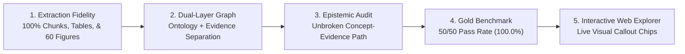

# Project Goal: AWS A3.0 Multimodal NLQ & Epistemic Knowledge System

## Current local A1 pass 004: requested answers complete (2026-10-21)

Branch `fix/a1-query-completeness`, base main `799112f`, completes the seven
identified parsing/composition gaps with generic operations. Harness
`a1-graph-qa-1.2.0` / planner `1.2.0` independently grades **QA001 15 PASS** and
**QA002 16 PASS**, no failures, partials or regressions. The existing 31 questions
ran once, model/provider NONE, zero calls. Focused checks passed 33/33 in 0.77 s;
no full suite. The goal is supported complete answers, including Q16's correct
insufficient-evidence explanation, rather than successful route counts.

QA001 retains 90/90 source pairs, 29 qualified candidate children and 7/7 lookup
facts. QA002 retains 13/13 mentions, 23/23 mappings and meets 11/11 limits
criteria. See the [private report](../storage/evidence_v2/a1_qa_repair_004/report.md).
This is DEVELOPMENT on exposed questions with bounded grammar, not general or
LLM acceptance. Source graph/database, v1 default and prior runs/graders remain
unchanged; candidate layout stays distinct from reviewed semantic subtype.
The two existing thin skills were reused unchanged. Stop further repair/replay
work. The owner subsequently authorized committing, pushing, PR merging and
local/online synchronization of this completed repair (2026-10-21); publication
does not broaden the demonstrated answer coverage or source authority.

Historical pass 003 publication note (2026-10-21): the owner approved commit, push, merge and local
synchronization of this prototype. The bounded DEVELOPMENT results and seven
remaining QA002 gaps below are unchanged; publication is not release acceptance.

## Historical pass 003: original set retained, follow-up gaps remained (2026-10-21)

Harness `1.1.0` independently grades **15 PASS / 0 FAIL / 0 PARTIAL** on QA001
and **9 PASS / 4 FAIL / 3 PARTIAL** on QA002. Preserve QA001's original 0/15
pre-capability baseline and 1.0 DEVELOPMENT 15/15; QA002 1.0 remains
0 PASS / 15 FAIL / 1 PARTIAL. This one 31-question repair pass is DEVELOPMENT
on exposed questions, not unseen validation or an LLM benchmark. Both sets ran
once, model/provider NONE and zero calls; focused checks were 33/33 in 0.56 s.
No full-suite result is claimed.

QA001 retains 90/90 correct supported source pairs, 29 qualified candidate
children and 7/7 lookup facts including two bounded negatives. QA002's
multi-name resolution is correct for 13/13 mentions and 23/23 mappings.
Layout questions 06–12 grade 4 PASS / 1 PARTIAL / 2 FAIL; source-limit questions
13–16 grade 0 PASS / 2 PARTIAL / 2 FAIL (3/11 criteria). QA002 passes 01–08, 11;
09, 14, 16 are partial; 10, 12, 13, 15 fail. Full details stay in the
[private report](../storage/evidence_v2/a1_qa_repair_003/report.md).

Remaining limits concern broader-category coverage (Q09), false selector residue
(Q10), comparison scope (Q12), A1-context selection (Q13), omitted positive
families despite a qualified semantic limit (Q14), generic “Does”/epistemic
parsing (Q15), and omitted concrete missing fields despite a correct limit (Q16).
Stop after this pass; no more repairs or replays.

Source graph 99 nodes / 127 edges and SHA-256
`6476c898439108dbeaf7b92f0be3946a3e0d3538d5c15afb860d1cf0e02cc4d2`
remain unchanged, as do 168 prior receipt files and six protected sources.
The thin [routing](../.agents/skills/evidence-graph-routing/SKILL.md) and
[QA](../.agents/skills/evidence-graph-qa/SKILL.md) skills contain only instructions
and metadata for existing code, not a wrapper framework or automatic backend
loader. Keep candidate semantics and private grading separate, A1-only source
scope, and no extra checks, UI/model/cloud, database/global configuration or Git
publication.

## Historical bounded A1 result: 15/15 independently graded PASS (2026-10-21)

The owner's 15 Figure A1 questions now have independent grades:
**15 PASS / 0 FAIL / 0 UNASSESSED**. For the first eight actual answer strings
and rows, all **90/90 source pairs** were retrieved correctly and are correct
and supported, with no missing/extra pairs, duplicates, designation mismatches
or source-binding errors. All 29 indented child qualifications remain candidate.
The other seven facts are **7/7 correct and supported**; both negative verdicts
were verified using the complete original chart plus positive foreign-category
membership, rather than treating a retrieval omission as evidence of absence.

This closes only the bounded first generic graph-QA DEVELOPMENT set on these
15 exposed questions. It is not unseen validation, corpus-wide acceptance or an
LLM benchmark. The original baseline **0/15** remains frozen. The new execution
used model/provider NONE and zero LLM calls. Raw runtime
`semantic_validation: false` remains unchanged; external PASS grading does not
upgrade candidate edges to verified graph semantics.

The source graph is unchanged at 99 nodes / 127 edges, full SHA-256
`6476c898439108dbeaf7b92f0be3946a3e0d3538d5c15afb860d1cf0e02cc4d2`.
Protected source, database and indices remain unchanged. Only the explicit
`--graph-qa` capability was added after baseline; v1, default packet mode and
ordinary v2/extractive remain unchanged. See the
[final source-safe QA receipt](evidence_v2_a1_qa_001.md).

Stop after this bounded set: no other image, model run, automatic replay or
comparison. Stay backend-only, preserve prior failures/private grading records,
and perform no UI, cloud, commit, push or merge work.

## Historical A1 execution result before independent grading (2026-10-21)

The bounded first CLI graph-QA execution produced 15 `graph_answer` outputs for
the owner's 15 Figure A1 questions, with model/provider NONE and zero LLM calls.
Independent answer grading is PENDING; no 15/15 pass, correctness, coverage or
source-support claim is established. The targeted 160 synthetic checks passed
in 2.01 s and remain software regression evidence only.

The execution measured wall time 374.355 ms and engine time 120.446 ms
(source projection 89.930 ms, image validation 8.503 ms, graph QA 22.013 ms).
The [first QA receipt](evidence_v2_a1_qa_001.md) owns aggregate execution/grading
status; raw answers and full reports remain in ignored storage.

The frozen baseline predates only the generic QA code addition. The source
graph stayed exactly **99 nodes / 127 edges**, with an identical full SHA-256;
protected source, database and indices are unchanged. No source-graph update or
graph semantic repair was made. Keep the original baseline's unanswered
`V2_READER_REQUIRED` results distinct from the first DEVELOPMENT graph answers.

The new capability is the separate explicit opt-in
`src/evidence_a1_cli.py --graph-qa`, using `src/evidence_a1_graph_qa.py`
(`a1-graph-qa-1.0`). Default packet mode, v1 and the ordinary v2/extractive path
are unchanged; ordinary v2 still requires a reader for these graph questions.
The current goal remains supported answers, which await independent grading.
Retain the single-A1/backend-only scope and private grading-data boundary; do
not advance to another figure or consume an inference allowance. No UI, cloud,
commit, push or merge is in scope.

## Historical authorization for first owner-CQ graph QA (2026-10-21)

The owner supplied 15 Figure A1 competency questions, IDs `A1-CQ-001` through
`A1-CQ-015`, and requests the bounded first QA/harness run. The previous empty
owner-pending dataset and setup-only stop are historical. The immediate goal is
to exercise generic deterministic graph QA on this one image and report its
actual evidence/answer behavior, with no UI, cloud or other-figure work.

The frozen baseline at ignored `storage/evidence_v2/a1_qa_run_001` predates the QA code addition; the source graph
remained unchanged. All 15 actual v2 queries returned `V2_READER_REQUIRED`
without answers; list requests 1–8 had only the root plus eight category nodes
and zero process rows. The baseline made no LLM calls. Preserve its results as
original failures/limitations and keep all later first-QA output DEVELOPMENT.

Generic deterministic graph selection/traversal and answer composition may now
be added after the baseline without changing the source graph. Do not hardcode answers to owner question IDs/text
or repair graph semantics to match grading expectations. The last two trailing
“No” values are private grading metadata, never execution prompts or graph
updates. Await actual result metrics before claiming pass, coverage or support.

Full raw output, answers and reports remain in ignored storage; the
[source-safe QA summary](evidence_v2_a1_qa_001.md) owns the aggregate result.
When graph answers need no inference, model/provider is NONE: this is not an
LLM evaluation. Stay on Figure A1's single image, preserve frozen rubrics and
older failures, and perform no commit, push or merge.

## Historical setup goal before owner questions (2026-10-21)

The owner will supply the competency questions. The current deliverable is a
usable Figure A1 backend setup, not a new answer-accuracy or model-comparison
result. All DeepSeek/local inference evaluations are stopped. None of the newly
approved five DeepSeek cases or the one installed `qwen2.5vl:7b` trial started.
Do not generate substitute questions, resume inference or spend that allowance.

Prepare the canonical Figure A1 single image and edition binding; source-bound
labels/designations and qualified graph hierarchy; manifest plus read-only
SQLite bindings; actual graph-traversal retrieval and complete evidence packet;
and a v2 CLI/harness that accepts the owner's future questions. Figure A1 is
Master Chart of Welding and Joining Processes at
`parsed/figures/Figure_A1_p88.png` (PDF index 87 / viewer 88 / printed 75).
Table A1, A2, B6 and other images are outside this setup unit.

The competency-question dataset is **EMPTY — owner pending**. The agent-authored
private A1 rubric remains DEFERRED, not an accepted competency-question set.
Readiness checks cover IDs, joins, graph paths, source editions/fingerprints,
image bindings, evidence closure and input validation only. Structural success
does not establish semantic answer accuracy or independent answer support.

The stopping state is `READY_FOR_OWNER_COMPETENCY_QUESTIONS` only when the setup
is usable; otherwise retain a precise setup blocker. Record the actual state
and structural evidence in [the A1 setup receipt](evidence_v2_a1_setup.md).
Do not advance to A2/B6. Retain backend-only scope, no UI/new database or graph
framework, unchanged existing stores and no commit/push/merge. Earlier semantic
failures, frozen questions/rubrics and evaluation plans below remain historical.

## Historical Figure A1 evaluation goal (2026-10-21)

The selected object is **Figure A1 — Master Chart of Welding and Joining
Processes**, a single image at `parsed/figures/Figure_A1_p88.png` (PDF index 87,
viewer page 88, printed page 75). Identity is resolved. Table A1 is a different
two-page object on printed pages 69–70 and is outside this single-image scope.
The previous identity-pending wording below remains a historical checkpoint.

The acceptance goal is complete correct Figure A1 graph evidence and pixels
entering the reader, followed by independent grading of answer correctness and
source support. The source auditor confirmed eight category boxes. Incorrect
AB/CAB expansions in legacy merged candidate
`annex_a_figures_a1_a2_a3_anatomy` must not become facts in the new projection.
A versioned A1 source projection is under development; existing SQLite/graph
stores remain unchanged. Implementation or successful generation alone does not
close the supported-answer gate.

Stay backend-only and on this one image. Exclude Table A1, B6 and unrelated
cases; introduce no UI work or new database/graph framework. Do not automatically
advance while A1's gate is unresolved; preserve a supported pass or exact blocker.
DeepSeek baseline generation for A1 is NOT covered by the earlier five-case
budget. The single installed `qwen2.5vl:7b` trial remains UNUSED and pending.
Prior semantic failures, frozen rubrics and current Git/provider restrictions
remain intact.

## Historical A1-first identity checkpoint (2026-10-21)

The immediate v2 goal is a supported backend answer for A1, with source/data,
graph, database/edition joins, retrieval/expansion and final reader input checked
for the current image. A1's source identity is pending inspection. “Annex A”
is a section, not proof of an object A1; do not assume a table, figure or file
identity. Confirm its exact edition, canonical object and source/image locator
before claiming retrieval completeness or reading correctness.

Do not run B6 or unrelated cases. Defer the original multipage B6 rubric while
retaining its frozen cases, scores and failures. One image is the work unit:
do not automatically advance while the current image's supported-answer gate
is unresolved. Record a supported pass or a precise blocker before considering
a next image. Backend correctness remains the objective; no UI enhancements,
redesign or new database/graph framework is in scope.

The five earlier DeepSeek comparison cases and the one installed
`qwen2.5vl:7b` trial are all UNUSED; none has begun under that approval. The
single local trial may apply to A1 after identity and packet inspection. The
previous five-case DeepSeek permission does not authorize sending this new A1
source. Do not infer a model result, spent allowance or new provider authority.
Prior pending validation plans below are historical and superseded by A1 first;
all prior semantic failures and frozen rubrics remain preserved.

## Backend acceptance goal and historical unused approval (2026-10-21)

V2.0 is backend-only. Its objective is correct graph/data facts, database and
edition joins, graph retrieval and expansion, and complete correct evidence
reaching the answer reader so answers are correct and supported by that evidence.
No UI enhancements or redesign are in scope; the existing guarded web API
version flag serves compatibility only. Software pass counts establish contracts
and regressions, while the acceptance decision depends on supported answers.

Record each failure separately as **source ingestion**, **graph facts/relations**,
**database/edition joins**, **retrieval/ranking/expansion**, **packet construction**
or **reader reasoning**. Diagnose from source to answer: a correct packet with a
wrong answer is a reader failure; evidence missing before generation requires a
source, graph, join, retrieval or packet correction. Preserve the source and
packet trace used for that attribution instead of changing the grading rubric.

Retain the existing SQLite/manifest/graph spine. A new database or graph framework
requires a measured gap and evidence that a bounded correction to the current
structure cannot meet the requirement; framework replacement is not the goal.

The owner has now authorized five frozen unchanged-v1 cases through the existing
DeepSeek provider and one trial of installed `qwen2.5vl:7b`. Results for this
bounded approval remain pending. It authorizes no additional paid cases, new
provider, installation, persistent setting, service restart, commit, push,
publication or merge. All original semantic failures and frozen rubrics remain
part of the acceptance record. The prior local-only comparison blocker below
is a historical pre-approval checkpoint, not the present permission boundary.

## Current bounded v2 status after runtime recovery (2026-10-21)

Local implementation and actual complete-packet image answering now run. The
original source gate remains **4/6 cases**, **11/13 facts correct**, **10/13
source-supported**; it is not complete semantic acceptance. The deterministic
negative-control repair passes an exposed development replay, while the
multipage model replay still fails. Full unchanged v1 live comparison, unseen
semantic validation and broader source coverage remain open. See
[runtime recovery and measured evidence](evidence_v2_runtime_recovery.md).
Baseline/tag/branch and no-commit/no-push scope remain unchanged.
One identical-input actual v1/v2 reviewed-source pair now ran without providers.
At that pre-approval checkpoint, five unchanged v1 generation cases were blocked
by configured DeepSeek cloud under local-only scope; see the
[comparison decision](evidence_v2_live_comparison_blocker.md). No new model trial had run.

## Current bounded v2 goal (2026-10-21)

Preserve the local v1 baseline and build one complete evidence-to-reader slice
behind an opt-in versioned interface. Local annotated tag `v1.0` identifies
`24bac45465bcb5c9ea14663f7a669927d5d2ed00`; work is on
`v2/evidence-engine`, while `main` remains unchanged. This is an experimental
local prototype, with no production-readiness claim and no commit, push,
publication or merge in the active task.

The bounded slice covers six native definition/alias entries (`root face`,
`root opening`, `root gap`, `bevel angle`, `back weld`, `backing weld`), structured
Tables A2/A3, and all three full-page Figure B6 continuations plus their required
applicability note. Other senses and footnote cases use original redistributable
fixtures; that software coverage does not establish source-wide coverage.
The present A2/A3 legacy Markdown has no cells. A versioned local three-page
native extraction supplies 133 A2 rows and 134 A3 rows without overwriting those
files or reconciling discrepancies by guesswork.

Success requires content-bound edition IDs and locators, typed definition/alias,
table, visual, comparison and ambiguity routes, and a complete evidence packet
that reaches the reader with every qualifier, exception, note and continuation.
Actual pixels must enter visual answering. Generated claims must bind to packet
evidence IDs and remain semantically unassessed until separately reviewed.
Exact extraction is a source-binding result, not a complete answer-quality score.

Keep v1 as the default; select `--evidence-version v2` for the new slice and
`--v2-reader local` only for the existing configured local reader. Return to
`--evidence-version v1` to roll back behavior. No new database, UI framework,
private-data destination or credential setup is part of this goal.

The [current implementation receipt](evidence_v2_implementation.md) owns final
step status, identical-input comparisons, executed tests, latency/cost evidence
and blockers. [The schema](evidence_v2_schema.md) and
[dependency contract](dependency_contract.md) define the reproducible software
boundary. Direct package pins, mocked fixtures and successful builds do not prove
fresh-environment, installed-model or complete corpus reproducibility. Broader
semantic/visual/table correctness and production latency remain separate gates;
all earlier failed fresh results below are preserved.

## Guarded running-app check and retained acceptance gaps (2026-10-16)

The latest increment was loaded into the local prototype under a provider-free
process guard. Actual API **19/19** and isolated Chrome **8/8** smoke checks
passed for source-composed answers, truthful evidence/status rendering, safe
failures, navigation and all required Figure B6 images/zoom. The favicon 404
still fails strict clean-network acceptance. Providers stayed disabled; no new
generated semantic/visual/table or multi-hop accuracy evidence was obtained.
Final regressions pass 827 guarded Python, 44 native-reader and 68 JavaScript
checks. Original fresh **2/6, 78/89** and separate fresh **3/6, 461/491** remain
failed; the repaired exposed replay is **DEVELOPMENT 4/6, 489/491**, with two
conservative scalar mismatches retained. Strict fresh, latency-budget and full
multimodal acceptance remain unmet or unassessed. Earlier unreloaded statements
below are historical checkpoints. See the
[current aggregate evidence](claim_evidence_implementation.md).

## Bounded through-range repair (2026-10-16)

Canonical bare numeric `through` ranges now retain their full ordered evidence
sets through simultaneous missing/corrupt assets. The repair preserves the
existing identity, binding and support boundaries; independent scoped review
cleared it. Final guarded checks pass 827 Python, 44 native-reader and 68
JavaScript cases. The exposed replay is DEVELOPMENT **4/6, 489/491**, with the
repaired workflow at 52/52 and zero unsafe support upgrades. Two stricter rubric
scalar mismatches remain documented; the original plan permits their unassessed
outcome. Original **2/6, 78/89** and first fresh **3/6, 461/491** remain failed
and unchanged. Apps remain unreloaded; semantic/visual accuracy, full multimodal
NLQ and latency-budget acceptance remain unassessed or unmet. See the
[implementation receipt](claim_evidence_implementation.md).

## Bounded claim/evidence resolution (2026-10-16)

The scoped follow-up preserves diagnostics through damaged navigation assets,
consumes direct figure continuations, retains source-only tables, distinguishes
citation parents from independent sources, and withholds generated references
with unresolved/wrong source identity. Guarded API/core and isolated synthetic
browser checks pass; existing apps were not reloaded and no new unseen or
semantic acceptance is claimed. Original failures and latency-budget/acceptance
gaps remain in the receipt.

Structured claims now have separate canonical-reference, selected-binding,
asset-availability and support results in the actual query code path. Complete
mentions, unsupported panels and ordered continuation sets are retained; only
server-projected exact reviewed facts can grant reviewed support status. Generic
generated claims remain unassessed and usually lack explicit evidence selectors.
The [implementation receipt](claim_evidence_implementation.md) preserves initial
development failures, the original strict replay and the explicitly amended
navigation protocol. Offline checks and bounded identity/state evaluations do
not establish visual/table understanding, complete claim extraction, multi-hop
reasoning or full multimodal NLQ. No new live-app acceptance or latency SLA is
claimed.

The initial fresh workflow gate was **2/6** (78/89 assertions), not complete
acceptance. Independent diagnosis identified a selected-role projection defect
and rubric conflicts between identity, availability and support states. A
conservative role-selection repair is tested; exposed-case replays remain
DEVELOPMENT. Original scores and support requirements are preserved.

## Bounded source-composed answers (2026-10-16)

The three-headword definition/alias route now composes exact reviewed source facts with validated citations and truthful outcome/assessment labels. Initial frozen actual-system results were 11/12 original questions (31/32 facts) and 5/6 unseen holdouts (19/20 facts) strictly complete. A source-bounded policy repair now passes 12/12 and 6/6 on the same rubric as DEVELOPMENT; reused holdouts are not fresh unseen validation, and the original failures are preserved. All 18 responses remain composed (16 extractive, two clarifications), establishing no model-reasoning improvement. Original three HTTP acceptance cases pass content and citations; real-browser query/figure flows pass, with a retained favicon 404 that fails the strict clean-network assertion. [Implementation, evidence and limits](answer_grounding_implementation.md) separate this bounded milestone from full multimodal NLQ, which remains undemonstrated.

## Bounded live terminology milestone (2026-10-15)

Three manually reviewed headwords are wired into actual hybrid retrieval and generation through an additive ignored local registry. A frozen 33-case before/after run demonstrates complete reviewed evidence for 12/12 terminology questions at rank one, exact parity for 10 unrelated controls, and eight retained scope gates. These evidence results are distinct from source-backed answer accuracy; fresh local generation still produces term and citation errors. The restarted loopback app and detailed outcomes are recorded in [the live terminology receipt](terminology_live_results.md). Full multimodal NLQ remains undemonstrated; broader terminology, diagram/table understanding, claim support and multi-hop evaluation remain separate milestones.

## Bounded helper milestone (2026-10-15)

Geometry validation, canonical element ranges and pure multi-target terminology records are implemented as bounded helper changes. Their focused/guarded regressions are described in the [implementation receipt](helper_hardening_implementation.md). This does not certify diagram regions, corpus-wide terminology, table fidelity, claim entailment or full multimodal NLQ; that helper-only milestone added no persistence or live retrieval integration. The later bounded integration is described above.

## Vector-selection milestone evidence (2026-10-15)

The numeric-list compatibility failure is repaired and covered by 44 actual-native-reader regression checks, alongside 176 selected existing Python checks and 4 JavaScript checks. A frozen fixed-pool comparison recorded 42/42 original fallbacks versus 42/42 successful cosine selections after the fix. Target Hit@10 improved from 1/28 to 11/28; only 12 targets have mapped candidates in that pool. The separate hybrid lane retrieved 23/28. Eight negative gates passed; 20 final-run fresh local answers remain factually ungraded. [Protocol and limits](vector_reader_compatibility.md) qualify the historical success claims below; full multimodal NLQ remains undemonstrated.

**Specification Target:** AWS A3.0M/A3.0:2020 (*Standard Welding Terms and Definitions*)  
**Repository:** `kaiello/aws-a30-prototype`  
**Current Milestone:** Bounded opt-in v2 evidence-engine slice; final status in the current receipt
**Status:** Experimental local prototype; broader semantic acceptance remains unmet or unassessed

**2026-10-15 evidence qualification:** Card 07's historical scores below are not a fresh demonstration of full multimodal NLQ. The [manifest implementation](declarative_manifest_implementation.md) verifies source locations for 190 pages, 62 figures and 11 tables and preserves injected retrieval behavior. It does not establish table-cell/footnote fidelity, diagram understanding, claim entailment, multi-hop completeness or live answer accuracy. Clause 4 occupies PDF indices 17-80, printed pp. 5-68; Annex B's normative/informative status conflicts between the contents and its opening page and is retained as conflicting. Existing stores and gold receipts were not regenerated.

---

## 1. Executive Summary & Objective

The objective of the **AWS A3.0 Standalone Multimodal Prototype** is to create an authoritative, fully auditable, multimodal Natural Language Query (NLQ) and Epistemic Knowledge Graph system over the complete 190-page **AWS A3.0M/A3.0:2020** specification (*Standard Welding Terms and Definitions*).

Welding standards are inherently multimodal and epistemically sensitive. A standard definition in text is rarely complete without:
1. **Mathematical edge geometries** (e.g., root faces, bevel angles, fillet weld throats).
2. **Standard vs. nonstandard designations** (e.g., deprecated shop jargon like *"short arc"* or *"burn-through"*).
3. **Multi-column process designation matrices** (e.g., Annex A Tables A1–A5 detailing processes like `GMAW-P`, `SMAW`, `FOW`).
4. **Vector engineering diagrams** (e.g., Annex B Figures B1–B60 depicting 1F–6GR test positions, weld grooves, and joint configurations).
5. **Normative consensus decisions and revision histories** (e.g., Annex C committee rationale and Annex D additions/deletions).

Generic RAG systems routinely hallucinate citations, confuse colloquial terms with standard terms, fail to parse multi-panel vector diagrams, and produce confident yet fabricated answers for out-of-scope queries. This project establishes an authoritative reference architecture that delivers:
- **Exact multimodal retrieval** linking text definitions, structured markdown tables, and crisp diagrammatic assets.
- **Unbroken epistemic provenance** where every asserted fact traces mathematically to a verified standard clause, table, or figure.
- **Strict, truthful abstention** on queries beyond the governing standard's normative boundary.

---

## 2. Core Scope & Corpus Boundaries

### In-Scope Assets
The prototype indexes 100% of the normative content of **AWS A3.0M/A3.0:2020**:
- **Clause 1–3**: Scope, normative references, and general technical principles.
- **Clause 4**: Complete Glossary of Welding Terms and Definitions (pp. 18–80; 1,500+ standard and nonstandard definitions).
- **Annex A**: Process Master Tables A1–A5 (classification of welding, joining, thermal spraying, cutting, and allied processes).
- **Annex B**: Figures B1–B54 + multi-part figures (60 total standard engineering figures, rendered at 180 DPI with 267+ interactive callout chips).
- **Annex C**: Style Rules & Committee Decisions (normative rationale behind key terms, such as parallel joints replacing edge joints).
- **Annex D**: Historical Revision Tracking Tables D1–D6 (new terms, modified terms, and deleted/deprecated terms).
- **Annex E & F**: Methodologies, conversion metrics, and standard interpretation procedures.

### Out-of-Scope (Strict Abstention Boundary)
The system enforces strict negative controls and must cleanly abstain without guessing or hallucinating when presented with:
- Weld acceptance criteria or non-destructive examination (NDE) reject limits (governed by fabrication codes such as **AWS D1.1**, **ASME Section IX**, or **NAVSEA T9074-AD-GIB-010/1688**).
- Base metal chemical compositions or filler metal tensile properties (governed by filler specifications such as **AWS A5.1** or **ASTM** material specs).
- Welding procedure qualification variables or preheat schedules.
- Fabricated or non-existent standard elements (e.g., fictitious Figure B120 or Table A10).

---

## 3. Measurable Success Criteria & Verification Gates

The prototype evaluates its readiness against rigorous quantitative and qualitative gates:

| Criterion | Target Metric | Achieved State (Card 07) | Status |
|---|:---:|:---:|:---:|
| **Glossary Coverage** | 100% of Clause 4 definitions | 164 grounded chunks, 2,522 concepts | **PASSED** |
| **Figure Extraction** | All 60 standard figures | 60 high-res PNGs + 267 interactive chips | **PASSED** |
| **Table Integration** | Tables A1–A5, D1–D6 | Complete structured Markdown & JSONL | **PASSED** |
| **Gold Benchmark Accuracy** | $\ge 95.0\%$ across all modalities | **50/50 (100.0%)** | **PASSED** |
| **Citation Precision** | Exact Clause, Page, Element ID | 100% verified against standard text | **PASSED** |
| **Truthful Abstention Rate** | 100% clean refusal on out-of-scope | 8/8 out-of-scope controls passed (100%) | **PASSED** |
| **Epistemic Trace Completeness**| 100% claims trace to EvidenceNode | Provenance score = 1.0 on standard queries | **PASSED** |
| **Infrastructure Overhead** | Zero external DB servers (No Docker/Neo4j) | Pure local GraphML + SQLite FTS5 | **PASSED** |

---

## 4. Architectural Non-Goals

To maintain high velocity, deterministic reproducibility, and zero infrastructure sprawl, the following are explicit non-goals:
1. **No External Database Clusters**: The system will not require Docker containers, Neo4j enterprise instances, Milvus/Qdrant clusters, or cloud database connections. All state is held in portable, version-controlled local GraphML, NanoVectorDB, and SQLite files.
2. **No Re-Ingestion Loops**: Once raw text chunks, table Markdown, and figure callout registries are generated, pipeline enhancements must use deterministic projection rather than expensive re-extraction or re-calling cloud LLMs.
3. **No Unbounded Chatbot Behavior**: The query interface is a deterministic technical information oracle, not a conversational small-talk bot. It prioritizes exact citations, qualified definitions, and visual evidence over verbose chat.

---

## 5. Milestone Delivery Roadmap

- [x] **Card 01: Clean-Slate Scaffold & Upstream LightRAG 1.5.7 Integration**: Complete project isolation from legacy workspaces, establishing local Graph and Vector foundations.
- [x] **Card 02: Full Text & Table Ingestion**: Ingestion of Clauses 1–4 and Annex A tables; 12-question baseline benchmark.
- [x] **Card 03: Multimodal Vision & Vector Figure Extraction**: High-fidelity 180 DPI extraction of Annex B figures from vector `/Form` XObjects.
- [x] **Card 04: Whole-Document Grounded NLQ & Citation Audit**: Graph traversal linking terms, tables, and figures; automated citation checking.
- [x] **Card 05: Exhaustive Document Expansion & 50-Item Benchmark**: Incorporation of Annex C (style rules/decisions) and Annex D (revision modifications); expansion to a 50-question multimodal gold benchmark.
- [x] **Card 06: Complete Interactive Diagram Directory**: High-resolution image assets and 267+ interactive callout chips across all 60 standard figures in Annex A and B.
- [x] **Card 07: Dual-Layer Epistemic Knowledge Graph**: Decoupling of Domain Ontology (2,522 nodes) from Normative Evidence (471 nodes) via 5,854 epistemic grounding bridges, backed by SQLite FTS5 and an auditable runtime Epistemic Verifier.
- [ ] **Next Steps**: Packaging as an installable Python package, containerized deployment option for enterprise air-gapped environments, and integration with broader military/aerospace fabrication specifications.

Security work dated 2026-10-15 is scoped to local asset, provider, credential and
request boundaries, with isolated regression evidence described in
[security boundary notes](security_boundary_notes.md). It preserves retrieval/model
defaults and does not claim a new multimodal accuracy milestone or production release.
The authorized missing-index follow-up adds explicit prerequisite failure handling,
without rebuilding data or claiming additional retrieval/answer coverage.
