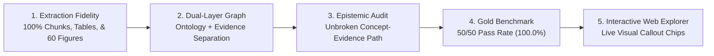

# Project Goal: AWS A3.0 Multimodal NLQ & Epistemic Knowledge System

## Vector-selection milestone evidence (2026-10-15)

The numeric-list compatibility failure is repaired and covered by 44 actual-native-reader regression checks, alongside 176 selected existing Python checks and 4 JavaScript checks. A frozen fixed-pool comparison recorded 42/42 original fallbacks versus 42/42 successful cosine selections after the fix. Target Hit@10 improved from 1/28 to 11/28; only 12 targets have mapped candidates in that pool. The separate hybrid lane retrieved 23/28. Eight negative gates passed; 20 final-run fresh local answers remain factually ungraded. [Protocol and limits](vector_reader_compatibility.md) qualify the historical success claims below; full multimodal NLQ remains undemonstrated.

**Specification Target:** AWS A3.0M/A3.0:2020 (*Standard Welding Terms and Definitions*)  
**Repository:** `kaiello/aws-a30-prototype`  
**Current Milestone:** Card 07 Completed (Dual-Layer Epistemic Graph Projection & 100% Gold Benchmark Verification)  
**Status:** Active Production Prototype  

**2026-10-15 evidence qualification:** Card 07's historical scores below are not a fresh demonstration of full multimodal NLQ. The [manifest implementation](declarative_manifest_implementation.md) verifies source locations for 190 pages, 62 figures and 11 tables and preserves injected retrieval behavior. It does not establish table-cell/footnote fidelity, diagram understanding, claim entailment, multi-hop completeness or live answer accuracy. Clause 4 occupies PDF indices 17-80, printed pp. 5-68; Annex B's normative/informative status conflicts between the contents and its opening page and is retained as conflicting. Existing stores and gold receipts were not regenerated.

---

## 1. Executive Summary & Objective

The objective of the **AWS A3.0 Standalone Multimodal Prototype** is to create an authoritative, fully auditable, multimodal Natural Language Query (NLQ) and Epistemic Knowledge Graph system over the complete 190-page **AWS A3.0M/A3.0:2020** specification (*Standard Welding Terms and Definitions*).

Welding standards are inherently multimodal and epistemically sensitive. A standard definition in text is rarely complete without:
1. **Mathematical edge geometries** (e.g., root faces, bevel angles, fillet weld throats).
2. **Standard vs. nonstandard designations** (e.g., deprecated shop jargon like *"short arc"* or *"burn-through"*).
3. **Multi-column process designation matrices** (e.g., Annex A Tables A1–A5 detailing processes like `GMAW-P`, `SMAW`, `FOW`).
4. **Vector engineering diagrams** (e.g., Annex B Figures B1–B60 depicting 1F–6GR test positions, weld grooves, and joint configurations).
5. **Normative consensus decisions and revision histories** (e.g., Annex C committee rationale and Annex D additions/deletions).

Generic RAG systems routinely hallucinate citations, confuse colloquial terms with standard terms, fail to parse multi-panel vector diagrams, and produce confident yet fabricated answers for out-of-scope queries. This project establishes an authoritative reference architecture that delivers:
- **Exact multimodal retrieval** linking text definitions, structured markdown tables, and crisp diagrammatic assets.
- **Unbroken epistemic provenance** where every asserted fact traces mathematically to a verified standard clause, table, or figure.
- **Strict, truthful abstention** on queries beyond the governing standard's normative boundary.

---

## 2. Core Scope & Corpus Boundaries

### In-Scope Assets
The prototype indexes 100% of the normative content of **AWS A3.0M/A3.0:2020**:
- **Clause 1–3**: Scope, normative references, and general technical principles.
- **Clause 4**: Complete Glossary of Welding Terms and Definitions (pp. 18–80; 1,500+ standard and nonstandard definitions).
- **Annex A**: Process Master Tables A1–A5 (classification of welding, joining, thermal spraying, cutting, and allied processes).
- **Annex B**: Figures B1–B54 + multi-part figures (60 total standard engineering figures, rendered at 180 DPI with 267+ interactive callout chips).
- **Annex C**: Style Rules & Committee Decisions (normative rationale behind key terms, such as parallel joints replacing edge joints).
- **Annex D**: Historical Revision Tracking Tables D1–D6 (new terms, modified terms, and deleted/deprecated terms).
- **Annex E & F**: Methodologies, conversion metrics, and standard interpretation procedures.

### Out-of-Scope (Strict Abstention Boundary)
The system enforces strict negative controls and must cleanly abstain without guessing or hallucinating when presented with:
- Weld acceptance criteria or non-destructive examination (NDE) reject limits (governed by fabrication codes such as **AWS D1.1**, **ASME Section IX**, or **NAVSEA T9074-AD-GIB-010/1688**).
- Base metal chemical compositions or filler metal tensile properties (governed by filler specifications such as **AWS A5.1** or **ASTM** material specs).
- Welding procedure qualification variables or preheat schedules.
- Fabricated or non-existent standard elements (e.g., fictitious Figure B120 or Table A10).

---

## 3. Measurable Success Criteria & Verification Gates

The prototype evaluates its readiness against rigorous quantitative and qualitative gates:

| Criterion | Target Metric | Achieved State (Card 07) | Status |
|---|:---:|:---:|:---:|
| **Glossary Coverage** | 100% of Clause 4 definitions | 164 grounded chunks, 2,522 concepts | **PASSED** |
| **Figure Extraction** | All 60 standard figures | 60 high-res PNGs + 267 interactive chips | **PASSED** |
| **Table Integration** | Tables A1–A5, D1–D6 | Complete structured Markdown & JSONL | **PASSED** |
| **Gold Benchmark Accuracy** | $\ge 95.0\%$ across all modalities | **50/50 (100.0%)** | **PASSED** |
| **Citation Precision** | Exact Clause, Page, Element ID | 100% verified against standard text | **PASSED** |
| **Truthful Abstention Rate** | 100% clean refusal on out-of-scope | 8/8 out-of-scope controls passed (100%) | **PASSED** |
| **Epistemic Trace Completeness**| 100% claims trace to EvidenceNode | Provenance score = 1.0 on standard queries | **PASSED** |
| **Infrastructure Overhead** | Zero external DB servers (No Docker/Neo4j) | Pure local GraphML + SQLite FTS5 | **PASSED** |

---

## 4. Architectural Non-Goals

To maintain high velocity, deterministic reproducibility, and zero infrastructure sprawl, the following are explicit non-goals:
1. **No External Database Clusters**: The system will not require Docker containers, Neo4j enterprise instances, Milvus/Qdrant clusters, or cloud database connections. All state is held in portable, version-controlled local GraphML, NanoVectorDB, and SQLite files.
2. **No Re-Ingestion Loops**: Once raw text chunks, table Markdown, and figure callout registries are generated, pipeline enhancements must use deterministic projection rather than expensive re-extraction or re-calling cloud LLMs.
3. **No Unbounded Chatbot Behavior**: The query interface is a deterministic technical information oracle, not a conversational small-talk bot. It prioritizes exact citations, qualified definitions, and visual evidence over verbose chat.

---

## 5. Milestone Delivery Roadmap

- [x] **Card 01: Clean-Slate Scaffold & Upstream LightRAG 1.5.7 Integration**: Complete project isolation from legacy workspaces, establishing local Graph and Vector foundations.
- [x] **Card 02: Full Text & Table Ingestion**: Ingestion of Clauses 1–4 and Annex A tables; 12-question baseline benchmark.
- [x] **Card 03: Multimodal Vision & Vector Figure Extraction**: High-fidelity 180 DPI extraction of Annex B figures from vector `/Form` XObjects.
- [x] **Card 04: Whole-Document Grounded NLQ & Citation Audit**: Graph traversal linking terms, tables, and figures; automated citation checking.
- [x] **Card 05: Exhaustive Document Expansion & 50-Item Benchmark**: Incorporation of Annex C (style rules/decisions) and Annex D (revision modifications); expansion to a 50-question multimodal gold benchmark.
- [x] **Card 06: Complete Interactive Diagram Directory**: High-resolution image assets and 267+ interactive callout chips across all 60 standard figures in Annex A and B.
- [x] **Card 07: Dual-Layer Epistemic Knowledge Graph**: Decoupling of Domain Ontology (2,522 nodes) from Normative Evidence (471 nodes) via 5,854 epistemic grounding bridges, backed by SQLite FTS5 and an auditable runtime Epistemic Verifier.
- [ ] **Next Steps**: Packaging as an installable Python package, containerized deployment option for enterprise air-gapped environments, and integration with broader military/aerospace fabrication specifications.

Security work dated 2026-10-15 is scoped to local asset, provider, credential and
request boundaries, with isolated regression evidence described in
[security boundary notes](security_boundary_notes.md). It preserves retrieval/model
defaults and does not claim a new multimodal accuracy milestone or production release.
The authorized missing-index follow-up adds explicit prerequisite failure handling,
without rebuilding data or claiming additional retrieval/answer coverage.
