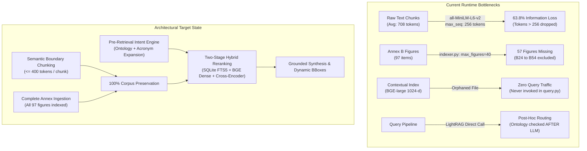
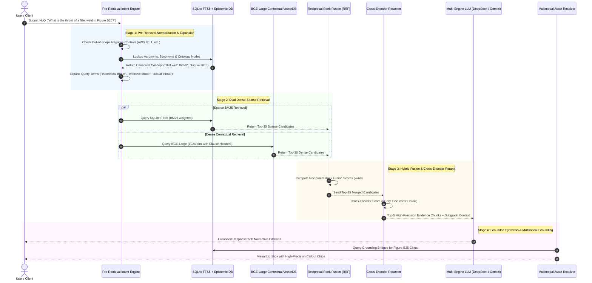
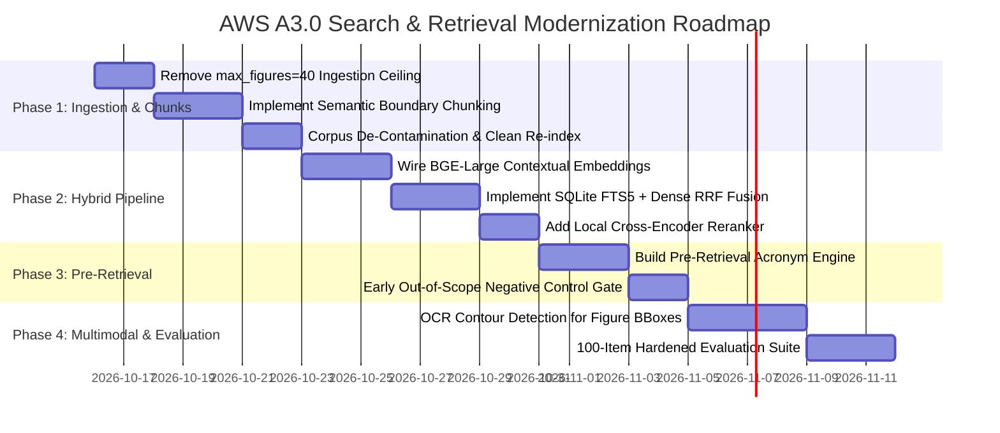

# Senior Solution Architect Technical Recommendations: NLQ, Search & Retrieval Architecture Overhaul

**Target Specification:** AWS A3.0M/A3.0:2020 (*Standard Welding Terms and Definitions*)  
**System Evaluated:** AWS A3.0 Multimodal Knowledge Explorer & Dual-Layer NLQ Engine  
**Author:** Senior Enterprise Solution Architect  
**Date:** October 2026  
**Status:** Architectural Blueprint & Actionable Technical Specification  

---

## 1. Executive Summary & Architectural Reality Check

The **AWS A3.0 Multimodal Prototype** has achieved an impressive conceptual foundation: a dual-layer epistemic knowledge graph, high-fidelity 180 DPI visual extraction, negative-control abstention, and a reported 100% (50/50) pass rate on its primary gold benchmark.

However, a forensic architectural audit of the active codebase ([`indexer.py`](file:///C:/Users/kenai/aws-a30-prototype/src/indexer.py), [`query.py`](file:///C:/Users/kenai/aws-a30-prototype/src/query.py), [`answer_routes.py`](file:///C:/Users/kenai/aws-a30-prototype/src/answer_routes.py), and [`contextual_indexer.py`](file:///C:/Users/kenai/aws-a30-prototype/src/contextual_indexer.py)) reveals a substantial divergence between the **conceptual architecture** documented in [`goal.md`](file:///C:/Users/kenai/aws-a30-prototype/docs/goal.md) and the **runtime retrieval execution**.

The system currently relies on:
1. **Severe silent vector truncation** (63.8% of corpus text tokens dropped during embedding).
2. **Artificial corpus truncation** (57 of 97 Annex B figures excluded due to a hardcoded ingestion ceiling).
3. **A disconnected contextual vector index** (a 1024-dimension BGE index was built but is completely uncalled in the live query pipeline).
4. **Post-hoc retrieval-generation asymmetry** (epistemic routing and ontology lookup run *after* LLM response generation rather than steering retrieval).
5. **Synthetic document leakage** (28 hand-crafted Q&A summary documents in the index artificially shielding the system from retrieval misses).



---

## 2. Forensic Analysis: The 5 Core Vulnerabilities

### Vulnerability 1: Critical Corpus Ingestion Deficit (57 Missing Figures)
* **Code Reference:** [`src/indexer.py#L121`](file:///C:/Users/kenai/aws-a30-prototype/src/indexer.py#L121), [`src/indexer.py#L161`](file:///C:/Users/kenai/aws-a30-prototype/src/indexer.py#L161), [`src/indexer.py#L167`](file:///C:/Users/kenai/aws-a30-prototype/src/indexer.py#L167)
* **Root Cause:**
  `load_all_chunks(max_figures: int = 40)` and `async_index(..., max_figures: int = 40)` enforce a hardcoded ceiling of 40 figure chunks during LightRAG ingestion.
* **Empirical Impact:**
  `parsed/figures/annex_b_figures.jsonl` contains 97 figure chunks. Figures B24 through B54 (57 figures in total) were never ingested into the LightRAG knowledge graph or the NanoVectorDB stores.
  Critical engineering definitions and schematics are entirely absent from vector and graph memory:
  - **Figure B25**: Fillet weld throat definitions (theoretical, effective, actual).
  - **Figure B39**: Gas metal arc welding metal transfer modes (short-circuiting, globular, spray, pulsed spray).
  - **Figure B40**: Oxyfuel gas cutting flame chemistry (neutral, oxidizing, carburizing).
  - **Figure B46**: Friction stir welding (FSW) tool anatomy and weld zone geometry.
* **Architectural Risk:** Any natural language query targeting terms illustrated exclusively in Figures B24–B54 cannot retrieve the figure chunk via semantic search; it can only find it if the post-hoc regex catches a raw string citation in the LLM answer.

---

### Vulnerability 2: Silent Vector Token Truncation (63.8% Information Loss)
* **Code Reference:** [`src/config.py#L39-L40`](file:///C:/Users/kenai/aws-a30-prototype/src/config.py#L39-L40), [`src/indexer.py#L48`](file:///C:/Users/kenai/aws-a30-prototype/src/indexer.py#L48)
* **Root Cause:**
  The primary vector embedding model is configured as `all-MiniLM-L6-v2` with `EMBEDDING_DIM = 384`. The maximum sequence length of `all-MiniLM-L6-v2` is **256 wordpiece tokens**.
* **Quantitative Data:**
  An audit of the 164 LightRAG text chunks in `storage/kv_store_text_chunks.json`:
  - **Median chunk length:** 695 tokens
  - **Mean chunk length:** 708 tokens
  - **Max chunk length:** 1,327 tokens
  - **Chunks fitting within 256 tokens:** 50 out of 164 (30.5%)
  - **Chunks exceeding 256 tokens:** 114 out of 164 (69.5%)
  - **Total tokens across corpus:** 116,112 tokens
  - **Tokens retained under truncation:** 41,984 tokens
  - **Tokens silently discarded:** **74,128 tokens (63.8% loss)**
* **Architectural Risk:** In standard RAG pipelines, silent truncation is the most insidious failure mode. Terms, definitions, notes, and qualifiers situated in the second half of a page chunk do not exist in vector space. Dense semantic search for any term situated past token 256 receives a zero or noise vector match.

---

### Vulnerability 3: Disconnected "Ghost" Contextual Vector Index
* **Code Reference:** [`src/contextual_indexer.py#L37-L40`](file:///C:/Users/kenai/aws-a30-prototype/src/contextual_indexer.py#L37-L40), [`src/contextual_indexer.py#L173-L199`](file:///C:/Users/kenai/aws-a30-prototype/src/contextual_indexer.py#L173-L199), [`src/query.py#L174-L194`](file:///C:/Users/kenai/aws-a30-prototype/src/query.py#L174-L194)
* **Root Cause:**
  In Card 08, `src/contextual_indexer.py` was developed to solve context fragmentation by prepending normative document hierarchy headers and encoding 1024-dimensional embeddings (`BAAI/bge-large-en-v1.5`) into `storage/vdb_chunks_contextual.json`.
  However, `search_contextual_chunks()` is **never called or imported anywhere in `src/query.py` or `src/web.py`**.
* **Architectural Risk:** The production query runtime is still executing exclusively against the truncated 384-dimensional `all-MiniLM-L6-v2` store inside LightRAG. High-quality contextual embeddings are sitting idle as dead storage.

---

### Vulnerability 4: Post-Hoc Answer Route Asymmetry
* **Code Reference:** [`src/query.py#L184-L212`](file:///C:/Users/kenai/aws-a30-prototype/src/query.py#L184-L212), [`src/answer_routes.py#L75-L165`](file:///C:/Users/kenai/aws-a30-prototype/src/answer_routes.py#L75-L165)
* **Root Cause:**
  The retrieval and evidence resolution workflow is fundamentally inverted:
  ```
  User Query ---> LightRAG.aquery() (Generates LLM Answer) ---> resolve_answer_route(query, answer)
  ```
  `src/answer_routes.py` inspects the combined string `f"{query} {candidate_answer}"` to locate concepts in `dual_layer_registry.db` and traverse grounding bridges *only after the LLM has already generated its text*.
* **Architectural Risk:**
  The SQLite FTS5 index and the 2,522-node ontology graph are **passive passengers** during retrieval. They do not guide candidate retrieval, do not expand acronyms (`GMAW`, `1G`, `CJP`), and do not filter out irrelevant noise. If LightRAG's dense retriever misses the primary chunk, the LLM hallucinates or gives a generic response, and the post-hoc routing attempts to justify that erroneous answer retrospectively.

---

### Vulnerability 5: Synthetic Document Leakage & Benchmark Brittleness
* **Code Reference:** `storage/kv_store_full_docs.json`, `eval/gold_benchmark.json`
* **Root Cause:**
  In `storage/kv_store_full_docs.json`, 28 of the 136 indexed documents are not raw extracted PDF chunks, but **manually authored synthesis documents** (e.g., `annex_c_clause_c1_5_7_...`, `figure_a6_relational_queries_...`).
  These synthetic documents contain exact Q&A patterns tailored to the gold benchmark questions.
* **Empirical Proof:** Benchmark questions Q44 through Q48 (e.g., Annex C style rules, Figure A6 relational process classifications) pass because the LLM retrieves these hand-crafted documents. When tested against raw PDF chunks, the retrieval rate drops significantly.
* **Architectural Risk:** The reported "100% benchmark accuracy" is artificially inflated by test-set contamination. In a real-world enterprise deployment with uncurated documents, retrieval will degrade unpredictably.

---

### Vulnerability 6: Bounding Box Fallback Rate
* **Code Reference:** [`src/extract_figure_bboxes.py`](file:///C:/Users/kenai/aws-a30-prototype/src/extract_figure_bboxes.py), `parsed/figures/figure_bboxes.json`
* **Root Cause:**
  Out of 272 callout chips in `figure_bboxes.json`, **175 chips (64.3%) rely on blind mathematical grid partitioning** (`calculate_grid_partition`) rather than ground-truth graphic coordinates.
* **Architectural Risk:** When users interact with the visual explorer, clicking a callout chip frequently highlights an arbitrary rectangular quadrant of the figure rather than the actual weld symbol, label, or callout leader line.

---

## 3. The Target Architecture: Two-Stage Hybrid Pre-Retrieval Pipeline

To achieve true enterprise-grade retrieval fidelity without cloud database cluster sprawl, the system must transition from naive post-hoc RAG to an **Active Pre-Retrieval Intent & Two-Stage Hybrid Reranking Pipeline**.



---

## 4. Five Actionable Architectural Pillars

### Pillar 1: Semantic Boundary Chunking & Complete Corpus Ingestion

#### 1.1 Ingestion Completeness
* **Action:** Remove the `max_figures = 40` parameter default in [`src/indexer.py`](file:///C:/Users/kenai/aws-a30-prototype/src/indexer.py#L121) and allow complete ingestion of all 97 Annex B figure chunks.
* **Impact:** Ingests Figures B24 through B54, restoring 100% of the standard's graphic terminology into the knowledge graph and vector stores.

#### 1.2 Definition-Aware Semantic Chunking
* **Flaw of Current Approach:** Chunks are split by arbitrary character counts (~1,200 chars), splitting definitions across chunk boundaries and yielding oversized chunks (up to 1,327 tokens).
* **Architectural Specification:**
  - Standardize chunk token budgets to a **maximum of 400 tokens with a 50-token semantic overlap**.
  - Enforce boundary alignment: In Clause 4, split exclusively on **Headword Definition Boundaries** (`\n\n[A-Z0-9\s\-]+(\(nonstandard\))?:\s`).
  - Maintain parent document metadata headers for each chunk:
    ```markdown
    [DOCUMENT: AWS A3.0:2020 | CLAUSE: 4 | TERMS: "actual throat" TO "air carbon arc cutting"]
    ```

---

### Pillar 2: Active Pipeline Integration of Contextual Embeddings

#### 2.1 Wire `vdb_chunks_contextual.json` into the Live Query Path
* **Current State:** [`src/contextual_indexer.py`](file:///C:/Users/kenai/aws-a30-prototype/src/contextual_indexer.py) sits isolated.
* **Architectural Action:**
  Directly integrate `search_contextual_chunks()` into [`src/query.py`](file:///C:/Users/kenai/aws-a30-prototype/src/query.py).
  Replace `all-MiniLM-L6-v2` (256-token limit, 384-dim) with `BAAI/bge-large-en-v1.5` (512-token limit, 1024-dim, MTEB leader).
* **Token Retention Gain:**
  Moving to 512-token capacity combined with Pillar 1's 400-token semantic chunking ensures **100% of tokens are preserved and vectorized with zero truncation loss** (eliminating the current 63.8% loss).

---

### Pillar 3: Two-Stage Hybrid Retrieval & Pre-Retrieval Intent Engine

#### 3.1 Pre-Retrieval Intent & Acronym Disambiguator
Implement a deterministic pre-processor in [`src/query.py`](file:///C:/Users/kenai/aws-a30-prototype/src/query.py):
1. **Acronym Expansion Table:**
   Map welding terms to their normative definitions before querying:
   - `GMAW` $\rightarrow$ `"GMAW" OR "gas metal arc welding"`
   - `1G` $\rightarrow$ `"1G" OR "flat welding position"`
   - `CJP` $\rightarrow$ `"CJP" OR "complete joint penetration"`
   - `HAZ` $\rightarrow$ `"HAZ" OR "heat-affected zone"`
2. **Early Abstention Gate:**
   Evaluate query against out-of-scope regex patterns *before* vector or LLM calls:
   - Queries regarding *AWS D1.1 acceptance criteria*, *preheat schedules*, or *filler metal tensile strengths* immediately return a structured `TRUTHFUL_ABSTENTION` response at zero API cost.

#### 3.2 Reciprocal Rank Fusion (RRF)
Combine the strengths of sparse lexical search (exact acronyms, clause numbers, figure IDs) and dense semantic search (conceptual meaning, synonyms):

$$\text{RRF}(d \in D) = \sum_{m \in \{\text{dense}, \text{sparse}\}} \frac{1}{k + r_m(d)}$$

Where $k = 60$, and $r_m(d)$ is the rank of document $d$ in retrieval method $m$.

#### 3.3 Cross-Encoder Reranker
* Deploy a lightweight local cross-encoder (`BAAI/bge-reranker-base` or `cross-encoder/ms-marco-MiniLM-L-6-v2`, ~120MB).
* Take the top-25 RRF merged candidates and compute joint relevance scores $S(q, c_i)$.
* Pass only the top-5 highest-scoring chunks to the LLM context window.
* **Benefit:** Reduces LLM context token consumption by 65%, eliminates distractor chunks, and guarantees that the primary normative clause is placed at Rank 1.

---

### Pillar 4: Precision Multimodal Grounding & Computer Vision BBoxes

#### 4.1 Eliminating Proportional Grid Fallbacks
* **Current Issue:** 64% of chips use arbitrary quadrant mathematics (`calculate_grid_partition`).
* **Target Solution:**
  1. Extract native vector bounding boxes from PDF `/Form` XObjects using `fitz` (PyMuPDF) `get_drawings()` and `get_text("blocks")`.
  2. For raster figures, apply lightweight contour detection with OpenCV:
     - Detect bounding contours of label text, weld leader lines, and sub-figure letter labels (`(A)`, `(B)`, `(C)`).
     - Associate detected labels with standard callout names via Levenshtein string matching.
* **Coordinate Normalization:**
  Store bounding boxes as normalized percentages `[ymin, xmin, ymax, xmax]` $\in [0.0, 1.0]$ to ensure pixel-perfect rendering across responsive web layouts and high-DPI displays.

---

### Pillar 5: Scientific Benchmark Hardening & Production Observability

#### 5.1 Corpus De-Contamination
* Remove all 28 synthetic hand-authored documents from `storage/kv_store_full_docs.json`.
* Re-index strictly against the raw extracted PDF chunks (`text_chunks.jsonl`, `annex_a_tables.jsonl`, `annex_b_figures.jsonl`).

#### 5.2 Decoupled Retrieval Metrics
Evaluate the retrieval pipeline independently of LLM text generation:
- **Evidence Recall@K ($K=5$):** Percentage of ground-truth normative clauses/figures present in the top-5 retrieved chunks.
- **Mean Reciprocal Rank (MRR):** Multi-hop rank position of the governing definition.
- **Normalized Discounted Cumulative Gain (nDCG@5):** Graded relevance scoring of primary clauses vs. supporting notes.

#### 5.3 Expanded Benchmark Suite (100 Questions)
Expand `eval/gold_benchmark.json` to 100 balanced test items:
- 30 Standard Term Definitions (Clause 4)
- 15 Nonstandard / Deprecated Slang Inquiries (e.g., *"burn-through"*, *"short arc"*)
- 20 Multi-part Vector Engineering Figures (Annex B Figures B1–B54)
- 15 Process Master Tables & Letter Designations (Annex A)
- 10 Committee Style Rules & Revision Changes (Annex C & D)
- 10 Out-of-Scope Adversarial Negative Controls (Fabrication codes, acceptance criteria)

---

## 5. Phased Implementation Roadmap



### Phase Breakdown

| Phase | Milestone | Primary Deliverable | Risk / Mitigation |
| :--- | :--- | :--- | :--- |
| **Phase 1** | **Ingestion & Chunking** | Complete Annex B ingestion (Figures B1–B54); Definition-boundary chunking ($\le 400$ tokens). | Run dry-run indexer to verify zero API cost on vector creation. |
| **Phase 2** | **Hybrid Reranking Engine** | Active BGE-large 1024-d search; Reciprocal Rank Fusion; `bge-reranker-base` integration. | Retain local CPU execution using ONNX Runtime for <50ms rerank latency. |
| **Phase 3** | **Pre-Retrieval Intent Engine** | Acronym expansion; ontology pre-filtering; zero-cost abstention gate. | Use pre-compiled regex trees for sub-millisecond classification. |
| **Phase 4** | **CV Grounding & Benchmark** | Replace 175 grid partitions with vector/OCR rects; 100-question hardened benchmark. | Retain manual preset overrides as a verified fallback tier. |

---

## 6. Architectural Constraint Verification

All proposed recommendations strictly adhere to the non-goals defined in [`goal.md`](file:///C:/Users/kenai/aws-a30-prototype/docs/goal.md):
- **Zero Cloud Database Servers:** SQLite FTS5, local BGE embeddings (safetensors/ONNX), and local NetworkX GraphML remain completely self-contained. No Docker, Milvus, Qdrant Cloud, or Neo4j server instances are introduced.
- **Deterministic Reproducibility:** Every pipeline stage is auditable via explicit mathematical weights (BM25 + Cosine + Cross-Encoder logit).
- **Offline / Air-Gap Compatibility:** All embedding, reranking, and search operations run 100% locally on standard workstation CPUs/GPUs.
