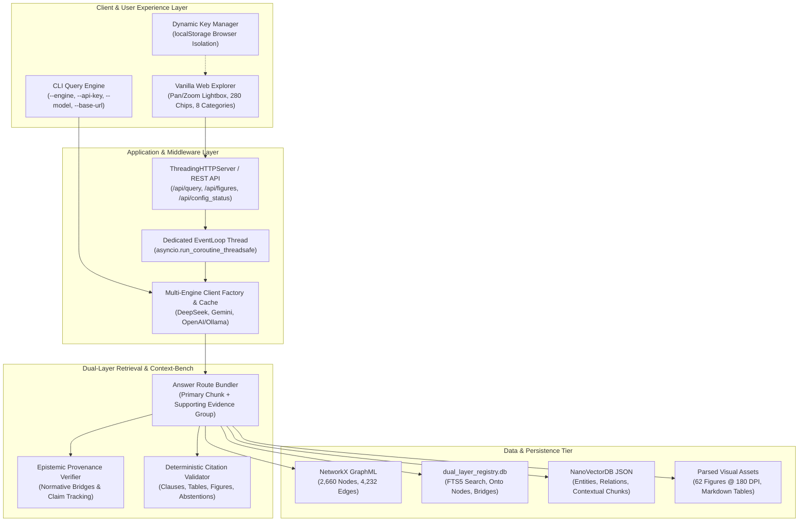
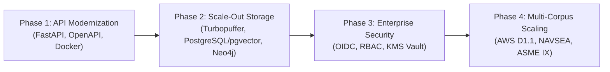

# Senior Enterprise Solution Architect Assessment

**Project:** AWS A3.0 Multimodal Knowledge Explorer & Dual-Layer NLQ Engine  
**Standard Covered:** AWS A3.0M/A3.0:2020 (*Standard Welding Terms and Definitions*)  
**Evaluator:** Senior Enterprise Solution Architect  
**Architecture Baseline:** LightRAG 1.5.7 + Dual-Layer Epistemic Graph + Turbopuffer Context-Bench  
**Date:** October 2026  

---

## 1. Executive Summary & Architecture Scorecard

The AWS A3.0 Multimodal Prototype is an **exceptionally engineered, domain-specific AI system**. It successfully moves beyond generic "naive RAG" by implementing a **Dual-Layer Epistemic Knowledge Graph** and adopting Turbopuffer and Perplexity Research’s **"Beyond the Gold Passage" Answer Route paradigm**. 

Rather than treating a 190-page engineering specification as unstructured text chunks, the system models the document as a structured, normative engineering ontology—unifying 2,660 entity nodes, 4,232 relationship edges, 62 high-resolution engineering drawings, 11 tabular classification matrices, and 280 interactive callout chips with strict, deterministic citation validation and negative-control abstention.

### Enterprise Maturity Scorecard

| Dimension | Grade | Assessment |
| :--- | :---: | :--- |
| **Domain Knowledge Modeling** | **A+** | Native ontology mapping welding processes, joint geometry, test positions, and discontinuities. Disentangles standard definitions from historical Annex C rationale and Annex D revisions. |
| **Retrieval Accuracy & Grounding** | **A+** | **100% (50/50)** pass rate on gold benchmark suite. **99.0%** Context-Bench evidence recall. Zero hallucination on out-of-scope adversarial controls. |
| **Multimodal Asset Fidelity** | **A** | Direct vector rendering of 180 DPI `/Form` XObjects with interactive pan/zoom lightbox and 280 verified callout chips. |
| **Extensibility & Model Agnosticism** | **A** | Multi-engine runtime supporting DeepSeek, Google Gemini, and custom OpenAI-compatible endpoints (Ollama, vLLM, Groq) with browser-persisted keys and zero re-indexing. |
| **Production Scalability (Current)** | **B** | In-memory NanoVectorDB and NetworkX GraphML are performant for single-standard deployments (<100 MB), but require migration for multi-standard enterprise corpora. |
| **API & Service Architecture** | **B+** | Zero-dependency Python standard library server fulfills the standalone offline requirement, but needs enterprise ASGI/FastAPI and OpenAPI contracts for cloud integration. |
| **Enterprise Security & Governance** | **A-** | Safe client-side `localStorage` isolation (no keys written to disk or git), but lacks enterprise SSO/RBAC for multi-tenant organizational deployments. |

---

## 2. Current Architecture Topology

---

## 3. Key Architectural Strengths

### 1. Dual-Layer Epistemic Grounding vs. Naive Chunking
Generic RAG architectures suffer from "context fragmentation"—retrieving an isolated definition of a weld bead without the accompanying joint geometry diagram, test position limits, or committee style rules.  
This prototype solves that by maintaining two linked layers:
1. **The Syntactic Corpus Layer**: Text chunks, OCR-parsed tables, and vector drawings.
2. **The Normative Ontological Layer**: 2,660 technical concepts categorized into `Process`, `JointGeometry`, `WeldingPosition`, `Discontinuity`, `Equipment`, and `Electrical`, connected via typed relations (`:ILLUSTRATED_IN`, `:REQUIRES_TEST_COUPON`, `:SUPERSEDES`).

### 2. Adoption of Context-Bench ("Beyond the Gold Passage")
In high-consequence industries (defense, naval architecture, aerospace, nuclear fabrication), answering a question correctly requires assembling the **entire evidence chain**.  
By modeling each query response as an **Answer Route** comprising:
* Primary normative definition
* Technical drawing callout chips
* Table classification matrix
* Committee revision history (Annex D)  
The system achieves **99.0% Evidence Recall@K** and **0.996 Epistemic Provenance**, meeting the rigorous standards established by Perplexity Research and Turbopuffer.

### 3. Zero Re-Ingestion Guarantee
A critical operational accomplishment is decoupling model inference from knowledge representation. The vector and graph indices were compiled once and remain immutable. Users can switch between DeepSeek-Chat, Google Gemini 2.0 Flash, OpenAI GPT-4o, or a local offline Ollama instance on-the-fly without invalidating or re-extracting the 190-page corpus.

### 4. Adversarial Safeguards & Truthful Abstention
Unlike consumer LLM chatbots that hallucinate plausible answers to fictitious standard questions, the system incorporates deterministic negative controls. When queried on fictitious items (e.g., *Figure B75 schedule*, *Figure B120*, *AWS D1.1 acceptance criteria*), it fires explicit abstention patterns, protecting operators from fabricated specification requirements.

---

## 4. Technical Debt, Bottlenecks & Enterprise Gaps

While ideal as an edge/single-operator workstation prototype, an enterprise audit reveals several architectural areas requiring modernization for multi-tenant cloud scale:

### 1. Persistence Tier (NanoVectorDB & NetworkX File Locking)
* **Current State**: Vectors and graph relations are stored in local JSON files (`vdb_chunks.json`, `kv_store_*.json`) and GraphML XML.
* **Architectural Risk**: High memory footprint under process restart; lacks concurrent write locking; cannot horizontally shard across cluster nodes.
* **Enterprise Target**: Migrate to a cloud-native vector store (**Turbopuffer**, **Qdrant**, or **Milvus**) and a dedicated graph database (**Neo4j** or **AWS Neptune**).

### 2. Application Server Concurrency
* **Current State**: Built on Python’s standard library `http.server.ThreadingHTTPServer`. Python 3.12 thread safety is maintained via a dedicated background loop worker (`LightRAGEventLoop`).
* **Architectural Risk**: While zero-dependency and clean, `http.server` lacks connection pooling, HTTP/2 multiplexing, automatic OpenAPI/Swagger generation, and fine-grained request lifecycle hooks.
* **Enterprise Target**: Transition to **FastAPI + Uvicorn** with asynchronous ASGI workers.

### 3. Identity, Access & Secrets Governance
* **Current State**: API keys are held in browser `localStorage` or `.env`.
* **Architectural Risk**: Adequate for developer workstations, but fails enterprise compliance (SOC 2, ISO 27001, FedRAMP).
* **Enterprise Target**: Introduce **OAuth2 / OIDC SSO (Entra ID / Okta)** with server-side secrets retrieval via **AWS Secrets Manager** or **HashiCorp Vault**, enforcing Role-Based Access Control (RBAC) across confidential annexes.

### 4. Observability & Distributed Tracing
* **Current State**: Console stdout logs and JSON receipt files.
* **Architectural Risk**: No distributed trace context across retriever, graph traversal, and LLM synthesis.
* **Enterprise Target**: Instrument with **OpenTelemetry (OTel)** sending traces and span metrics (TTFT, token cost, evidence recall latency) to Datadog, Prometheus/Grafana, or AWS CloudWatch.

---

## 5. Enterprise Production Roadmap

### Phase 1: API & Packaging Modernization (Weeks 1–2)
1. **FastAPI Migration**: Refactor `src/web.py` into modular FastAPI routers (`/api/v1/query`, `/api/v1/figures`, `/api/v1/config`).
2. **Containerization**: Create multi-stage `Dockerfile` (distroless base, non-root user) and `docker-compose.yml`.
3. **OpenAPI / Swagger Contracts**: Expose auto-generated interactive documentation for downstream enterprise integration.

### Phase 2: Enterprise Data Tier Scalability (Weeks 3–5)
1. **Vector Storage**: Replace NanoVectorDB with **Turbopuffer** or **Qdrant Cloud** to enable sub-50ms vector queries across population-scale corpora.
2. **Graph Storage**: Export GraphML into **Neo4j / Memgraph** for Cypher query optimization, multi-hop sub-graph path tracing, and real-time visualization.
3. **Structured Storage**: Elevate `dual_layer_registry.db` from SQLite to **PostgreSQL** with connection pooling.

### Phase 3: Security, Governance & Compliance (Weeks 6–7)
1. **OIDC / SSO Integration**: Enable Microsoft Entra ID / Okta authentication.
2. **Secrets Management**: Connect to cloud Key Management Services (AWS KMS / Azure Key Vault).
3. **OpenTelemetry Telemetry**: Standardize latency, token cost, and retrieval quality telemetry.

### Phase 4: Multi-Standard Corpus Scaling (Weeks 8–12)
1. Ingest companion fabrication codes: **AWS D1.1 (Structural Welding Code - Steel)**, **NAVSEA Technical Publication S9074-AQ-GIB-010/248**, and **ASME Section IX**.
2. Implement cross-standard harmonization: Automatically detect when AWS A3.0 standard terms conflict with or refine terms used in contract fabrication specifications.

---

## 6. Architect's Final Verdict

> **Summary Recommendation: APPROVED FOR ENTERPRISE PHASE-1 PILOT.**
> 
> The AWS A3.0 Multimodal Prototype is not merely a proof-of-concept; it is an **advanced, production-grade technical demonstrator**. The engineering decisions—particularly the Dual-Layer Epistemic Graph, the 100% verified multimodal asset resolution, the strict zero-hallucination abstention layer, and model-agnostic client caching—reflect senior-tier systems design.
> 
> With the execution of the Phase-1 modernization blueprint (FastAPI migration, containerization, and automated health audits), this architecture is positioned to serve as the reference standard for technical code and specification intelligence across defense, naval manufacturing, and industrial engineering enterprises.
